# HTML-CSS-3: 29 - Hero

**ไฟล์ต้นฉบับ:** 29- Hero.mp4

▶️ [ดูวิดีโอ](../../HTML-CSS-3/29-%20Hero.mp4)

---

## ภาพรวมคลิปนี้

คลิปนี้ Mosh สร้างส่วน **Hero Section** ของหน้าเว็บ Moshify ซึ่งเป็นส่วนบนสุดของหน้าแรก ประกอบด้วยหัวข้อใหญ่ "Cloud Hosting for Pros" ข้อความอธิบายสั้นๆ ปุ่ม "GET STARTED" และภาพประกอบ (banner) ทางด้านขวา โดยใช้ Component ที่เคยสร้างไว้ก่อนหน้านี้ทั้งหมดมาประกอบร่วมกัน ได้แก่ Block, Grid, Button และ Container

ก่อนเริ่มเขียนโค้ด Mosh เปิดไฟล์ Photoshop mockup 2 ไฟล์เพื่อดูการออกแบบ: แบบเดสก์ท็อป (standard) ที่มีข้อความอยู่ซ้าย ภาพอยู่ขวา และแบบมือถือ (mobile) ที่ข้อความและภาพเรียงต่อกันในแนวตั้ง จากนั้นเข้าไปดูโฟลเดอร์ `images` ใน Finder ซึ่งมีไฟล์ภาพที่เตรียมไว้ล่วงหน้าแล้ว เช่น `banner.png`, `logo.png`, `testimonial.jpg` ฯลฯ

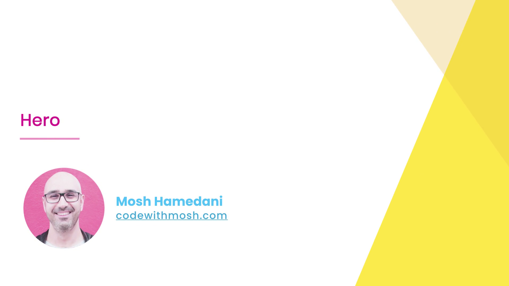

---

## 1. ดู Photoshop Mockup ก่อนเริ่มงาน

Mosh เปิดไฟล์ `standard-Recovered.psd` (มุมมองเดสก์ท็อป) และ `mobile-Recovered.psd` (มุมมองมือถือ) เพื่อดูว่า Hero Section ควรมีหน้าตาอย่างไร


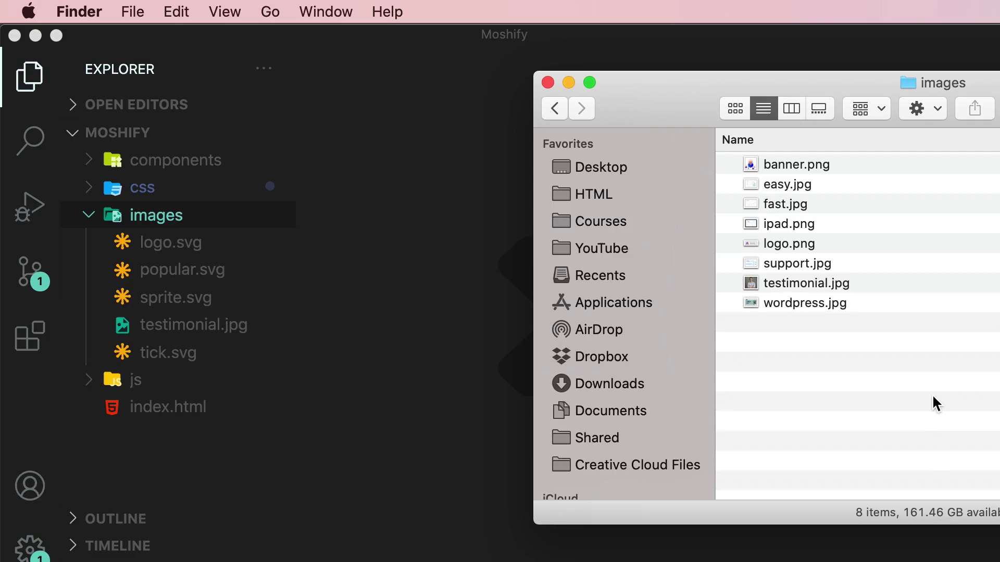

> 💡 มุมมองเดสก์ท็อป: หัวข้อ "Cloud Hosting for Pros" อยู่ชิดซ้าย ภาพประกอบ (เซิร์ฟเวอร์ 3D พร้อมแล็ปท็อป/มือถือ) อยู่ชิดขวา ส่วนมุมมองมือถือ: หัวข้อและปุ่มเรียงต่อกันในแนวตั้ง โดยภาพจะอยู่ด้านล่างสุด

จากนั้นเพิ่มไฟล์ `banner.png` เข้าไปในโฟลเดอร์ `images` ของโปรเจกต์:

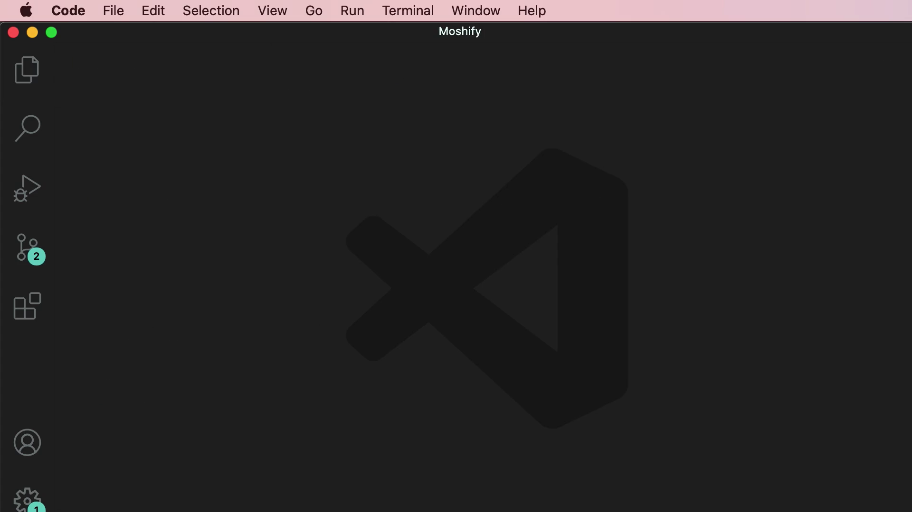

---

## 2. สร้างโครงสร้าง HTML ของ Hero Section

Mosh สร้าง `<section>` ใหม่โดยใช้ class ที่เคยสร้างไว้จากคลิป Blocks (`block`, `block--dark`, `block--skewed-left`) ผสมกับ Grid component (`container`, `grid`, `grid--1x2`) ที่เคยสร้างไว้ก่อนหน้า:

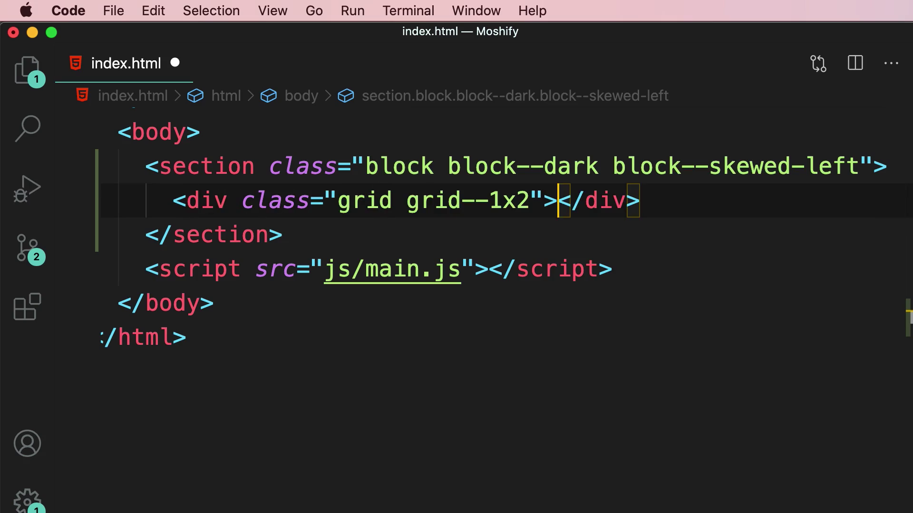

```html
<section class="block block--dark block--skewed-left">
  <div class="container grid grid--1x2">
    ...
  </div>
</section>
```

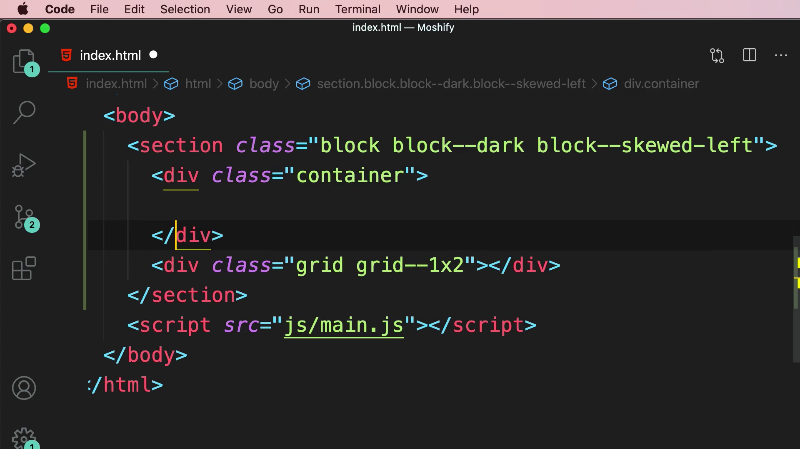

> 🔧 สังเกตว่า Mosh รวม utility class `container` เข้ากับ `grid grid--1x2` ไว้ใน `<div>` เดียวกัน เพื่อให้ได้ทั้งการจำกัดความกว้างสูงสุด (จาก `.container`) และ layout แบบ 2 คอลัมน์ (จาก `.grid.grid--1x2`) พร้อมกัน โดยไม่ต้องสร้าง wrapper เพิ่ม

---

## 3. เพิ่มเนื้อหาข้อความ (Heading, Paragraph, Button)

```html
<div class="container grid grid--1x2">
  <div class="hero__content">
    <h1>Cloud Hosting for Pros</h1>
    <p>Deploy your websites in less than 60 seconds.</p>
    <a href="" class="btn btn--accent"></a>
  </div>
</div>
```

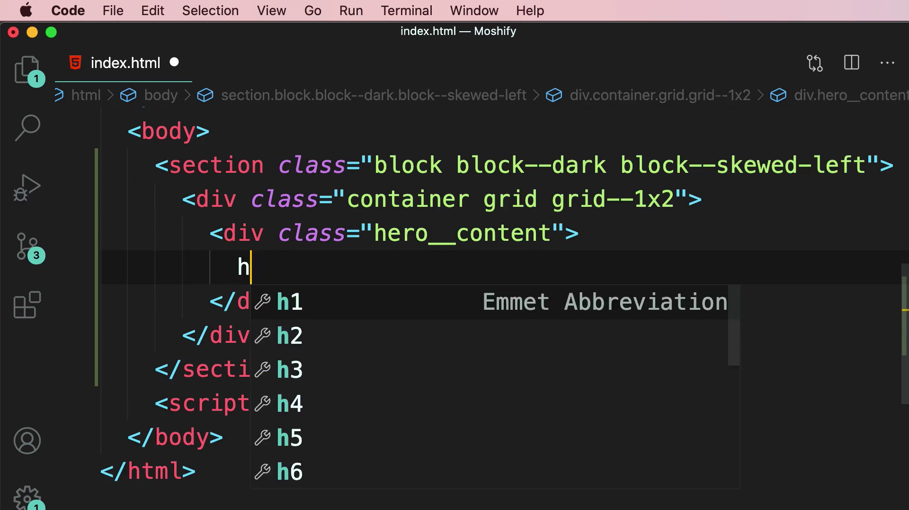

Mosh เพิ่มปุ่ม (ลิงก์) โดยใช้ class ของ Button component ที่เคยสร้างไว้ (`btn`, `btn--accent`) ต่อจาก heading และ paragraph:

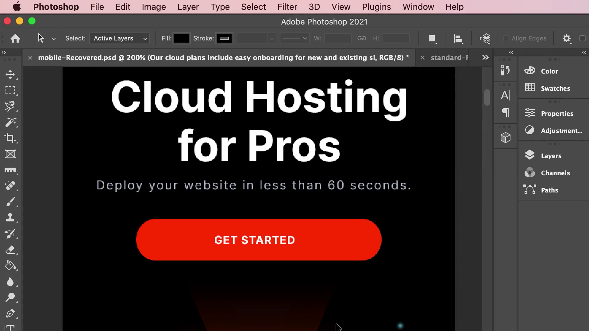

จากนั้นเพิ่มข้อความในปุ่มและปรับ class ของปุ่มด้วย modifier `btn--stretched` (ที่เคยสร้างไว้ในคลิป Buttons) เพื่อให้ปุ่มขยายเต็มความกว้างบนมือถือ พร้อมเพิ่ม `` placeholder สำหรับภาพประกอบ:

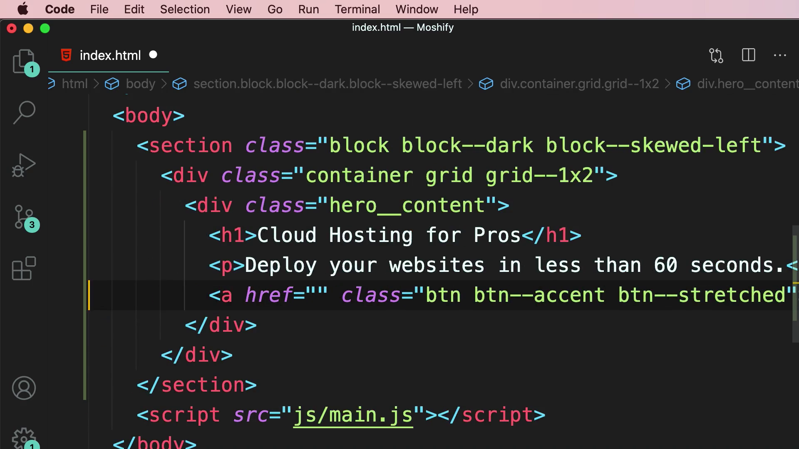

```html
<a href="" class="btn btn--accent btn--stretched">GET STARTED</a>
```

---

## 4. ปัญหา: หัวข้อ H1 มองไม่เห็นบนพื้นหลังสีดำ

เมื่อดูผลลัพธ์ในเบราว์เซอร์ Mosh พบว่าข้อความหัวข้อ "Cloud Hosting for Pros" แทบมองไม่เห็นเพราะเป็นสีม่วงเข้มบนพื้นหลังสีดำ:

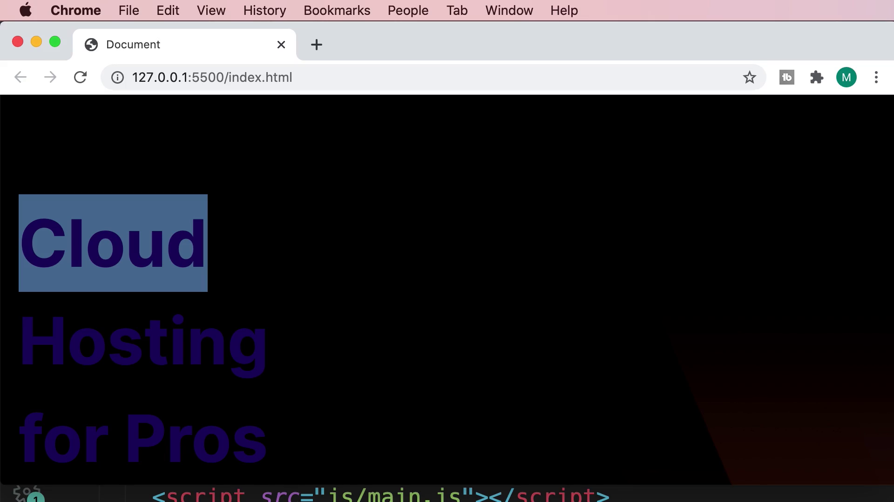

> 🔍 Mosh เปิด DevTools ตรวจสอบและพบว่า selector `.block--dark .block__heading { color: #fff; }` ที่เคยสร้างไว้ในคลิป Blocks จะทำให้หัวข้อเป็นสีขาวก็ต่อเมื่อ `<h1>` มี class `block__heading` เท่านั้น แต่ `<h1>` ตัวนี้ยังไม่มี class ดังกล่าว จึงไม่ได้รับสีขาวตามที่ตั้งใจ

**วิธีแก้ไข:** เพิ่ม class `block__heading` ให้กับ `<h1>` และเปลี่ยน `<div class="hero__content">` เป็น `<header class="block__header hero__content">` (นำ semantic wrapper จากคลิป Blocks มาใช้ร่วม):

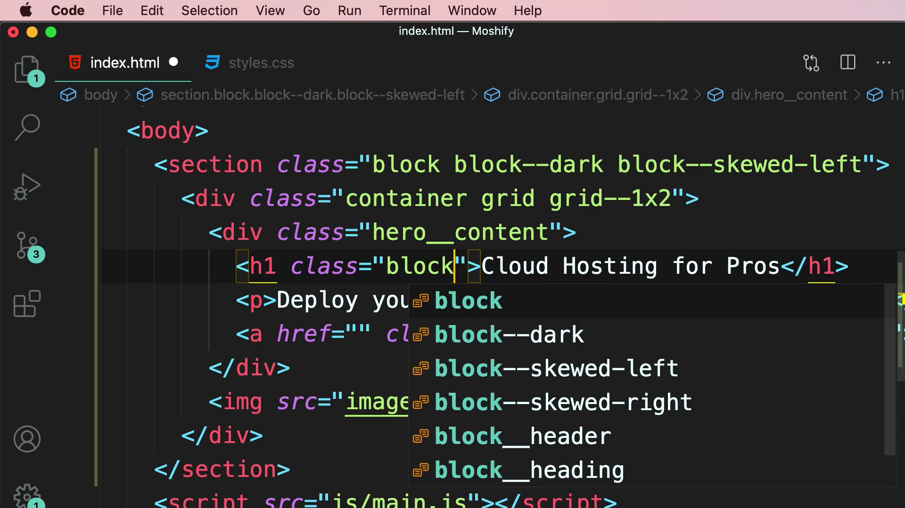

```html
<header class="block__header hero__content">
  <h1 class="block__heading">Cloud Hosting for Pros</h1>
  <p class="hero__tagline">Deploy your websites in less than 60 seconds.</p>
  <a href="" class="btn btn--accent btn--stretched">GET STARTED</a>
</header>
```

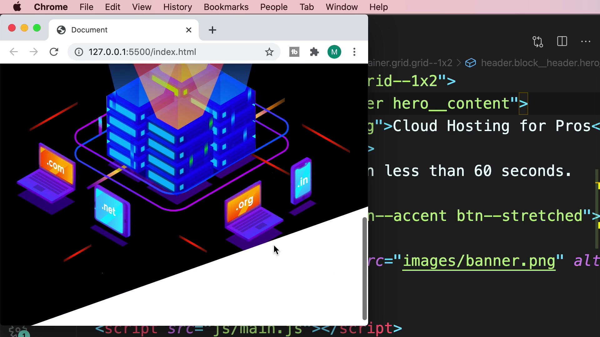

> ⚠️ **บทเรียนสำคัญ:** การนำ Component หลายตัวมาผสมกัน (Composition) ต้องระวังว่า class ที่ใช้เลือก style นั้นถูกใส่ครบทุกจุดหรือไม่ — ถ้าลืมใส่ class ที่จำเป็น (เช่น `block__heading`) selector ที่ตั้งใจไว้จะไม่ทำงาน

---

## 5. เพิ่ม class `.hero__tagline` ให้ข้อความ Tagline

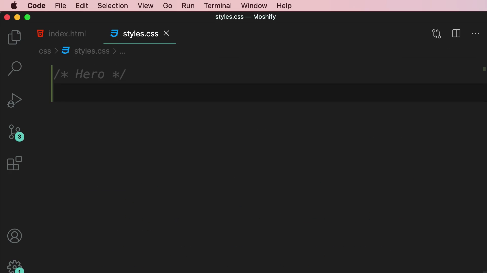

จากนั้นสร้าง section ใหม่ในไฟล์ `styles.css` ชื่อ `/* Hero */` และเพิ่ม CSS ให้ `.hero__tagline` ทีละบรรทัด:

```css
.hero__tagline {
  font-size: 2rem;
}
```

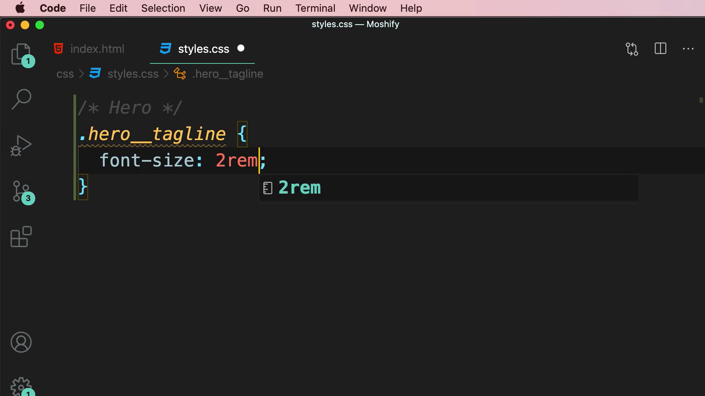

```css
.hero__tagline {
  font-size: 2rem;
  color: #b9c3cf;
}
```


```css
.hero__tagline {
  font-size: 2rem;
  color: #b9c3cf;
  letter-spacing: 1px;
}
```

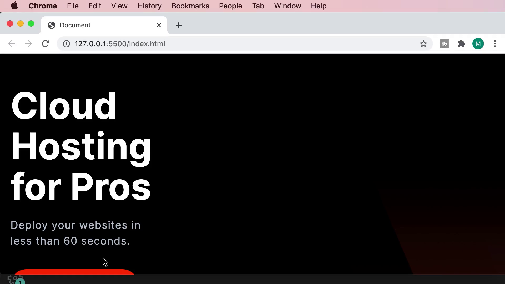

```css
.hero__tagline {
  font-size: 2rem;
  color: #b9c3cf;
  letter-spacing: 1px;
  margin: 2rem 0 5rem;
}
```

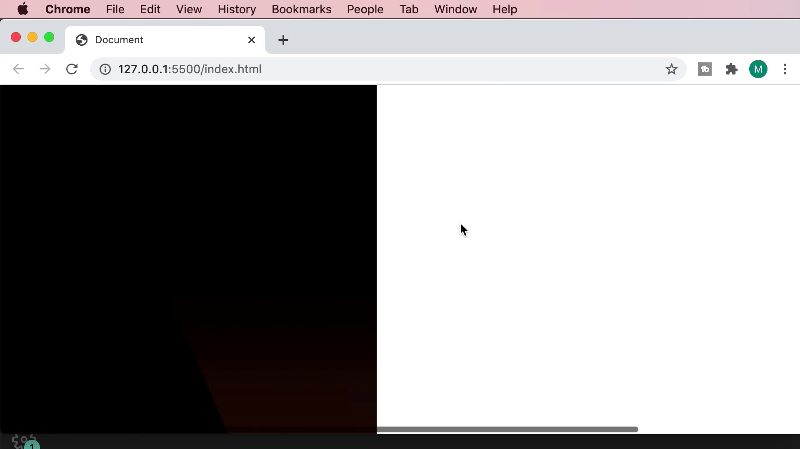

> 📝 `margin: 2rem 0 5rem;` หมายถึง margin-top 2rem, margin ซ้าย-ขวา 0, margin-bottom 5rem — ใช้ shorthand แบบ 3 ค่า (บน, ซ้าย-ขวา, ล่าง) เพื่อเว้นระยะห่างจากปุ่มด้านล่างให้มากพอ

---

## 6. เพิ่มภาพ Banner จริงและทำให้ Responsive

แทนที่ placeholder ด้วยภาพจริง:

```html

```

ผลลัพธ์: เห็นภาพประกอบเซิร์ฟเวอร์ 3D จริงปรากฏในเบราว์เซอร์

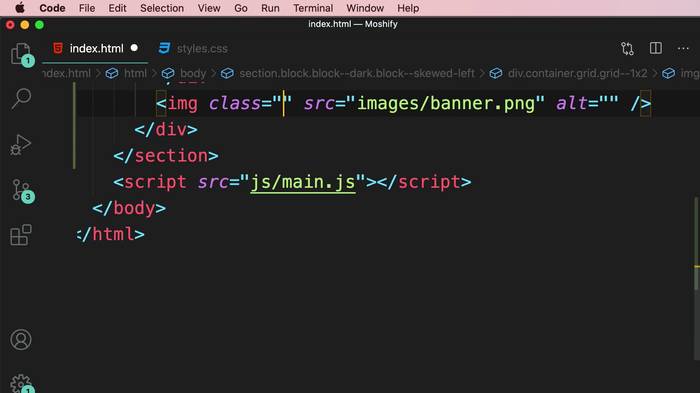

จากนั้นเพิ่ม CSS ให้ภาพขยายเต็มความกว้างของคอลัมน์เสมอ (responsive):

```css
.hero__image {
  width: 100%;
}
```

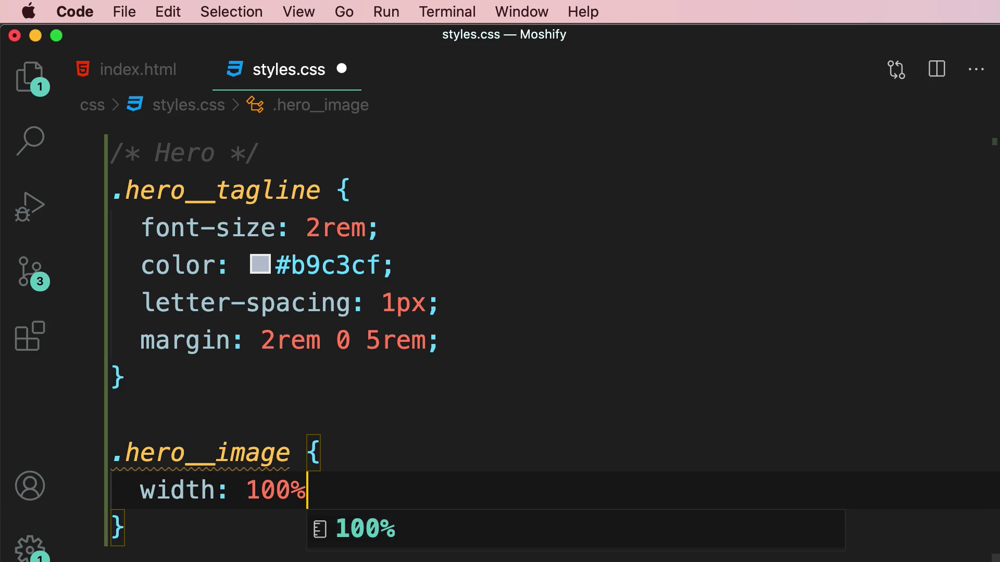

> 💡 `width: 100%` บน `` เป็นเทคนิคพื้นฐานที่สำคัญมากสำหรับภาพ responsive — ทำให้ภาพขยาย/หดตามความกว้างของ container เสมอ โดยที่ความสูงจะปรับตามอัตราส่วนเดิมโดยอัตโนมัติ (เพราะไม่ได้กำหนด height ตายตัว)

---

## 7. ปรับ `clip-path` ของ Hero ให้เป็นค่าเฉพาะของตัวเอง

เดิมความเอียง (skew) ของ section มาจาก class ร่วม `.block--skewed-left` ที่ใช้ค่า `polygon(0% 0%, 100% 0%, 100% 80%, 0% 100%)` Mosh ทดลองปรับค่าความเอียงเฉพาะของ Hero โดยแยกออกมาเป็น class `.hero` เดี่ยวๆ:

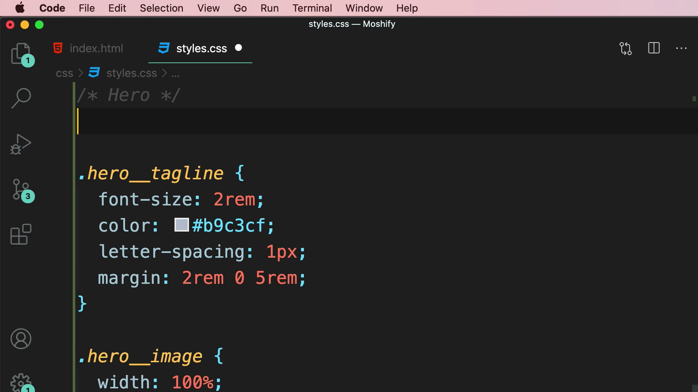

```css
.hero {
  clip-path: polygon(0% 0%, 100% 0%, 100% 90%, 0% 100%);
}
```

หลังทดลองเปรียบเทียบ Mosh ตัดสินใจกลับไปใช้ค่าเดิมคือ 80% (เอียงมากกว่า) เพื่อให้ตรงกับดีไซน์ต้นฉบับ:

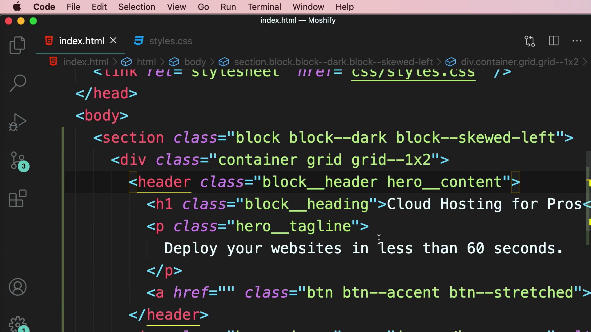

```css
.hero {
  clip-path: polygon(0% 0%, 100% 0%, 100% 80%, 0% 100%);
}
```

> 🔍 การแยก `clip-path` ออกมาเป็น class `.hero` เฉพาะ (แทนที่จะพึ่งพา `.block--skewed-left` ที่ใช้ร่วมกับ section อื่น) ทำให้ปรับแต่งมุมเอียงของ Hero ได้อย่างอิสระโดยไม่กระทบ section อื่นที่ใช้ modifier เดียวกัน

ผลลัพธ์ในเบราว์เซอร์เมื่อขยายหน้าจอกว้างขึ้น เห็นข้อความและภาพเริ่มจัดเรียงแบบ 2 คอลัมน์:

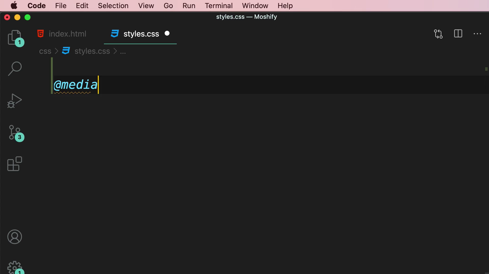

---

## 8. ทำ Responsive ด้วย Media Query สำหรับหน้าจอเดสก์ท็อป

Mosh สร้าง media query ใหม่:

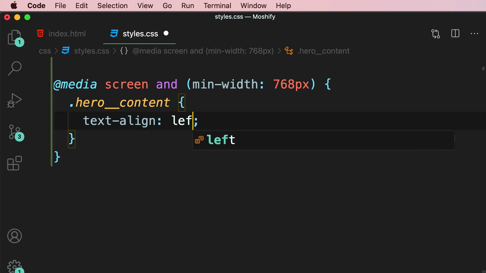

```css
@media screen and (min-width: 768px) {
  .hero__content {
    text-align: left;
    align-self: center;
  }

  .hero {
    padding-top: 0;
  }
}
```

### 8.1 จัดข้อความให้ชิดซ้ายบนจอใหญ่

```css
.hero__content {
  text-align: left;
}
```

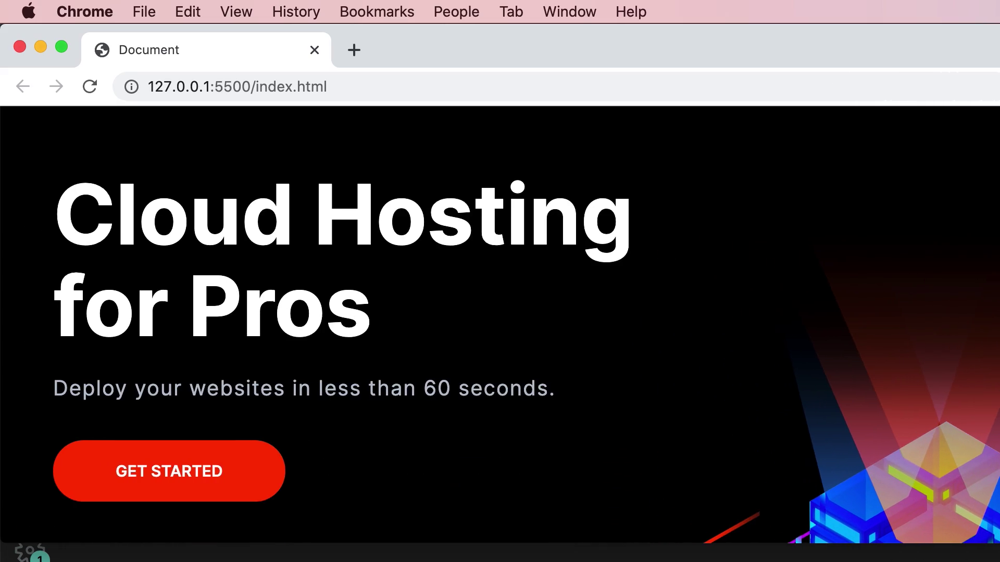

> 📝 เดิม `.block__header` (ที่ `.hero__content` ใช้ร่วม) กำหนด `text-align: center;` ไว้เป็นค่าเริ่มต้น (จากคลิป Blocks) ซึ่งเหมาะกับ Block ทั่วไป แต่สำหรับดีไซน์เดสก์ท็อปของ Hero ต้องการให้ข้อความชิดซ้าย จึงต้อง Override ด้วย `text-align: left;` เฉพาะบนจอกว้าง

Mosh เปิดไฟล์ Photoshop มุมมองเดสก์ท็อปเทียบอีกครั้งเพื่อยืนยันตำแหน่งข้อความ:

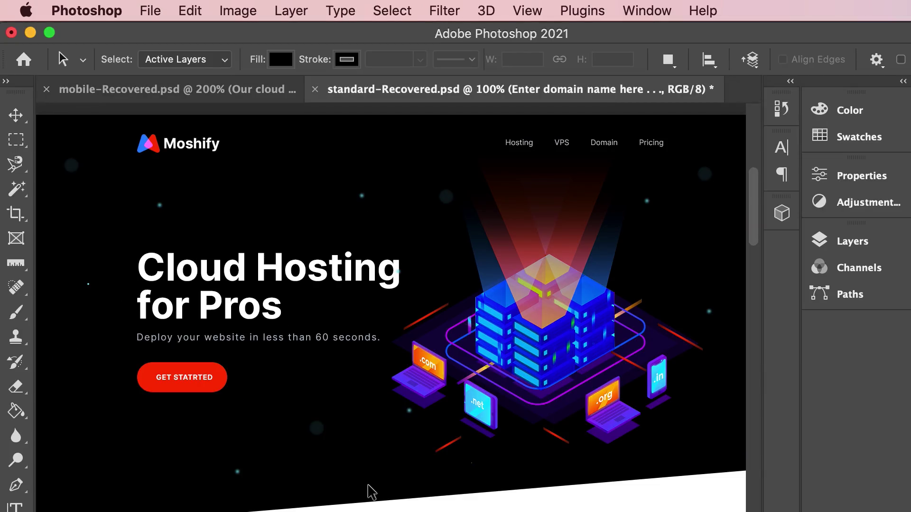

ผลลัพธ์ในเบราว์เซอร์: ข้อความชิดซ้าย ภาพอยู่ขวา ตรงตามดีไซน์

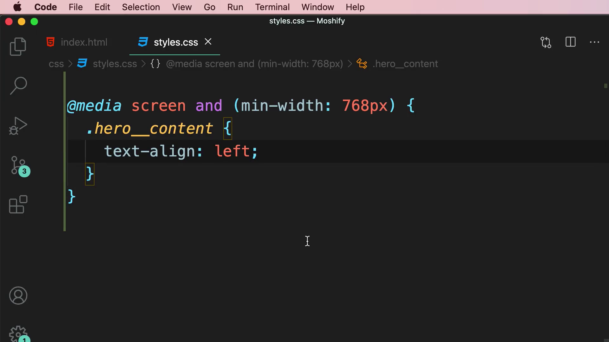

### 8.2 จัดตำแหน่งแนวตั้งด้วย `align-self: center`

```css
.hero__content {
  text-align: left;
  align-self: center;
}
```

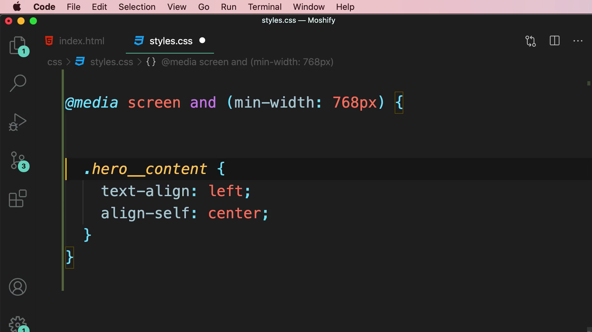

> 💡 `align-self: center` ใช้กับ grid item แต่ละตัวเพื่อจัดตำแหน่งแนวตั้งของตัวมันเองภายใน grid cell โดยไม่กระทบ item อื่น เพราะข้อความ (`hero__content`) มีความสูงน้อยกว่าภาพ (`hero__image`) มาก การจัดให้อยู่กึ่งกลางแนวตั้งของ cell ทำให้ดูสมดุลมากกว่าปล่อยให้ชิดขอบบน (ค่าเริ่มต้นของ grid item)

Mosh ตรวจสอบมุมมองมือถืออีกครั้งเพื่อความแน่ใจว่าไม่กระทบ:

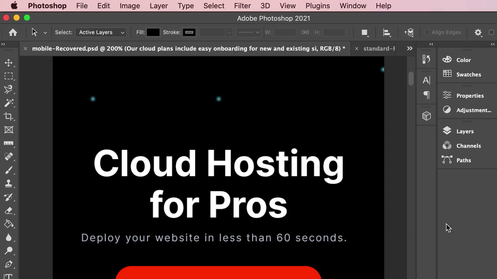

### 8.3 รีเซ็ต padding-top บนจอใหญ่

```css
.hero {
  padding-top: 0;
}
```

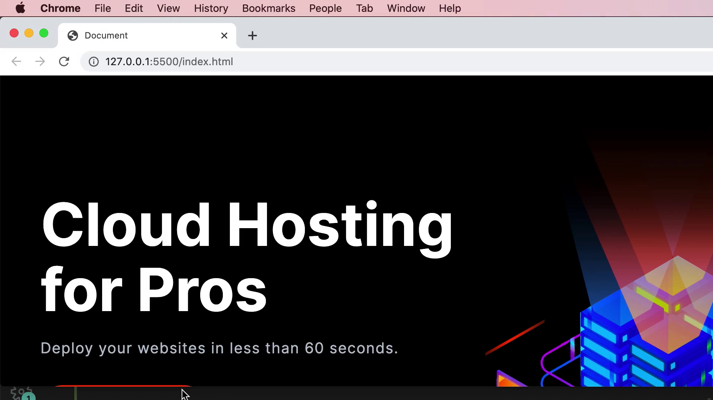

> 📌 เพราะ `.block--skewed-left` มี `padding-bottom` เพิ่มมาจาก `calc()` (จากคลิป Blocks) ซึ่งอาจทำให้ระยะห่างด้านบนของ Hero ไม่พอดีกับดีไซน์บนจอกว้าง Mosh จึงรีเซ็ต `padding-top` เป็น 0 เฉพาะในโหมดเดสก์ท็อป

ผลลัพธ์สุดท้าย: Hero Section ที่สมบูรณ์ ปรับตัวได้ทั้งบนมือถือ (เรียงแนวตั้ง ข้อความกึ่งกลาง) และเดสก์ท็อป (2 คอลัมน์ ข้อความชิดซ้าย ภาพชิดขวา)

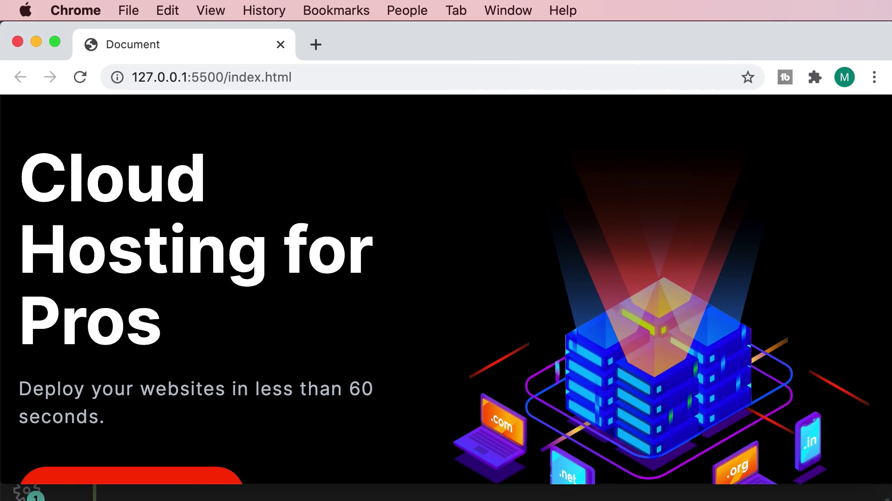

---

## สรุปภาพรวมของคลิปนี้

| หัวข้อ | รายละเอียด |
|---|---|
| Component ที่นำมาใช้ร่วม | Block (`block`, `block--dark`, `block--skewed-left`), Grid (`grid`, `grid--1x2`), Container, Button (`btn`, `btn--accent`, `btn--stretched`) |
| HTML หลัก | `<section class="block block--dark hero">` ครอบ `<div class="container grid grid--1x2">` ที่มี `<header class="block__header hero__content">` และ `` |
| BEM naming ใหม่ | `.hero`, `.hero__content`, `.hero__tagline`, `.hero__image` |
| ปัญหาที่พบ | หัวข้อ h1 มองไม่เห็นเพราะขาด class `block__heading` ที่จำเป็นสำหรับ selector สีขาวจาก `.block--dark` |
| Responsive | `@media screen and (min-width: 768px)` ปรับ text-align, align-self, และ padding-top ให้เหมาะกับจอกว้าง |
| ภาพ Responsive | `.hero__image { width: 100%; }` ทำให้ภาพขยาย/หดตามพื้นที่เสมอ |

### แนวคิดสำคัญที่ได้จากคลิปนี้

1. **การประกอบ Component หลายตัวเข้าด้วยกัน (Composition)** — Hero Section ไม่ได้สร้างจากศูนย์ แต่ประกอบจาก Block, Grid, Container และ Button ที่เคยสร้างไว้ก่อนหน้า แสดงให้เห็นพลังของการออกแบบ CSS แบบ Component-based
2. **ต้องตรวจสอบ class ที่จำเป็นให้ครบ** — เมื่อผสม Component หลายตัว ต้องแน่ใจว่าใส่ class ที่ selector อื่นต้องพึ่งพา (เช่น `block__heading`) ไม่เช่นนั้น style ที่ตั้งใจไว้จะไม่ทำงาน
3. **`width: 100%` บน ``** เป็นเทคนิคพื้นฐานสำหรับทำให้ภาพ responsive ตามความกว้างของ container
4. **แยก class เฉพาะเมื่อจำเป็น** — แม้จะมี `.block--skewed-left` ใช้ร่วมกันอยู่แล้ว แต่เมื่อ Hero ต้องการค่า clip-path ที่ต่างออกไปเล็กน้อย การแยกเป็น `.hero` เฉพาะทำให้ปรับแต่งได้อิสระโดยไม่กระทบ section อื่น
5. **`align-self`** ใช้จัดตำแหน่งแนวตั้งของ grid item แต่ละตัวแยกจากกัน เหมาะกับกรณีที่ item มีความสูงไม่เท่ากันในแถวเดียวกัน
6. **Media query ไม่ได้มีไว้แค่เปลี่ยน layout ใหญ่ๆ** — บางครั้งใช้ปรับรายละเอียดเล็กๆ น้อยๆ เช่น text-align, align-self, หรือ padding เพื่อให้ดีไซน์ตรงกับ mockup มากที่สุดในแต่ละขนาดจอ

---

*สรุปจากคลิปการสอนของ Mosh Hamedani (Code with Mosh) — คอร์ส Building a Web Site with HTML & CSS, คลิปที่ 29: Hero*
