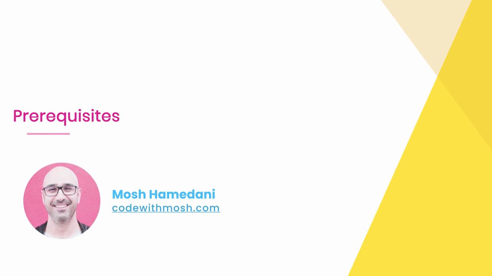
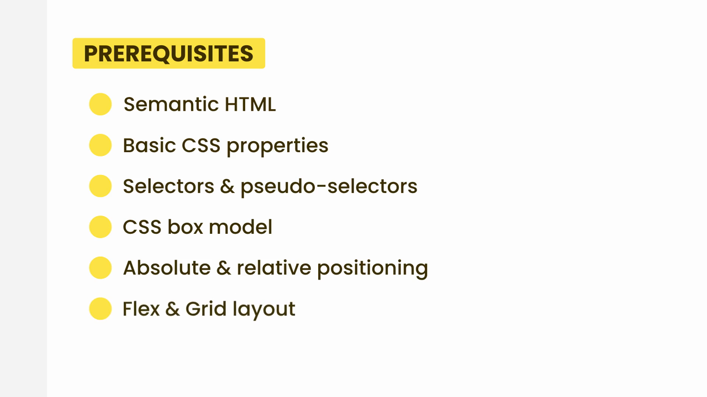
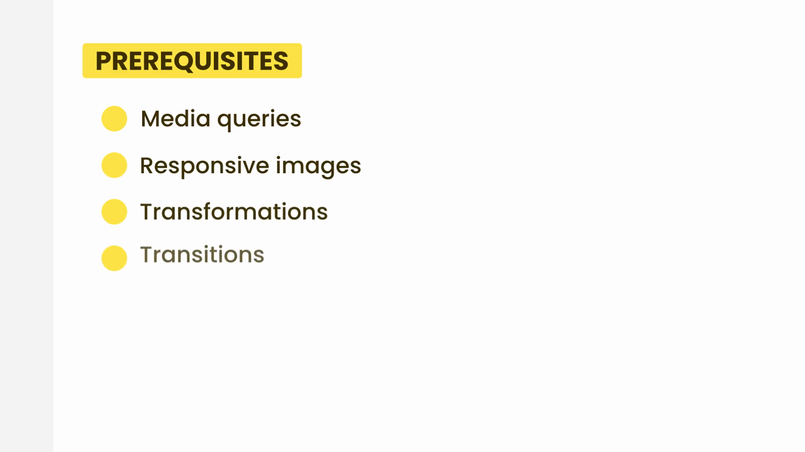

# HTML-CSS-3: 03 - Prerequisites (0:50)

**ไฟล์ต้นทาง:** `3-_Prerequisites.mp4`

▶️ **[เปิดวิดีโอต้นฉบับ](../../HTML-CSS-3/3-_Prerequisites.mp4)**

---

## ภาพรวมคลิปนี้

คลิปสั้นๆ ที่ Mosh สรุปรายการความรู้พื้นฐานที่ผู้เรียนควรมีมาก่อนเข้าเรียนคอร์ส "Building a Web Site" นี้ โดยเป็นการทบทวนหัวข้อทั้งหมดที่เคยสอนไว้ใน The Ultimate HTML and CSS Course (บทที่ 1-7) เพื่อยืนยันว่าผู้เรียนพร้อมสำหรับการลงมือสร้างโปรเจกต์จริงแล้ว

---

## 1. เปิดคลิปด้วยสไลด์ชื่อเรื่อง

สไลด์ชื่อคลิป **"Prerequisites"** พร้อมรูปโปรไฟล์ผู้สอน:

---

## 2. รายการความรู้พื้นฐานที่จำเป็น

สไลด์ป้ายเหลือง **"PREREQUISITES"** ทยอยเผยรายการทีละข้อ:

รายการทั้งหมดที่ปรากฏจนครบ:

> รายการความรู้พื้นฐานที่ Mosh ระบุว่าจำเป็นก่อนเรียนคอร์สนี้ ได้แก่:
> 1. **Semantic HTML** — การใช้แท็ก HTML ที่สื่อความหมาย (เช่น `<header>`, `<nav>`, `<section>`)
> 2. **Basic CSS properties** — คุณสมบัติ CSS พื้นฐาน (สี, ฟอนต์, ระยะห่าง ฯลฯ)
> 3. **Selectors & pseudo-selectors** — ตัวเลือก CSS และ pseudo-class/pseudo-element
> 4. **CSS box model** — แนวคิดกล่อง content, padding, border, margin
> 5. **Absolute & relative positioning** — การจัดตำแหน่ง element ด้วย `position`
> 6. **Flex & Grid layout** — ระบบ Layout แบบ Flexbox และ CSS Grid
> 7. **Media queries** — การเขียน CSS ที่ปรับตามขนาดหน้าจอ (responsive design)
> 8. **Responsive images** — เทคนิคจัดการรูปภาพให้ตอบสนองต่อหน้าจอต่างขนาด
> 9. **Transformations** — การหมุน/ย่อ/ขยาย/เลื่อน element ด้วย `transform`
> 10. **Transitions** — การทำให้การเปลี่ยนแปลงค่า CSS เกิดขึ้นอย่างนุ่มนวล

---

## สรุปภาพรวมของคลิปนี้

| ประเด็น | รายละเอียด |
|---|---|
| **หัวข้อ** | Prerequisites — ทบทวนความรู้พื้นฐานที่จำเป็นก่อนเรียน |
| **จำนวนหัวข้อที่ระบุ** | 10 หัวข้อ ครอบคลุม HTML, CSS Box Model, Positioning, Flex/Grid, Responsive Design, Transform/Transition |
| **เนื้อหาโค้ด** | ไม่มี — เป็นคลิปสรุปรายการล้วนๆ |

**แนวคิดสำคัญที่ได้จากคลิปนี้:**

1. **คอร์สนี้ไม่ได้สอนพื้นฐาน HTML/CSS ซ้ำ** แต่จะพาลงมือสร้างเว็บไซต์จริงทันที ผู้เรียนจึงควรมีความเข้าใจหัวข้อทั้ง 10 ข้อที่ระบุมาก่อนแล้ว
2. **รายการที่ระบุครอบคลุมเนื้อหาของบททั้งหมดใน The Ultimate HTML and CSS Course** ตั้งแต่ semantic HTML, box model, positioning, ไปจนถึง Flexbox/Grid, responsive design, และ transform/transition ที่เพิ่งเรียนจบไปในบทก่อนหน้า
3. **หากยังไม่แม่นหัวข้อใดในรายการนี้ ควรย้อนกลับไปทบทวนก่อน** เพื่อให้ตามเนื้อหาของโปรเจกต์ Moshify ในคอร์สนี้ได้อย่างราบรื่น

---

*หมายเหตุ: คลิปนี้เป็นส่วนหนึ่งของคอร์ส "Building a Web Site" โดย Mosh Hamedani (codewithmosh.com) — คลิปที่ 3*
