# HTML-CSS-3: 31 - Domain Block

**ไฟล์ต้นฉบับ:** 31- Domain Block.mp4

---

## ภาพรวมคลิปนี้

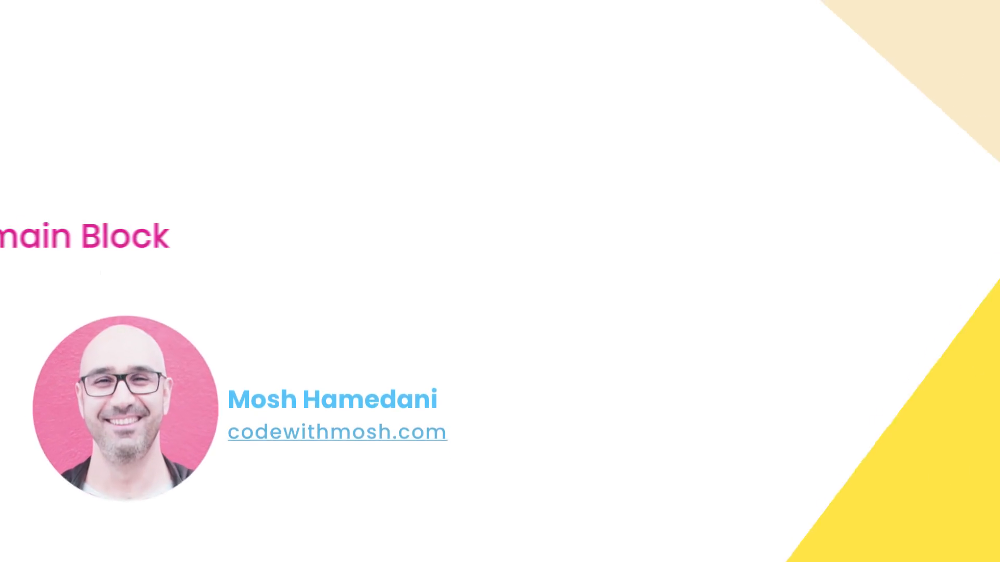

คลิปนี้ Mosh สอนการสร้าง **Domain Block** ซึ่งเป็นส่วนของหน้าเว็บ Moshify ที่ให้ผู้ใช้พิมพ์ชื่อโดเมนแล้วกดค้นหา พร้อมแสดงราคาของนามสกุลโดเมนต่าง ๆ (.com, .sg, .space, .info, .net, .xyz) โดยเนื้อหาครอบคลุมการนำคอมโพเนนต์เดิม (input-group, btn, badge) มาใช้ซ้ำ, การทำ CSS Grid สำหรับรายการราคา, และการอภิปรายเรื่อง utility classes เทียบกับแนวทาง component-based CSS ที่ใช้ในโปรเจกต์นี้

---

## 1. ทบทวน Mockup ใน Photoshop

Mosh เปิดไฟล์ mockup ทั้งเวอร์ชันมือถือ (`mobile.psd`) และเดสก์ท็อป (`standard.psd`) เพื่อดูโครงสร้างของ Domain Block ก่อนเริ่มเขียนโค้ด

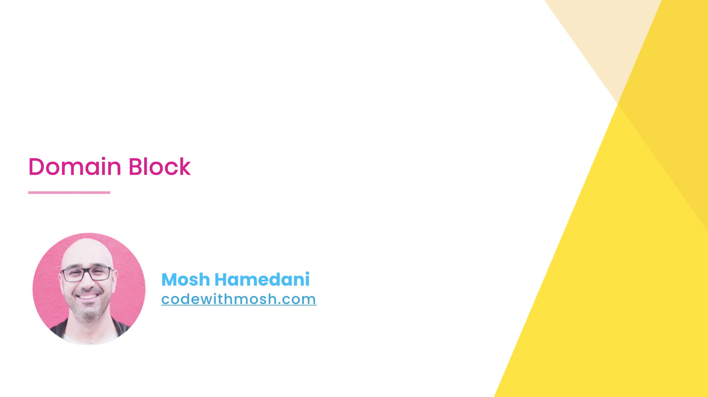

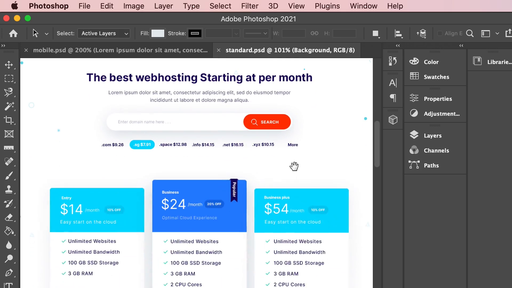

> 📌 Domain Block ประกอบด้วย 3 ส่วนหลัก: หัวข้อ + คำอธิบาย, กล่องค้นหาโดเมน (search box), และรายการราคาโดเมน 6 รายการ

---

## 2. สร้างโครงสร้าง Section ด้วย Emmet

Mosh เปิด `index.html` แล้วใช้ Emmet abbreviation สร้างโครงสร้างเริ่มต้น

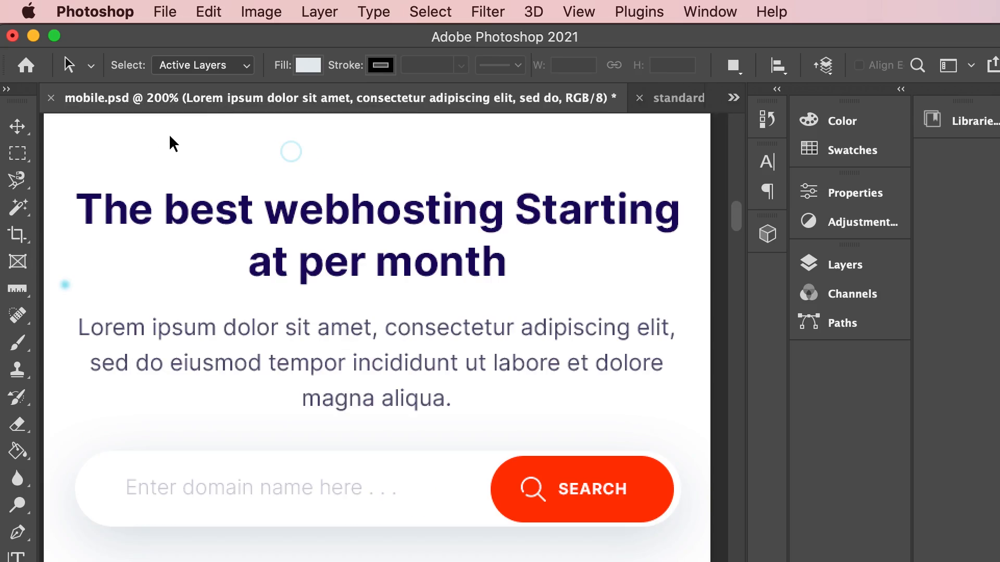

พิมพ์ Emmet abbreviation:

```
section.block.container.block-domain
```

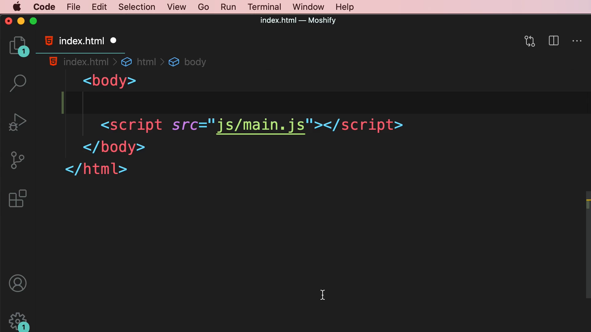

ได้ผลลัพธ์:

```html
<section class="block container block-domain"></section>
```

> 💡 คลาส `block` และ `container` เป็นคอมโพเนนต์ที่มีอยู่แล้วจากคลิปก่อนหน้า (ใช้ร่วมกับทุก section) ส่วน `block-domain` เป็นคลาส BEM ใหม่เฉพาะของ section นี้

---

## 3. เพิ่ม Header พร้อมหัวข้อและคำอธิบาย

Mosh เพิ่ม `<header class="block__header">` พร้อม `<h2>` และ `<p>` โดยนำคลาส `block__header` ที่มีอยู่แล้วมาใช้ซ้ำ

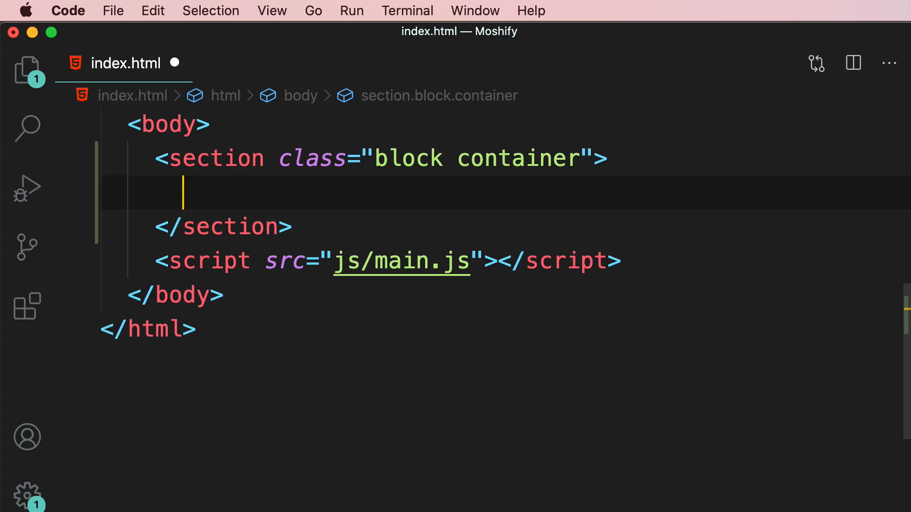

```html
<section class="block container block-domain">
  <header class="block__header">
    <h2 class="block__heading">Starting at $9 per month</h2>
    <p>Lorem ipsum dolor sit amet consectetur adipisicing elit. Deleniti, exercitationem?</p>
  </header>
</section>
```

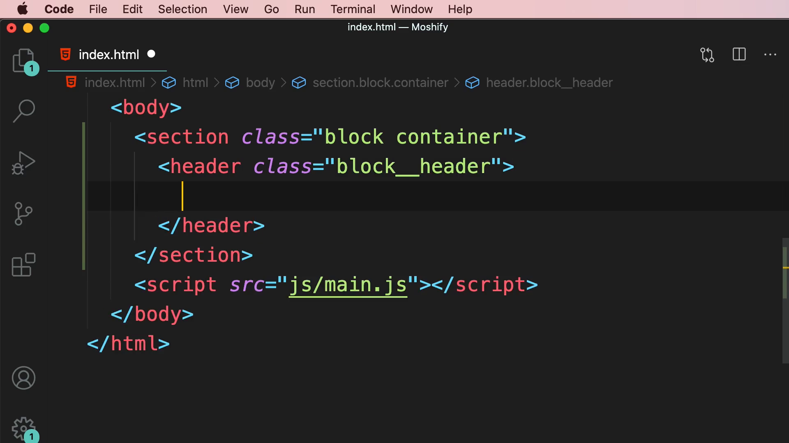

---

## 4. นำ Input Group (กล่องค้นหา) มาใช้ซ้ำ

Mosh เปิดไฟล์ตัวอย่างคอมโพเนนต์ `input-groups.html` เพื่อดูโค้ดของ input group ที่เคยสร้างไว้ในคลิปก่อนหน้า

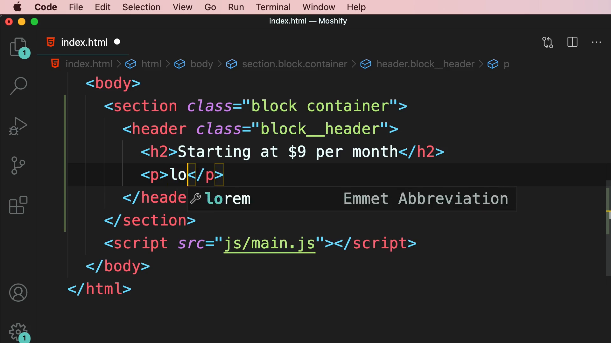

คัดลอกโค้ด HTML ของ input group

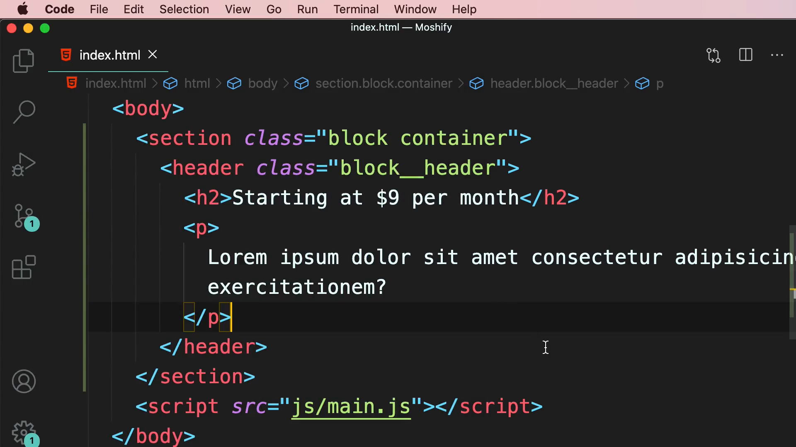

แล้ววางลงใน Domain Block section

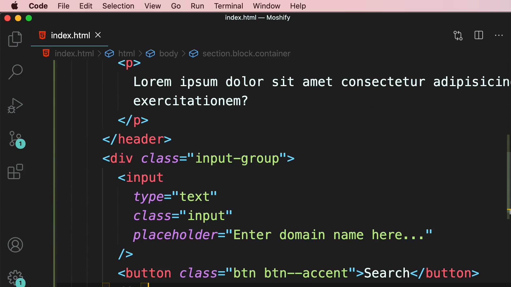

```html
<div class="input-group">
  <input type="text" class="input" placeholder="Enter domain name here...">
  <button class="btn btn--accent btn--stretched">Search</button>
</div>
```

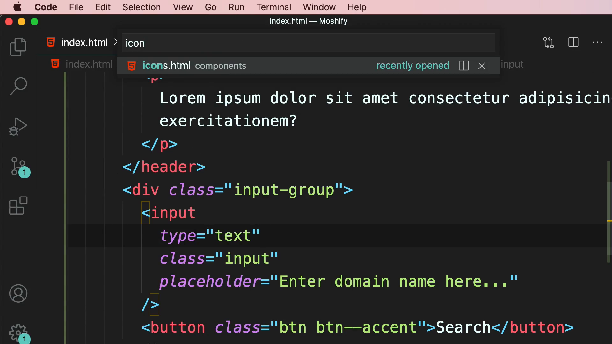

> 🔧 การนำคอมโพเนนต์ที่มีอยู่แล้วมาใช้ซ้ำแบบนี้เป็นหัวใจของแนวทาง component-based CSS ช่วยลดการเขียนโค้ดซ้ำซ้อนและรักษาความสม่ำเสมอของดีไซน์ทั่วทั้งเว็บไซต์

---

## 5. เปลี่ยนข้อความปุ่มเป็นไอคอนค้นหา (SVG Sprite)

Mosh เปิดไฟล์ `icons.html` เพื่อดูรายการไอคอน SVG ที่มีอยู่ในสไปรต์ของโปรเจกต์

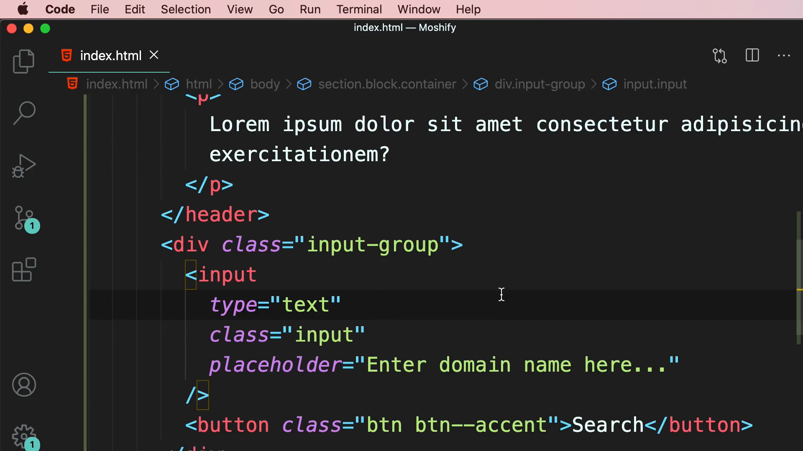

จากนั้นแทนที่ข้อความ "Search" ในปุ่มด้วย SVG icon โดยใช้ `xlink:href` ชี้ไปยังไอคอน `search` ในสไปรต์

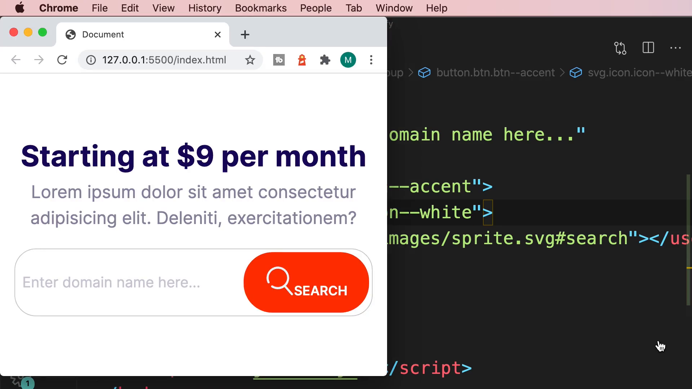

```html
<button class="btn btn--accent btn--stretched">
  <svg class="icon"><use xlink:href="images/sprite.svg#search"></use></svg>
  Search
</button>
```

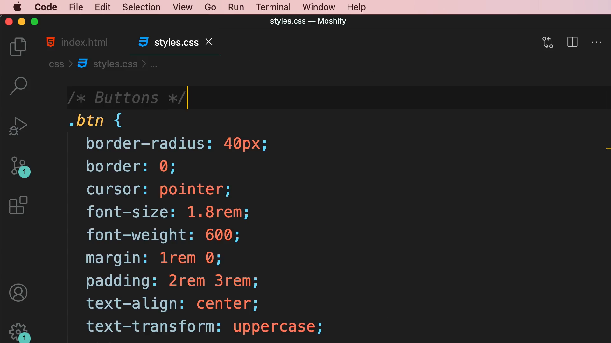

> 📝 การใช้ SVG sprite (`<use xlink:href="...">`) ช่วยให้สามารถใช้ไอคอนเดียวกันซ้ำได้หลายที่โดยโหลดไฟล์ SVG เพียงครั้งเดียว

---

## 6. จัดสไตล์ไอคอนในปุ่มด้วย `.btn .icon`

เมื่อเพิ่มไอคอนเข้าไปในปุ่มแล้ว ไอคอนมีขนาดใหญ่เกินไปและไม่เรียงกับข้อความ Mosh จึงเพิ่ม CSS rule ใหม่

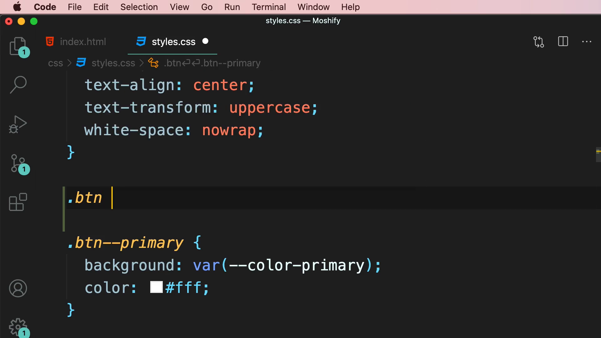

ค่อย ๆ เพิ่มพร็อพเพอร์ตี้ทีละบรรทัด

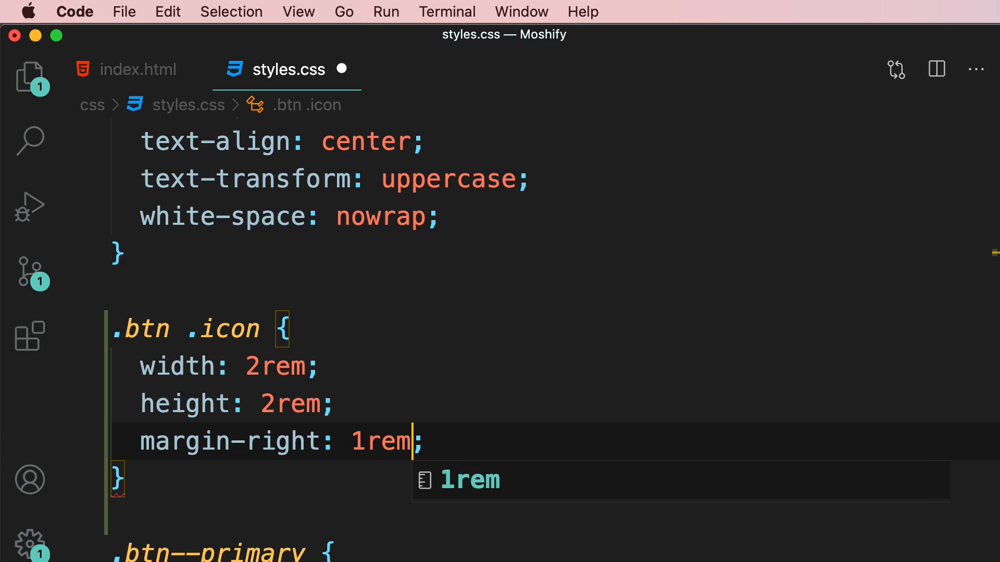

```css
.btn .icon {
  width: 2rem;
  height: 2rem;
  margin-right: 1rem;
}
```

จากนั้นเพิ่ม `vertical-align: middle` เพื่อให้ไอคอนอยู่กึ่งกลางแนวตั้งเทียบกับข้อความ

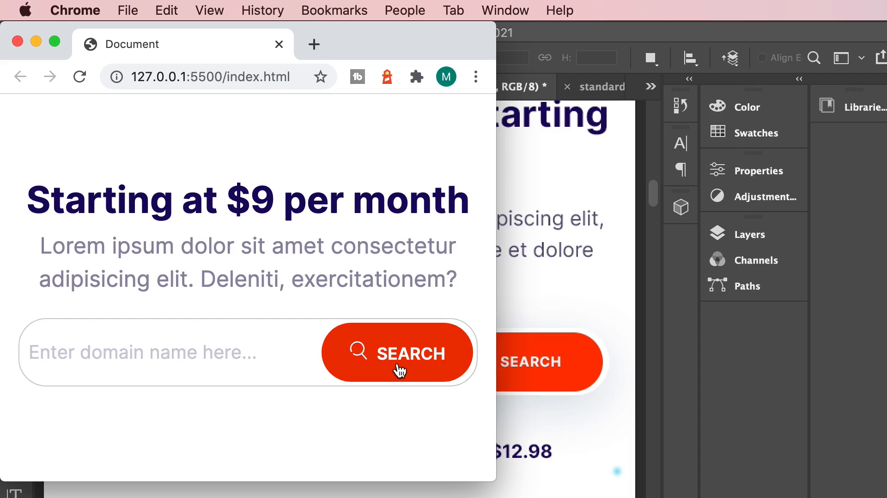

```css
.btn .icon {
  width: 2rem;
  height: 2rem;
  margin-right: 1rem;
  vertical-align: middle;
}
```

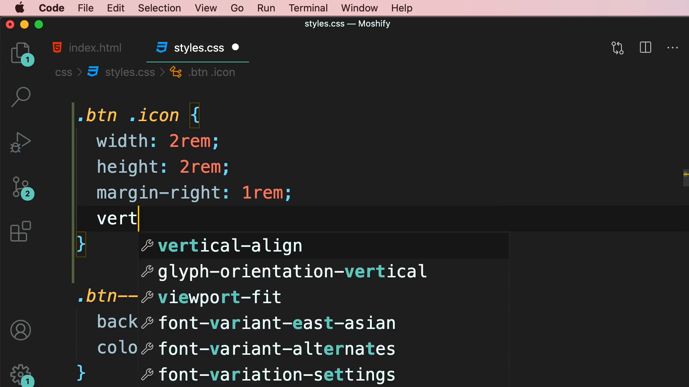

> 💡 ค่า `vertical-align: middle` จำเป็นสำหรับ inline-level element อย่าง SVG icon ที่วางอยู่ข้าง ๆ ข้อความ เพราะค่าเริ่มต้นของ `vertical-align` คือ `baseline` ซึ่งจะทำให้ไอคอนดูเหมือนลอยต่ำกว่าข้อความเล็กน้อย

---

## 7. ตรวจสอบ Input Group เดิมด้วย DevTools

Mosh เปิด DevTools เพื่อตรวจสอบสไตล์ของ `.input-group .input` ที่มีอยู่แล้วจากคอมโพเนนต์เดิม

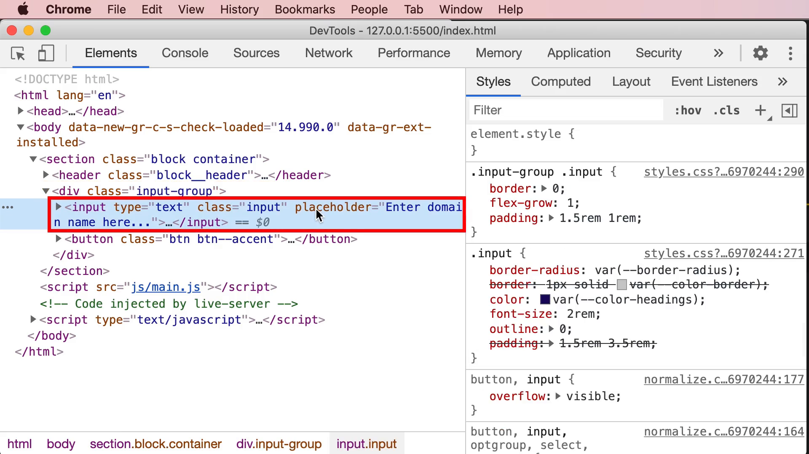

และตรวจสอบ `.input-group .btn` ซึ่งมี `margin: 4px;` กำหนดไว้แล้ว

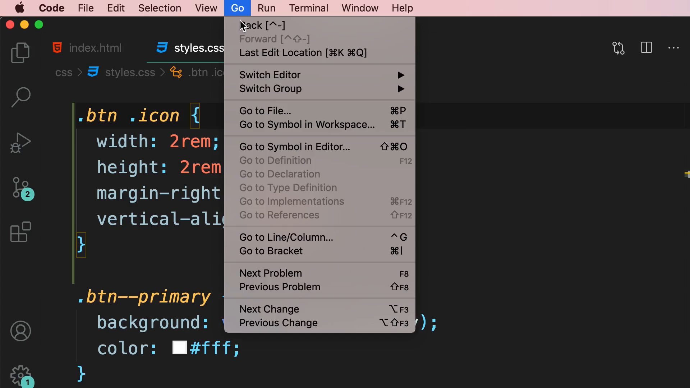

> 🔍 การใช้ DevTools ตรวจสอบสไตล์ของคอมโพเนนต์เดิมช่วยให้เข้าใจว่าทำไม layout ถึงออกมาเป็นแบบนี้ โดยไม่ต้องเขียนโค้ดใหม่ซ้ำ

---

## 8. บทแทรก: Utility Classes กับแนวทาง Component-Based CSS

Mosh หยุดพักเพื่ออธิบายแนวคิดเรื่อง **Utility Classes** (เช่นแนวทางของ Tailwind CSS) ที่มีคลาสสำเร็จรูปสำหรับ box-shadow, border, font ฯลฯ ให้หยิบมาประกอบกันได้ทันที

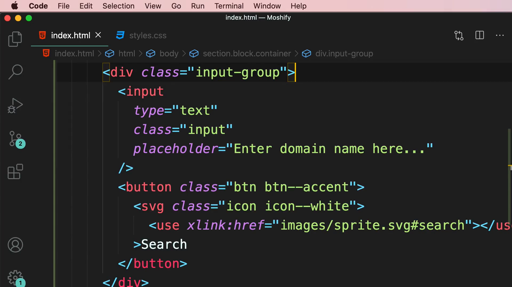

เพื่อสาธิต เขาลองเพิ่มคลาส `box-shadow` แบบ utility เข้าไปที่ input group ชั่วคราว

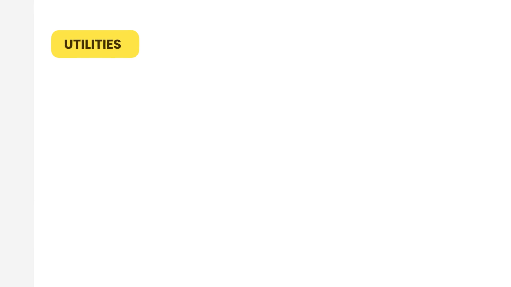

แต่หลังจากสาธิตแล้ว Mosh **ลบคลาสทดลองนี้ออก** และอธิบายว่าในคอร์สนี้จะยังคงใช้แนวทาง BEM/component-based ต่อไป เพราะเหมาะกับการเรียนรู้พื้นฐาน CSS มากกว่า

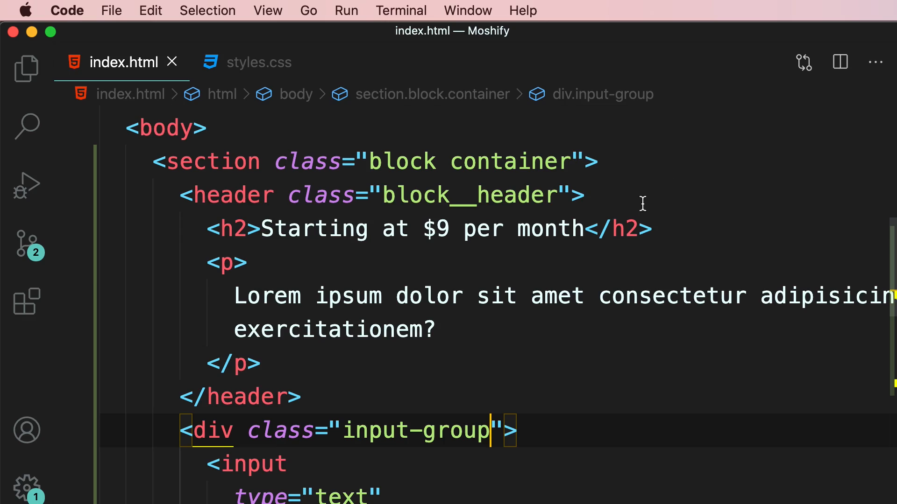

> ⚠️ นี่เป็นเพียงการอธิบายแนวคิดเสริมให้เข้าใจภาพรวม ไม่ใช่แนวทางที่ใช้จริงในโปรเจกต์ Moshify ของคอร์สนี้ โค้ดจริงยังคงเขียนแบบ BEM scoped selector ต่อไป

---

## 9. เพิ่ม Box Shadow แบบ Scoped Selector

แทนที่จะใช้ utility class Mosh เขียน selector เฉพาะเจาะจงกับ component นี้

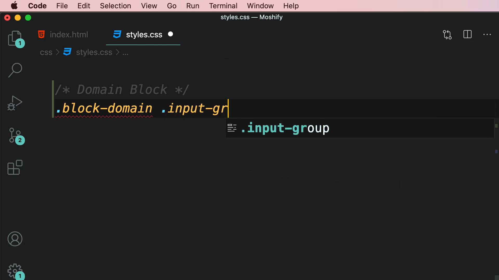

```css
.block-domain .input-group {
  box-shadow: 0 0 30px 20px #e6ebee;
}
```

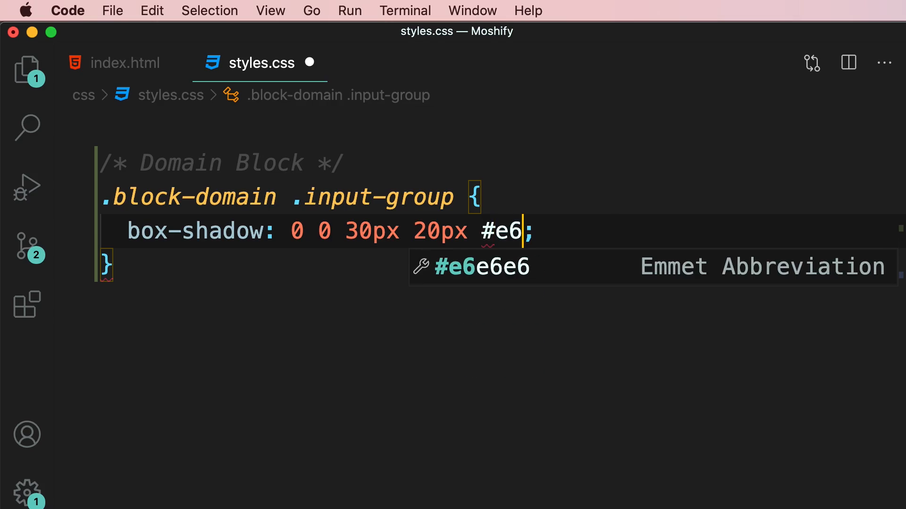

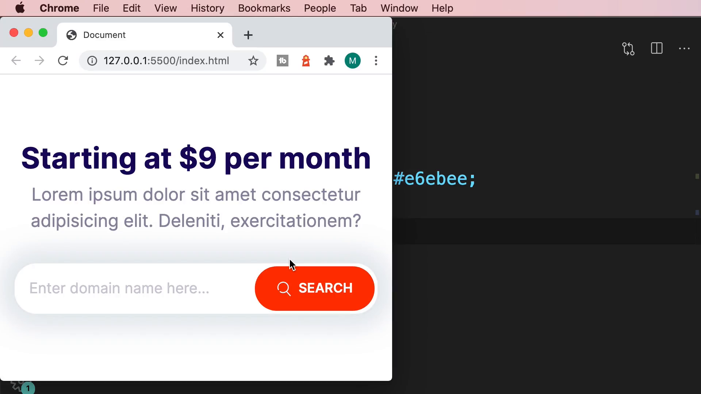

> 📌 การเขียน selector แบบ `.block-domain .input-group` (descendant selector) ทำให้ box-shadow นี้มีผลเฉพาะ input-group ที่อยู่ภายใน Domain Block เท่านั้น ไม่กระทบ input-group ที่ใช้ในส่วนอื่นของเว็บไซต์

---

## 10. สร้างรายการราคาโดเมนด้วย `<ul>`

Mosh เพิ่ม `<ul class="list block-domain__prices">` สำหรับแสดงราคาโดเมนแต่ละนามสกุล

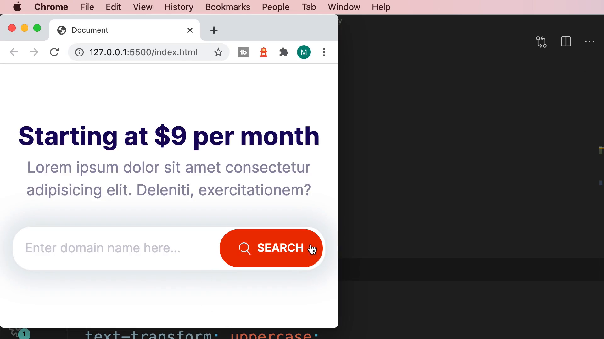

ใช้ Emmet multiplication (`li*6`) เพื่อสร้าง `<li>` จำนวน 6 รายการทันที

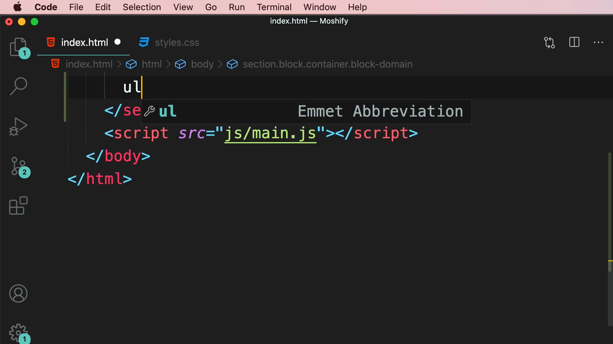

จากนั้นพิมพ์ราคาแต่ละนามสกุลลงในแต่ละ `<li>`


```html
<ul class="list block-domain__prices">
  <li>.com $9</li>
  <li>.sg $10</li>
  <li>.space $11</li>
  <li>.info $14</li>
  <li>.net $10</li>
  <li>.xyz $10</li>
</ul>
```

---

## 11. ใส่ Badge ให้กับรายการแรก (.com)

เพื่อเน้นให้ `.com` ดูโดดเด่นกว่ารายการอื่น (เป็นตัวเลือกที่ถูกเลือกไว้/แนะนำ) Mosh ครอบข้อความด้วย `<span>` และใช้คลาส `badge` ที่มีอยู่แล้ว

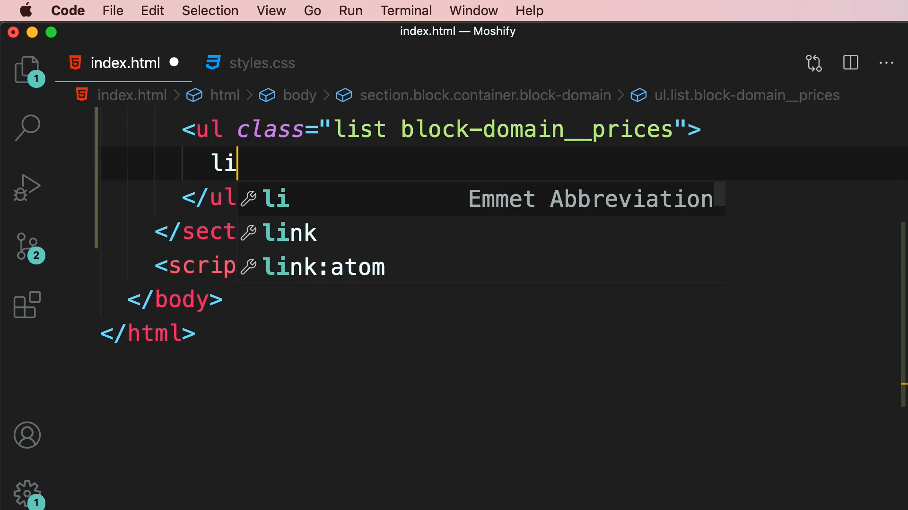

```html
<li><span class="badge badge--secondary">.com $9</span></li>
```

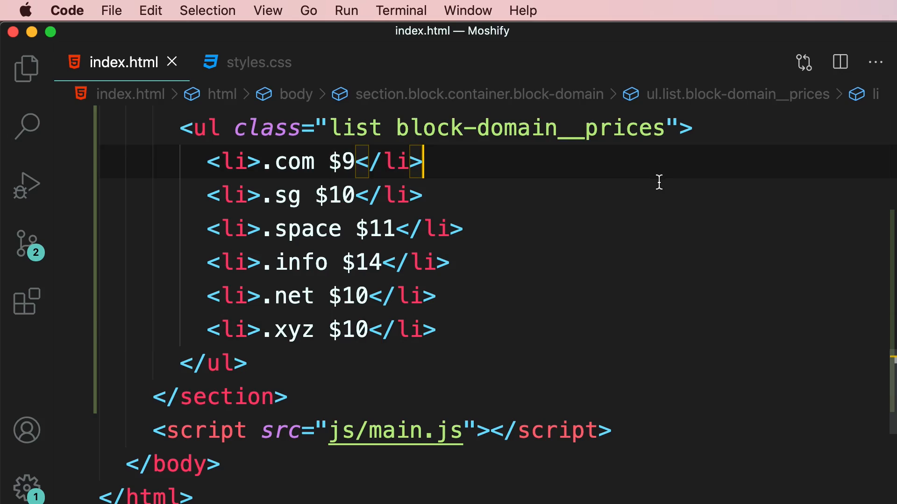

> ✅ การนำคลาส `badge` และ `badge--secondary` ที่เคยสร้างไว้ในคอมโพเนนต์อื่นมาใช้ซ้ำ ช่วยให้ได้ปุ่มทรงแคปซูลสีสันตรงกับดีไซน์ระบบ (design system) ของเว็บไซต์ทันที โดยไม่ต้องเขียน CSS ใหม่

---

## 12. จัดวางรายการราคาด้วย CSS Grid

Mosh เพิ่ม CSS rule ใหม่สำหรับ `.block-domain__prices` โดยเริ่มจาก `display: grid`

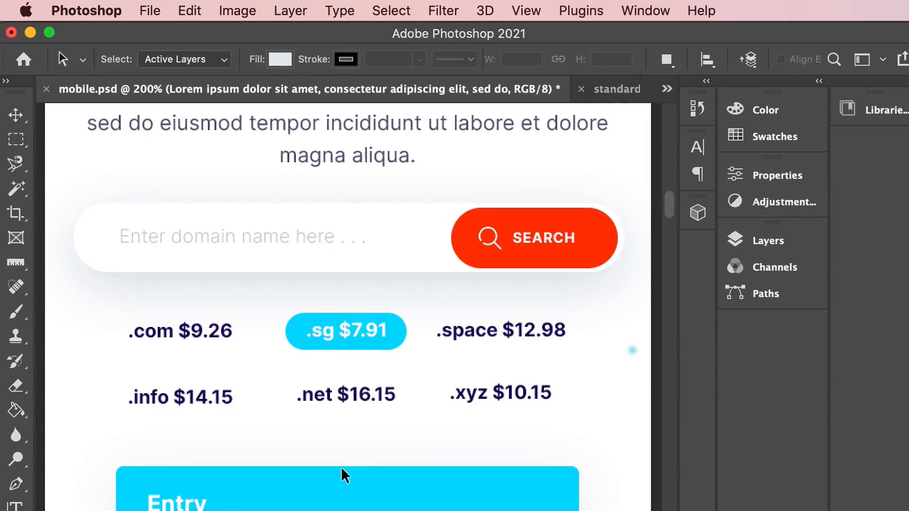

กำหนดคอลัมน์เป็น 3 คอลัมน์เท่ากัน (สำหรับหน้าจอเล็ก/ค่าเริ่มต้น)

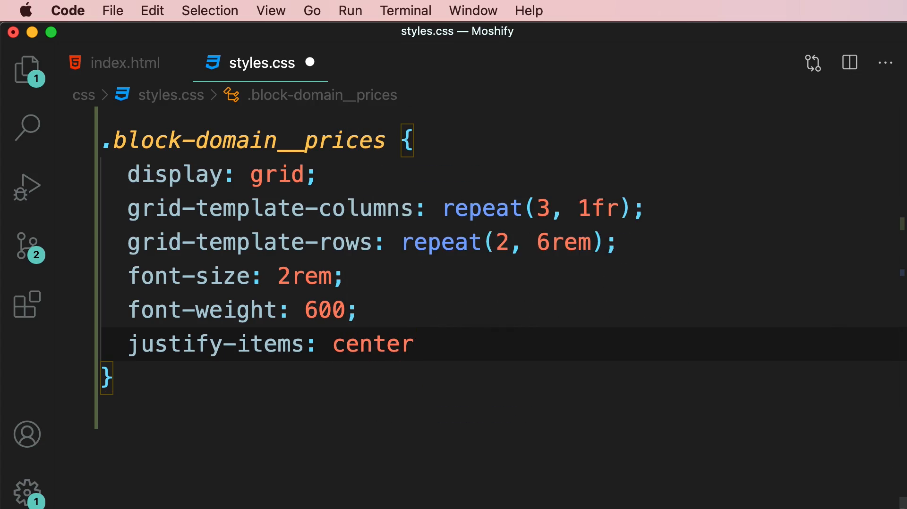

```css
.block-domain__prices {
  display: grid;
  grid-template-columns: repeat(3, 1fr);
}
```

กำหนดจำนวนแถวเป็น 2 แถว แถวละ 6rem

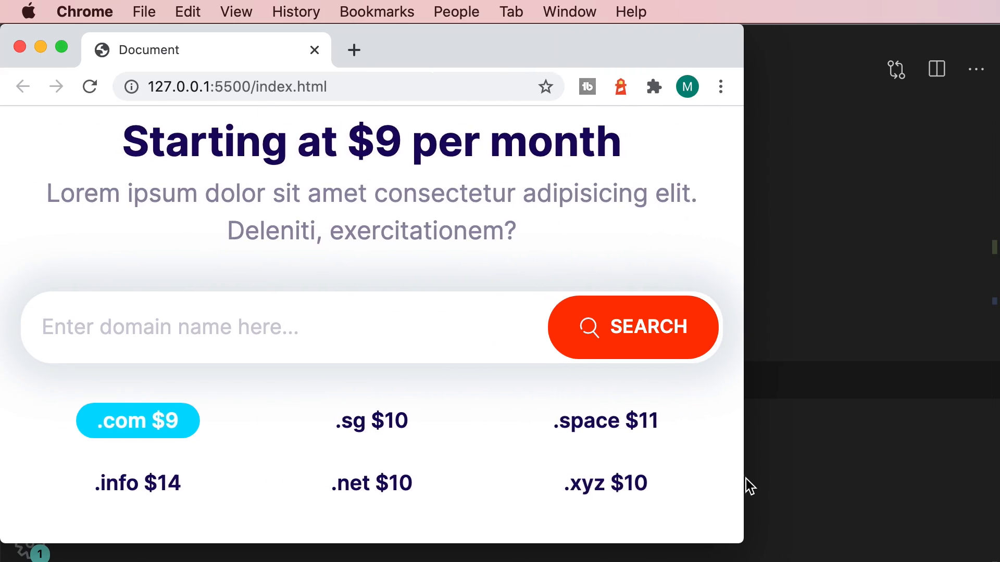

```css
grid-template-rows: repeat(2, 6rem);
```

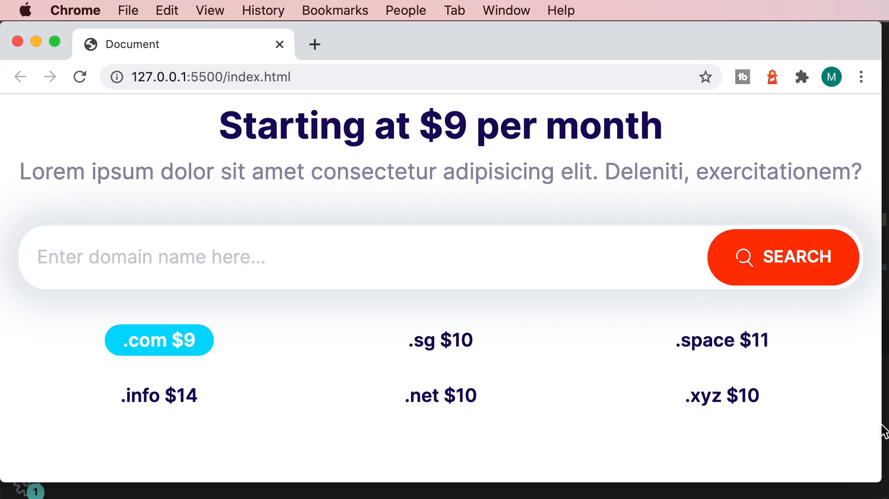

จากนั้นเพิ่ม `font-size`, `font-weight` และ `justify-items: center` เพื่อจัดข้อความให้อยู่กึ่งกลางแต่ละช่อง

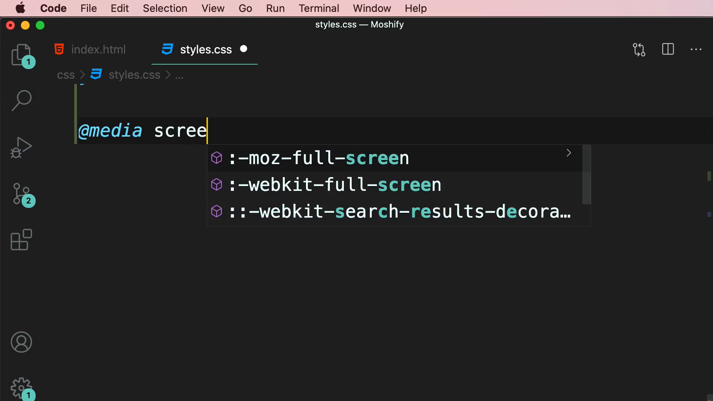

```css
.block-domain__prices {
  display: grid;
  grid-template-columns: repeat(3, 1fr);
  grid-template-rows: repeat(2, 6rem);
  font-size: 2rem;
  font-weight: 600;
  justify-items: center;
}
```

> 📝 ผลลัพธ์บนหน้าจอมือถือ: ราคาโดเมนทั้ง 6 รายการจะเรียงเป็นตาราง 3 คอลัมน์ × 2 แถว

---

## 13. เพิ่ม Media Query สำหรับหน้าจอกว้าง

เพื่อให้บนหน้าจอเดสก์ท็อปราคาทั้ง 6 รายการแสดงในแถวเดียว Mosh เพิ่ม media query ใหม่

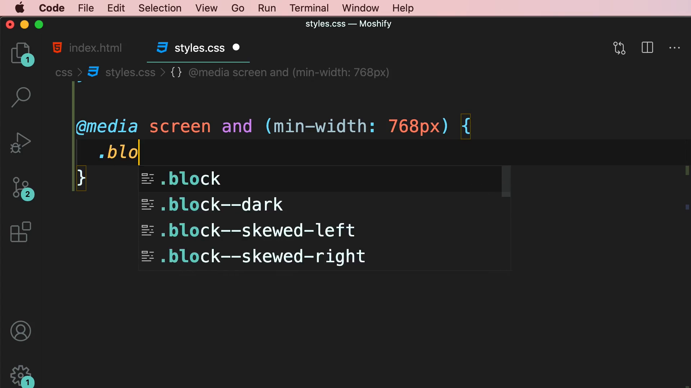

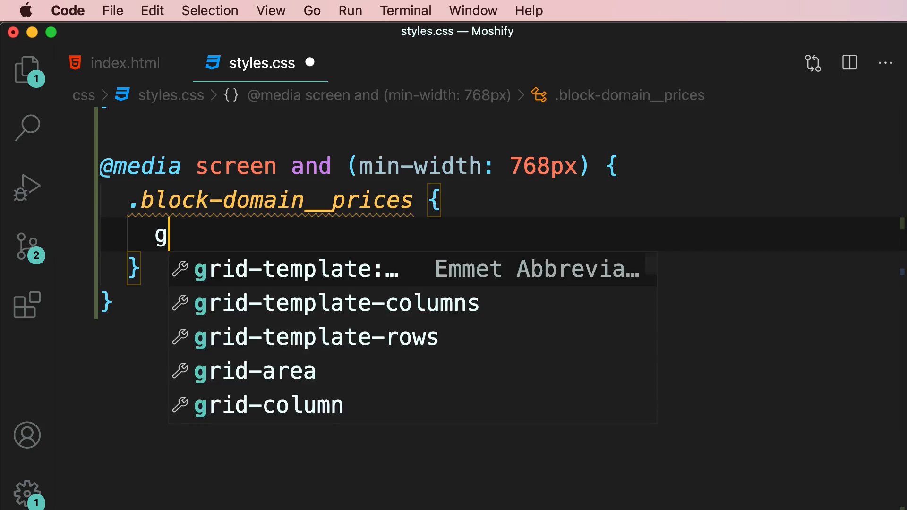

```css
@media screen and (min-width: 768px) {
  .block-domain__prices {
    grid-template-columns: repeat(6, 1fr);
  }
}
```

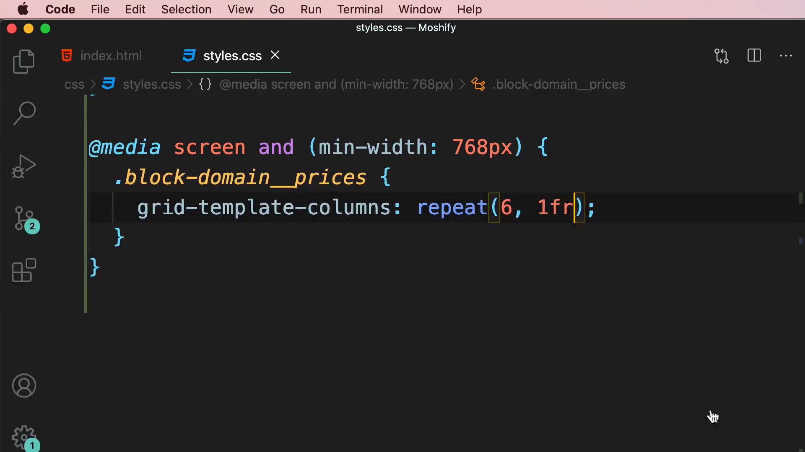

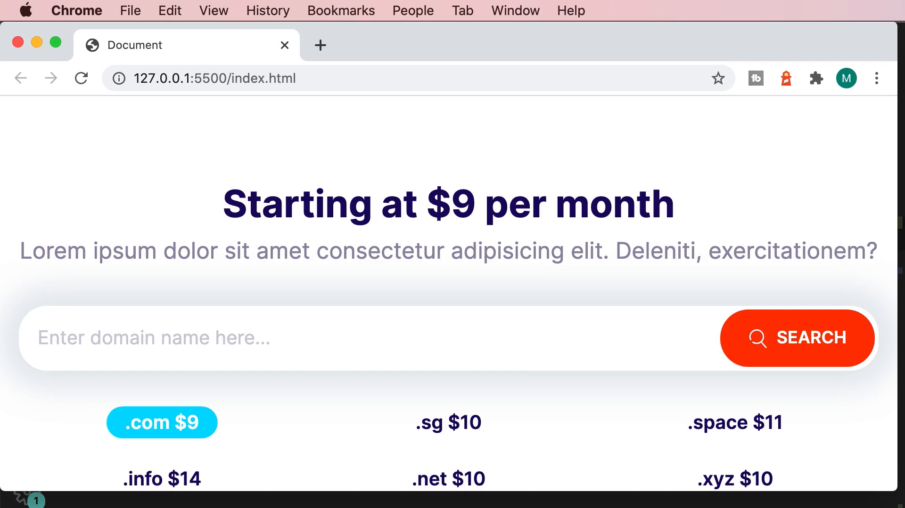

---

## 14. ทดลองใช้ `repeat(auto-fit, ...)` แทนจำนวนคอลัมน์ตายตัว

Mosh เปิด DevTools เพื่อดู Grid overlay ของ layout ปัจจุบัน

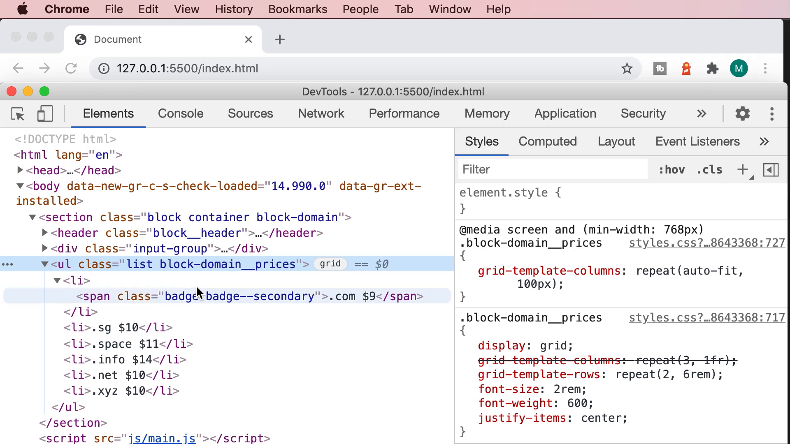

จากนั้นทดลองเปลี่ยนเป็น `repeat(auto-fit, 100px)` เพื่อสาธิตว่า grid จะปรับจำนวนคอลัมน์อัตโนมัติตามพื้นที่ว่าง

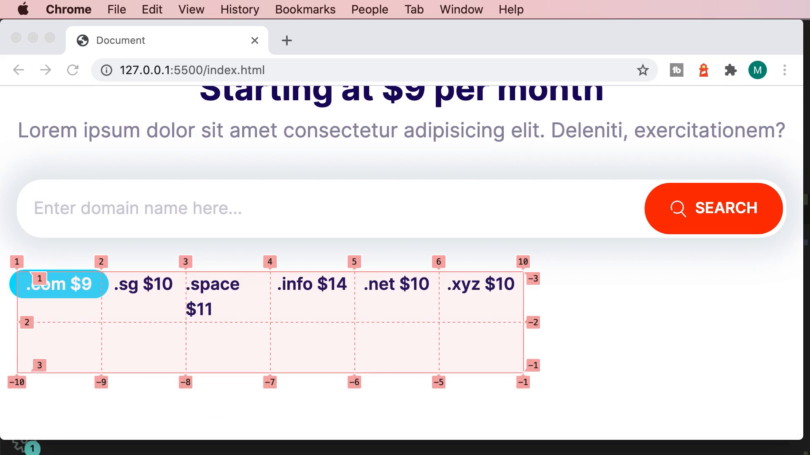

```css
grid-template-columns: repeat(auto-fit, 100px);
```

ผลลัพธ์: คอลัมน์แคบเกินไปทำให้ข้อความ "$11" ตกลงบรรทัดใหม่ (ล้นช่อง)

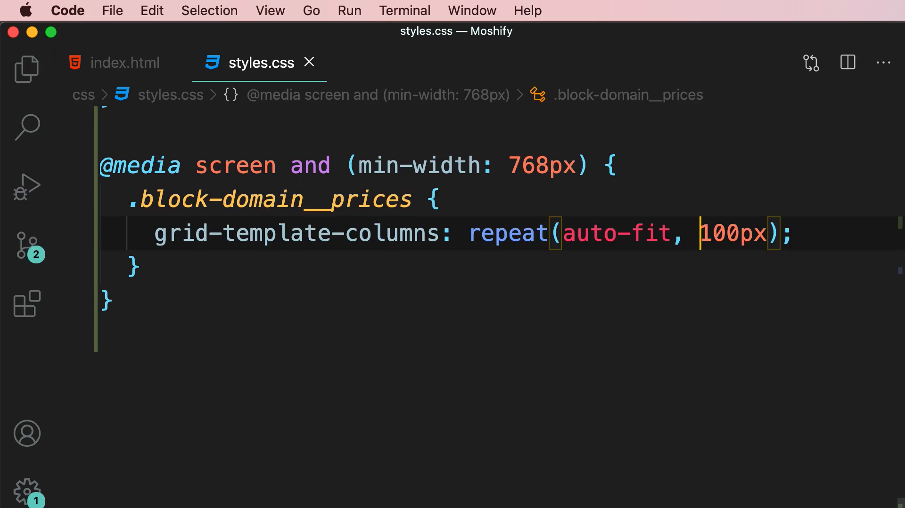

Mosh จึงปรับเป็น `repeat(auto-fit, minmax(100px, 1fr))` เพื่อให้แต่ละคอลัมน์มีความกว้างขั้นต่ำ 100px แต่ขยายเต็มพื้นที่ที่เหลือได้

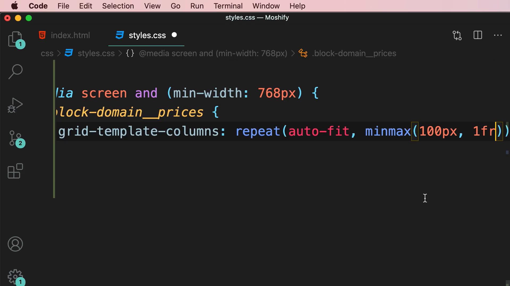

```css
grid-template-columns: repeat(auto-fit, minmax(100px, 1fr));
```

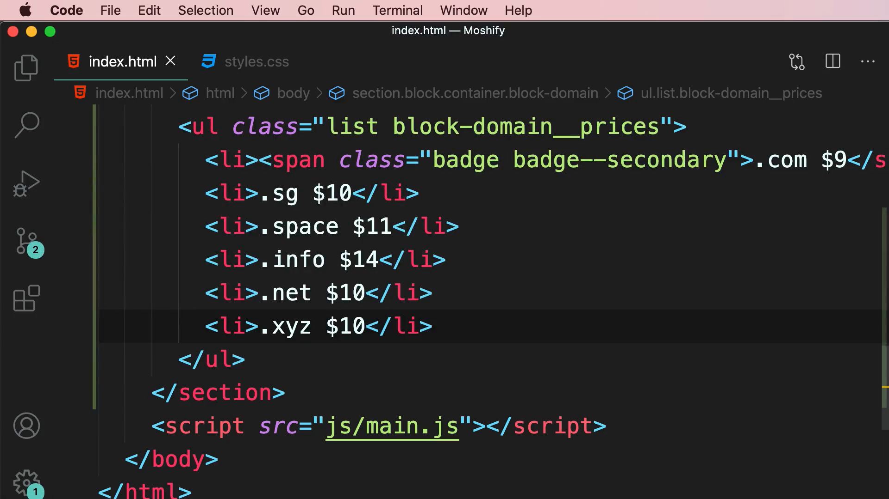

> 🔍 `repeat(auto-fit, minmax(...))` เป็นเทคนิคที่มีประโยชน์มากสำหรับ grid ที่ต้องรองรับจำนวนไอเทมไม่แน่นอน เพราะเบราว์เซอร์จะคำนวณจำนวนคอลัมน์ที่เหมาะสมเองโดยอัตโนมัติ โดยไม่ต้องเขียน media query เพิ่มเติมสำหรับทุกขนาดหน้าจอ

Mosh ทดลองเพิ่ม `<li>` พิเศษเข้าไปอีก 1 รายการเพื่อดูว่า grid แบบ auto-fit จะจัดการอย่างไรเมื่อจำนวนไอเทมเปลี่ยน

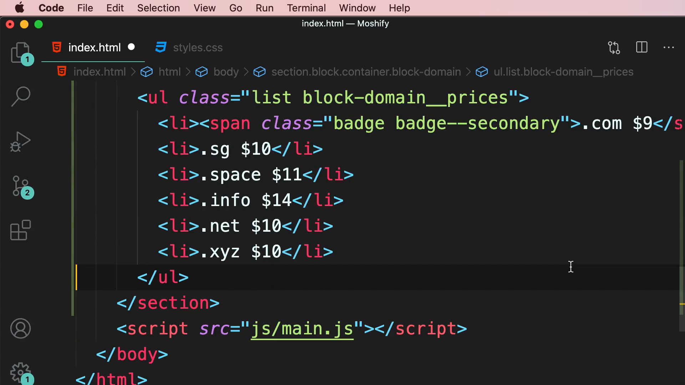

หลังจากสาธิตเสร็จ เขาลบ `<li>` ทดสอบนี้ออก


---

## 15. สรุปกลับมาใช้ `repeat(3, 1fr)` เป็นค่าสุดท้าย

หลังจากสาธิตเทคนิค `auto-fit`/`minmax` ให้เห็นภาพแล้ว Mosh ตัดสินใจใช้ค่าคอลัมน์แบบตายตัว `repeat(3, 1fr)` สำหรับโปรเจกต์นี้ เนื่องจากให้ผลลัพธ์ที่คาดเดาได้และควบคุมง่ายกว่าสำหรับดีไซน์ที่ทราบจำนวนไอเทมแน่นอนอยู่แล้ว (6 รายการ)

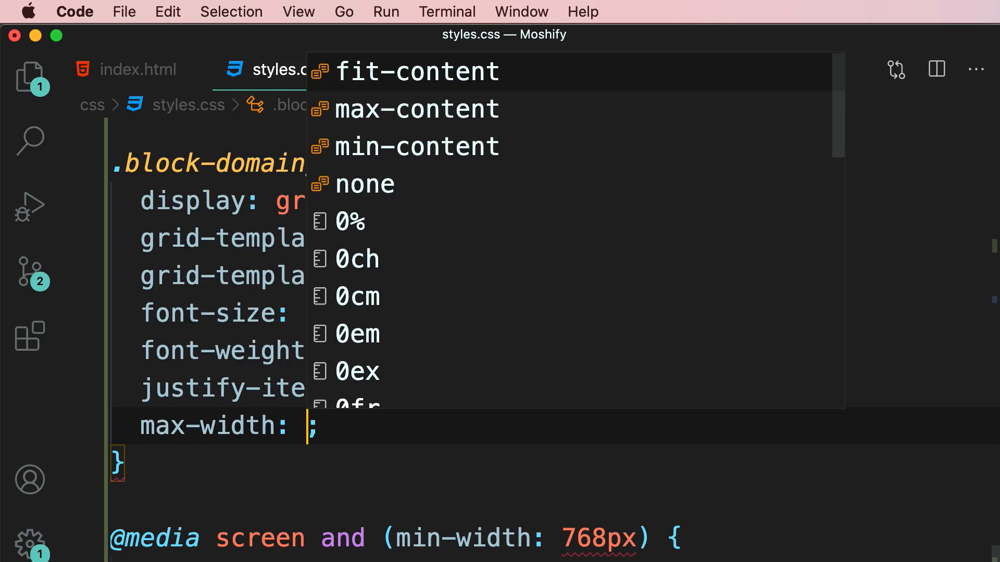

> 📌 บทเรียนสำคัญ: `auto-fit`/`minmax` เหมาะกับกรณีที่จำนวนไอเทมไม่แน่นอนหรือเปลี่ยนแปลงได้ ส่วน `repeat(N, 1fr)` แบบตายตัวเหมาะกับกรณีที่ทราบจำนวนไอเทมแน่ชัดตามดีไซน์ที่วางไว้

---

## 16. ปรับความกว้างของกล่องค้นหาให้ไม่กว้างเกินไป

Mosh กลับไปดู mockup ใน Photoshop อีกครั้งเพื่อเทียบสัดส่วนความกว้างของกล่องค้นหา

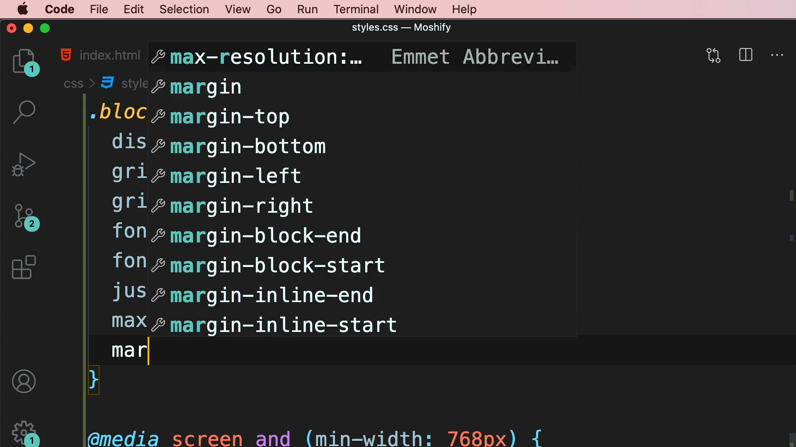

แล้วเพิ่ม `max-width` และ `margin: auto` ให้กับ `.block-domain .input-group` เพื่อจำกัดความกว้างสูงสุดและจัดให้อยู่กึ่งกลาง

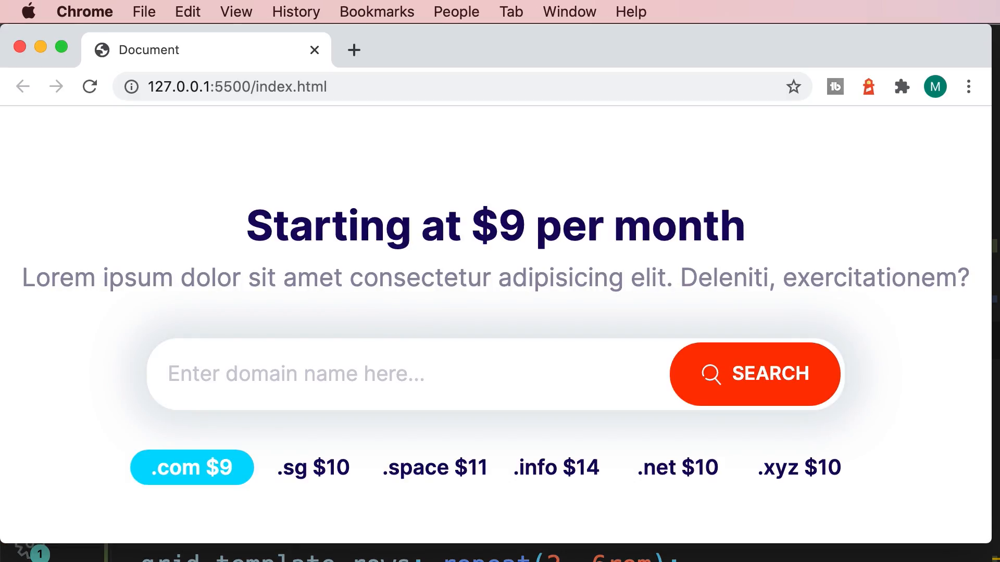

```css
.block-domain .input-group {
  box-shadow: 0 0 30px 20px #e6ebee;
  border: 0;
  margin: 4rem auto;
  max-width: 670px;
}
```

ทดสอบผลลัพธ์โดยการย่อ-ขยายหน้าต่างเบราว์เซอร์

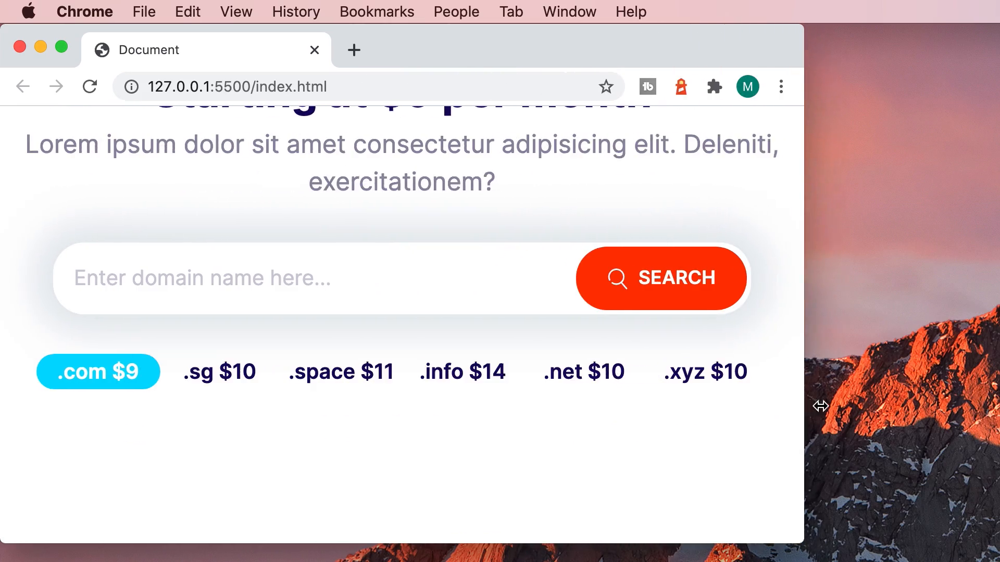

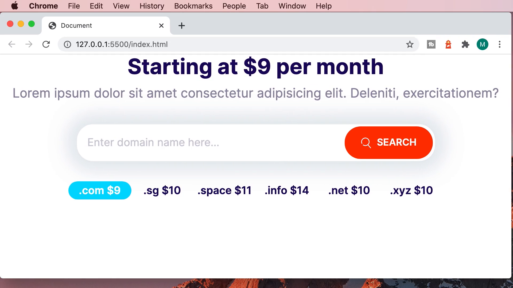

> ✅ การกำหนด `max-width` ควบคู่กับ `margin: auto` เป็นเทคนิคพื้นฐานที่ใช้บ่อยมากในการทำ centered container ที่ไม่ขยายกว้างเกินไปบนจอใหญ่ แต่ยังคงยืดหยุ่น (responsive) ได้เต็มที่บนจอเล็ก

---

## สรุปภาพรวมของคลิปนี้

| หัวข้อ | รายละเอียด |
|---|---|
| ส่วนที่สร้าง | Domain Block: หัวข้อ + กล่องค้นหาโดเมน + รายการราคา 6 นามสกุล |
| คอมโพเนนต์ที่นำมาใช้ซ้ำ | `.block`, `.container`, `.block__header`, `.input-group`, `.btn`, `.badge` |
| ไอคอน | SVG sprite (`<use xlink:href="...#search">`) พร้อม CSS `.btn .icon` |
| CSS Layout หลัก | CSS Grid (`display:grid`, `grid-template-columns`, `grid-template-rows`, `justify-items`) |
| แนวคิดที่อภิปราย | Utility Classes เทียบกับ Component-based/BEM CSS |
| เทคนิค Grid ขั้นสูง | `repeat(auto-fit, minmax(...))` เทียบกับ `repeat(N, 1fr)` แบบตายตัว |
| Responsive | Media query `min-width: 768px` เปลี่ยนจาก 3 คอลัมน์ (มือถือ) เป็น 6 คอลัมน์ (เดสก์ท็อป) |
| การจัดวางกล่องค้นหา | `max-width` + `margin: auto` เพื่อจำกัดความกว้างสูงสุดและจัดกึ่งกลาง |

### แนวคิดสำคัญที่ได้จากคลิปนี้

1. **การนำคอมโพเนนต์เดิมมาใช้ซ้ำ** (input-group, btn, badge) ช่วยประหยัดเวลาและรักษาความสม่ำเสมอของดีไซน์ทั่วทั้งเว็บไซต์
2. **SVG sprite กับ `xlink:href`** เป็นวิธีมาตรฐานในการใช้ไอคอนซ้ำหลายจุดโดยโหลดไฟล์ภาพเพียงครั้งเดียว
3. **Scoped selector (เช่น `.block-domain .input-group`)** ช่วยให้ปรับแต่งสไตล์เฉพาะจุดได้โดยไม่กระทบคอมโพเนนต์เดียวกันที่ใช้ในที่อื่น ซึ่งเป็นข้อดีของแนวทาง BEM/component-based เมื่อเทียบกับ utility classes
4. **`repeat(auto-fit, minmax(min, max))`** เป็นเทคนิค CSS Grid ที่ทรงพลัง เหมาะกับกรณีจำนวนไอเทมไม่แน่นอน ส่วน `repeat(N, 1fr)` เหมาะกับกรณีทราบจำนวนไอเทมแน่นอนตามดีไซน์
5. **`max-width` ร่วมกับ `margin: auto`** เป็นเทคนิคพื้นฐานสำหรับจำกัดความกว้างสูงสุดขององค์ประกอบและจัดให้อยู่กึ่งกลางในแนวนอน
6. **Media query แบบ mobile-first** (`min-width: 768px`) ใช้ปรับจำนวนคอลัมน์ของ grid ให้เหมาะกับขนาดหน้าจอที่ต่างกัน

---

*สรุปจากคลิปที่ 31 ในคอร์ส "Building a Website" โดย Mosh Hamedani (codewithmosh.com)*
