# HTML-CSS-3: 34 - Showcase Block

**ไฟล์ต้นฉบับ:** "34- Showcase Block.mp4"

---

## ภาพรวมคลิปนี้

คลิปนี้ Mosh สอนการสร้าง **Showcase Block** ซึ่งเป็น section ใหม่ที่มีลักษณะพิเศษกว่า block อื่น ๆ ที่เคยทำมาในคอร์ส เพราะมันใช้ **theme สีเข้ม (dark theme)** และมี **รูปทรงเฉียง (skewed shape)** ที่ขอบล่างของ section ทำให้หน้าเว็บดูมีมิติและน่าสนใจมากขึ้น เนื้อหาของ section นี้คือ "User-friendly Control Panel" ที่โชว์ภาพหน้าจอแอปบน iPad พร้อมกับ list รายการฟีเจอร์ 3 ข้อ (Easy Start & Managed Updates, Staging Git & WP-CLI, Dynamic Caching & More) แต่ละรายการมีไอคอนประกอบ

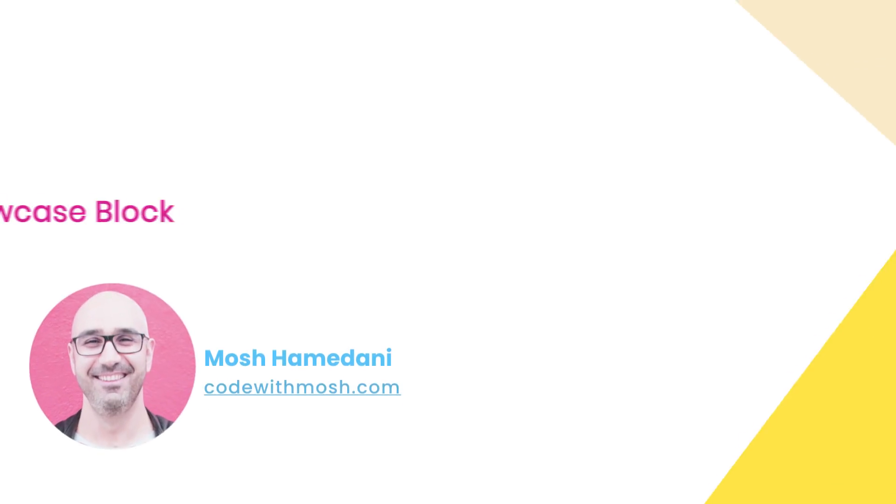

> 💡 Showcase Block เป็นจุดที่ Mosh แนะนำ CSS modifier class 2 ตัวใหม่คือ `.block--dark` (เปลี่ยนพื้นหลัง section เป็นสีเข้ม) และ `.block--skewed-right` (ตัดขอบล่างของ section ให้เอียง) ซึ่งสามารถผสมกับ `.block` เดิมที่เคยใช้ในคอร์สได้เลย

---

## 1. ทบทวนดีไซน์ใน Photoshop

Mosh เริ่มต้นด้วยการเปิดไฟล์ Photoshop มาดู mockup ของ section "User-friendly Control Panel" ซึ่งมีพื้นหลังสีเข้ม (เกือบดำ) ตัดกับภาพหน้าจอแอป (คล้ายหน้า App Store/Integrations) ที่วางอยู่ในกรอบ iPad ทางด้านซ้าย และด้านขวาเป็นหัวข้อใหญ่พร้อม list รายการฟีเจอร์ 3 ข้อ แต่ละข้อมีไอคอนเส้น (line icon) สีน้ำเงินกำกับอยู่ด้านหน้า

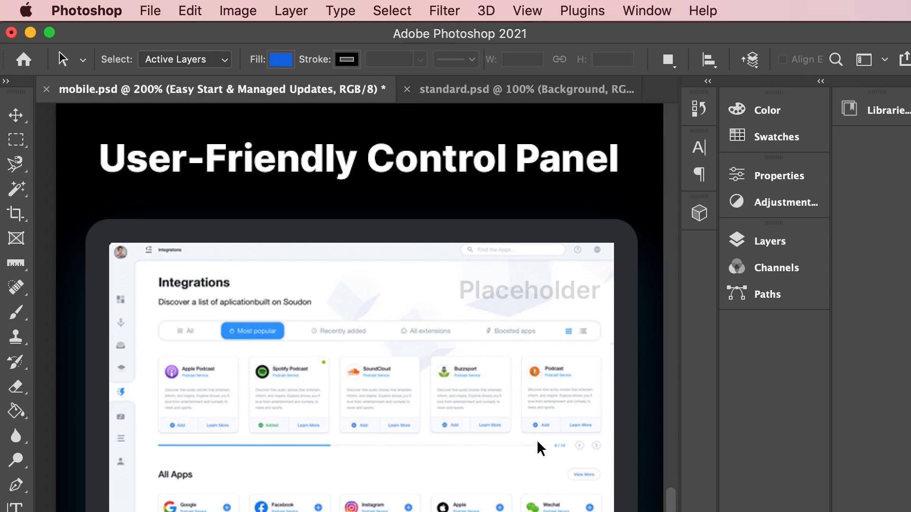

> 📝 รายการฟีเจอร์ทั้ง 3 ข้อใน mockup คือ:
> 1. **Easy Start & Managed Updates** — ไอคอนรูปภาพ (picture/image icon)
> 2. **Staging, Git & WP-CLI** — ไอคอนกราฟแท่ง/กราฟเติบโต (bar chart / growth icon)
> 3. **Dynamic Caching & More** — ไอคอนอื่น ๆ ที่เกี่ยวกับความเร็ว/cache

ก่อนเริ่มเขียนโค้ด Mosh อธิบายว่า section นี้จะต่างจาก section อื่น ๆ ตรงที่มันมีพื้นหลังเข้ม ดังนั้นสีตัวหนังสือ สีหัวข้อ และสีของ paragraph จะต้องกลับด้าน (invert) จากปกติ — งานส่วนนี้จะทำผ่าน class modifier ใหม่ `.block--dark`

---

## 2. เตรียมรูปภาพ (ipad.png) ด้วยการติ๊ดพื้นหลังออก

Mosh สลับไปที่ไฟล์ `standard.psd` ที่มีภาพหน้าจอแอปเต็ม ๆ (ไม่มีกรอบ iPad) แล้วใช้เครื่องมือ selection/crop ตัดเฉพาะส่วนภาพหน้าจอออกมา จากนั้น export เป็นไฟล์ `ipad.png` (พร้อมเวอร์ชัน `@2x` สำหรับจอ retina) เพื่อนำไปใช้เป็น `` ใน HTML


> 🔧 หลักการเดิมที่ใช้ซ้ำจากคลิปก่อน ๆ: Mosh export รูปเป็นทั้ง `.png` และ `.webp` สองเวอร์ชัน (1x และ @2x) เพื่อรองรับ `<picture>` element ที่จะใช้แสดงภาพแบบ responsive และเลือก format ที่เบราว์เซอร์รองรับ

---

## 3. เริ่มเขียน HTML ด้วย Emmet — `section.block.block--dark.block--skewed-right`

Mosh เปิดไฟล์ `index.html` แล้วพิมพ์ Emmet abbreviation:

```
section.block.block--dark.block--skewed-right
```

กด Tab แล้ว Emmet จะ expand ออกมาเป็น:

```html
<section class="block block--dark block--skewed-right"></section>
```

> 📌 สังเกตว่า class `block` ตัวเดิมยังคงอยู่ (สำหรับ padding แนวตั้งมาตรฐานของทุก section) และมี modifier class อีก 2 ตัวต่อท้ายคือ `block--dark` และ `block--skewed-right` — นี่คือรูปแบบ BEM (Block Element Modifier) ที่ Mosh ใช้มาตลอดทั้งคอร์ส

จากนั้นเพิ่ม `<header class="block__header">` พร้อม `<h2>User-friendly Control Panel</h2>` ข้างในเหมือน section อื่น ๆ:

```html
<section class="block block--dark block--skewed-right">
  <header class="block__header">
    <h2>User-friendly Control Panel</h2>
  </header>
</section>
```

ทดสอบดูผลลัพธ์ในเบราว์เซอร์ พบว่าพื้นหลังยังเป็นสีขาวอยู่ เพราะยังไม่ได้เขียน CSS ให้กับ `.block--dark`

---

## 4. เขียน CSS ให้ `.block--dark`

Mosh สลับไปที่ `styles.css` แล้วเพิ่ม CSS rule ใหม่:

```css
.block--dark {
  color: rgb(123, 133, 139);
  background: rgb(0, 0, 0);
}
```

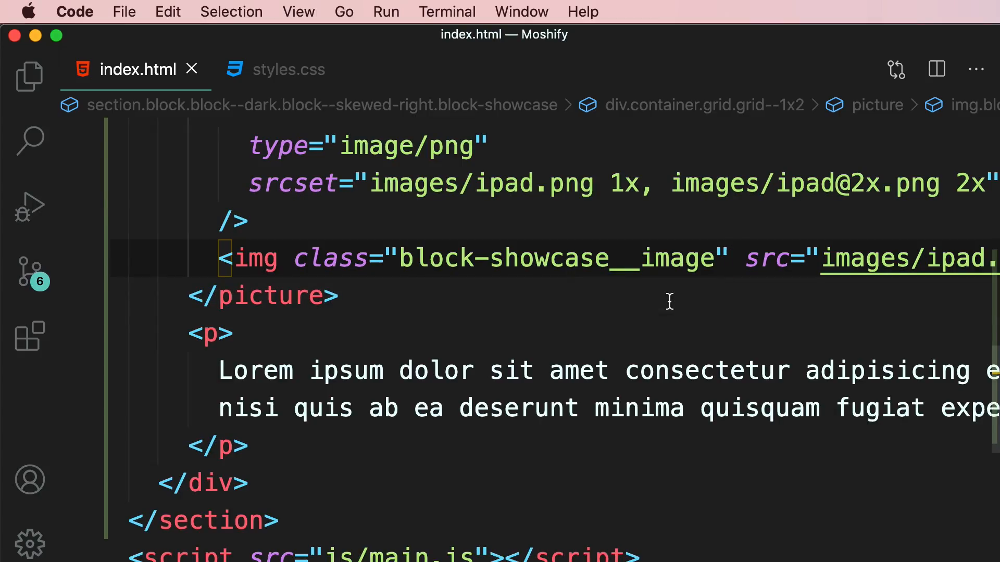

> ⚠️ เนื่องจาก `color` ที่กำหนดใน `.block--dark` เป็นสีเทาอ่อน (สำหรับข้อความ paragraph ทั่วไป) แต่หัวข้อ (h1-h3) ยังคงเป็นสีเข้มตามค่า default ของ `--color-headings` ทำให้ตัวหนังสือหัวข้อมองไม่เห็นบนพื้นดำ Mosh จึงต้องเพิ่ม override ให้ heading เป็นสีขาวด้วย:

```css
.block--dark h1,
.block--dark h2,
.block--dark h3 {
  color: #fff;
}
```

หลังจากเพิ่ม CSS แล้ว ทดสอบในเบราว์เซอร์ ตอนนี้พื้นหลังเป็นสีดำ หัวข้อเป็นสีขาว และตัวหนังสือทั่วไปเป็นสีเทาอ่อนตามที่ต้องการ

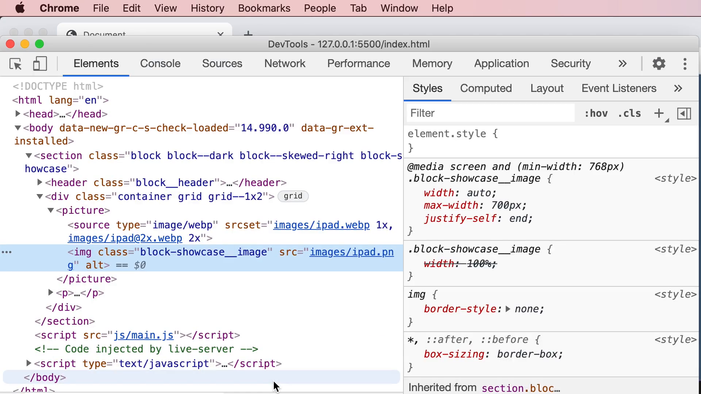

---

## 5. เพิ่มรูปภาพด้วย `<picture>` element (responsive image)

Mosh เพิ่ม `<div class="container grid grid--1x2">` ต่อจาก header เพื่อแบ่ง layout เป็น 2 คอลัมน์ (รูปภาพ | เนื้อหา) จากนั้นใช้ `<picture>` element เพื่อใส่ภาพ `ipad.png` แบบ responsive ที่รองรับทั้ง webp และ png พร้อม 1x/2x สำหรับจอความละเอียดสูง:

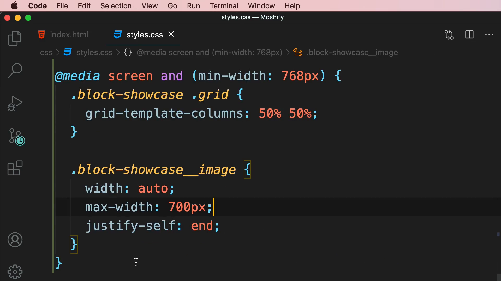

```html
<div class="container grid grid--1x2">
  <picture>
    <source
      type="image/webp"
      srcset="images/ipad.webp 1x, images/ipad@2x.webp 2x"
    />
    <source
      type="image/png"
      srcset="images/ipad.png 1x, images/ipad@2x.png 2x"
    />
    
  </picture>
</div>
```

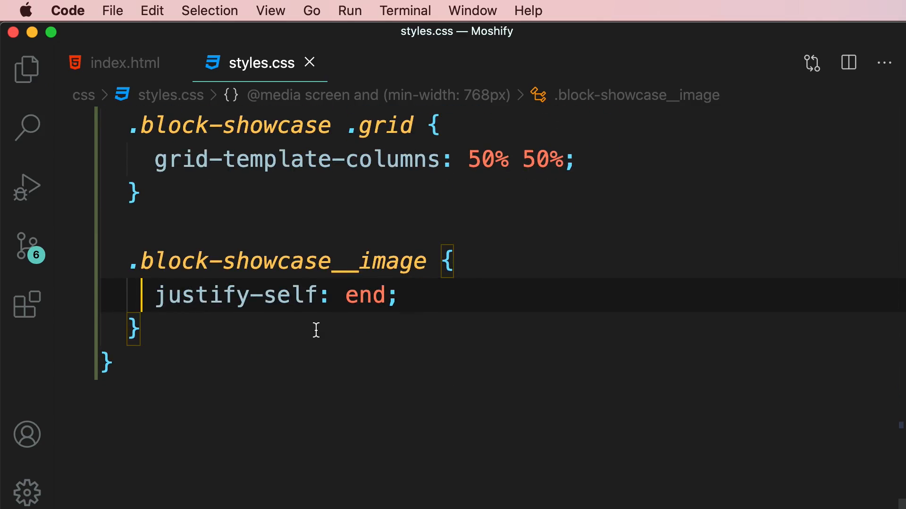

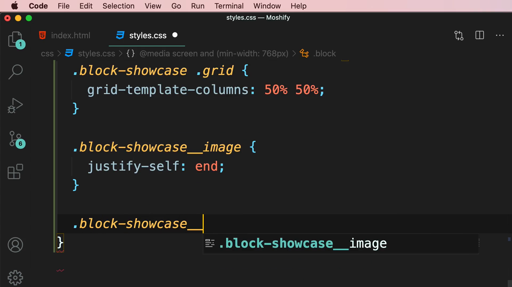

> 🔍 ลำดับความสำคัญของ `<source>` ใน `<picture>`:
> 1. เบราว์เซอร์จะอ่านจากบนลงล่าง และเลือก `<source>` แรกที่ `type` ตรงกับ format ที่รองรับ
> 2. ถ้ารองรับ `.webp` (เบราว์เซอร์สมัยใหม่ส่วนใหญ่) จะใช้ไฟล์ webp ซึ่งมีขนาดเล็กกว่า
> 3. ถ้าไม่รองรับ (เบราว์เซอร์เก่า) จะ fallback ไปที่ `.png`
> 4. `` ตัวสุดท้ายเป็น fallback สุดท้ายสำหรับเบราว์เซอร์ที่ไม่รองรับ `<picture>` เลย และยังเป็นตัวที่ใส่ `class` และ `alt` attribute ด้วย

จากนั้นทดสอบในเบราว์เซอร์ ผลลัพธ์คือรูป iPad แสดงอยู่ทางซ้ายของ section สีเข้ม

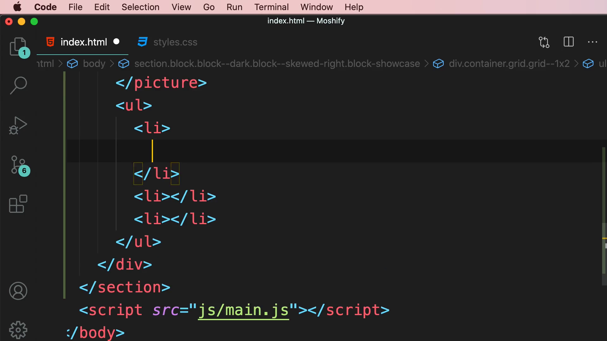

---

## 6. เขียน CSS ให้รูปภาพ `.block-showcase__image` (responsive width)

Mosh เพิ่ม CSS ให้รูปภาพแสดงเต็มความกว้างบนจอมือถือ แต่จำกัดขนาดสูงสุดบนจอ desktop:

```css
.block-showcase__image {
  width: 100%;
}

@media screen and (min-width: 768px) {
  .block-showcase__image {
    width: auto;
    max-width: 700px;
    justify-self: end;
  }

  .block-showcase__image > img {
    width: auto;
    max-width: 700px;
  }
}
```

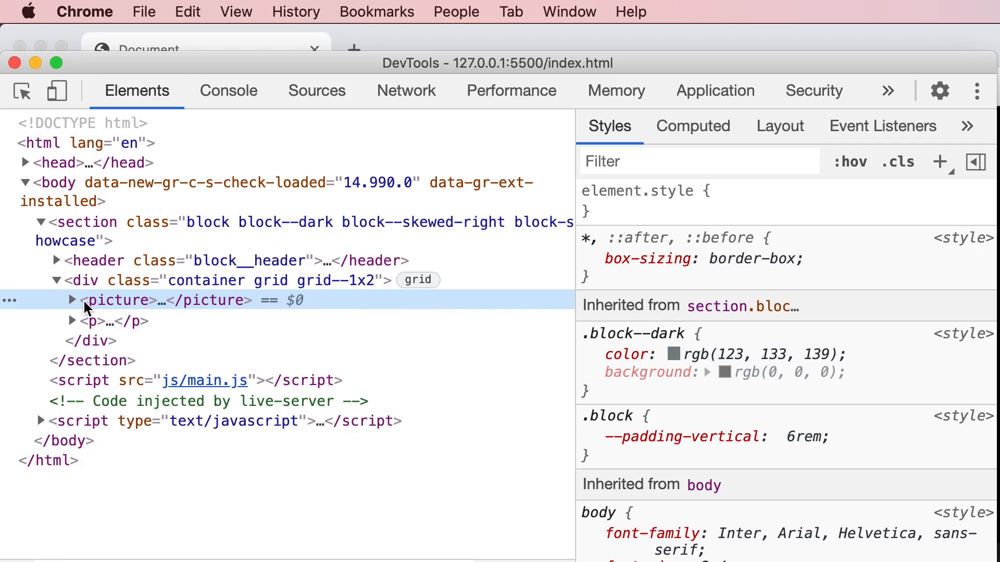

> 📌 `justify-self: end` ใช้จัดตำแหน่งรูปภาพให้ชิดขวาภายใน grid cell ของมัน เพื่อให้รูปอยู่ใกล้กับข้อความทางด้านขวามากขึ้นบนจอ desktop

Mosh ยังเพิ่ม CSS สำหรับ grid ของ section นี้โดยเฉพาะ เนื่องจาก `.block-showcase` ต้องการสัดส่วนคอลัมน์ 50/50 (ต่างจาก grid ปกติที่อาจเป็นสัดส่วนอื่น):

```css
@media screen and (min-width: 768px) {
  .block-showcase .grid {
    grid-template-columns: 50% 50%;
  }
}
```

---

## 7. แทนที่ข้อความ Lorem Ipsum ด้วย List รายการฟีเจอร์ (ul > li)

เดิมทีต่อจาก `<picture>` Mosh ใส่ `<p>Lorem ipsum...</p>` ไว้ก่อนชั่วคราวเพื่อทดสอบ layout แต่ในขั้นตอนนี้ Mosh **ลบ `<p>` ออก แล้วแทนที่ด้วย `<ul>`** ที่มี 3 `<li>` สำหรับรายการฟีเจอร์ทั้ง 3 ข้อ โดยใช้ Emmet abbreviation:

```
ul>li*3
```

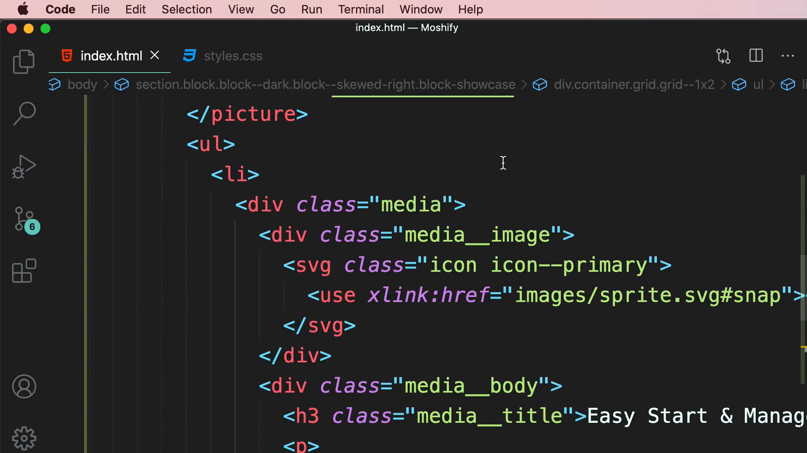

ผลลัพธ์ที่ได้:

```html
<ul>
  <li></li>
  <li></li>
  <li></li>
</ul>
```

---

## 8. สร้าง Media Component ซ้ำใน list แต่ละรายการ

ในแต่ละ `<li>` Mosh นำ **Media Object component** (component ที่เคยสร้างไว้ในไฟล์ `components/media.html` จากคลิปก่อนหน้านี้ในคอร์ส — ใช้กับ Testimonials Block) กลับมาใช้ซ้ำ โดยแต่ละ media ประกอบด้วยไอคอน SVG (จาก sprite) ด้านซ้าย และหัวข้อ + เนื้อหาด้านขวา:

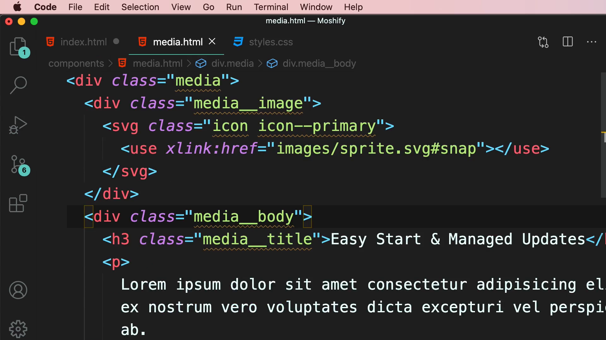

```html
<li>
  <div class="media">
    <div class="media__image">
      <svg class="icon icon--primary">
        <use xlink:href="images/sprite.svg#snap"></use>
      </svg>
    </div>
    <div class="media__body">
      <h3 class="media__title">Easy Start & Managed Updates</h3>
      <p>
        Lorem ipsum dolor sit amet consectetur adipisicing elit. Ex nostrum
        vero voluptates dicta excepturi vel perspiciatis ab.
      </p>
    </div>
  </div>
</li>
```

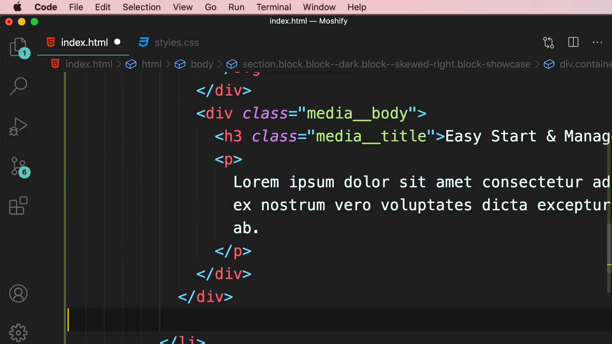

Mosh ใช้ icon จาก sprite sheet เดิม (`images/sprite.svg`) ที่มีไอคอนหลายแบบรวมอยู่ในไฟล์เดียว โดยอ้างอิงผ่าน `<use xlink:href="images/sprite.svg#snap">` — เปลี่ยนแค่ `#snap` เป็นชื่อไอคอนอื่นตามที่ต้องการในแต่ละรายการ (เช่น ไอคอนกราฟสำหรับ "Staging, Git & WP-CLI")

ทดสอบในเบราว์เซอร์ พบว่าไอคอนและข้อความแสดงถูกต้องแล้ว (ยังเป็น Lorem Ipsum อยู่):

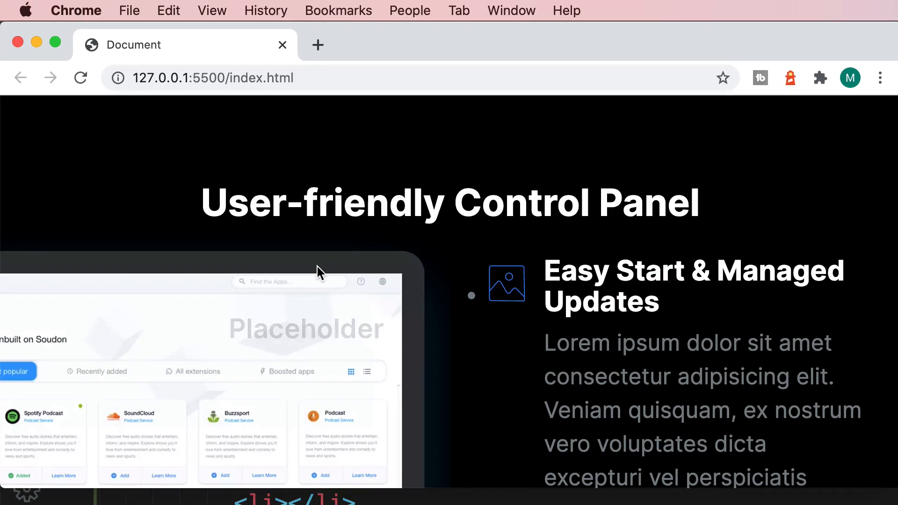

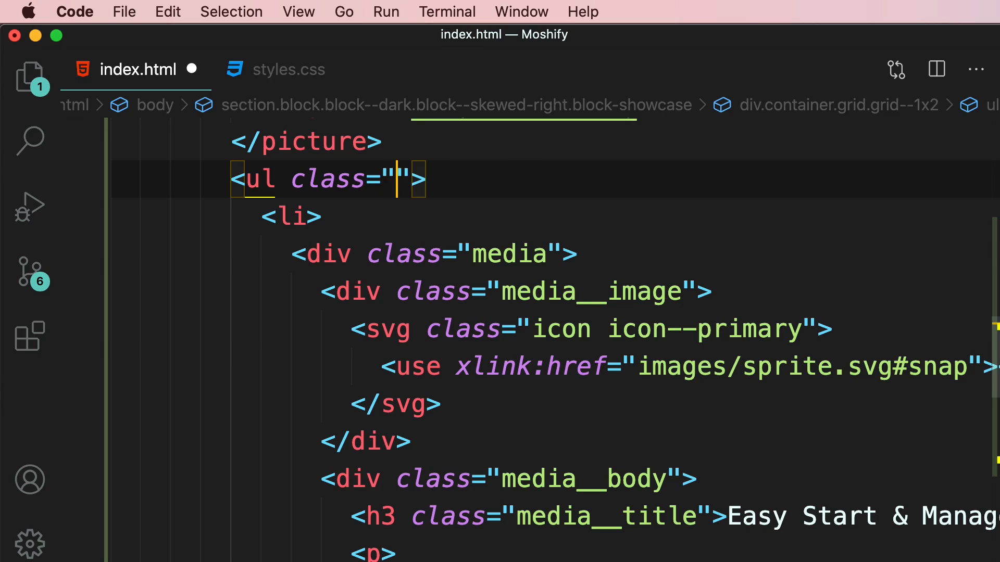

จากนั้น Mosh copy โครงสร้าง `<li>` นี้อีก 2 ชุด แล้วแก้ไข `xlink:href` และ `h3` ให้ตรงกับรายการที่ 2 (Staging, Git & WP-CLI) และรายการที่ 3 (Dynamic Caching & More)

---

## 9. เขียน CSS ให้ `<ul class="list">`

โดย default เบราว์เซอร์จะใส่ bullet point (`•`) และ padding ให้ `<ul>` มาโดยอัตโนมัติ ซึ่งไม่ตรงกับดีไซน์ Mosh จึงเพิ่ม class `list` ให้ `<ul>` แล้วเขียน CSS:

```css
/* Lists */
.list {
  list-style: none;
  padding-left: 0;
  color: var(--color-headings);
}
```

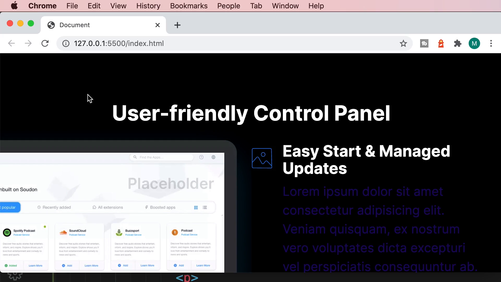

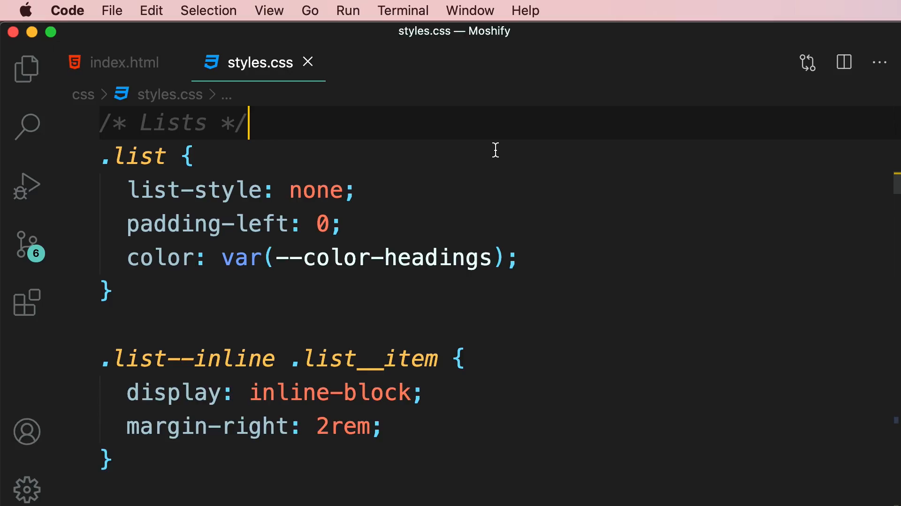

> 🔍 `list-style: none` เอา bullet point ออก และ `padding-left: 0` เอา indentation ที่เบราว์เซอร์ใส่ให้ default ออก ส่วน `color: var(--color-headings)` ใช้ CSS Custom Property (ตัวแปร CSS) ที่ประกาศไว้ตอนต้นไฟล์เพื่อให้สีของ list สอดคล้องกับสีหัวข้อ

นอกจากนี้ในไฟล์ยังมี class ที่เกี่ยวข้องซึ่งเคยสร้างไว้ก่อนหน้าและถูกนำมาอ้างอิงร่วมกัน เช่น `.list--inline` (แสดง list แบบแนวนอน) และ `.list--tick` (list ที่มีไอคอนถูกเป็นเครื่องหมายหน้ารายการ ใช้ใน Plans Block):

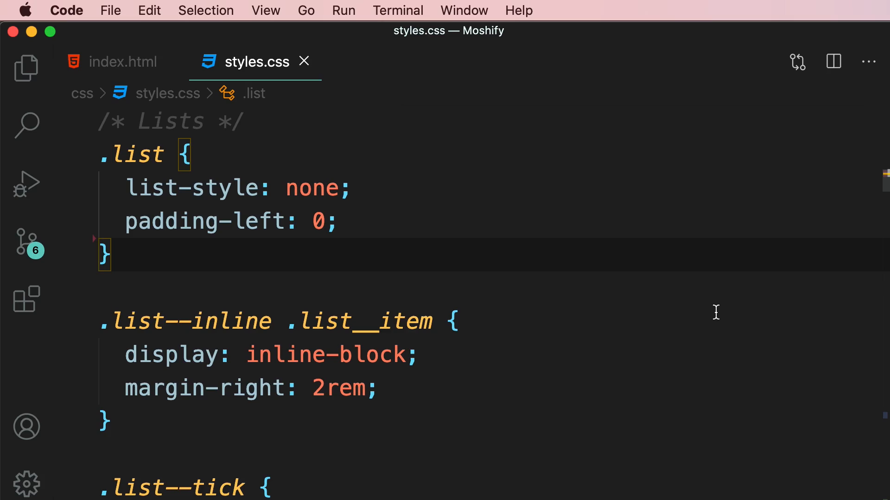

```css
.list--tick {
  list-style-image: url(../images/tick.svg);
  padding-left: 3rem;
  color: var(--color-headings);
}
```

CSS สำหรับ `.media` component ที่ใช้ซ้ำในแต่ละ `<li>` (สืบทอดมาจากคลิป Testimonials Block):

```css
/* Media */
.media {
  display: flex;
  margin-bottom: 4rem;
}

.media__title {
  margin-top: 0;
}

.media__body {
  margin: 0 2rem;
}
```

---

## 10. อัปเดตเนื้อหาจริง (Real Copy) จาก Photoshop

หลังจากวาง layout และ style เสร็จแล้ว Mosh กลับไปเปิด Photoshop (`mobile.psd`) เพื่อคัดลอกข้อความจริงจาก mockup มาแทนที่ Lorem Ipsum ในแต่ละรายการ:


ข้อความจริงที่ใช้:

> **Easy Start & Managed Updates**
> "Our cloud plans include easy onboarding for new and existing sites and managed WordPress and WooCommerce auto-updates."

> **Staging, Git & WP-CLI**
> "We make your WordPress and WooCommerce development flow easier with a convenient staging..."

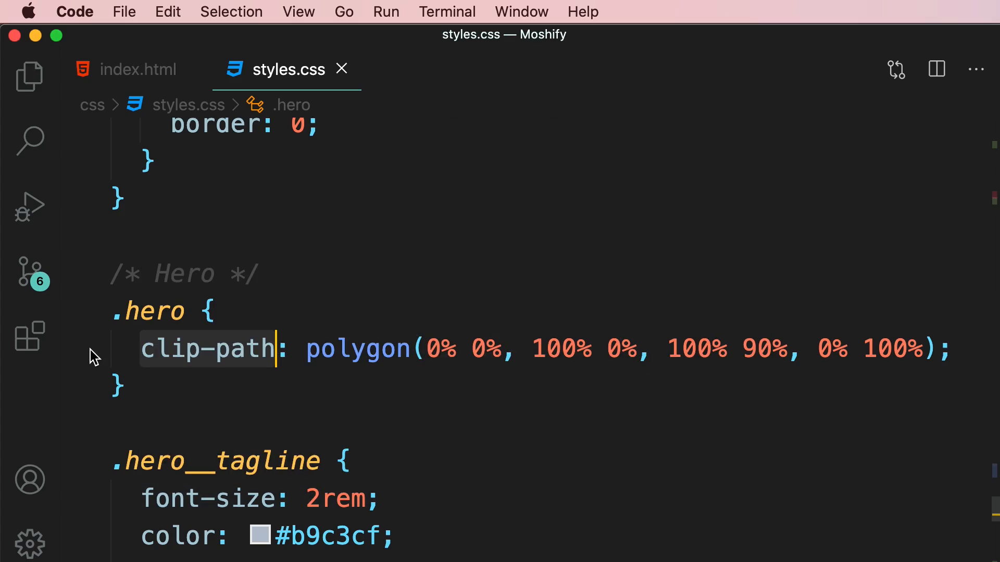

Mosh คัดลอกข้อความทีละรายการจาก Photoshop มาวางแทนที่ `<p>` ใน `media__body` ของแต่ละ `<li>` ในไฟล์ `index.html`:

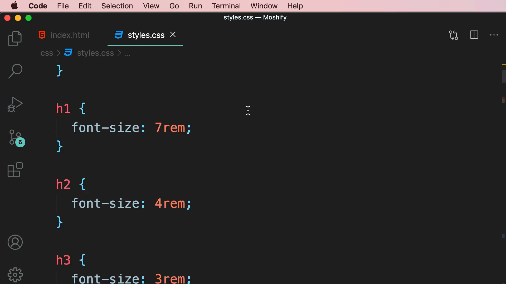

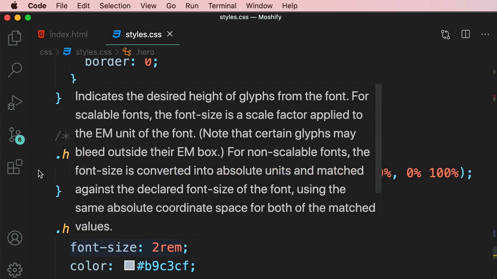

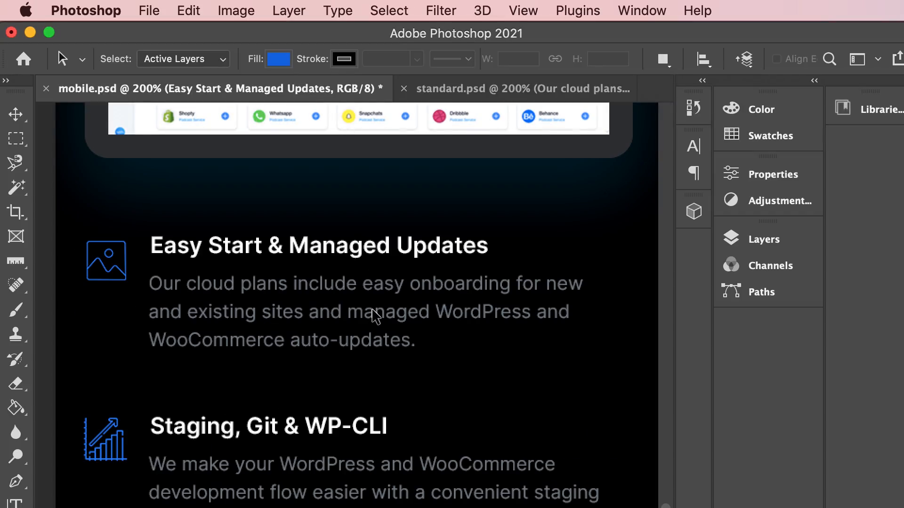

หลังอัปเดตข้อความจริงครบทั้ง 3 รายการแล้ว ทดสอบผลลัพธ์ในเบราว์เซอร์:

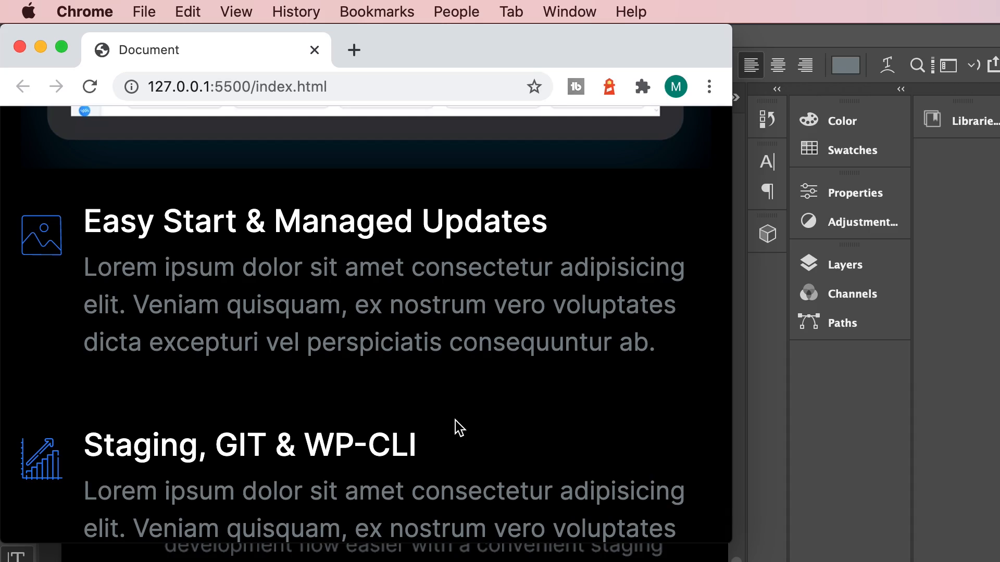

---

## 11. สร้างรูปทรงเฉียงด้วย `.block--skewed-right` (CSS `clip-path`)

จุดเด่นสำคัญที่สุดของคลิปนี้คือการสร้างขอบเฉียง (skewed edge) ที่ด้านล่างของ section โดยใช้ CSS property `clip-path` ร่วมกับฟังก์ชัน `polygon()`:

```css
.block--skewed-right {
  padding-bottom: calc(var(--padding-vertical) + 4rem);
  clip-path: polygon(0% 0%, 100% 0%, 100% 100%, 0% 80%);
}

.block--skewed-left {
  padding-bottom: calc(var(--padding-vertical) + 4rem);
  clip-path: polygon(0% 0%, 100% 0%, 100% 80%, 0% 100%);
}
```

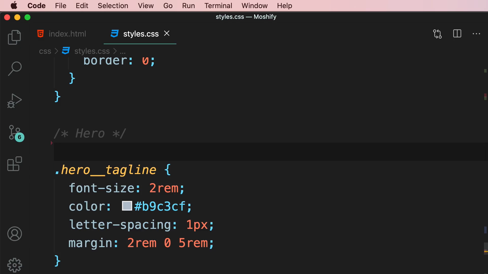

> 🔍 **หลักการทำงานของ `clip-path: polygon()`:** ค่าที่ใส่ในวงเล็บคือชุดของจุดพิกัด (x%, y%) ที่ใช้ "ตัด" element ให้เหลือเฉพาะพื้นที่ภายในรูปหลายเหลี่ยมที่ลากผ่านจุดเหล่านั้น
> - จุดที่ 1: `0% 0%` = มุมบนซ้าย
> - จุดที่ 2: `100% 0%` = มุมบนขวา
> - จุดที่ 3: `100% 100%` = มุมล่างขวา (เต็มความสูง)
> - จุดที่ 4: `0% 80%` = มุมล่างซ้าย แต่อยู่ที่ 80% ของความสูง (ไม่ใช่ 100%) — จุดนี้เองที่ทำให้ขอบล่างเอียงจากซ้ายไปขวา (สูงด้านซ้าย ต่ำด้านขวา)
>
> สำหรับ `.block--skewed-left` สลับตำแหน่งจุดที่ 3 และ 4 เพื่อให้ความเอียงกลับทิศทาง (สูงด้านขวา ต่ำด้านซ้าย) สำหรับใช้กับ section อื่นในหน้าเว็บที่ต้องการทิศทางตรงข้าม

> 📌 `padding-bottom: calc(var(--padding-vertical) + 4rem)` เพิ่ม padding ด้านล่างให้มากกว่าปกติ (`--padding-vertical` เป็นตัวแปรที่ใช้กับทุก `.block`) เพื่อชดเชยพื้นที่ที่ถูกตัดหายไปจาก `clip-path` ไม่ให้เนื้อหาถูกตัดขาดไปด้วย

ทดสอบผลลัพธ์ในเบราว์เซอร์ พบว่าขอบล่างของ section สีดำเอียงเป็นเส้นทแยงมุมสวยงาม ต่อเนื่องกับ section ถัดไปที่เป็นพื้นหลังสีขาว

---

## 12. ปรับ Typography พื้นฐานของหน้าเว็บ (เพิ่มเติม)

ระหว่างคลิป Mosh ยังทบทวน/ปรับปรุงกฎ CSS พื้นฐานเกี่ยวกับ typography ที่ใช้ทั่วทั้งเว็บไซต์:

```css
/* Typography */
html {
  /* 62.5% of 16px = 10px */
  font-size: 62.5%;
}

body {
  font-family: Inter, Arial, Helvetica, sans-serif;
  font-size: 2.4rem;
  line-height: 1.5;
  color: var(--color-body);
}
```

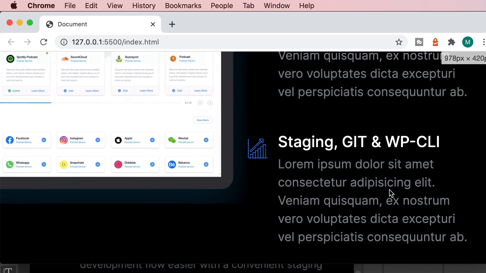

> 💡 เทคนิค `font-size: 62.5%` บน `html` เป็นเทคนิคที่นิยมใช้กันมากในการเขียน CSS เพราะ browser default font-size คือ `16px` การตั้งเป็น `62.5%` จะทำให้ `1rem = 10px` พอดี (16 × 0.625 = 10) ทำให้คำนวณขนาดฟอนต์ต่าง ๆ ด้วยหน่วย `rem` ง่ายขึ้นมาก เช่น `2.4rem = 24px`

นอกจากนี้ยังมีการเพิ่ม pseudo-element `::selection` เพื่อกำหนดสีพื้นหลังเมื่อผู้ใช้ลากเลือกข้อความ (text selection):

```css
::selection {
  background: ...;
}
```

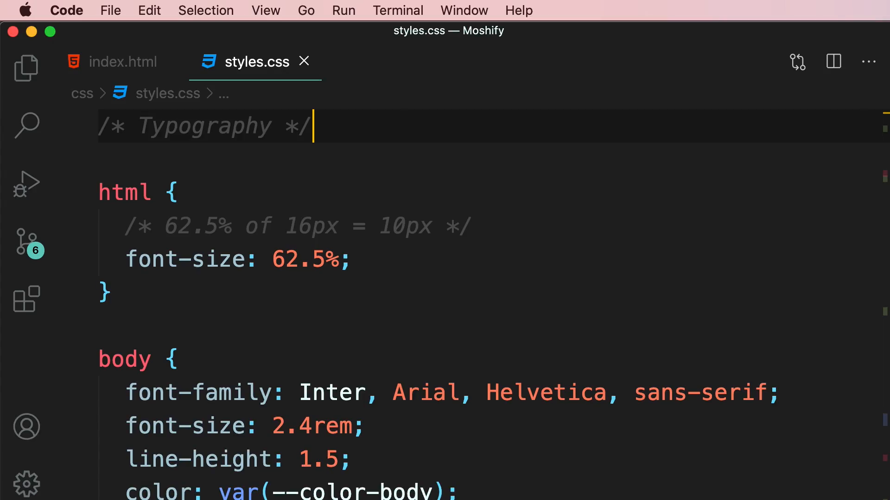

---

## ผลลัพธ์สุดท้ายในเบราว์เซอร์

หลังจากทำครบทุกขั้นตอน Showcase Block แสดงผลเป็น section พื้นหลังสีดำ มีขอบล่างเอียง, ภาพ iPad อยู่ทางซ้าย, หัวข้อ "User-friendly Control Panel" และ list รายการฟีเจอร์ 3 ข้อพร้อมไอคอนและเนื้อหาจริงทางด้านขวา

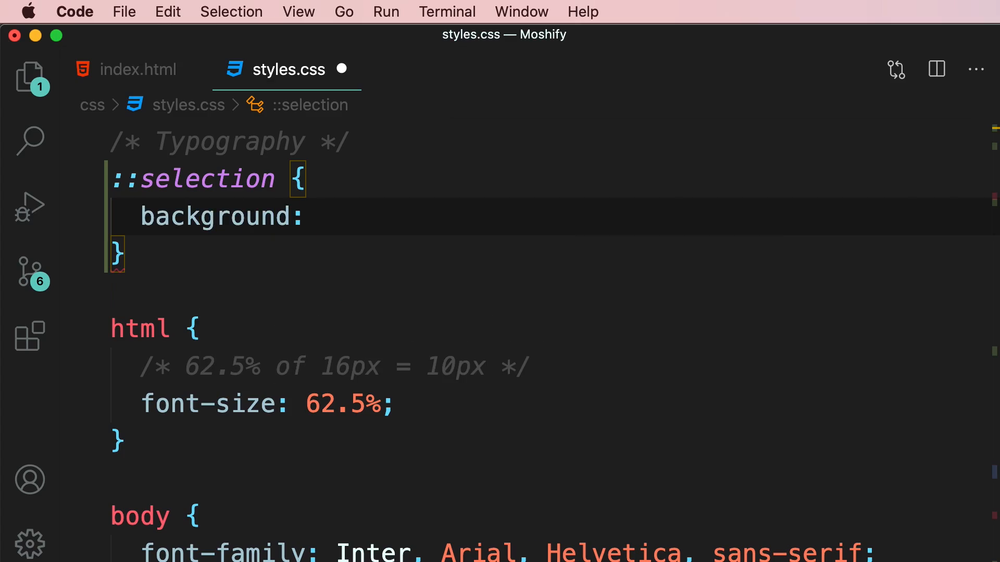

---

## สรุปภาพรวมของคลิปนี้

| หัวข้อ | รายละเอียด |
|---|---|
| Section ที่สร้าง | Showcase Block ("User-friendly Control Panel") |
| Class modifier ใหม่ | `.block--dark`, `.block--skewed-right`, `.block--skewed-left` |
| เทคนิค CSS หลัก | `clip-path: polygon()` สำหรับตัดขอบเฉียง |
| Component ที่ใช้ซ้ำ | Media Object (`.media`, `.media__image`, `.media__body`) จาก Testimonials Block |
| รูปภาพ | `<picture>` + `<source>` (webp/png, 1x/2x) responsive image |
| Layout | `.container.grid.grid--1x2` พร้อม media query ปรับสัดส่วนคอลัมน์ 50/50 ที่ 768px |
| List | `<ul class="list">` เอา bullet ออก ใช้ icon SVG จาก sprite แทน |

**แนวคิดสำคัญที่ได้จากคลิปนี้**

1. การสร้าง dark theme section ด้วย modifier class `.block--dark` และการ override สี heading ให้เป็นสีขาวเมื่อพื้นหลังเข้ม
2. เทคนิค `clip-path: polygon()` สำหรับสร้างรูปทรงเฉียง (skewed shape) ที่ขอบของ section ซึ่งเป็นเทคนิค CSS ขั้นสูงที่ทำให้ดีไซน์มีมิติมากขึ้น
3. การคำนวณ `padding-bottom` ด้วย `calc()` เพื่อชดเชยพื้นที่ที่ clip-path ตัดออกไป ป้องกันเนื้อหาถูกตัดขาด
4. การนำ component (`.media`) ที่เคยสร้างไว้แล้วในคลิปก่อนหน้ามาใช้ซ้ำ (reusability) แทนที่จะเขียนโครงสร้างใหม่ทั้งหมด
5. การใช้ `<picture>` + `<source>` ร่วมกับ srcset 1x/2x เพื่อ responsive image ที่รองรับทั้ง format และความละเอียดหน้าจอ
6. เทคนิค `font-size: 62.5%` บน `html` เพื่อให้หน่วย `rem` คำนวณง่าย (1rem = 10px)

---

*บทเรียนนี้เป็นส่วนหนึ่งของคอร์ส "Building a Web Site" โดย Mosh Hamedani (codewithmosh.com) — คลิปที่ 34*
