# HTML-CSS-3: 35 - Testimonials Block

**ไฟล์ต้นฉบับ:** "35- Testimonials Block.mp4"

---

## ภาพรวมคลิปนี้

คลิปนี้เป็นคลิปสั้น ๆ ที่ Mosh สอนการสร้าง **Testimonials Block** — section ที่แสดงคำรีวิว/ความคิดเห็นจากลูกค้า ("What our Customers are Saying") จุดที่น่าสนใจคือ Mosh **ไม่ได้เขียนโครงสร้าง card คำรีวิวใหม่ตั้งแต่ต้น** แต่นำ component ที่มีอยู่แล้วในโปรเจกต์ (ไฟล์ `components/testimonials.html`) มาวางใช้ซ้ำโดยตรง ซึ่งสะท้อนแนวคิดสำคัญเรื่อง **component reusability** ที่ Mosh เน้นย้ำมาตลอดทั้งคอร์ส

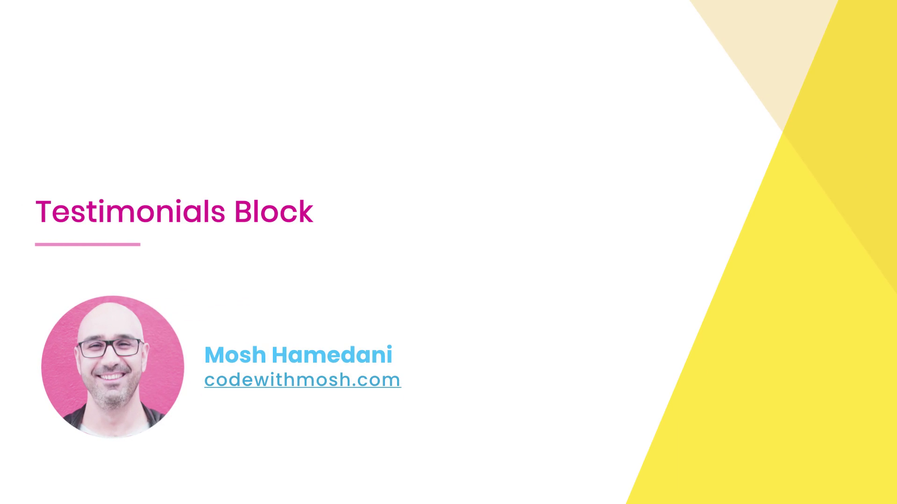

> 💡 คลิปนี้แสดงให้เห็นประโยชน์ของการแยกส่วนประกอบ (component) ออกเป็นไฟล์ HTML แยกต่างหากตั้งแต่ต้น — เมื่อถึงเวลาต้องใช้ card แบบเดียวกันในหลาย section ก็แค่ copy-paste โค้ดจากไฟล์ component มาวางแทนที่จะพิมพ์ใหม่ทั้งหมด

---

## 1. สร้างโครงสร้าง Section ด้วย Emmet

Mosh เริ่มต้นด้วยการพิมพ์ Emmet abbreviation ในไฟล์ `index.html`:

```
section.block
```

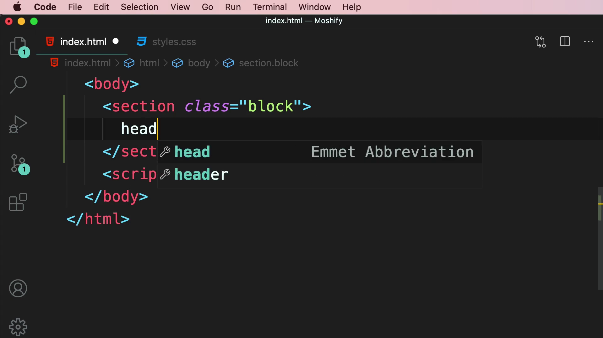

กด Tab ได้ผลลัพธ์:

```html
<section class="block"></section>
```

จากนั้นพิมพ์ Emmet ต่อภายใน section:

```
header.block__header
```

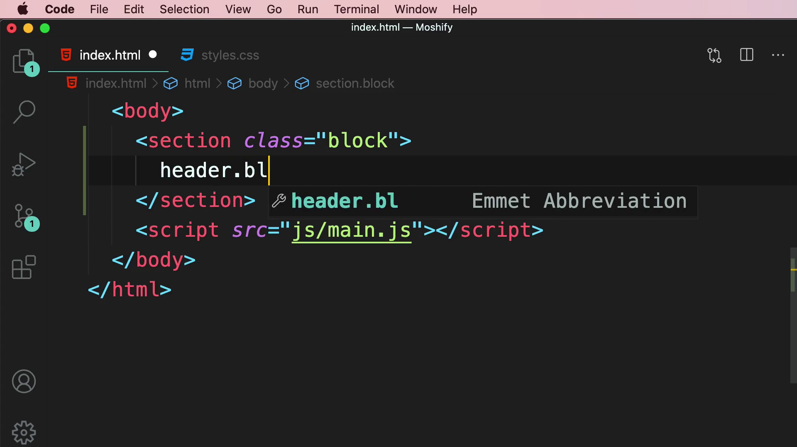

ได้ผลลัพธ์:

```html
<section class="block">
  <header class="block__header"></header>
</section>
```

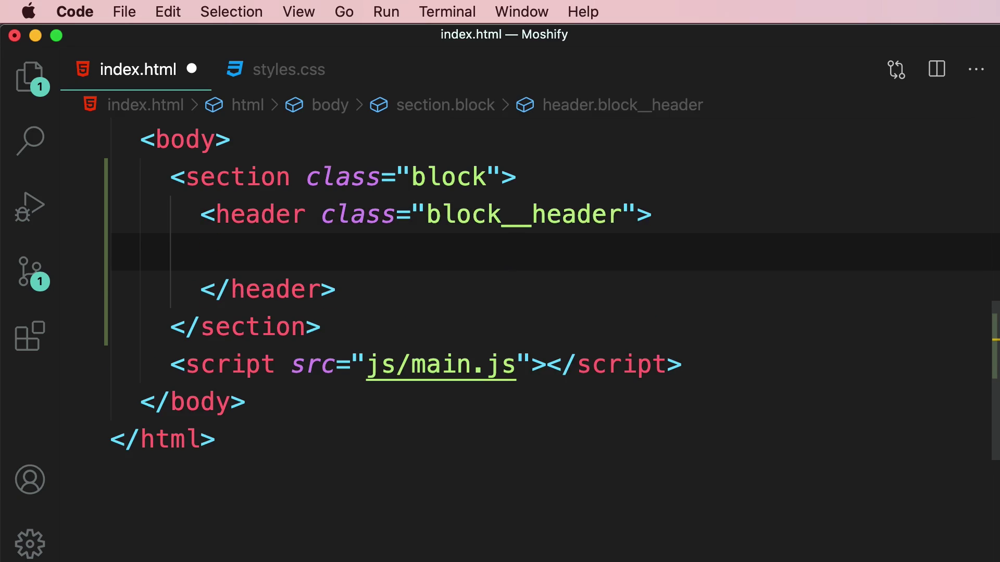

> 📌 รูปแบบนี้เป็นรูปแบบมาตรฐานที่ Mosh ใช้สร้างทุก section ในคอร์ส (Plans Block, Features Block, Showcase Block ฯลฯ) คือเริ่มจาก `<section class="block">` ตามด้วย `<header class="block__header">` ที่ครอบหัวข้อและคำอธิบายสั้น ๆ ของ section นั้น

---

## 2. เพิ่มหัวข้อและคำอธิบาย

ภายใน `<header>` Mosh เพิ่ม `<h2>` สำหรับหัวข้อหลัก:

```html
<h2>What our Customers are Saying</h2>
```

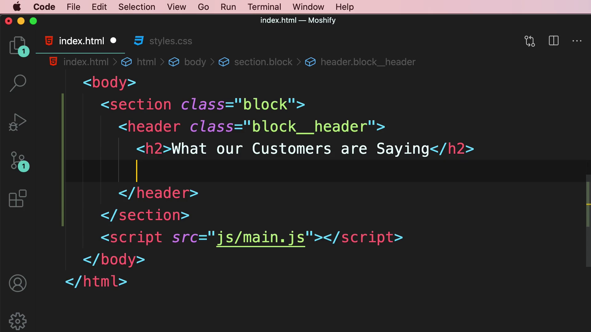

จากนั้นเพิ่ม `<p>` ด้วย Emmet abbreviation `lorem10` เพื่อ generate ข้อความ Lorem Ipsum ความยาว 10 คำสำหรับใช้เป็นคำอธิบายรองชั่วคราว:

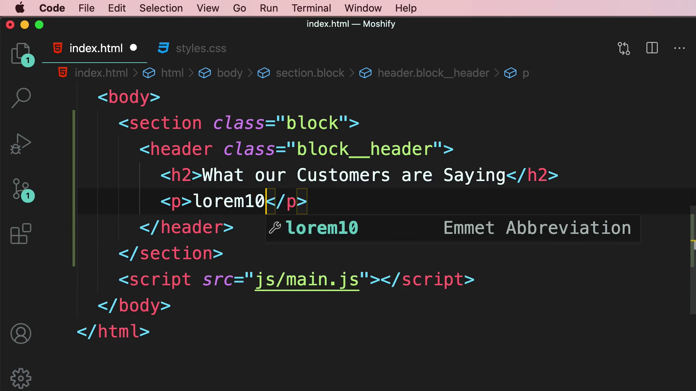

```html
<header class="block__header">
  <h2>What our Customers are Saying</h2>
  <p>
    Lorem ipsum dolor sit amet, consectetur adipisicing elit. Aut, ipsam.
  </p>
</header>
```

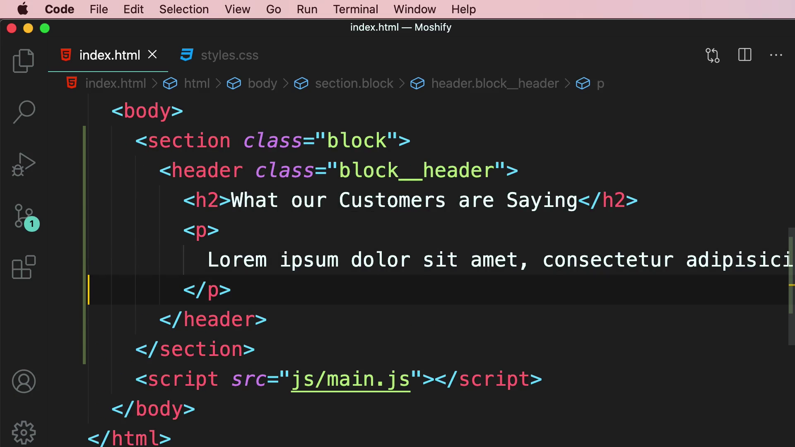

> 🔍 เทคนิค Emmet `lorem10` เป็นเทคนิคที่ Mosh ใช้ซ้ำหลายครั้งตลอดคอร์สเพื่อ generate ข้อความ placeholder อย่างรวดเร็วโดยไม่ต้องพิมพ์หรือ copy ข้อความยาว ๆ มาเอง — ตัวเลขท้าย `lorem` กำหนดจำนวนคำโดยประมาณ

---

## 3. เพิ่ม Container สำหรับใส่ Testimonial Card

ต่อจาก `</header>` Mosh เพิ่ม `<div class="container">` เพื่อเป็นกรอบสำหรับใส่ testimonial card:

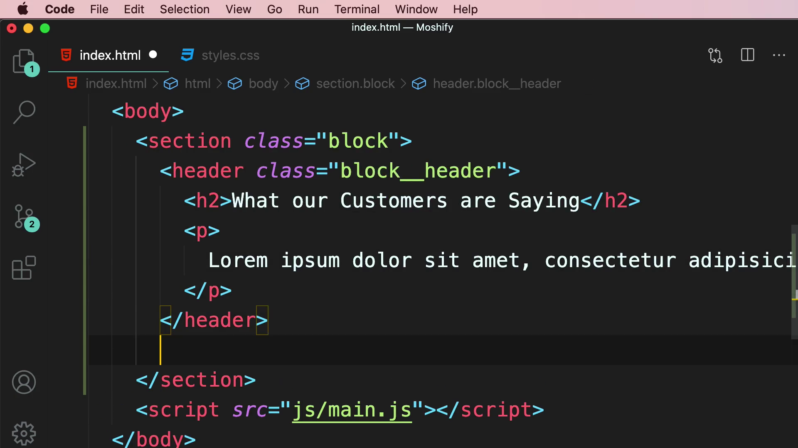

```html
<section class="block">
  <header class="block__header">
    <h2>What our Customers are Saying</h2>
    <p>
      Lorem ipsum dolor sit amet, consectetur adipisicing elit. Aut, ipsam.
    </p>
  </header>
  <div class="container"></div>
</section>
```

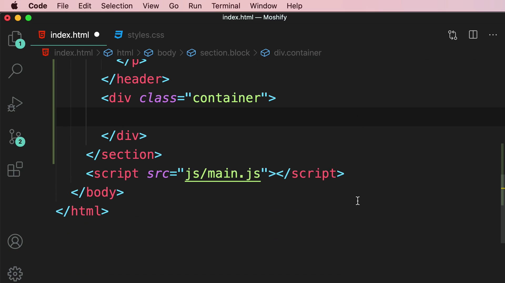

---

## 4. นำ Component `testimonials.html` มาใช้ซ้ำ

แทนที่จะเขียนโครงสร้าง testimonial card ขึ้นใหม่ Mosh เปิด Command Palette ของ VS Code (Cmd+P) แล้วค้นหาไฟล์ `testimonials.html` ที่อยู่ในโฟลเดอร์ `components` ซึ่งเป็นไฟล์ที่เก็บโค้ดตัวอย่าง component ต่าง ๆ ที่เคยสร้างไว้ในคอร์ส (เช่น `media.html`, `block-showcase.html`, `block-features.html`, `features.html`)

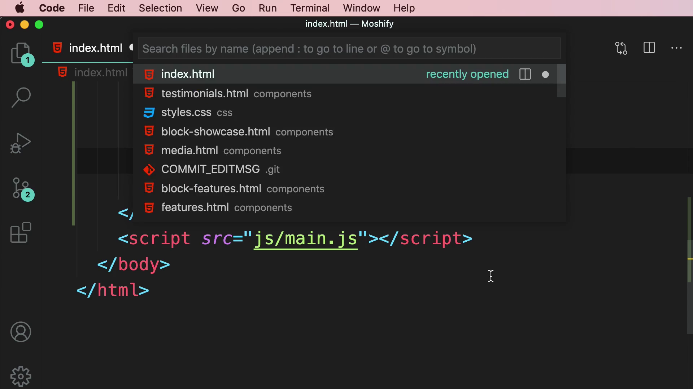

เปิดไฟล์ `testimonials.html` ขึ้นมาดูโครงสร้างที่มีอยู่แล้ว:

```html
<div class="card testimonial">
  <div class="grid grid--1x2">
    <div class="testimonial__image">
      
      <span class="icon-container icon-container--accent">
        <svg class="icon icon--white icon--small">
          <use xlink:href="images/sprite.svg#quotes"></use>
        </svg>
      </span>
    </div>
    <blockquote class="quote">
      <p class="quote__text">
        "Lorem, ipsum dolor sit amet consectetur adipisicing elit. Incidunt
        optio officiis dolore earum error eaque perferendis laudantium sed
        praesentium dolorum."
      </p>
      <footer>
        <div class="media">
          <div class="media__image">
            <svg class="icon icon--primary quote__line">
              <use xlink:href="images/sprite.svg#line"></use>
            </svg>
          </div>
          <div class="media__body">
            <h3 class="media__title quote__author">John Smith</h3>
            <p class="quote__organization">ABC Company</p>
          </div>
        </div>
      </footer>
    </blockquote>
  </div>
</div>
```

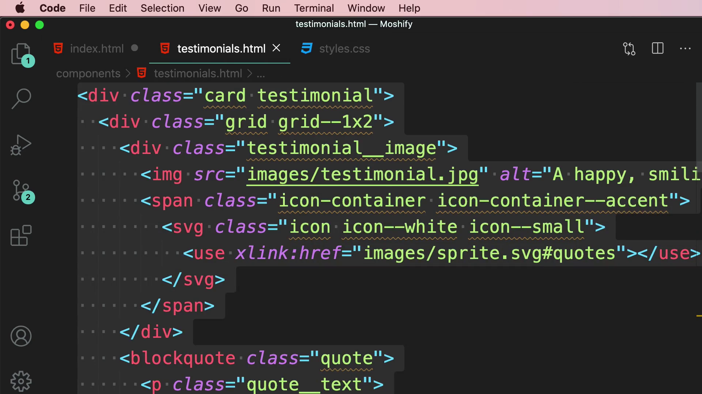

> 🔧 โครงสร้างของ testimonial card ประกอบด้วยส่วนสำคัญ:
> - `.testimonial__image` — รูปภาพลูกค้าพร้อม icon เครื่องหมายคำพูด (quotes) วางซ้อนทับมุมขวาล่างของรูป โดยใช้ `.icon-container--accent` (พื้นหลังวงกลมสีแดง/accent)
> - `<blockquote class="quote">` — ใช้ HTML tag ที่ถูกต้องตามความหมาย (semantic) สำหรับข้อความอ้างอิงคำพูด
> - `.quote__text` — ข้อความคำรีวิว
> - `<footer>` ภายใน blockquote ที่มี Media Object component (`.media`) ซ้อนอยู่อีกชั้น ใช้แสดงชื่อผู้พูด (`.quote__author`) และชื่อองค์กร (`.quote__organization`)

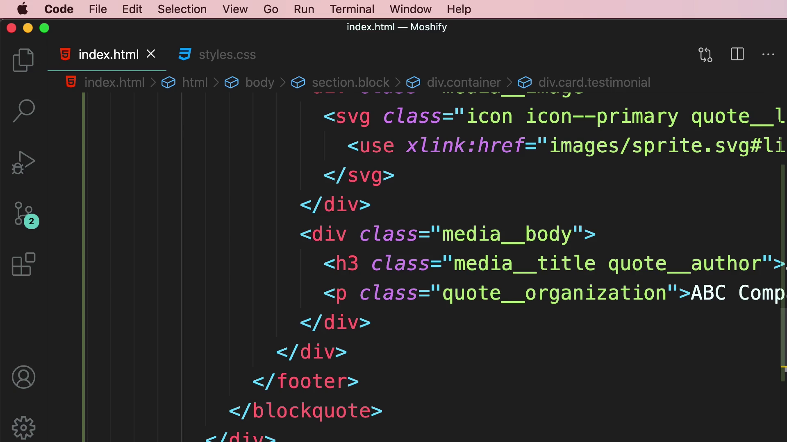

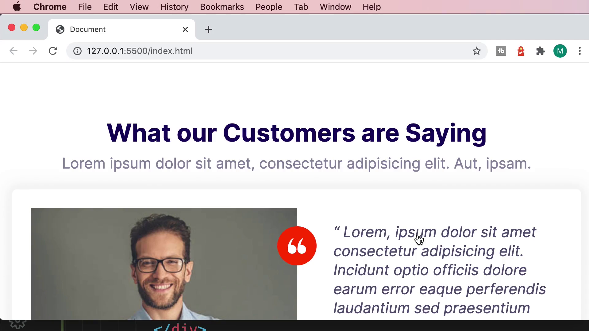

> 📝 Mosh copy โค้ดทั้งหมดจากไฟล์ `testimonials.html` แล้ววางไว้ภายใน `<div class="container">` ที่สร้างไว้ในขั้นตอนก่อนหน้า ไม่มีการแก้ไขโครงสร้างใด ๆ เพิ่มเติม เพราะ CSS ของ `.card`, `.testimonial`, `.quote`, `.media` ทั้งหมดถูกเขียนไว้เรียบร้อยแล้วตั้งแต่คลิปก่อน ๆ ในคอร์ส

---

## 5. ทดสอบผลลัพธ์ในเบราว์เซอร์

หลังวางโค้ด component แล้ว Mosh บันทึกไฟล์และรีเฟรชเบราว์เซอร์ (ผ่าน Live Server) ทันทีก็เห็นผลลัพธ์ testimonial card แสดงผลถูกต้องสมบูรณ์ เพราะ CSS ถูกเตรียมไว้แล้วล่วงหน้า:

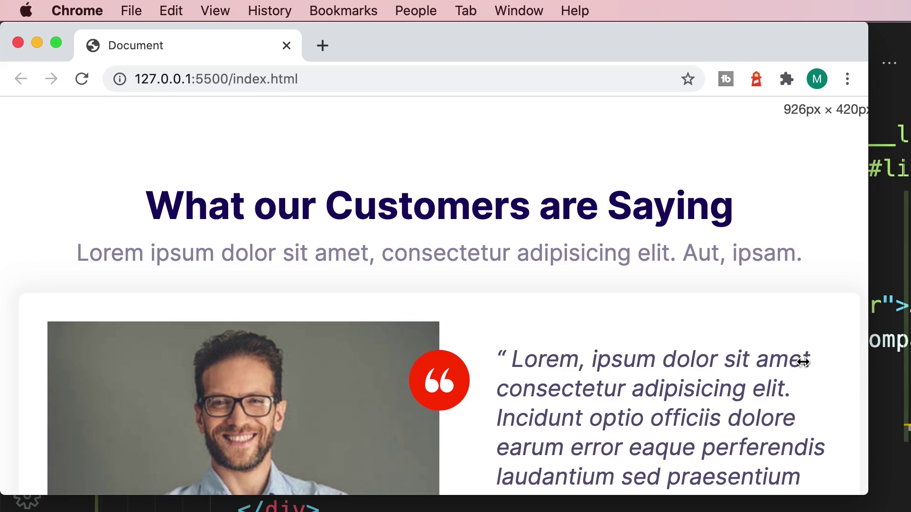

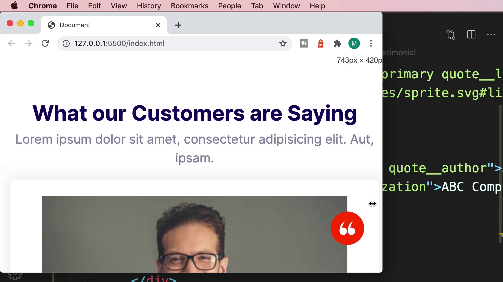

Mosh ซูมเข้าไปตรวจสอบรายละเอียดของ card ทีละส่วน เริ่มจากรูปภาพลูกค้าพร้อมไอคอนเครื่องหมายคำพูดสีแดงที่มุมขวาล่าง:

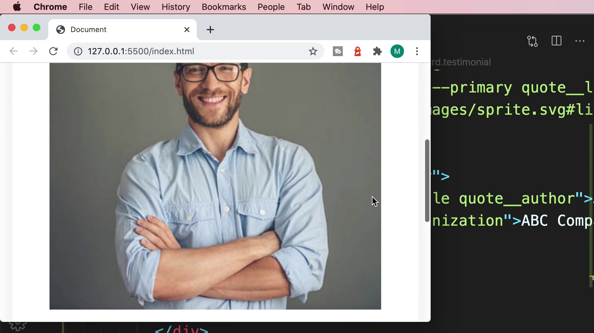

ตามด้วยข้อความคำรีวิว (Lorem Ipsum) และชื่อผู้รีวิว "John Smith":

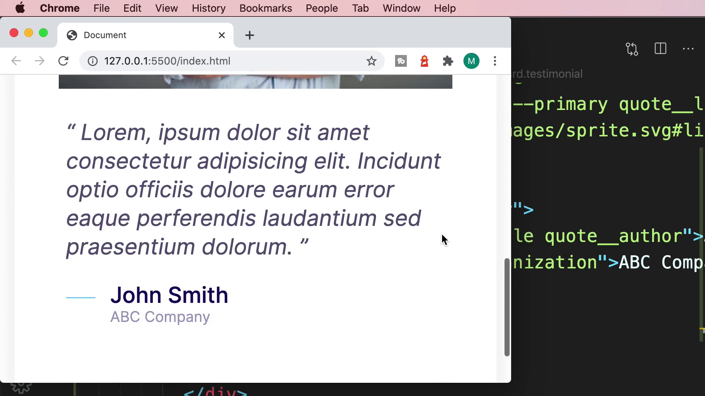

และชื่อองค์กร "ABC Company" ที่อยู่ใต้ชื่อผู้รีวิว:

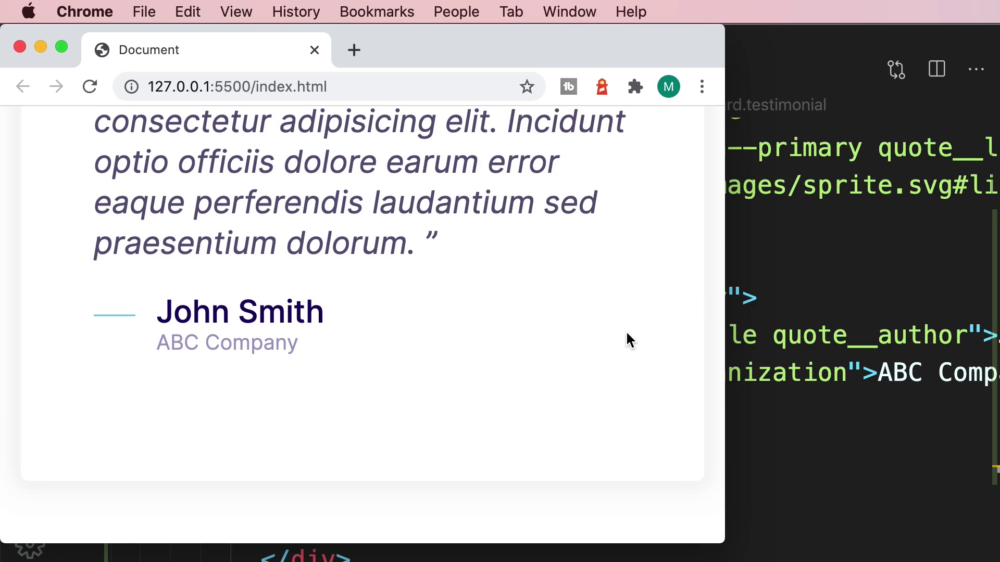

ภาพรวมทั้ง section หลังแสดงผลครบถ้วน:

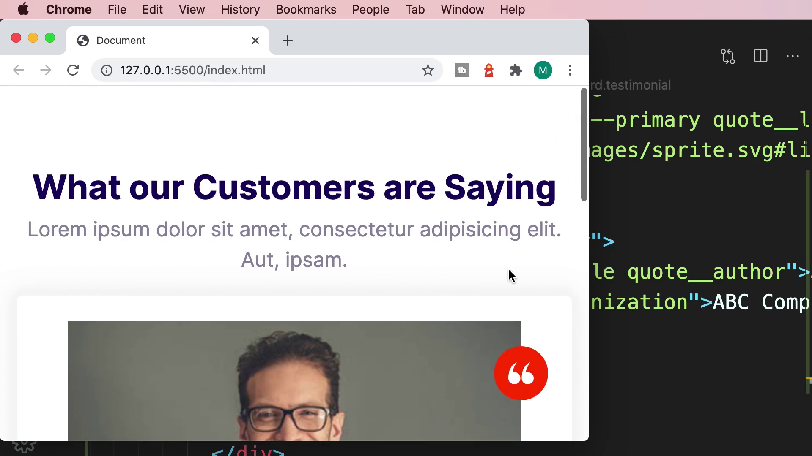

---

## 6. ปรับแต่ง CSS เพิ่มเติมให้ `.block__header`

เนื่องจากระยะห่างระหว่างหัวข้อ (`.block__header`) กับ testimonial card ด้านล่างยังชิดกันเกินไป Mosh จึงสลับไปที่ไฟล์ `styles.css` เพื่อเพิ่ม CSS property `margin-bottom` ให้กับ `.block__header`:

```css
.block__header {
  text-align: center;
  margin-bottom: 4rem;
}
```

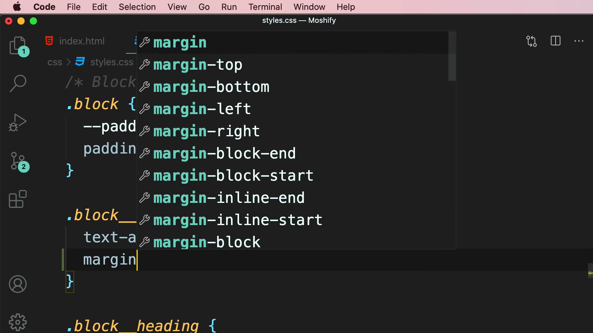

> ⚠️ ก่อนหน้านี้ CSS ของ `.block__header` มีเพียง `text-align: center` เท่านั้น (ใช้จัดกึ่งกลางหัวข้อและคำอธิบาย) การเพิ่ม `margin-bottom: 4rem` ทำให้มีระยะห่างจาก card ด้านล่างมากขึ้น ทำให้ layout ดูโปร่งและอ่านง่ายขึ้น ซึ่งเป็น CSS rule ที่มีผลกับ `.block__header` ของ**ทุก section** ในเว็บไซต์ ไม่ใช่แค่ Testimonials Block เท่านั้น

ทดสอบผลลัพธ์อีกครั้งหลังปรับ CSS:

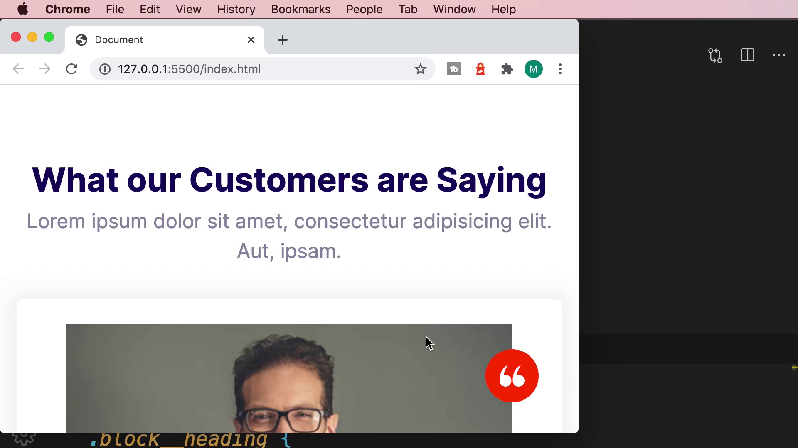

---

## ผลลัพธ์สุดท้ายในเบราว์เซอร์

Testimonials Block แสดงผลสมบูรณ์: หัวข้อ "What our Customers are Saying" พร้อมคำอธิบายรองอยู่กึ่งกลาง ตามด้วย testimonial card ที่มีระยะห่างที่เหมาะสม ประกอบด้วยรูปลูกค้า ไอคอนเครื่องหมายคำพูด ข้อความรีวิว และข้อมูลผู้รีวิว

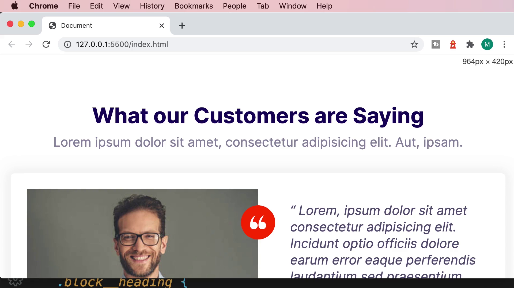

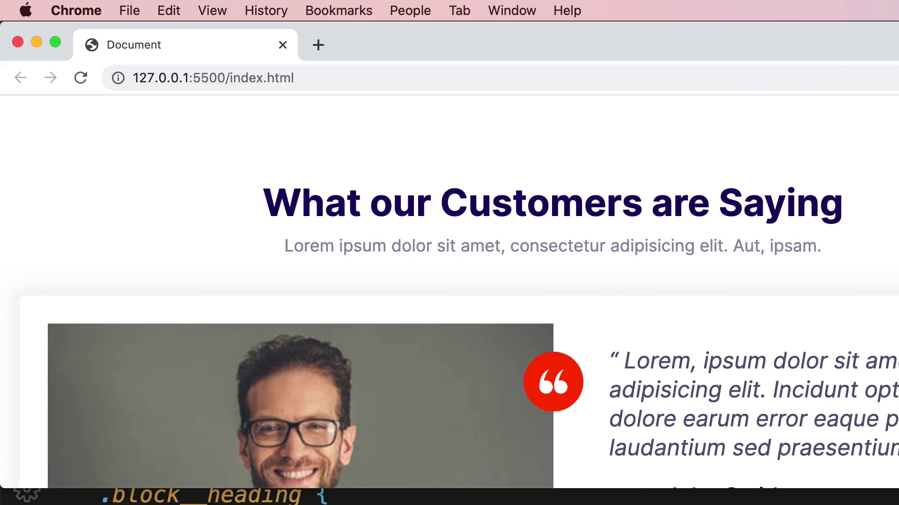

---

## สรุปภาพรวมของคลิปนี้

| หัวข้อ | รายละเอียด |
|---|---|
| Section ที่สร้าง | Testimonials Block ("What our Customers are Saying") |
| วิธีการหลัก | นำ component `testimonials.html` ที่มีอยู่แล้วมาวางใช้ซ้ำ (copy-paste) |
| โครงสร้างหลัก | `.card.testimonial` > `.grid.grid--1x2` > `.testimonial__image` + `<blockquote class="quote">` |
| Component ที่ซ้อนอยู่ภายใน | Media Object (`.media`, `.media__body`) สำหรับแสดงชื่อผู้รีวิวและองค์กร |
| Semantic HTML | ใช้ `<blockquote>` และ `<footer>` ตามความหมายที่ถูกต้อง |
| CSS ที่เพิ่ม | `.block__header { margin-bottom: 4rem; }` |

**แนวคิดสำคัญที่ได้จากคลิปนี้**

1. หลักการ **component reusability** — เมื่อสร้างส่วนประกอบ (เช่น testimonial card) ไว้ในไฟล์ component แยกต่างหากแล้ว การนำมาใช้ใน section ใหม่ทำได้เพียง copy-paste โดยไม่ต้องเขียน HTML หรือ CSS ใหม่
2. การใช้ Emmet abbreviation (`section.block`, `header.block__header`, `lorem10`) เพื่อสร้างโครงสร้างพื้นฐานของ section อย่างรวดเร็ว ซึ่งเป็นรูปแบบเดียวกับที่ใช้ในทุก section ก่อนหน้า
3. การใช้ HTML แบบ semantic ที่ถูกต้อง เช่น `<blockquote>` สำหรับข้อความอ้างอิงคำพูด และ `<footer>` สำหรับข้อมูลประกอบท้าย quote
4. การซ้อน component ย่อยภายใน component ใหญ่ (Media Object ซ้อนอยู่ใน testimonial card) แสดงให้เห็นว่า component สามารถประกอบกันเป็นชั้น ๆ ได้ (composition)
5. CSS ที่เขียนไว้ล่วงหน้าสำหรับ class ที่ใช้ร่วมกัน (`.block__header`, `.card`, `.media`) ช่วยให้ section ใหม่แสดงผลถูกต้องได้ทันทีโดยแทบไม่ต้องเขียน CSS เพิ่ม

---

*บทเรียนนี้เป็นส่วนหนึ่งของคอร์ส "Building a Web Site" โดย Mosh Hamedani (codewithmosh.com) — คลิปที่ 35*
