# HTML-CSS-3: 37 - Putting It All Together

**ไฟล์ต้นฉบับ:** "37- Putting It All Together.mp4"

---

## ภาพรวมคลิปนี้

คลิปนี้เป็นคลิป **สรุปรวมทุกอย่างเข้าด้วยกัน (Putting It All Together)** หลังจากที่ตลอดคอร์ส Mosh สอนสร้าง component ต่าง ๆ แยกกันไว้ในไฟล์ `components/*.html` (เช่น `navbar.html`, `block-hero.html`, `block-domain.html`, `block-plans.html`, `block-features.html`, `block-showcase.html`, `block-testimonials.html`, `block-footer.html`) คลิปนี้ Mosh จะนำ component เหล่านั้นมา**ประกอบรวมกันเป็นหน้าเว็บ `index.html` ที่สมบูรณ์** ทีละส่วน ตั้งแต่ Navbar, Hero Section ไปจนถึง Domain Section แล้วทดสอบผลลัพธ์ผ่าน Chrome DevTools Device Toolbar ในหลายขนาดหน้าจอ

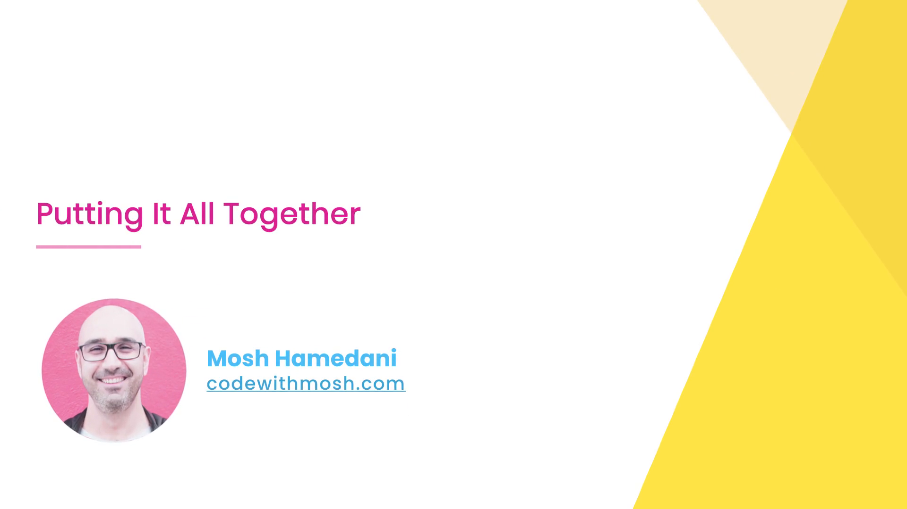

> 💡 นี่คือจุดที่แสดงให้เห็นคุณค่าของแนวทาง **component-based development** ที่ Mosh ใช้สอนมาตลอดคอร์ส — เมื่อแต่ละ section ถูกสร้างและทดสอบแยกกันไว้อย่างดีแล้ว การประกอบเป็นหน้าเว็บจริงจึงทำได้รวดเร็วมาก เพียงแค่ copy-paste โค้ดจากไฟล์ component มาวางเรียงต่อกันใน `index.html`

---

## 1. ทบทวนดีไซน์ทั้งหมดใน Photoshop

Mosh เปิดไฟล์ Photoshop `standard.psd` และ `mobile.psd` ทวนดูภาพรวมของหน้าเว็บทั้งหมดอีกครั้ง ทั้งเวอร์ชัน mobile และ desktop เพื่อดูว่า section ต่าง ๆ เรียงต่อกันอย่างไรก่อนเริ่มประกอบ

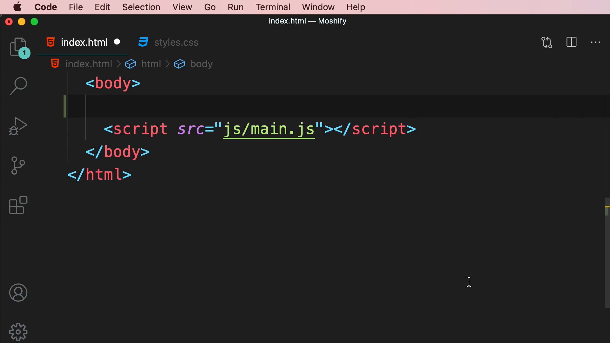

---

## 2. เริ่มต้นจากไฟล์ index.html เปล่า

Mosh เปิดไฟล์ `index.html` ที่มีเพียงโครงสร้าง HTML พื้นฐาน (`<body>`, `<script src="js/main.js">`) แล้วเริ่มเพิ่ม `<header>` element เปล่า ๆ ไว้เป็นจุดเริ่มต้น:

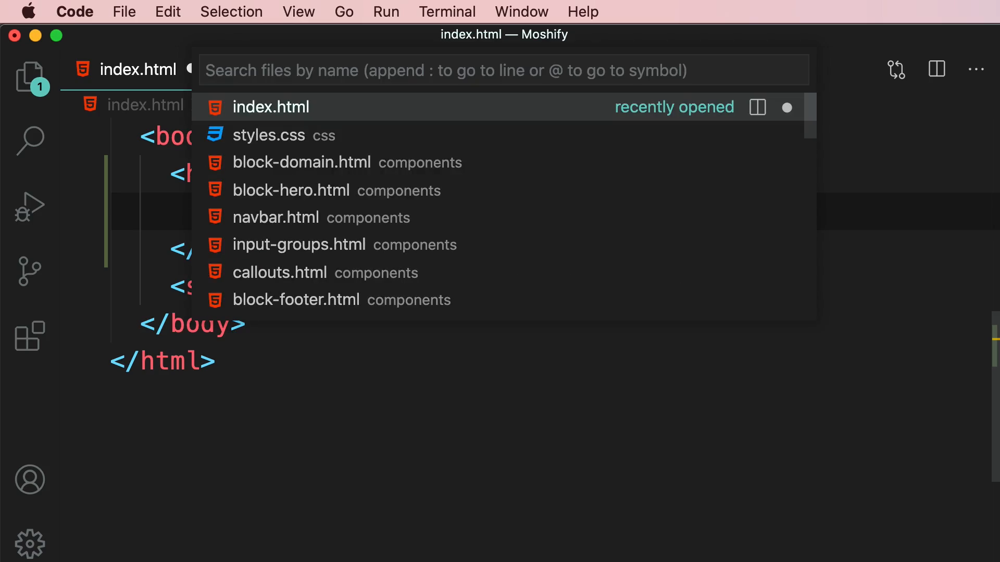

```html
<body>
  <header></header>
  <script src="js/main.js"></script>
</body>
```

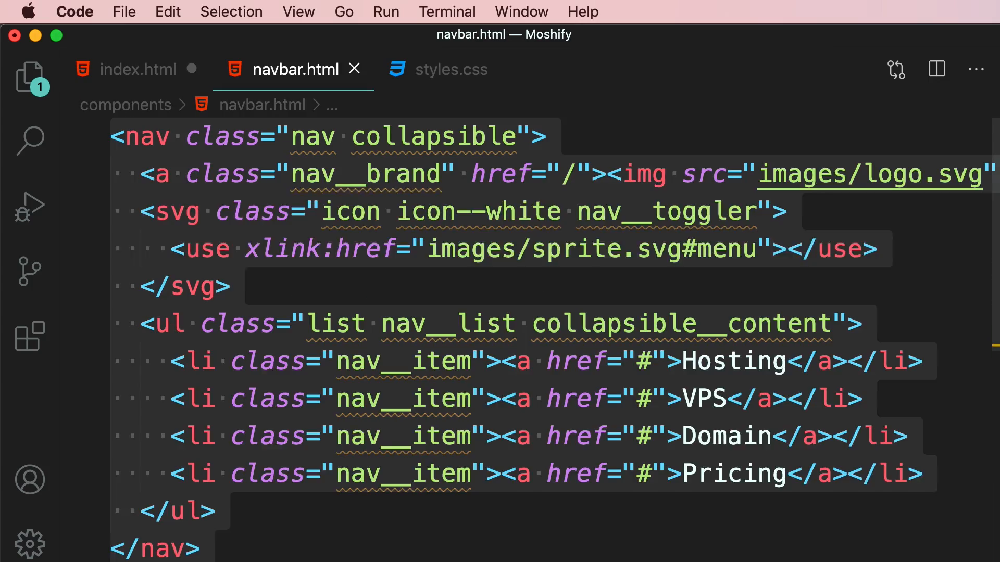

---

## 3. นำ Navbar Component มาใส่ก่อนเป็นอันดับแรก

Mosh เปิด Command Palette (Cmd+P) ค้นหาไฟล์ `navbar.html` ในโฟลเดอร์ `components`:

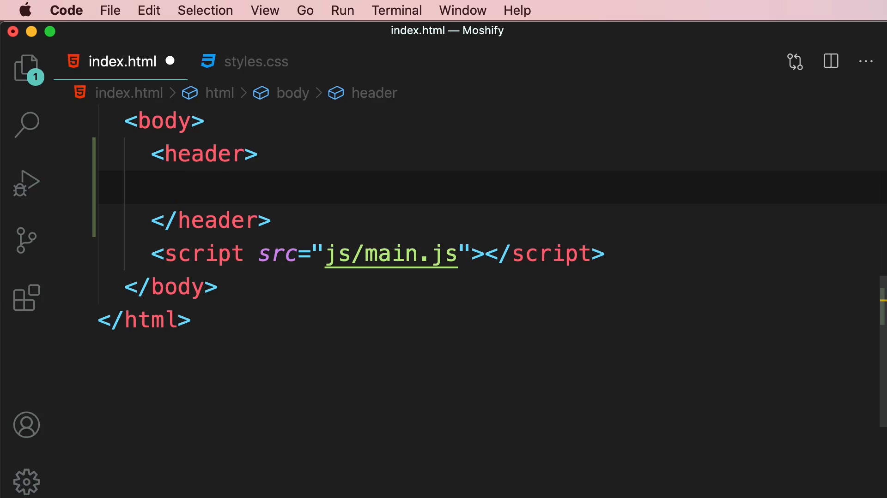

เปิดดูโครงสร้างของ Navbar component ที่เคยสร้างไว้:

```html
<nav class="nav collapsible">
  <a class="nav__brand" href="/"></a>
  <svg class="icon icon--white nav__toggler">
    <use xlink:href="images/sprite.svg#menu"></use>
  </svg>
  <ul class="list nav__list collapsible__content">
    <li class="nav__item"><a href="#">Hosting</a></li>
    <li class="nav__item"><a href="#">VPS</a></li>
    <li class="nav__item"><a href="#">Domain</a></li>
    <li class="nav__item"><a href="#">Pricing</a></li>
  </ul>
</nav>
```

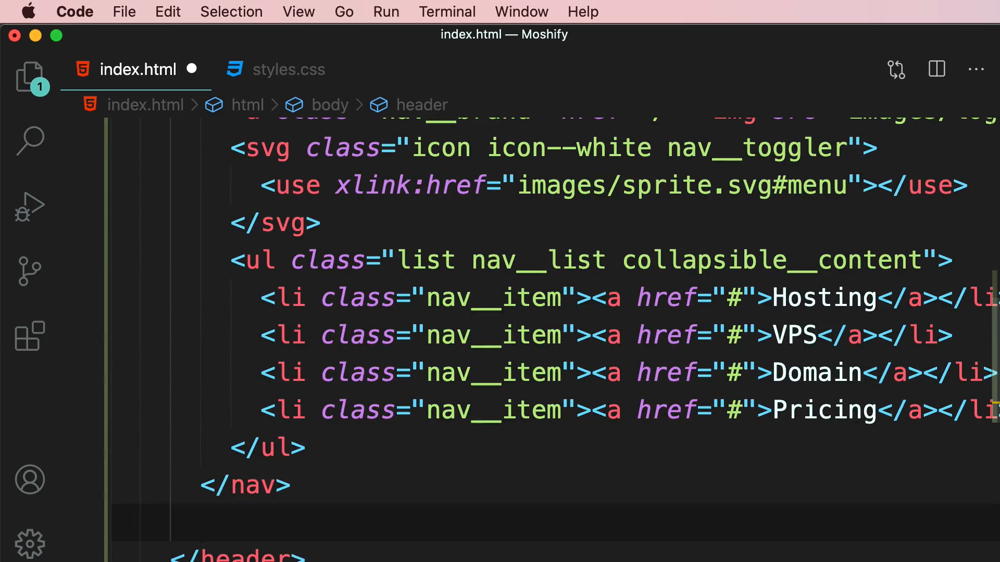

Mosh copy โค้ดทั้งหมดนี้แล้ววางไว้ภายใน `<header>` ที่เตรียมไว้ใน `index.html` จากนั้นทดสอบผลลัพธ์ในเบราว์เซอร์:

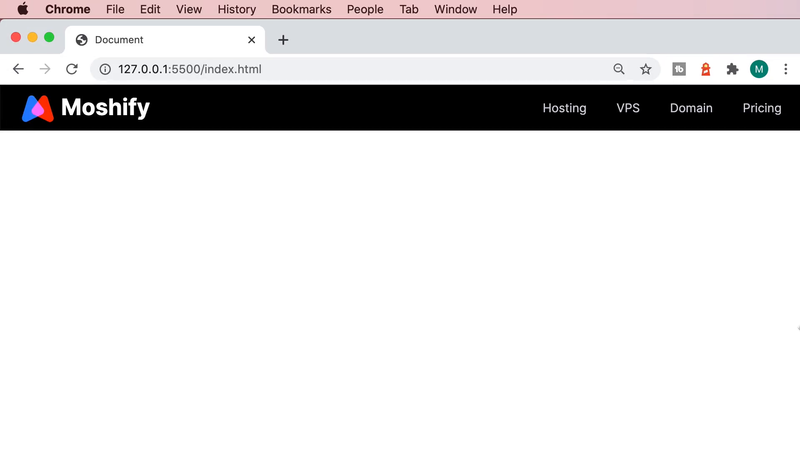

Navbar แสดงผลถูกต้องทันทีตั้งแต่ครั้งแรก ทั้งโลโก้ Moshify, เมนู Hosting/VPS/Domain/Pricing และปุ่ม hamburger menu สำหรับจอมือถือ เพราะ CSS ของ `.nav`, `.nav__brand`, `.nav__toggler` ถูกเขียนไว้เรียบร้อยแล้วในคลิปก่อนหน้า:

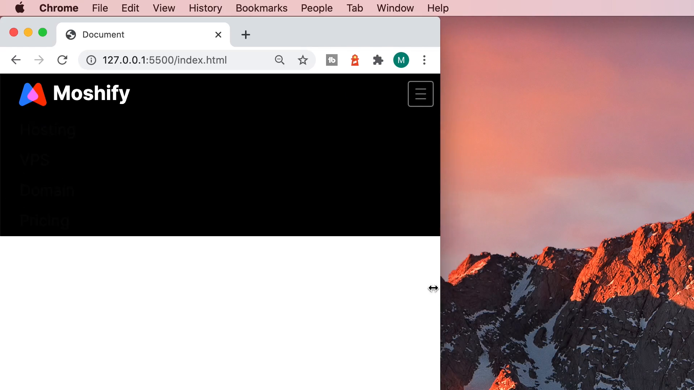

---

## 4. ทดสอบ Responsive ด้วย Chrome DevTools Device Toolbar

หลังใส่ Navbar เสร็จ Mosh เปิด Chrome DevTools แล้วสลับไปที่ Device Toolbar (ไอคอนมือถือ/แท็บเล็ต) เพื่อทดสอบว่า Navbar แสดงผลถูกต้องในหลายขนาดหน้าจอ:

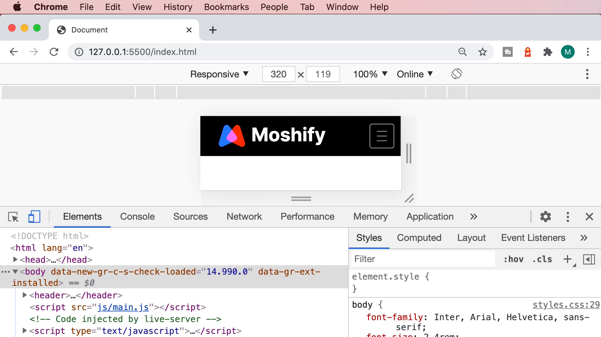

Mosh ปรับขนาดหน้าจอจำลองไปเรื่อย ๆ เริ่มจาก 320px (Mobile S):

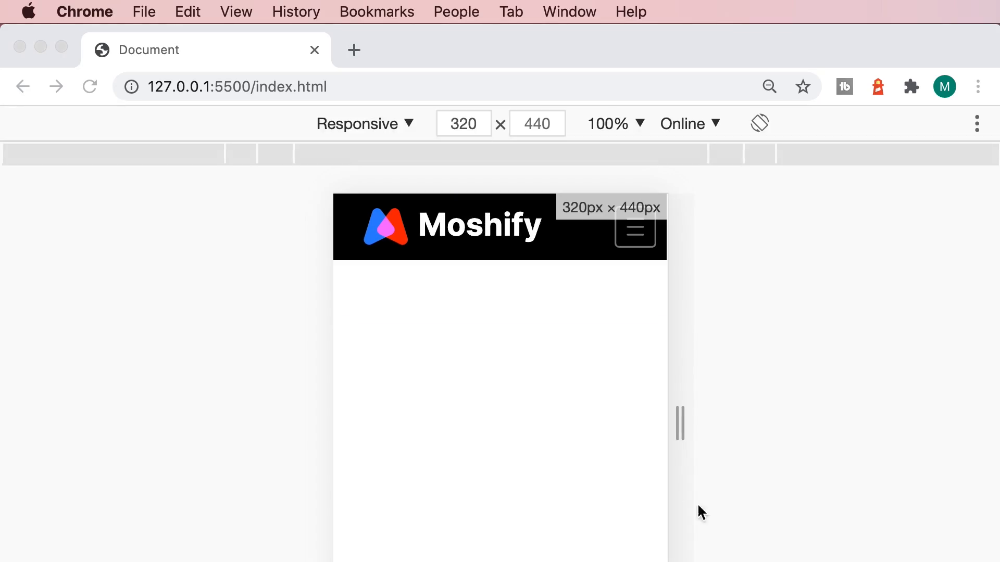

ไปจนถึง 768px (Tablet):

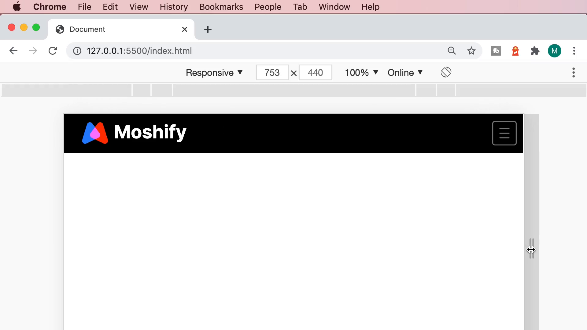

> 🔍 Mosh ทดสอบผ่านหลายขนาดหน้าจอมาตรฐานที่ Chrome DevTools เตรียมไว้ให้ (Moto G4, Galaxy S5, Pixel 2, iPhone 5/SE, iPhone 6/7/8, iPad, Surface Duo, Galaxy Fold ฯลฯ) เพื่อให้มั่นใจว่า Navbar ที่สร้างด้วยเทคนิค responsive (`.collapsible`, media query breakpoint ที่ 768px) ทำงานถูกต้องในทุกอุปกรณ์จริง ไม่ใช่แค่ปรับขนาดหน้าต่างเบราว์เซอร์เฉย ๆ

---

## 5. นำ Hero Block Component มาใส่ต่อ

ขั้นตอนถัดไป Mosh ค้นหาไฟล์ `block-hero.html`:

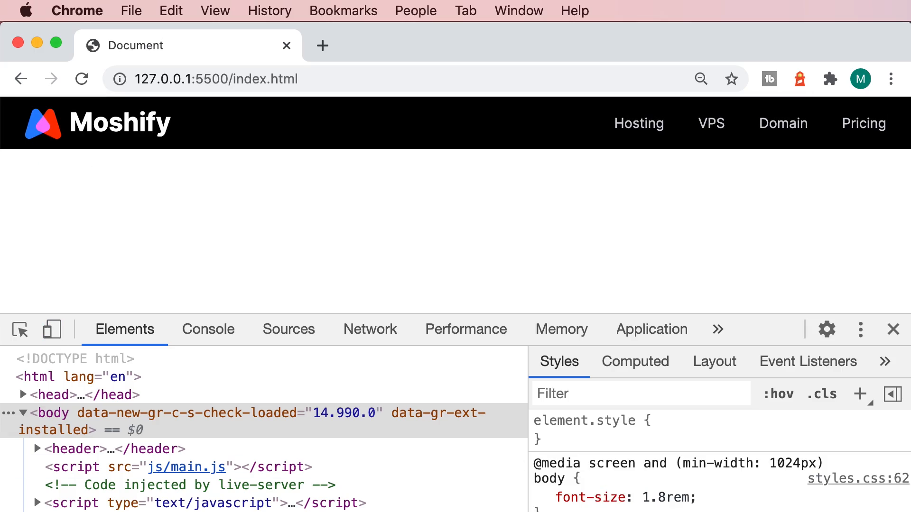

เปิดดูโครงสร้าง Hero Block ที่มี `<picture>` element สำหรับรูปภาพ responsive (webp/png พร้อม 1x/2x):

```html
<picture>
  <source
    type="image/webp"
    srcset="images/banner.webp 1x, images/banner@2x.webp 2x"
  />
  <source
    type="image/png"
    srcset="images/banner.png 1x, images/banner@2x.png 2x"
  />
  
</picture>
```


Mosh สลับกลับไปที่ `index.html` ซึ่งตอนนี้มีแค่ `<header>` (Navbar) และพื้นที่ว่างต่อจากนั้น:

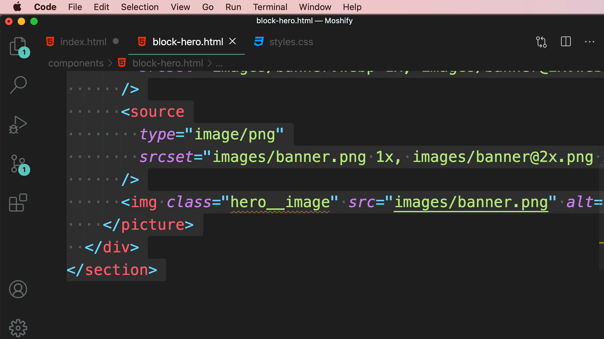

Copy โค้ดทั้งหมดของ Hero Block มาวางต่อจาก `</header>`:

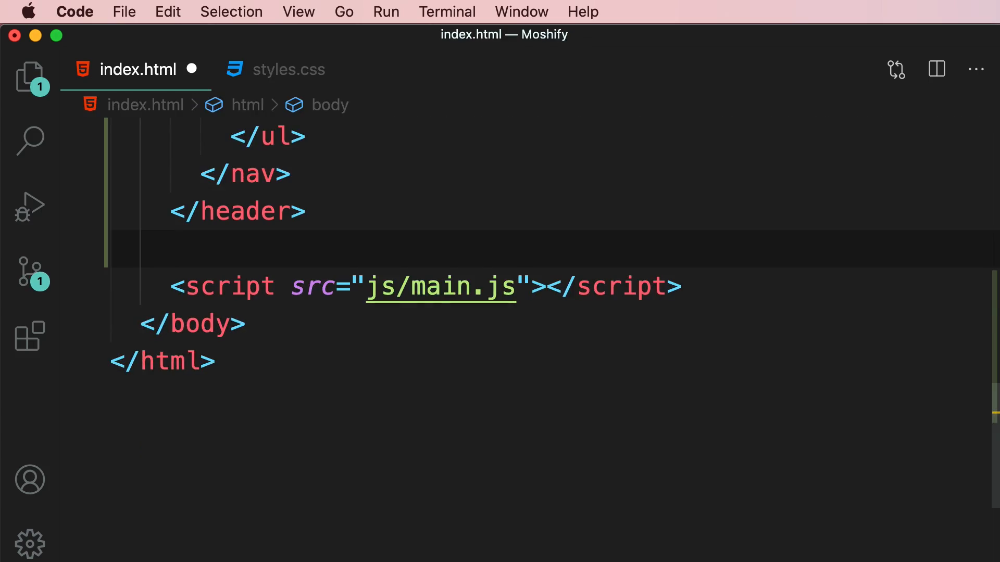

โครงสร้าง section ที่ได้ (สังเกต class modifiers ที่ผสมกัน):

```html
<section class="block block--dark block--skewed-left hero">
  <div class="container grid grid--1x2">
    <header class="block__header">
      <h1>Cloud Hosting for Pros</h1>
      <p>Deploy your websites in less than 60 seconds.</p>
      <a href="#" class="btn btn--accent btn--stretched">Get Started</a>
    </header>
    <picture>
      <!-- ... source webp/png ... -->
      
    </picture>
  </div>
</section>
```

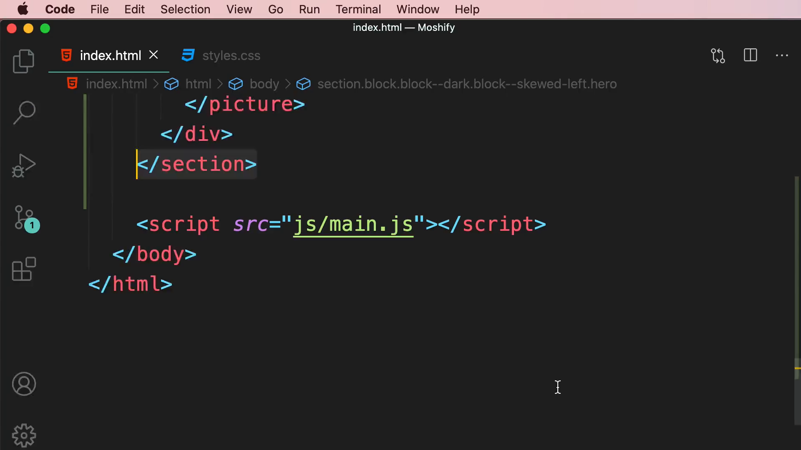

> 📌 Hero Section ใช้ class modifier ผสมกันถึง 4 ตัว: `.block` (padding แนวตั้งมาตรฐาน) + `.block--dark` (พื้นหลังเข้ม) + `.block--skewed-left` (ขอบล่างเอียงไปทิศตรงข้ามกับ Showcase Block) + `.hero` (class เฉพาะของ section นี้) — แสดงให้เห็นพลังของระบบ BEM modifier ที่ผสมผสานกันได้อย่างยืดหยุ่น

ทดสอบผลลัพธ์บนจอมือถือ 320px ผลลัพธ์คือ section สีดำพร้อมหัวข้อ "Cloud Hosting for Pros" คำอธิบาย และปุ่ม "Get Started":

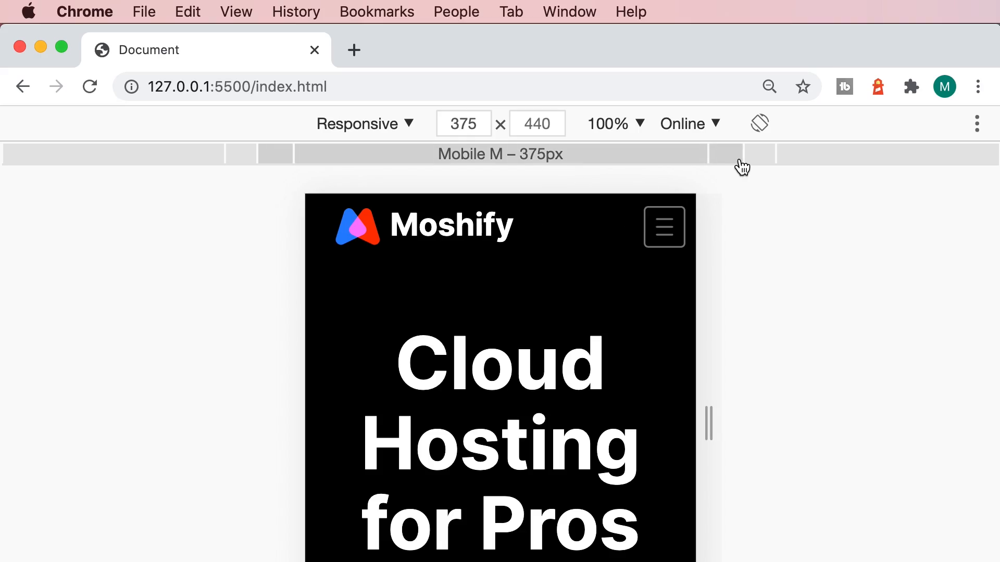

Mosh ปรับ zoom level ของ DevTools เพื่อดูผลลัพธ์ในสัดส่วนต่าง ๆ:

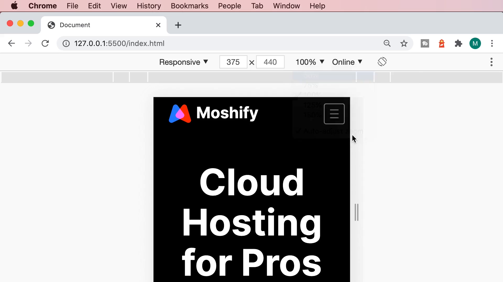

---

## 6. นำ Domain Block Component มาใส่ต่อจาก Hero

Mosh ค้นหาไฟล์ component ที่เกี่ยวข้องกับ "block" อีกครั้งผ่าน Command Palette เพื่อดูรายการ component ทั้งหมดที่มีอยู่ในโปรเจกต์:

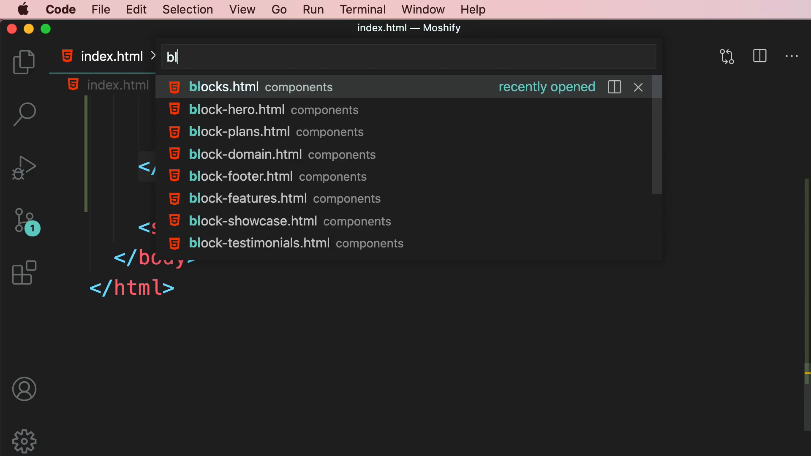

พิมพ์ต่อเพื่อกรองหา `block-domain.html` โดยเฉพาะ:

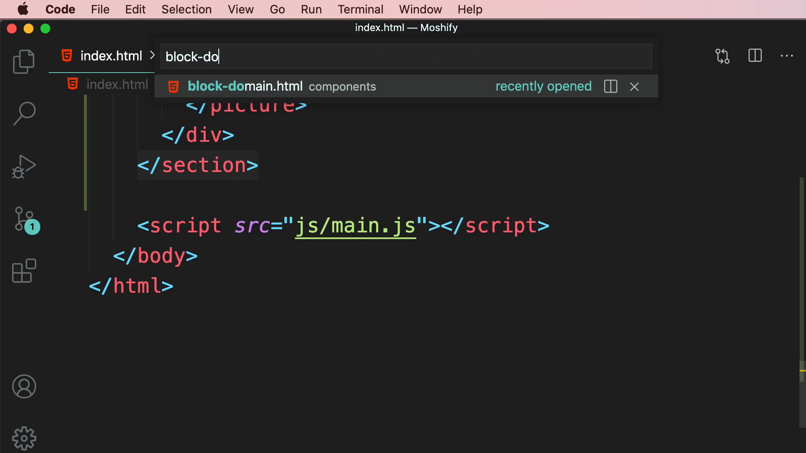

เปิดไฟล์ `block-domain.html` ดูโครงสร้างที่เคยสร้างไว้ — เป็น section ที่แสดงราคาเริ่มต้น พร้อมช่องค้นหาโดเมนและรายการราคานามสกุลโดเมนต่าง ๆ:

```html
<section class="block container block-domain">
  <header class="block__header">
    <h2>Starting at $9 per month</h2>
    <p>Lorem ipsum dolor sit amet consectetur adipisicing el...</p>
  </header>
  <div class="input-group">
    <input type="text" class="input" placeholder="Enter domain name here..." />
    <button class="btn btn--accent">
      <svg class="icon icon--white">
        <use xlink:href="images/sprite.svg#search"></use>
      </svg>
      Search
    </button>
  </div>
  <ul class="list block-domain__prices">
    <li><span class="badge badge--secondary">.com $9</span></li>
    <li>.sg $10</li>
    <li>.space $11</li>
    <li>.info $14</li>
    <li>.net $10</li>
    <li>.xyz $10</li>
  </ul>
</section>
```

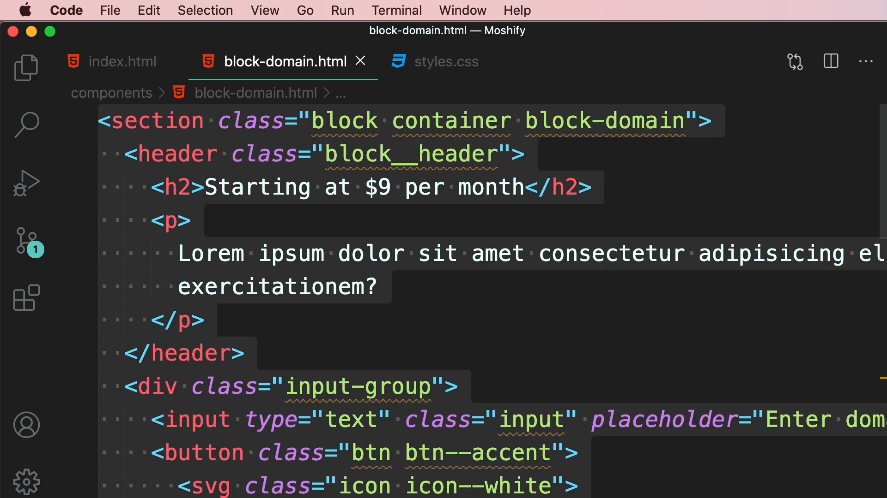

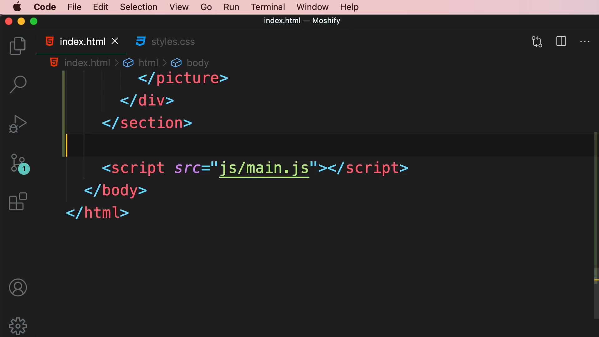

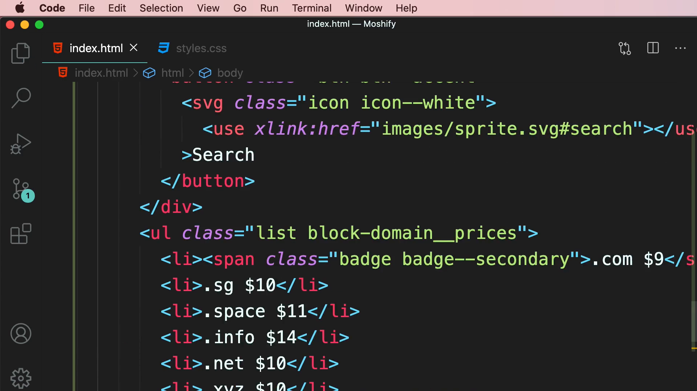

> 🔧 สังเกตว่า `<section>` ของ Domain Block ใช้ class `block container block-domain` — ต่างจาก section อื่นที่มักจะแยก `<div class="container">` ไว้ข้างใน `<section class="block">` เพราะ Domain Block นี้ไม่มี layout แบบ grid 2 คอลัมน์ จึงรวม `container` ไว้ใน section เดียวกันได้เลย ส่วน `.badge.badge--secondary` ใช้ทำ pill สีฟ้าเน้นราคา `.com $9` ให้เด่นกว่ารายการ TLD อื่น ๆ

Mosh copy โค้ดทั้งหมดมาวางต่อจาก Hero Section ใน `index.html` แล้วทดสอบผลลัพธ์ในเบราว์เซอร์:

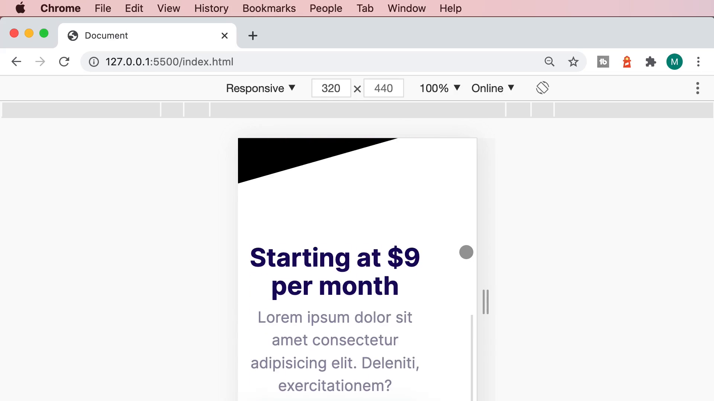

หัวข้อ "Starting at $9 per month" พร้อมคำอธิบาย Lorem Ipsum แสดงผลถูกต้อง ตามด้วยช่องค้นหาโดเมนพร้อมปุ่ม Search สีแดง:

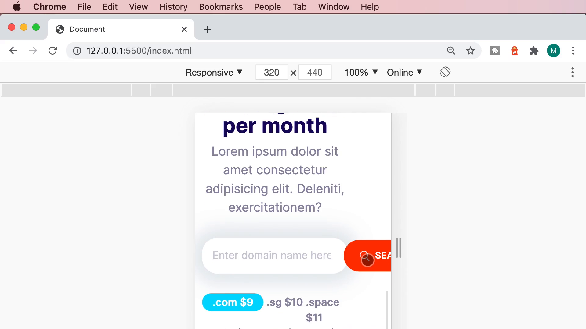

และรายการราคานามสกุลโดเมนที่มี badge สีฟ้าเน้น `.com $9` ตามดีไซน์ต้นฉบับ:

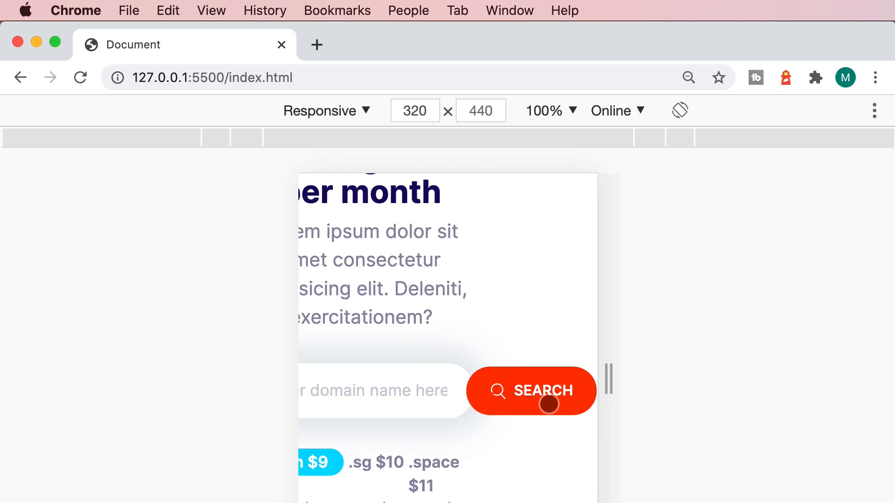

---

## สรุปภาพรวมของคลิปนี้

| หัวข้อ | รายละเอียด |
|---|---|
| เป้าหมายคลิป | ประกอบทุก component ที่สร้างไว้แยกกันเข้าเป็นหน้าเว็บ `index.html` ที่สมบูรณ์ |
| ลำดับการประกอบ | `navbar.html` → `block-hero.html` → `block-domain.html` (และต่อเนื่องในคลิปถัดไปด้วย block อื่น ๆ) |
| วิธีการหลัก | Command Palette (Cmd+P) ค้นหาไฟล์ component → copy โค้ดทั้งหมด → วางต่อกันใน `index.html` |
| การทดสอบ | Chrome DevTools Device Toolbar สลับขนาดหน้าจอหลายแบบ (320px, 375px, 768px, iPhone 5/SE ฯลฯ) และปรับ zoom level |
| Class modifier ที่พบ | `.block--dark`, `.block--skewed-left` (Hero) ผสมกับ `.hero`; `.block.container.block-domain` (Domain) |

**แนวคิดสำคัญที่ได้จากคลิปนี้**

1. หลักการ **component-based development** — การแยกสร้างและทดสอบแต่ละ section เป็นไฟล์ component อิสระ ทำให้ขั้นตอนการประกอบหน้าเว็บจริงรวดเร็วและมีข้อผิดพลาดน้อยมาก
2. การทดสอบ responsive design ด้วย Chrome DevTools Device Toolbar อย่างเป็นระบบ ไล่ทดสอบตั้งแต่จอเล็กสุดไปจนถึงจอใหญ่ เพื่อยืนยันว่า breakpoint และ CSS ที่เขียนไว้ทำงานถูกต้องในทุกอุปกรณ์
3. การผสมผสาน BEM modifier class หลายตัวเข้าด้วยกันในองค์ประกอบเดียว (เช่น `block block--dark block--skewed-left hero`) แสดงให้เห็นความยืดหยุ่นของระบบการตั้งชื่อ class แบบ BEM
4. โครงสร้าง `<section>` ไม่จำเป็นต้องเหมือนกันทุก section เสมอไป — บาง section รวม `container` ไว้ในคลาสเดียวกับ `block` ได้เลยถ้าไม่มี layout grid ที่ซับซ้อน
5. Command Palette ของ VS Code (Cmd+P) เป็นเครื่องมือสำคัญที่ช่วยให้สลับไปมาระหว่างไฟล์ component จำนวนมากในโปรเจกต์ได้อย่างรวดเร็ว

---

*บทเรียนนี้เป็นส่วนหนึ่งของคอร์ส "Building a Web Site" โดย Mosh Hamedani (codewithmosh.com) — คลิปที่ 37*
