# HTML-CSS-3: 38 - Troubleshooting Layout Issues

**ไฟล์ต้นฉบับ:** "38- Troubleshooting Layout Issues.mp4"

---

## ภาพรวมคลิปนี้

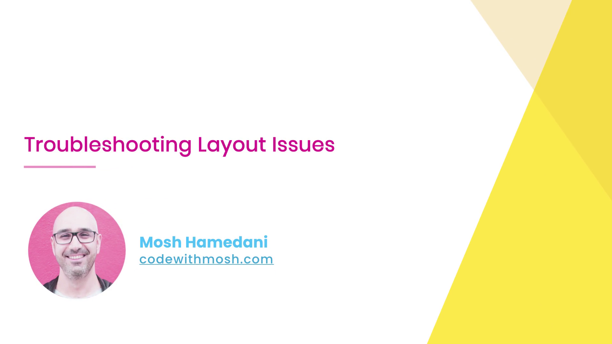

คลิปนี้ Mosh สอนเทคนิคสำคัญมากสำหรับ Front End Developer นั่นคือ **วิธีแก้ปัญหา (Troubleshoot) เลย์เอาต์ที่พัง** โดยไม่ต้องไปยุ่งกับหน้าเว็บจริง (`index.html`) ที่มีโค้ดซับซ้อนเต็มไปหมด แนวคิดหลักคือการสร้างไฟล์ทดลอง (playground) แยกต่างหาก แล้วคัดลอกเฉพาะส่วนที่มีปัญหามาทดสอบอย่างโดดเดี่ยว (isolate) จากนั้นใช้ Chrome DevTools ไล่ปรับขนาดหน้าจอเพื่อหาจุดที่เลย์เอาต์พัง วิเคราะห์สาเหตุจาก CSS Box Model และ Flexbox แล้วแก้ไขด้วยโค้ด CSS เพียงบรรทัดเดียว

> 💡 **ทำไมต้องเรียนคลิปนี้**: ในชีวิตจริงของ Front End Developer ปัญหาเลย์เอาต์ล้น (overflow), ซ้อนทับ (overlap), หรือบิดเบี้ยวที่หน้าจอบางขนาด เป็นเรื่องที่เจอบ่อยมาก การรู้วิธี "แยกปัญหาออกมาทดสอบ" (isolate the bug) เป็นทักษะที่ทำให้ debug ได้เร็วขึ้นมาก แทนที่จะนั่งงงอยู่กับโค้ดทั้งหน้าเว็บ

---

## 1. ปัญหาที่ต้องแก้: กล่องค้นหาโดเมน (Search Box) ล้นออกนอกกรอบ

Mosh เปิดโปรเจกต์ Moshify และชี้ให้เห็นว่าที่ Block Domain (ส่วน "Starting at $9 per month" พร้อมช่องกรอกโดเมนและปุ่ม Search) เมื่อปรับขนาดหน้าจอไปที่ความกว้างบางค่า ปุ่ม **SEARCH** สีแดงจะ "ล้น" ออกนอกกรอบของกล่องค้นหา ทำให้ปุ่มถูกตัดขาดหายไปครึ่งหนึ่งหรือเกือบทั้งหมด

> ⚠️ ปัญหานี้เป็นปัญหาคลาสสิกของ Flexbox: เมื่อ container มีความกว้างจำกัด แต่ content ข้างในมีความกว้างขั้นต่ำ (min-content) มากกว่าที่ container จะรองรับได้ browser จะปล่อยให้ content ล้นออกไปแทนที่จะบีบให้พอดี

---

## 2. สร้างไฟล์ Playground แยกต่างหากสำหรับทดสอบ

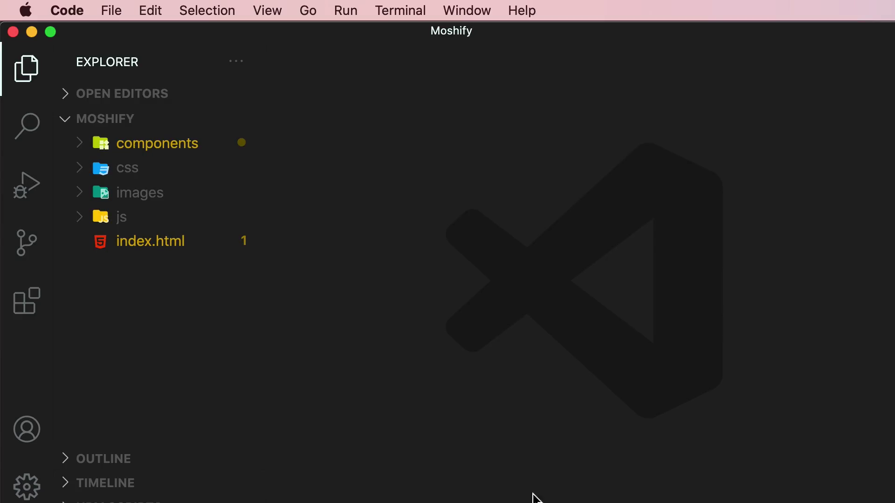

Mosh เปิด Explorer panel ใน VS Code ซึ่งแสดงโครงสร้างโปรเจกต์ Moshify ที่มีอยู่แล้ว:
- โฟลเดอร์ `components/`
- โฟลเดอร์ `css/`
- โฟลเดอร์ `images/`
- โฟลเดอร์ `js/`
- ไฟล์ `index.html`

แทนที่จะแก้ไขปัญหาโดยตรงใน `index.html` (ซึ่งมีโค้ดเยอะและซับซ้อน) Mosh สร้างไฟล์ใหม่ขึ้นมาชื่อ `playground.html`

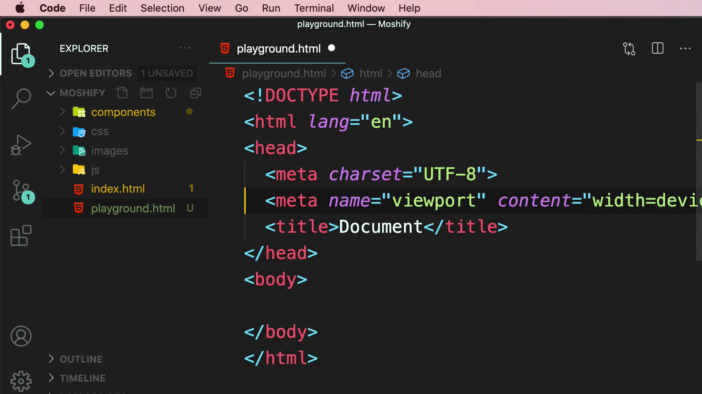

โดยคลิกขวาที่ Explorer แล้วเลือก New File จากนั้นพิมพ์ชื่อไฟล์ `pl` (ระบบกำลังจะเติมเป็น `playground.html`)

> 📝 **แนวคิดสำคัญ**: ไฟล์ `playground.html` (หรือชื่ออื่นๆ เช่น `test.html`, `sandbox.html`) เป็นเทคนิคที่นักพัฒนามืออาชีพใช้กันบ่อยมาก เพื่อสร้าง "สนามทดลอง" เล็กๆ แยกออกจากโปรเจกต์จริง จะได้ไม่ต้องกลัวว่าจะทำโค้ดจริงพัง

### 2.1 HTML5 Boilerplate ของไฟล์ playground.html

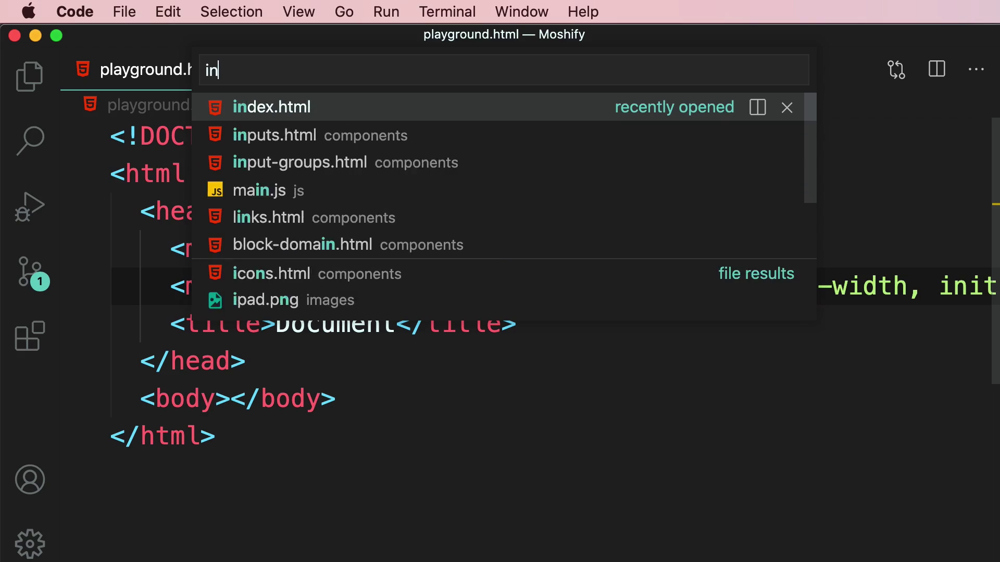

VS Code สร้างโครงสร้าง HTML5 มาตรฐานให้อัตโนมัติ (จาก Emmet snippet `!`):

```html
<!DOCTYPE html>
<html lang="en">
<head>
    <meta charset="UTF-8">
    <meta name="viewport" content="width=device-width, init...">
    <title>Document</title>
</head>
<body>

</body>
</html>
```

### 2.2 เชื่อมโยง Stylesheet เดียวกับโปรเจกต์จริง

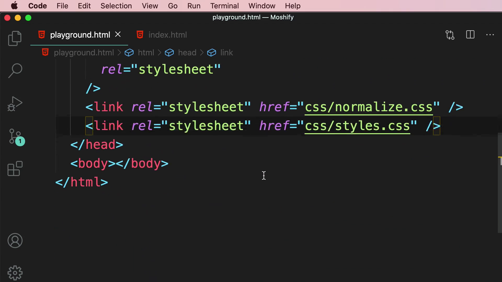

Mosh เพิ่ม `<link>` สองบรรทัดใน `<head>` เพื่อให้ `playground.html` ใช้ CSS ชุดเดียวกับ `index.html` จริง — นี่คือกุญแจสำคัญที่ทำให้การทดสอบใน playground สะท้อนปัญหาที่เกิดขึ้นจริงได้แม่นยำ:

```html
<head>
    <meta charset="UTF-8">
    <meta name="viewport" content="width=device-width, initial-scale=1.0">
    <title>Document</title>
    <link rel="stylesheet" href="css/normalize.css">
    <link rel="stylesheet" href="css/styles.css">
</head>
<body>

</body>
</html>
```

> 🔍 เนื่องจาก `playground.html` วางอยู่ในโฟลเดอร์ระดับเดียวกับ `index.html` (root ของโปรเจกต์) จึงสามารถอ้างอิง path แบบสัมพัทธ์ (relative path) `css/normalize.css` และ `css/styles.css` ได้เหมือนกับไฟล์หลักทุกประการ

---

## 3. คัดลอกเฉพาะส่วนที่มีปัญหามาไว้ใน Playground

### 3.1 ค้นหาไฟล์ component ด้วย Command Palette

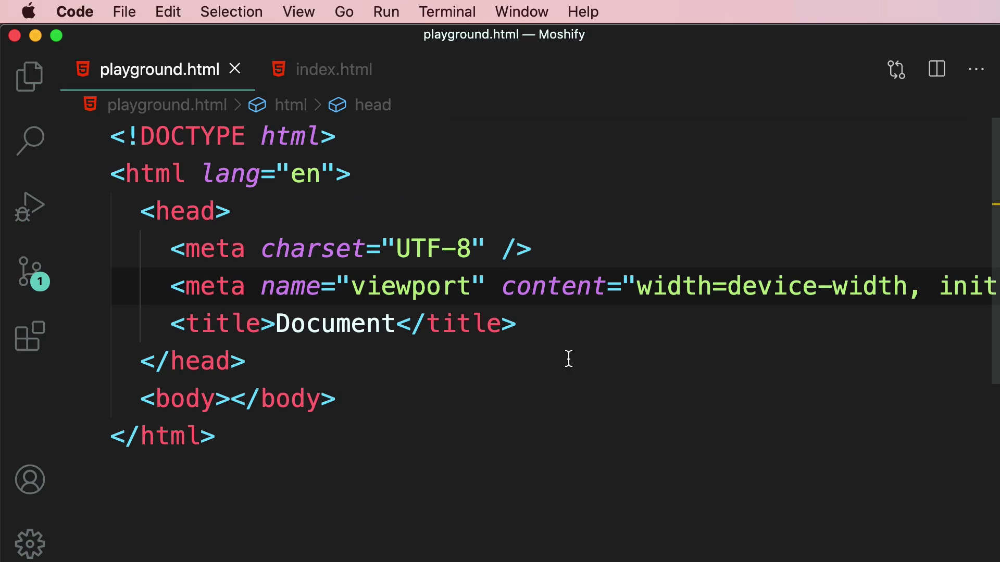

Mosh กด `Cmd + P` เปิด Command Palette แล้วพิมพ์ค้นหาไฟล์ ระบบแสดงรายการไฟล์ที่เพิ่งเปิดล่าสุด/ที่ตรงกับคำค้น เช่น `index.html`, `inputs.html`, `input-groups.html`, `main.js`, `links.html`, `block-domain.html`, `icons.html`, `ipad.png` — เห็นได้ว่า Mosh กำลังมองหาไฟล์ component ที่เกี่ยวข้องกับส่วน Domain block

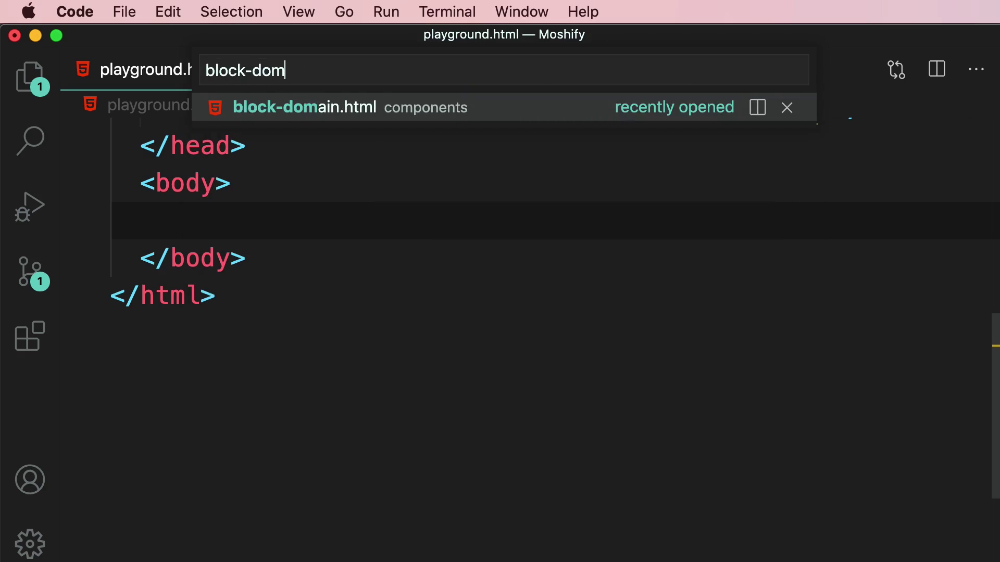

จากนั้นพิมพ์ค้นหาต่อว่า `block-dom` ระบบเจอไฟล์ `block-domain.html` อยู่ในโฟลเดอร์ `components`

### 3.2 วาง (Paste) โครงสร้าง HTML ของ Block Domain ลงใน Playground

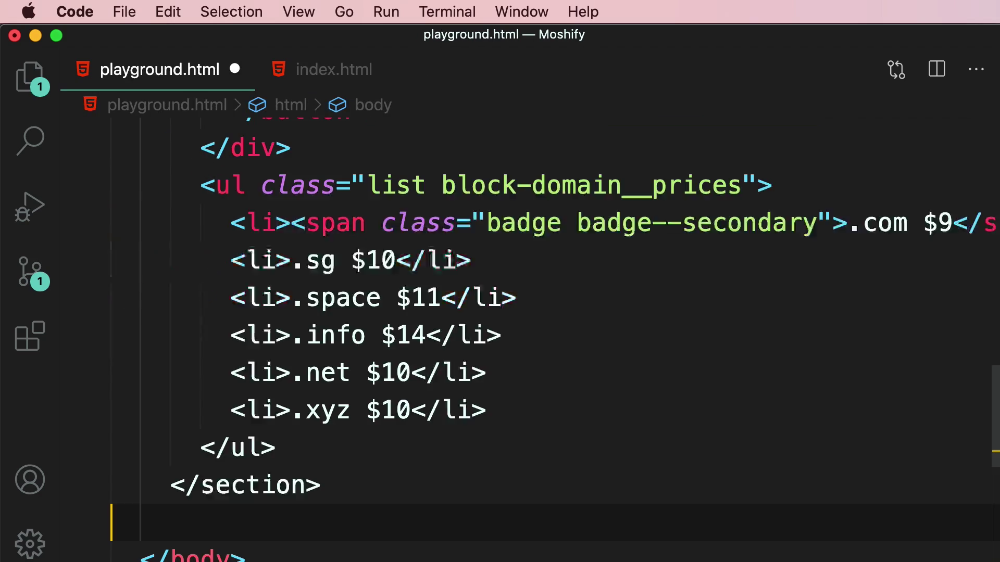

Mosh คัดลอกโค้ด HTML ทั้งหมดของ Block Domain component จาก `components/block-domain.html` มาวางใน `playground.html` ระหว่าง `<body>` และ `</body>` โครงสร้างที่ปรากฏมีลักษณะประมาณนี้:

```html
<body>
    <section class="block container block-domain">
        <header class="block__header">
            <h2>Starting at $9 per month</h2>
            <p>Lorem ipsum dolor sit amet consectetur adipisicing elit. Deleniti, exercitationem?</p>
        </header>

        <div class="input-group">
            <input type="text" class="input" placeholder="Enter domain name here...">
            <button class="btn btn--accent">
                <svg class="icon icon--white">
                    <use xlink:href="images/sprite.svg#search"></use>
                </svg>
                Search
            </button>
        </div>

        <ul class="list block-domain__prices">
            <li><span class="badge badge--secondary">.com $9</span></li>
            <li>.sg $10</li>
            <li>.space $11</li>
            <li>.info $14</li>
            <li>.net $10</li>
            <li>.xyz $10</li>
        </ul>
    </section>

    </body>
</html>
```

> 📌 สังเกตว่าโครงสร้างนี้ประกอบด้วย 3 ส่วนหลัก: `header.block__header` (หัวข้อ + คำบรรยาย), `div.input-group` (ช่องกรอกโดเมน + ปุ่ม Search ซึ่งเป็นจุดที่มีปัญหา), และ `ul.list.block-domain__prices` (รายการราคาโดเมนแบบต่างๆ)

### 3.3 ทดลองเปิดดูใน Live Server

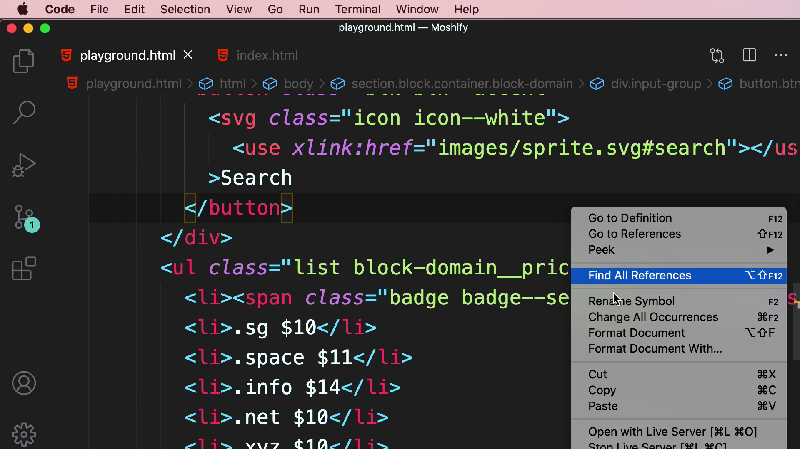

Mosh คลิกขวาแล้วเลือก "Open with Live Server" เพื่อรัน `playground.html` ผ่าน `127.0.0.1:5500/playground.html` (สังเกต URL ต่างจาก `index.html` ปกติ เพราะตอนนี้กำลังดูไฟล์ทดลองแยกต่างหาก)

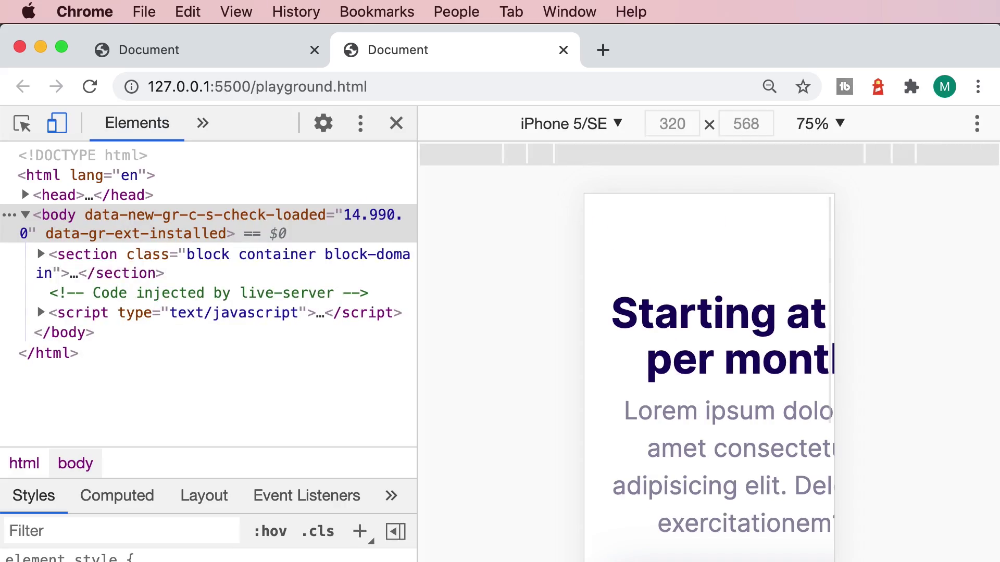

เมื่อเปิด Chrome DevTools และสลับไปที่โหมด Device Toolbar (จำลองอุปกรณ์มือถือ) เลือกขนาด **iPhone 5/SE (320 × 568)** จะเห็นว่าตอนนี้หน้า playground แสดงเฉพาะส่วน Block Domain เท่านั้น ไม่มีส่วนอื่นๆ ของเว็บไซต์มากวนสายตา — ทำให้ง่ายต่อการโฟกัสปัญหา

---

## 4. วิเคราะห์โครงสร้าง DOM ด้วย DevTools Elements Panel

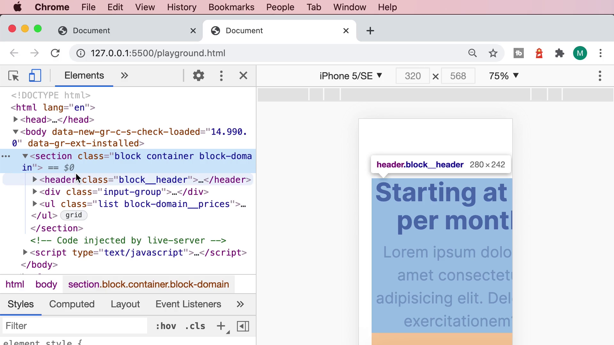

Mosh เปิดแท็บ Elements ใน DevTools แล้วไล่ hover ผ่าน element ต่างๆ ใน DOM tree เพื่อดูว่าแต่ละส่วนถูก render เป็นกล่องขนาดเท่าไหร่บนหน้าจอ (แถบสีฟ้าไฮไลต์คือ element ที่กำลังชี้อยู่):

```html
<section class="block container block-domain">
```
ขนาดที่แสดง: **280 × 273 px** (กินพื้นที่ทั้งหมดของหน้าจอ 320px ลบด้วย padding)

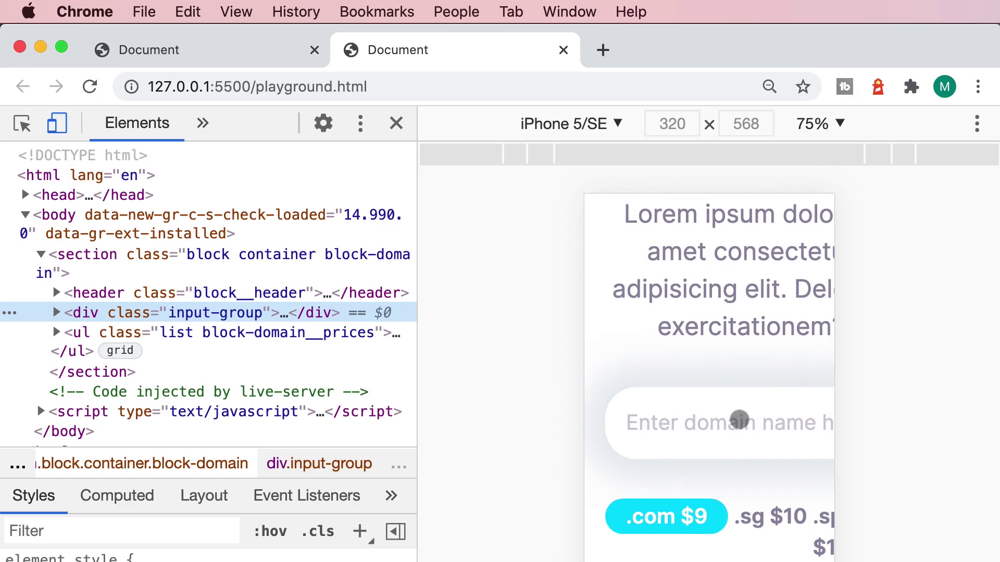

```html
<header class="block__header">
```
ขนาดที่แสดง: **280 × 242 px** — เป็นส่วนหัวข้อ + คำบรรยาย

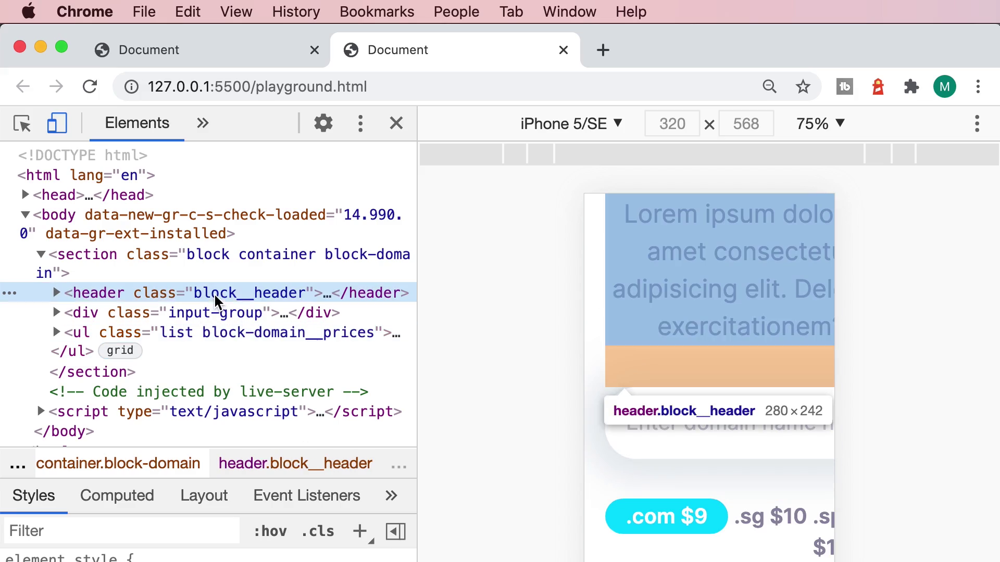

```html
<div class="input-group">
```
เมื่อ hover ที่ `div.input-group` จะเห็นว่ากรอบสีฟ้าครอบคลุมกล่องค้นหาทั้งหมด (input + button) และแสดงข้อความ placeholder "Enter domain name here..." อยู่ในกล่องพอดี ณ ความกว้างนี้

> 🔧 ในขั้นตอนนี้ Mosh กำลังใช้เทคนิค **DOM Inspection แบบ hover-to-highlight** เพื่อทำความเข้าใจโครงสร้างกล่อง (Box Model) ของแต่ละ element ก่อนที่จะเริ่มปรับขนาดหน้าจอเพื่อหาจุดที่พัง

ระหว่างไล่ hover Mosh ยังกลับไปดูโค้ด HTML ใน VS Code อีกครั้งเพื่อตรวจสอบ markup ของ `ul.list.block-domain__prices` ที่มี `<span class="badge badge--secondary">.com $9</span>` และรายการราคาโดเมนอื่นๆ ให้แน่ใจว่าคัดลอกมาครบถ้วนตรงกับต้นฉบับ:

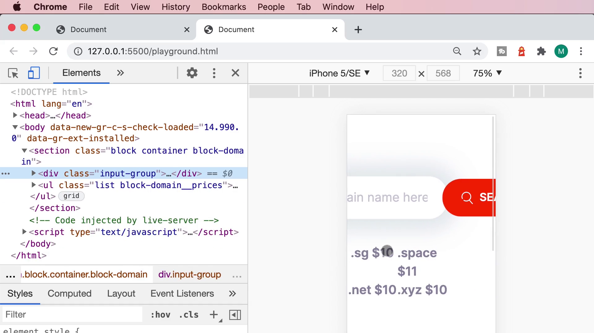

จากนั้นสลับไปที่แท็บ browser อีกอันที่เปิด DevTools ค้างไว้ ซึ่งตอนนี้ `<body>` ของ `index.html` จริงยังว่างเปล่าอยู่ (ยังไม่ได้แก้ไขไฟล์จริง เพราะทุกอย่างกำลังทดสอบใน `playground.html` เท่านั้น):

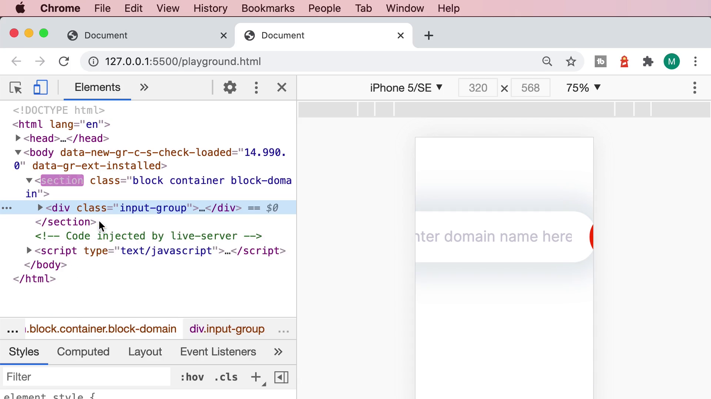

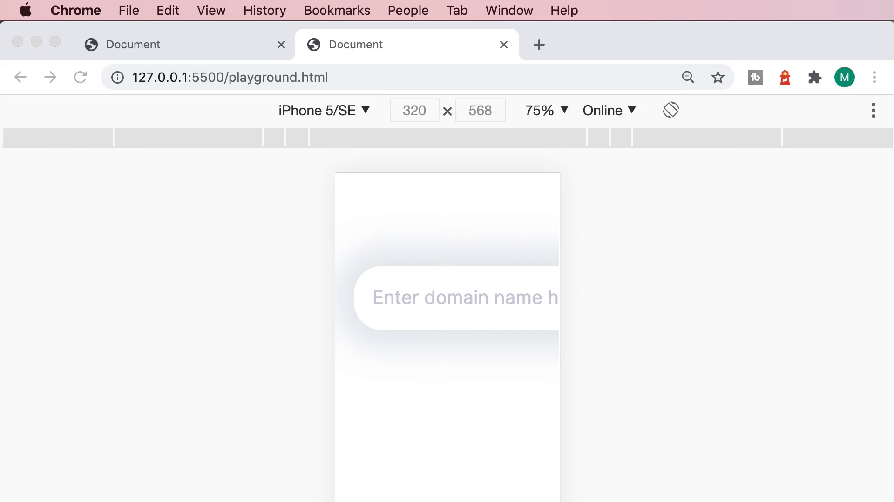

Mosh ไล่ hover ต่อไปที่ `section.block.container.block-domain` อีกครั้งเพื่อย้ำความเข้าใจโครงสร้างก่อนเริ่มขั้นตอนปรับขนาดหน้าจอ:

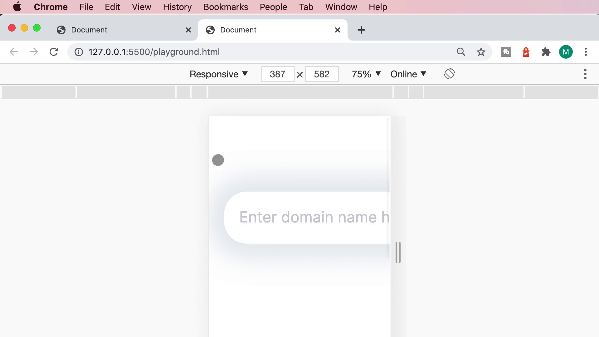

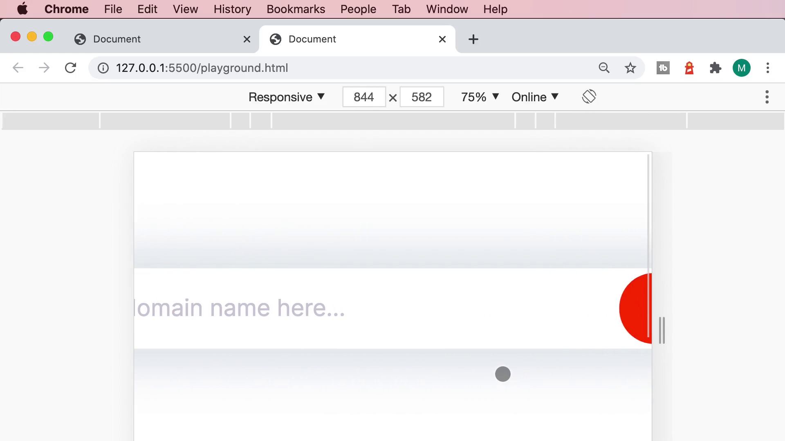

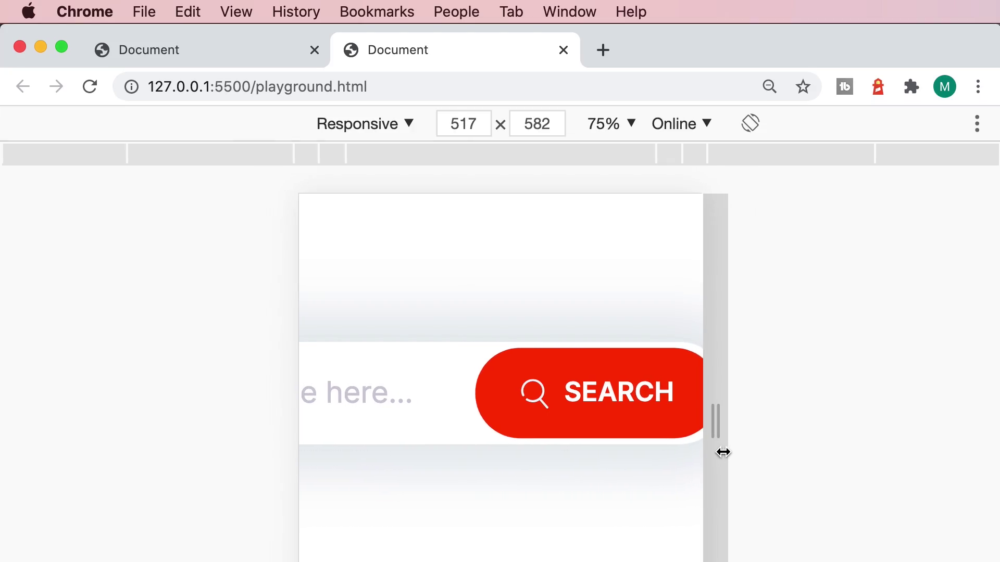

ที่ขนาดหน้าจอ iPhone 5/SE (320px) นี้เองที่ Mosh สังเกตเห็นปัญหาปุ่ม Search ถูกบดบัง/ล้นเป็นครั้งแรกอย่างชัดเจน ก่อนจะเริ่มไล่ปรับขนาดหน้าจอในหัวข้อถัดไป

---

## 5. ไล่หาจุดที่เลย์เอาต์พัง ด้วยการลาก Responsive Viewport

Mosh สลับ Device Toolbar เป็นโหมด **Responsive** แล้วลากขอบหน้าต่างจำลอง (drag the resize handle ด้านขวา) เพื่อปรับความกว้างหน้าจอไปเรื่อยๆ ทีละนิด สังเกตพฤติกรรมของปุ่ม Search ที่ความกว้างต่างๆ:

| ความกว้าง (px) | พฤติกรรมของปุ่ม Search | ภาพประกอบ |
|---|---|---|
| 320 | ปกติ ปุ่มพอดีกรอบ | frame 010 |
| 387 | ปกติ ยังไม่ล้น | 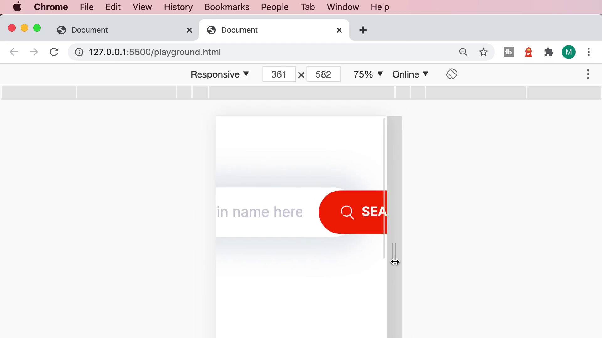 |
| 844 | **ปุ่มล้นออกนอกกรอบขวา ถูกตัดหาย** | 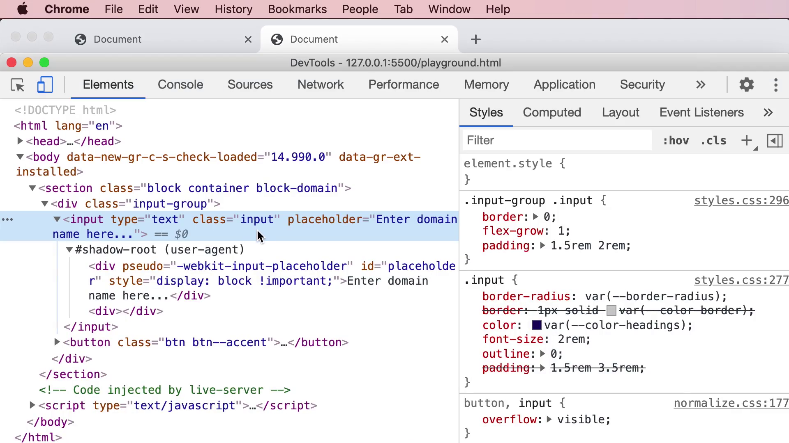 |
| 517 | ปุ่มกลับมาแสดงปกติ | 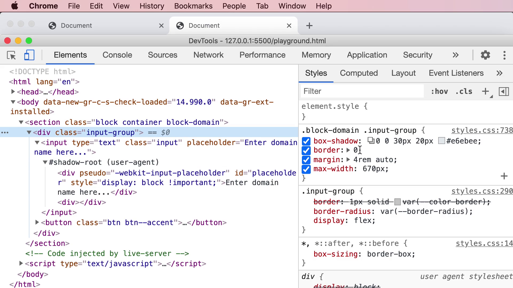 |
| 361 | **ปุ่มล้นอีกครั้ง เห็นแค่ "SEA"** | 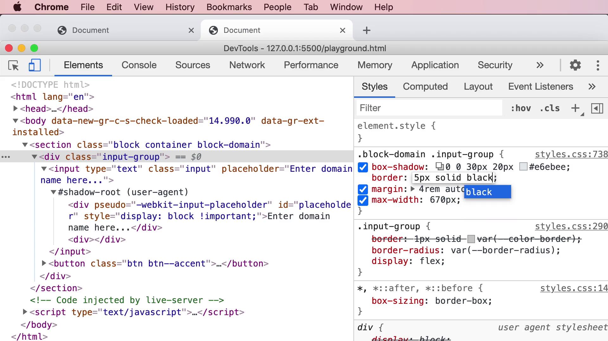 |

> ⚠️ **จุดสำคัญที่ Mosh เน้นย้ำ**: ปัญหานี้ไม่ได้เกิดที่ความกว้างค่าใดค่าหนึ่งตายตัว แต่เกิด "เป็นช่วงๆ" สลับไปมา (บางความกว้างพังบางความกว้างไม่พัง) นี่คือสัญญาณบ่งชี้ว่าปัญหาไม่ได้มาจาก media query breakpoint ที่ตั้งไว้ผิด แต่เป็นปัญหาพื้นฐานของ **Flexbox กับความกว้างของ content ภายใน**

---

## 6. เจาะลึกสาเหตุด้วย Styles Panel และ Computed Tab

### 6.1 ตรวจสอบ CSS ที่มีผลกับ input และ input-group

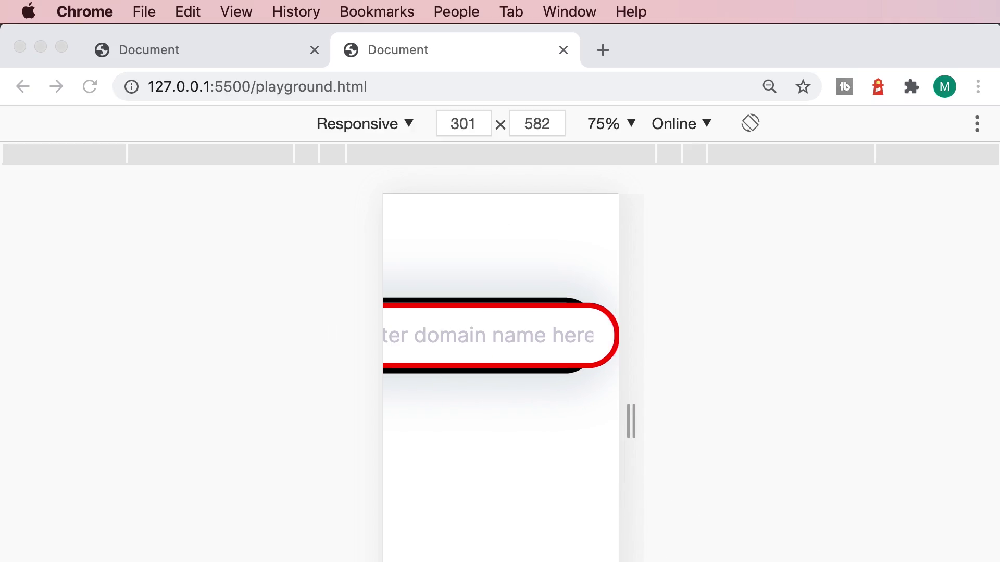

Mosh เลือก element `<input>` ใน DOM tree แล้วดูที่ Styles panel ด้านขวา พบกฎ CSS ที่เกี่ยวข้อง:

```css
.input-group .input {
    border: 0;
    flex-grow: 1;
    padding: 1.5rem 2rem;
}

.input {
    border-radius: var(--border-radius);
    border: 1px solid var(--color-border);
    color: var(--color-headings);
    font-size: 2rem;
    outline: 0;
    padding: 1.5rem 3.5rem;
}
```

> 💡 สังเกตว่า `.input` มี `font-size: 2rem` (ใหญ่มาก ~32px) และ `padding: 1.5rem 3.5rem` (padding ซ้าย-ขวารวมกันมากถึง 7rem หรือ ~112px) ค่าเหล่านี้รวมกันทำให้ input มี **min-content width** ที่สูงมาก แม้จะตั้งค่า `flex-grow: 1` ให้ยืดได้ แต่ default ของ flex item คือ `flex-shrink` จะไม่มีทางบีบเล็กกว่าค่า `min-width: auto` (ซึ่งเท่ากับ min-content) ได้เลย

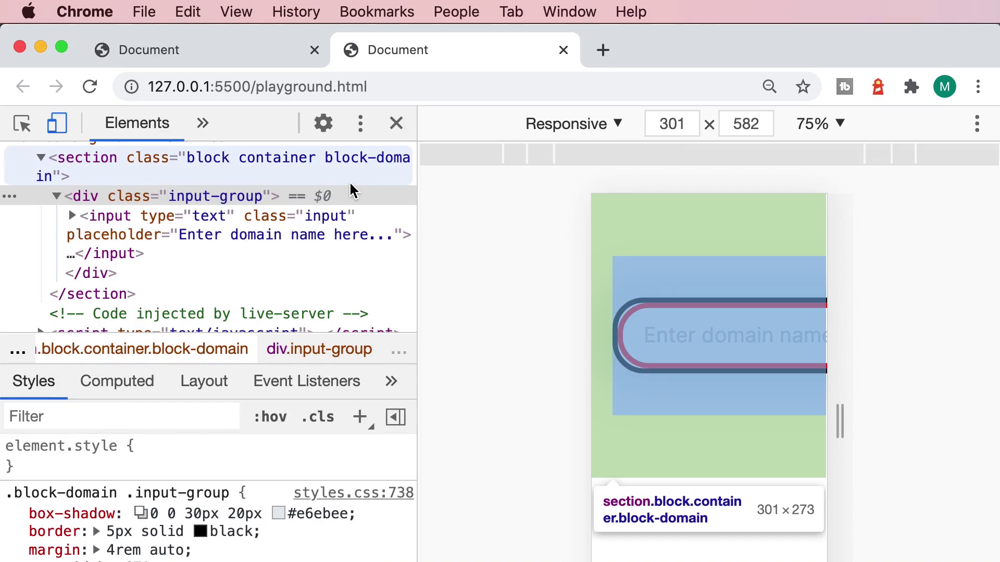

และดูที่ parent container:

```css
.block-domain .input-group {
    box-shadow: 0 0 30px 20px #e6ebee;
    border: 0;
    margin: 4rem auto;
    max-width: 670px;
}

.input-group {
    border: 1px solid var(--color-border);
    border-radius: var(--border-radius);
    display: flex;
}
```

`.input-group` ตั้งค่า `display: flex;` และมี `max-width: 670px;` — เมื่อหน้าจอแคบกว่าความกว้างที่ input + button ต้องการจริงๆ (ตาม min-content) ตัว container จะไม่สามารถบีบลูกๆ ให้เล็กลงได้ จึงเกิด overflow

### 6.2 ทดลองแก้ไขชั่วคราว: เพิ่ม border สังเกตพฤติกรรม

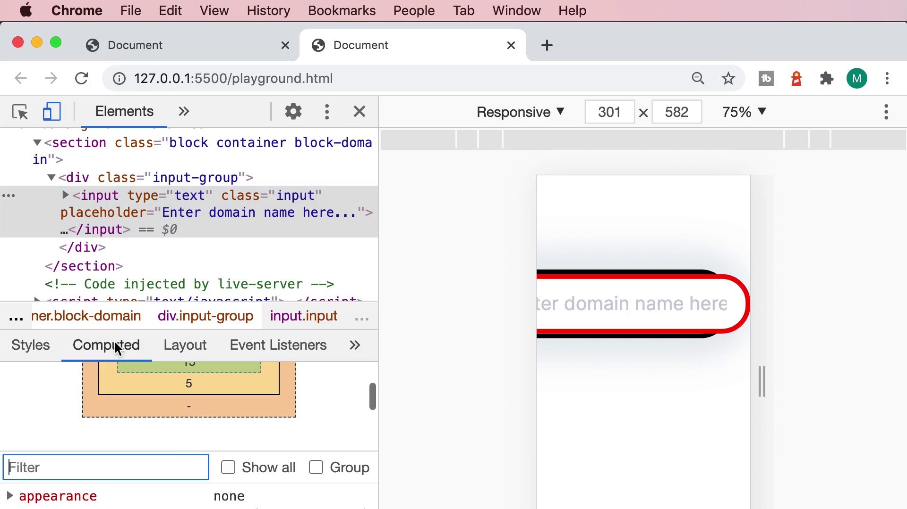

Mosh ทดลองแก้ไข property `border` ของ `.block-domain .input-group` เป็น `5px solid black` โดยตรงใน DevTools (แก้ live โดยไม่กระทบไฟล์จริง) เพื่อให้มองเห็นขอบเขตของ container ชัดเจนขึ้นเวลาไล่ดูปัญหา overflow

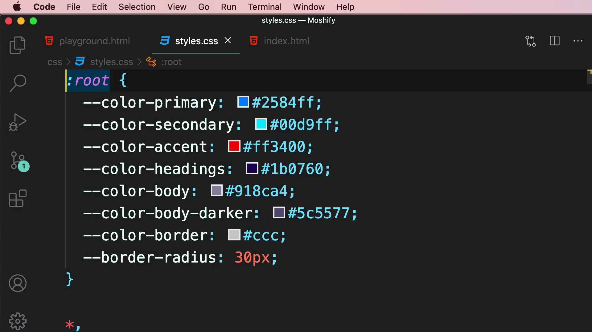

เมื่อปรับหน้าจอแคบลงไปที่ **301px** จะเห็นกรอบสีแดง (จาก DevTools element highlight) ของ `<input>` ยื่นล้นออกไปทางขวาของกรอบดำ (container) อย่างชัดเจน ยืนยันว่า input มีความกว้างขั้นต่ำที่ตายตัวและไม่ยอมหดตาม container

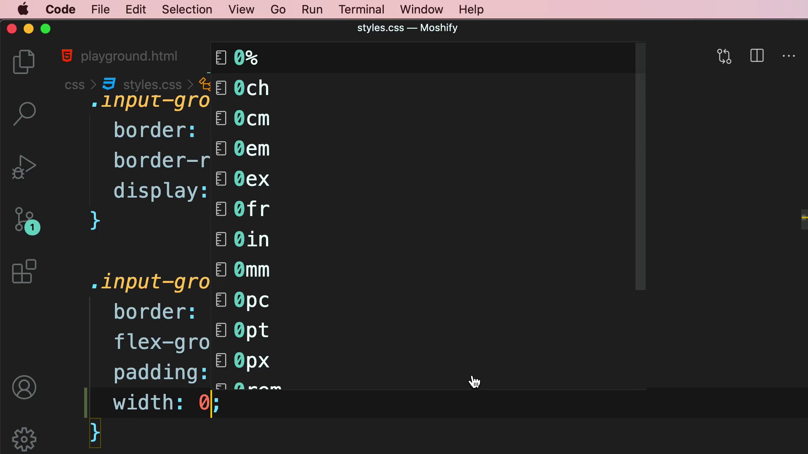

Mosh สลับกลับไปดู DOM tree ที่ element `section.block.container.block-domain` เพื่อยืนยันขนาดของ section หลักเทียบกับ input-group ข้างใน

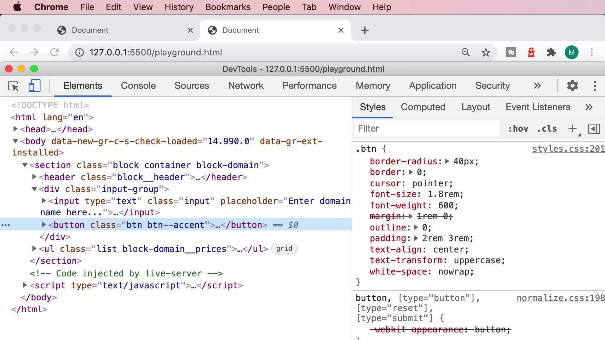

จากนั้นเปิดแท็บ **Computed** ของ `<input>` เพื่อดูค่า CSS ที่คำนวณจริง (ไม่ใช่แค่ค่าที่เขียนในไฟล์ CSS) รวมถึง `appearance: none` และค่าอื่นๆ ที่ browser คำนวณให้ในบริบทของ flex container

---

## 7. แก้ไขปัญหา: เพิ่ม `width: 0` ให้กับ Input ใน Input Group

### 7.1 เปิดไฟล์ styles.css ดูตัวแปร root

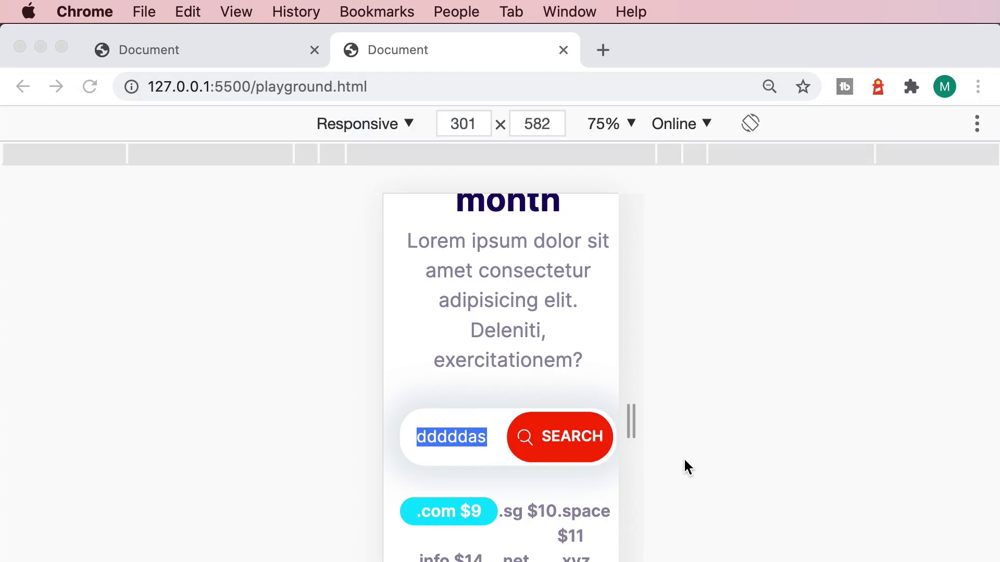

Mosh เปิดไฟล์ `css/styles.css` ใน VS Code แล้วเลื่อนขึ้นไปดูตัวแปร CSS Custom Properties ที่ `:root`:

```css
:root {
    --color-primary: #2584ff;
    --color-secondary: #00d9ff;
    --color-accent: #ff3400;
    --color-headings: #1b0760;
    --color-body: #918ca4;
    --color-body-darker: #5c5577;
    --color-border: #ccc;
    --border-radius: 30px;
}
```

### 7.2 เพิ่ม CSS Rule ใหม่: `.input-group input { width: 0; }`

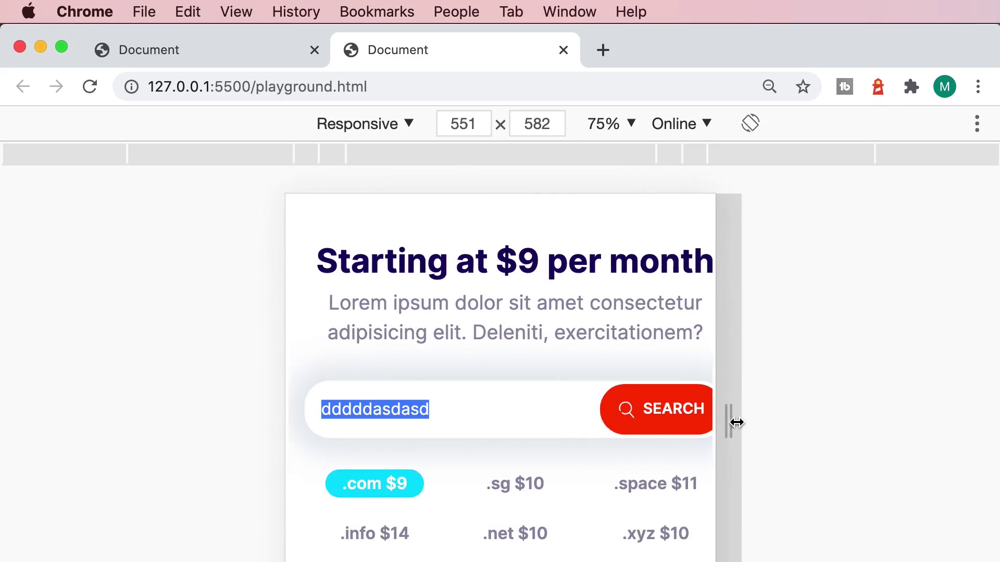

Mosh ค้นหาส่วน `.input-group` ในไฟล์ `styles.css` แล้วเพิ่ม CSS rule ใหม่:

```css
.input-group input {
    width: 0;
}
```

> ✅ **หลักการเบื้องหลังการแก้ไข**: การตั้งค่า `width: 0` ให้กับ flex item จะไปแทนที่ค่า `min-width: auto` (default ของ flex item ที่ทำให้ item ไม่มีวันเล็กกว่า content ของมัน) เมื่อ `width` ถูกกำหนดชัดเจนเป็น `0` บวกกับ `flex-grow: 1` ที่มีอยู่แล้ว input จะ**เริ่มต้นจากความกว้าง 0 แล้วค่อยขยายตามพื้นที่ที่เหลือใน flex container** ทำให้ input สามารถหดตัวลงได้ตามความกว้างของหน้าจอจริงๆ โดยไม่ล้นออกนอกกรอบอีกต่อไป นี่คือเทคนิค CSS ที่นักพัฒนามืออาชีพใช้แก้ปัญหา "flex item ไม่ยอมหด" กันบ่อยมาก

### 7.3 ทดสอบผลลัพธ์หลังแก้ไข

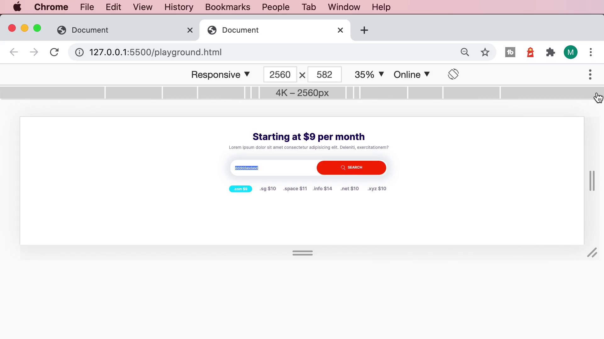

Mosh กลับไปที่ browser แล้วพิมพ์ข้อความทดสอบ `dddddasdasd` ลงในช่อง input เพื่อดูว่าเมื่อมีตัวอักษรเยอะๆ ปุ่ม Search ยังคงแสดงผลถูกต้องหรือไม่ ที่ความกว้าง **551px** ผลลัพธ์ออกมาสมบูรณ์แบบ: input หดตัวพอดี ปุ่ม SEARCH สีแดงแสดงครบถ้วนไม่ล้น


ที่ความกว้างแคบสุด **320px** (iPhone SE) ข้อความ `dddddasda...` ในช่อง input ถูกตัดพอดีกับขอบ ปุ่ม SEARCH ยังคงแสดงเต็มรูปแบบไม่ล้นออกไปแล้ว

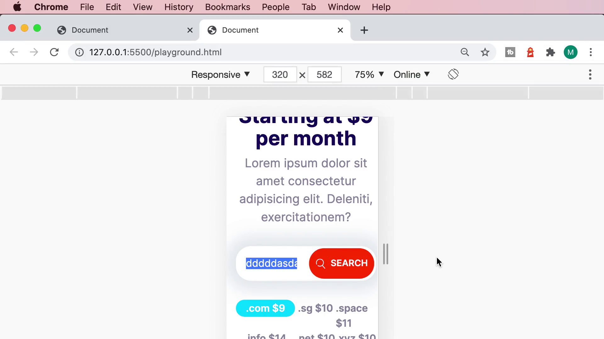

เลื่อนหน้าจอลงมาดูส่วนรายการราคาโดเมน (`.sg $10`, `.space $11` ฯลฯ) ก็ยังแสดงผลปกติ ไม่ได้รับผลกระทบจากการแก้ไข

---

## 8. ทำความสะอาดโค้ดเพิ่มเติม (Minor Cleanup)

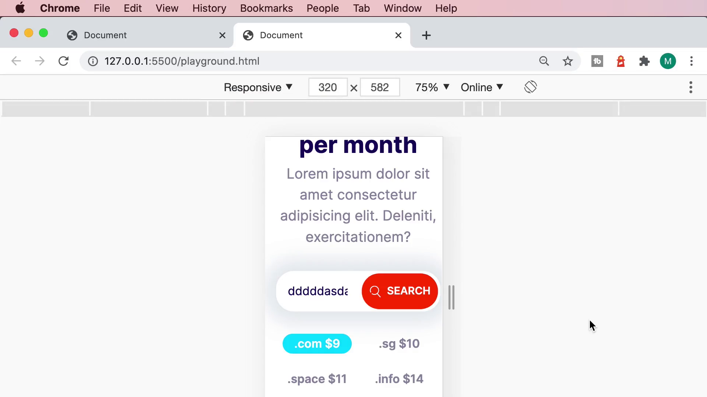

ระหว่างตรวจสอบไฟล์ `styles.css` Mosh สังเกตเห็นว่า class `.list` มีการกำหนด `color: var(--color-headings);` ซ้ำซ้อนอยู่ จึงลบทิ้งออก เนื่องจากสีของ list item ควรจะสืบทอด (inherit) มาจาก parent context ที่ถูกต้องอยู่แล้ว ไม่จำเป็นต้องบังคับสีซ้ำที่ class ทั่วไปแบบนี้:

```css
/* Lists */
.list {
    list-style: none;
    padding-left: 0;
    /* ลบ: color: var(--color-headings); */
}
```

> 📌 นี่เป็นตัวอย่างของการทำ code review เล็กๆ น้อยๆ ระหว่างการแก้บั๊ก — เมื่อ Mosh เปิดไฟล์ CSS อยู่แล้วเพื่อหาจุดแก้ไขหลัก มักจะสังเกตเห็นจุดที่ปรับปรุงเพิ่มเติมได้ไปในตัว (source control panel ของ VS Code แสดงว่ามีการแก้ไข 2 จุดในไฟล์ `styles.css`)

Mosh เลื่อนกลับขึ้นไปดูตัวแปร `:root` อีกครั้งเพื่อตรวจทานค่าสีทั้งหมดให้แน่ใจว่ายังถูกต้องตรงกัน:

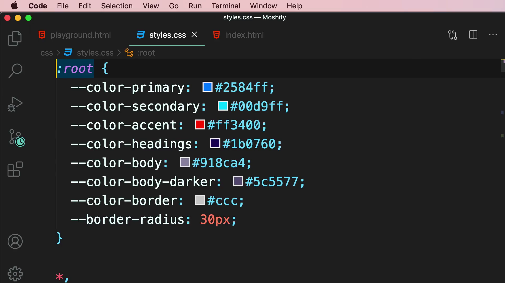

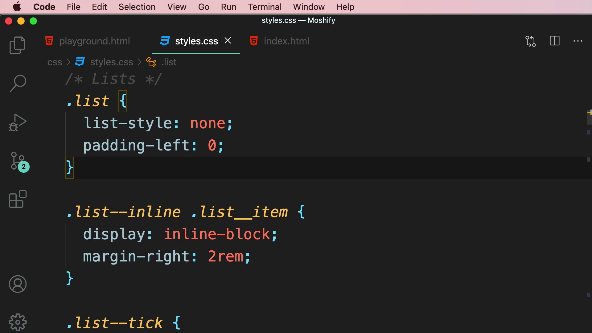

จากนั้นใช้ฟีเจอร์ Go to Line (`Ctrl+G`) เพื่อกระโดดไปยังบรรทัดที่ต้องการตรวจสอบอย่างรวดเร็ว:

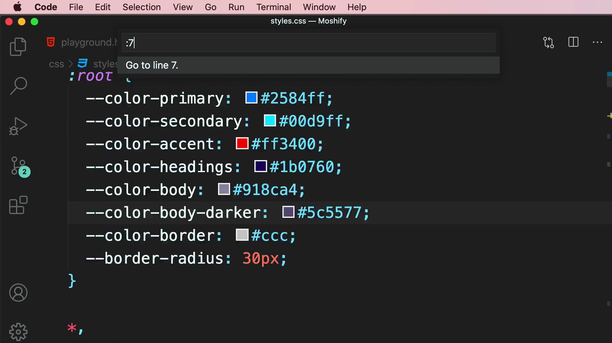

Mosh เลื่อนไปตรวจสอบ rule `.block-domain__prices` ที่กำหนด grid layout ของรายการราคาโดเมน เพื่อให้แน่ใจว่าการแก้ไขปัญหา `.input-group` จะไม่กระทบกับส่วนนี้:

```css
.block-domain__prices {
    display: grid;
    grid-template-columns: repeat(2, 1fr);
    grid-template-rows: repeat(2, 6rem);
    font-size: 2rem;
    font-weight: 600;
    justify-items: center;
    max-width: 700px;
}
```

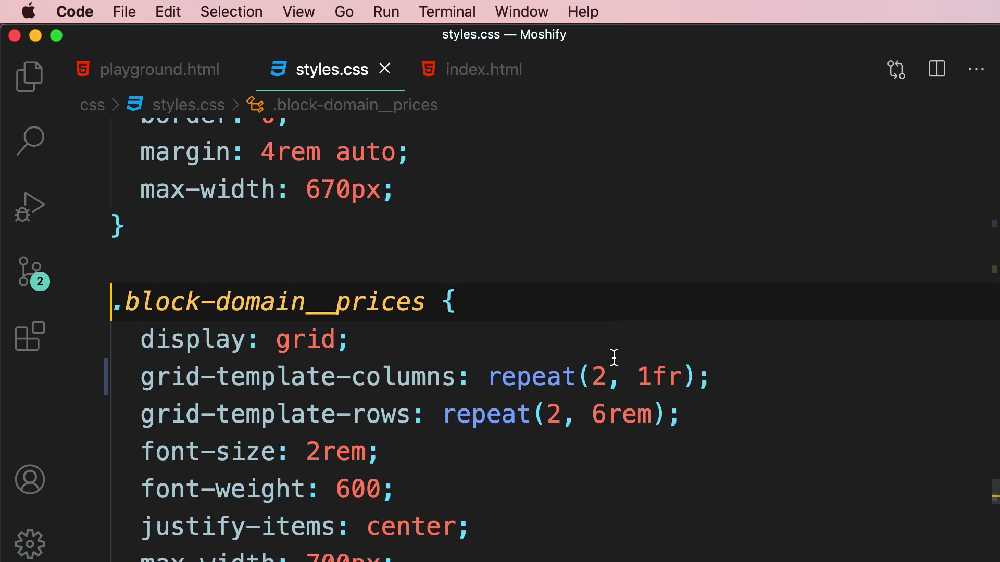

และตรวจสอบ rule ด้านบนที่มี `color: var(--color-headings);` กำกับสีของราคาโดเมนไว้แยกต่างหาก (คนละจุดกับ `.list` ที่เพิ่งลบสีซ้ำซ้อนออกไป):

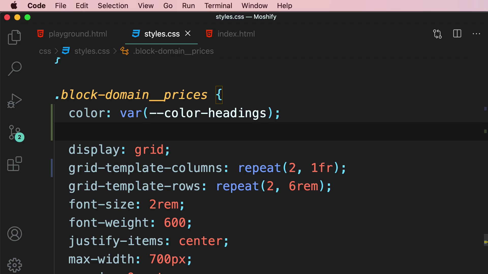

---

## 9. ตรวจสอบผลลัพธ์สุดท้ายในทุกขนาดหน้าจอ

Mosh ทำการทดสอบซ้ำอีกครั้งในหลากหลายความกว้างหน้าจอเพื่อยืนยันว่าปัญหาได้รับการแก้ไขอย่างสมบูรณ์:

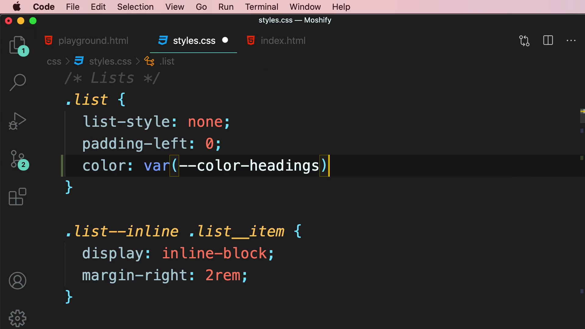

ที่ **320px**: ปุ่ม Search แสดงผลปกติ ไม่มีการล้นอีกต่อไป

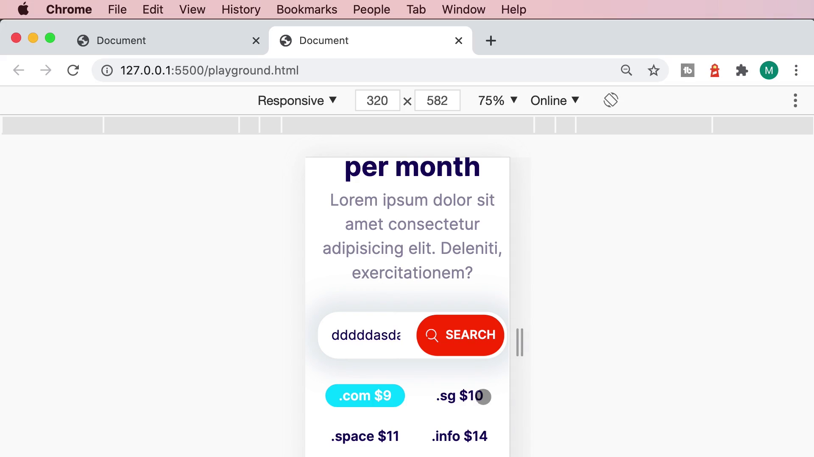

เลื่อนลงดูส่วนราคาโดเมนทั้งหมด (`.com $9`, `.sg $10` ฯลฯ) ที่ความกว้าง 320px ก็ยังคงจัดเรียงเป็น 2 คอลัมน์ตาม grid ที่ตั้งไว้ ไม่ได้รับผลกระทบใดๆ จากการแก้ไข `.input-group input`

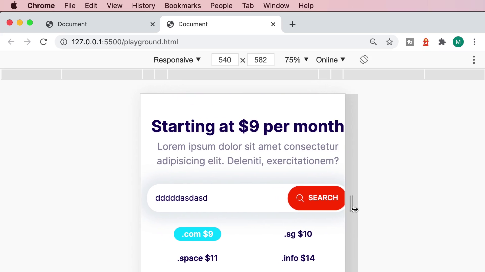

ที่ **540px**: layout สมบูรณ์ ราคาโดเมนแสดงเป็น 2 คอลัมน์

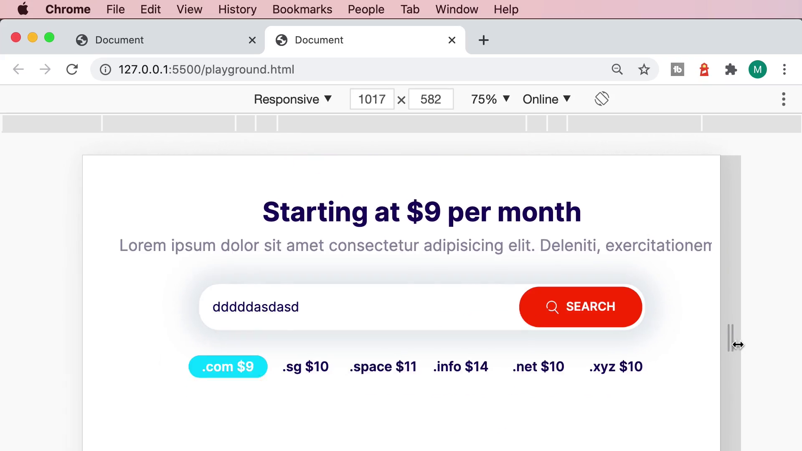

ที่ **1017px** (หน้าจอกว้าง): ราคาโดเมนขยายเป็นแถวเดียว 6 คอลัมน์ ปุ่ม Search ยังคงสัดส่วนถูกต้องสมบูรณ์แบบ

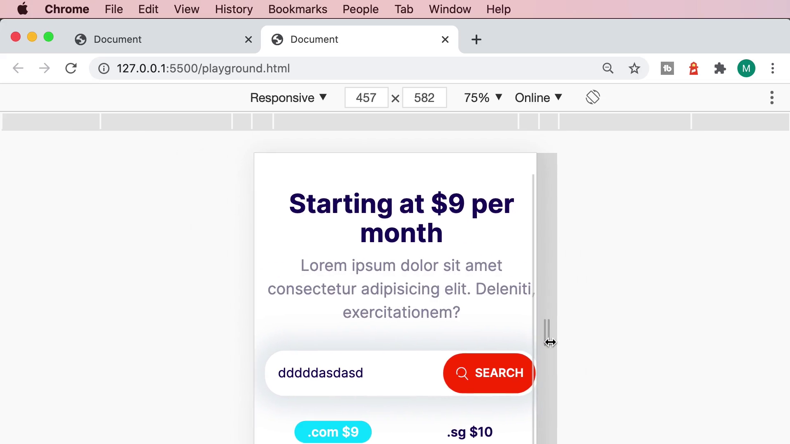

ที่ **457px**: การจัดวางยังคงถูกต้อง ไม่มีจุดใดที่ล้นหรือผิดเพี้ยนอีกแล้ว

> ✅ Mosh สรุปว่าเมื่อลากปรับความกว้างหน้าจอไล่ตั้งแต่เล็กสุดไปจนถึงใหญ่สุด (ทุกค่าที่เป็นไปได้ ไม่ใช่แค่ breakpoint ที่กำหนดไว้) ปัญหาการล้นของปุ่ม Search ได้หายไปอย่างสมบูรณ์แล้ว

---

## สรุปภาพรวมของคลิปนี้

| หัวข้อ | รายละเอียด |
|---|---|
| ปัญหาที่พบ | ปุ่ม SEARCH ในกล่องค้นหาโดเมน (Block Domain) ล้นออกนอกกรอบที่บางความกว้างหน้าจอ |
| เทคนิคการวินิจฉัย | สร้างไฟล์ `playground.html` แยกต่างหาก คัดลอกเฉพาะ component ที่มีปัญหามาทดสอบ |
| เครื่องมือที่ใช้ | Chrome DevTools (Elements panel, Styles panel, Computed tab, Device Toolbar / Responsive mode) |
| สาเหตุของปัญหา | `.input-group` เป็น `display: flex` แต่ `.input` ข้างในไม่มี `width` กำหนดชัดเจน ทำให้ `min-width: auto` (default ของ flex item) บังคับให้ input กว้างเท่า min-content เสมอ ไม่ยอมหดตามพื้นที่ |
| วิธีแก้ไข | เพิ่ม CSS rule `.input-group input { width: 0; }` เพื่อ override ค่า min-width default และให้ `flex-grow: 1` ทำงานได้อย่างถูกต้อง |
| การทดสอบยืนยัน | ลากปรับ Responsive viewport ตั้งแต่ 301px ถึง 2560px และพิมพ์ข้อความยาวทดสอบในช่อง input |
| การปรับปรุงเพิ่มเติม | ลบ `color: var(--color-headings)` ที่ซ้ำซ้อนออกจาก class `.list` |

**แนวคิดสำคัญที่ได้จากคลิปนี้**

1. **สร้าง Playground แยกเพื่อ Debug** — เมื่อเจอปัญหาเลย์เอาต์ในหน้าเว็บที่ซับซ้อน ให้สร้างไฟล์ HTML แยกต่างหาก (เชื่อม stylesheet เดียวกัน) แล้วคัดลอกเฉพาะส่วนที่มีปัญหามาทดสอบอย่างโดดเดี่ยว จะทำให้วิเคราะห์ได้ง่ายและเร็วขึ้นมาก
2. **ไล่ปรับ Responsive Viewport ทีละนิด** — อย่าทดสอบแค่ breakpoint ที่ตั้งไว้ (เช่น 320px, 768px) แต่ควรลากปรับความกว้างอย่างต่อเนื่องเพื่อหาว่าปัญหาเกิดขึ้นที่ช่วงไหนบ้าง เพราะบั๊กบางอย่างไม่ได้ผูกกับ breakpoint
3. **เข้าใจพฤติกรรม Default ของ Flex Item** — flex item แต่ละตัวมีค่า `min-width: auto` เป็นค่าเริ่มต้น ซึ่งทำให้ item ไม่มีวันหดเล็กกว่าความกว้างของ content ภายใน (min-content) แม้จะตั้ง `flex-shrink` หรือ `flex-grow` ไว้ก็ตาม
4. **เทคนิค `width: 0` แก้ปัญหา Flex Item ไม่ยอมหด** — การกำหนด `width: 0` ให้กับ flex item ที่มี `flex-grow` จะช่วยให้ item เริ่มต้นจากศูนย์แล้วขยายตามพื้นที่ที่เหลือจริง แทนที่จะยึดติดกับความกว้างของ content ภายใน
5. **ใช้ DevTools Styles และ Computed Tab ควบคู่กัน** — Styles panel บอกว่า CSS rule ไหนกำลังมีผล (และรู้ลำดับ specificity) ส่วน Computed tab บอกค่าที่ browser คำนวณจริงหลังรวมทุก rule เข้าด้วยกัน ใช้ทั้งคู่ร่วมกันจะวิเคราะห์ปัญหาได้แม่นยำกว่า
6. **ทดสอบด้วยข้อมูลจริงที่ยาวกว่าปกติ** — การพิมพ์ข้อความทดสอบยาวๆ ลงในฟอร์ม (เช่น `dddddasdasd`) ช่วยจำลองสถานการณ์การใช้งานจริงที่ผู้ใช้อาจพิมพ์ข้อความยาว ทำให้มั่นใจได้ว่าการแก้ไขนั้นครอบคลุมกรณีการใช้งานจริง

---

*สรุปโดยละเอียดจากคลิปการสอนของ Mosh Hamedani (Code with Mosh) หลักสูตร "Building a Website with HTML and CSS" คลิปที่ 38: Troubleshooting Layout Issues*
