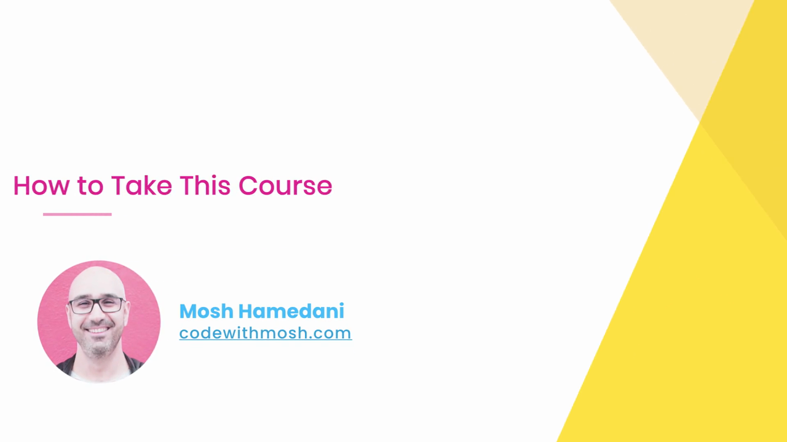
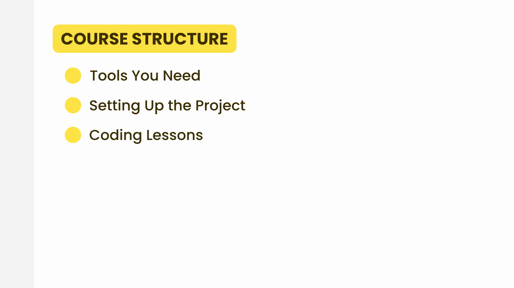
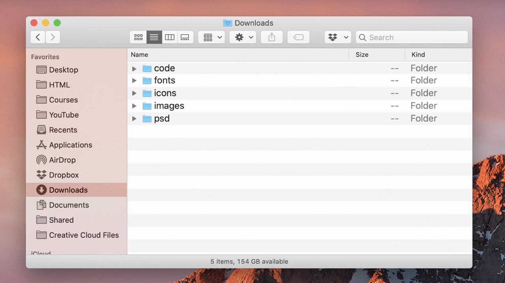
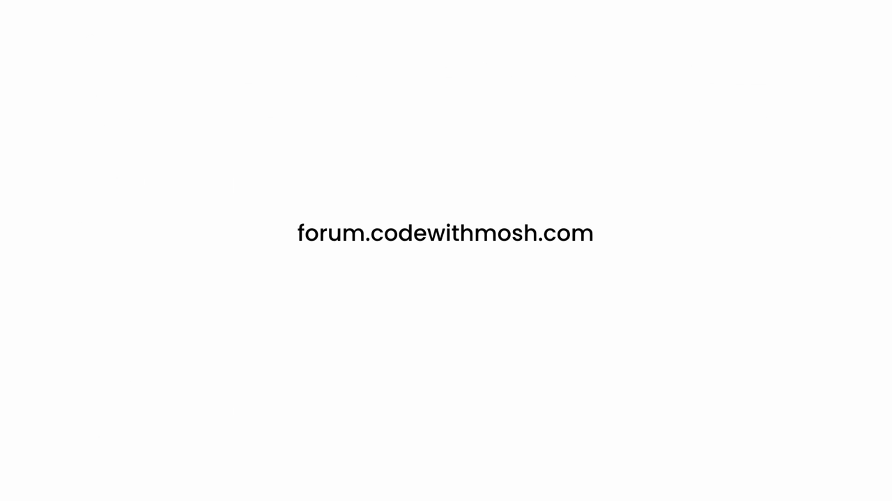

# HTML-CSS-3: 04 - How to Take This Course (1:45)

**ไฟล์ต้นทาง:** `4-How_to_Take_This_Course.mp4`

▶️ **[เปิดวิดีโอต้นฉบับ](../../HTML-CSS-3/4-How_to_Take_This_Course.mp4)**

---

## ภาพรวมคลิปนี้

คลิปนี้ Mosh อธิบายโครงสร้างของคอร์ส "Building a Web Site" และแนะนำวิธีเรียนให้ได้ผลดีที่สุด ก่อนจะเริ่มลงมือปฏิบัติจริงในคลิปถัดไป โดยครอบคลุมสามส่วนหลัก: เครื่องมือที่ต้องใช้, การตั้งค่าโปรเจกต์, และรูปแบบของบทเรียนโค้ดดิ้ง พร้อมแนะนำช่องทางขอความช่วยเหลือเมื่อติดขัด

---

## 1. เปิดคลิปด้วยสไลด์ชื่อเรื่อง

สไลด์ชื่อคลิป **"How to Take This Course"** พร้อมรูปโปรไฟล์ผู้สอน:

---

## 2. โครงสร้างคอร์ส (Course Structure)

สไลด์ป้ายเหลือง **"COURSE STRUCTURE"** ทยอยเผยหัวข้อทีละข้อ จนครบทั้งสามส่วน:

> โครงสร้างคอร์สแบ่งเป็นสามส่วนตามลำดับ:
> 1. **Tools You Need** — เครื่องมือที่ต้องติดตั้งก่อนเริ่ม (คลิปถัดไป)
> 2. **Setting Up the Project** — การเตรียมไฟล์และโฟลเดอร์โปรเจกต์
> 3. **Coding Lessons** — บทเรียนลงมือเขียนโค้ดจริงทีละส่วนของเว็บไซต์ Moshify

---

## 3. โครงสร้างไฟล์โปรเจกต์ที่ดาวน์โหลดมา

Mosh แสดงหน้าต่าง Finder ของ macOS เปิดโฟลเดอร์ **Downloads** ที่มีไฟล์ทรัพยากรของโปรเจกต์ (ดาวน์โหลดมาพร้อมคอร์ส) แบ่งเป็น 5 โฟลเดอร์ย่อย:

> โฟลเดอร์ทรัพยากรของโปรเจกต์ประกอบด้วย:
> - **code** — โฟลเดอร์ว่างสำหรับเริ่มเขียนโค้ด HTML/CSS ของตัวเอง
> - **fonts** — ไฟล์ฟอนต์ที่ใช้ในดีไซน์
> - **icons** — ไอคอนกราฟิกต่างๆ ที่ใช้ในหน้าเว็บ
> - **images** — รูปภาพประกอบเนื้อหา
> - **psd** — ไฟล์ดีไซน์ต้นแบบ Photoshop (`mobile.psd`, `standard.psd`)
>
> Mosh แนะนำให้ผู้เรียนดาวน์โหลดโฟลเดอร์นี้มาเตรียมไว้ก่อนเริ่มลงมือเขียนโค้ดตามคอร์ส เพื่อให้มีทรัพยากร (ฟอนต์ ไอคอน รูปภาพ) ครบตามที่ใช้ในวิดีโอ

---

## 4. รูปแบบบทเรียนโค้ดดิ้ง

Footage สต็อกแสดงนักพัฒนากำลังนั่งพิมพ์โค้ดที่แล็ปท็อปอย่างตั้งใจ ใช้ประกอบการอธิบายรูปแบบของบทเรียนโค้ดดิ้งที่จะตามมา:

> Mosh อธิบายว่าบทเรียนโค้ดดิ้งแต่ละคลิปจะพาลงมือเขียนโค้ดส่วนหนึ่งของหน้าเว็บ Moshify ทีละขั้นตอน โดยแนะนำให้ผู้เรียน**เขียนโค้ดตามไปพร้อมกัน** แทนที่จะดูเฉยๆ เพื่อให้เกิดความเข้าใจและความชำนาญจริง

---

## 5. ช่องทางขอความช่วยเหลือเมื่อติดขัด

Mosh แนะนำเว็บฟอรัมชุมชนของคอร์ส **forum.codewithmosh.com** เป็นช่องทางหลักสำหรับตั้งคำถามเมื่อเจอปัญหาหรือติดขัดระหว่างเรียน:

ตามด้วย footage สต็อกแสดงกลุ่มคนหนุ่มสาวกำลังนั่งดูแล็ปท็อปด้วยกันอย่างสนุกสนาน สื่อถึงบรรยากาศชุมชนผู้เรียนที่ช่วยเหลือกัน:

> Mosh ย้ำว่าหากเจอข้อผิดพลาดหรือไม่เข้าใจส่วนใดของบทเรียน สามารถโพสต์คำถามในฟอรัมนี้ได้ ซึ่งมีทั้ง Mosh เองและผู้เรียนคนอื่นๆ คอยช่วยตอบ

---

## สรุปภาพรวมของคลิปนี้

| ประเด็น | รายละเอียด |
|---|---|
| **หัวข้อ** | How to Take This Course — วิธีเรียนคอร์สนี้ให้ได้ผล |
| **โครงสร้างคอร์ส** | Tools You Need → Setting Up the Project → Coding Lessons |
| **โฟลเดอร์ทรัพยากรโปรเจกต์** | code, fonts, icons, images, psd |
| **ช่องทางขอความช่วยเหลือ** | forum.codewithmosh.com |

**แนวคิดสำคัญที่ได้จากคลิปนี้:**

1. **คอร์สแบ่งเป็น 3 ส่วนตามลำดับ** — เริ่มจากเตรียมเครื่องมือ, ตั้งค่าโปรเจกต์, แล้วจึงเข้าสู่บทเรียนโค้ดดิ้งจริง
2. **ควรดาวน์โหลดโฟลเดอร์ทรัพยากรโปรเจกต์ล่วงหน้า** (code, fonts, icons, images, psd) เพื่อให้มีไฟล์ฟอนต์ ไอคอน รูปภาพ และไฟล์ดีไซน์ต้นแบบครบตามที่ใช้ในบทเรียน
3. **แนะนำให้เขียนโค้ดตามไปพร้อมกับวิดีโอ** แทนที่จะดูเฉยๆ เพื่อให้เกิดทักษะและความเข้าใจที่แท้จริง
4. **มีฟอรัมชุมชน forum.codewithmosh.com คอยรองรับคำถาม** เมื่อเจอปัญหาระหว่างเรียน ไม่ต้องติดขัดอยู่คนเดียว

---

*หมายเหตุ: คลิปนี้เป็นส่วนหนึ่งของคอร์ส "Building a Web Site" โดย Mosh Hamedani (codewithmosh.com) — คลิปที่ 4*
