# HTML-CSS-3: 05 - Tools You Need (3:59)

**ไฟล์ต้นทาง:** `5-Tools_You_Need.mp4`

▶️ **[เปิดวิดีโอต้นฉบับ](../../HTML-CSS-3/5-Tools_You_Need.mp4)**

---

## ภาพรวมคลิปนี้

คลิปนี้ Mosh พาติดตั้งและตั้งค่าเครื่องมือทั้งหมดที่จำเป็นก่อนเริ่มลงมือสร้างโปรเจกต์ Moshify ได้แก่ เบราว์เซอร์สำหรับทดสอบและ DevTools, VS Code, ส่วนขยาย (Extensions) ที่ช่วยเพิ่มประสิทธิภาพการเขียน HTML/CSS จำนวน 5 ตัว, และ Git สำหรับควบคุมเวอร์ชันโค้ด

---

## 1. เปิดคลิปด้วยสไลด์ชื่อเรื่อง

สไลด์ชื่อคลิป **"Tools You Need"** พร้อมรูปโปรไฟล์ผู้สอน:

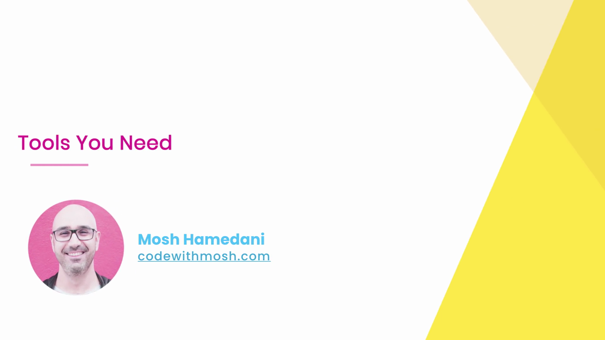

---

## 2. เบราว์เซอร์สำหรับทดสอบเว็บไซต์

Mosh แนะนำให้ติดตั้งเบราว์เซอร์อย่างน้อยสองตัวเพื่อทดสอบความเข้ากันได้ (cross-browser compatibility) โดยเปิดหน้าดาวน์โหลด **Google Chrome** (google.com/chrome):

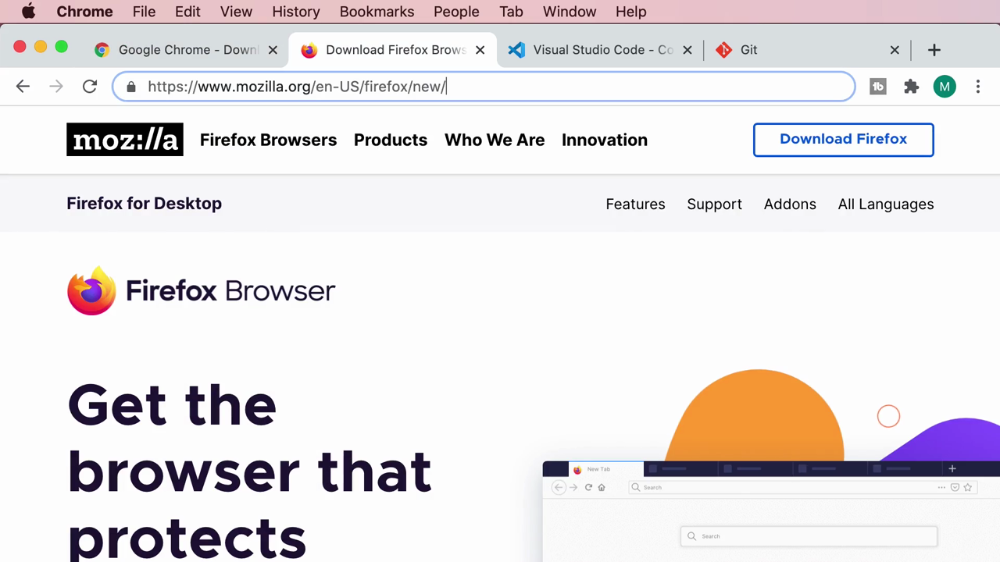

และหน้าดาวน์โหลด **Mozilla Firefox** (mozilla.org):

จากนั้นสาธิตการเปิด **Firefox DevTools** แสดงแผง Layout ที่มีเครื่องมือช่วยแสดงภาพ **Flexbox** และ **Grid** (overlay grid, grid display settings):

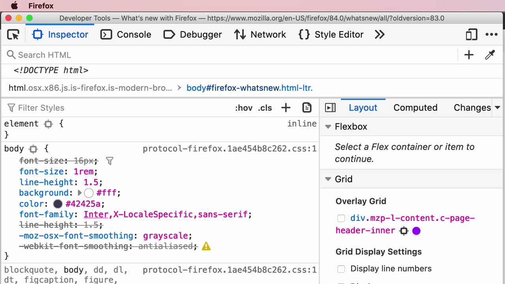

> **หมายเหตุสำคัญ:** Mosh แนะนำให้ทดสอบเว็บไซต์บนเบราว์เซอร์มากกว่าหนึ่งตัวเสมอ เพราะแต่ละเบราว์เซอร์อาจแสดงผล CSS แตกต่างกันเล็กน้อย โดยเฉพาะฟีเจอร์ใหม่ๆ Firefox DevTools มีเครื่องมือแสดงภาพ Grid/Flexbox ที่ละเอียดกว่า Chrome ในบางจุด จึงมีประโยชน์มากเวลา debug เลย์เอาต์

---

## 3. โปรแกรมแก้ไขโค้ด — Visual Studio Code

เปิดหน้าดาวน์โหลด **Visual Studio Code** (code.visualstudio.com):

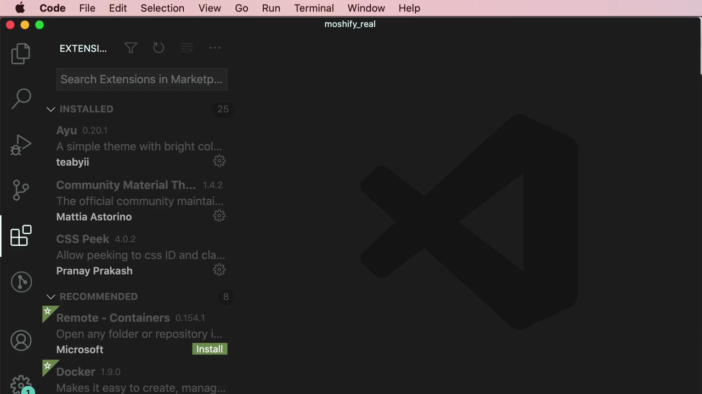

หลังติดตั้งแล้ว เปิดโปรเจกต์ **"moshify_real"** และไปที่แผง **Extensions** (ไอคอนรูปสี่เหลี่ยมต่อกัน) เพื่อติดตั้งส่วนขยายเพิ่มเติม:

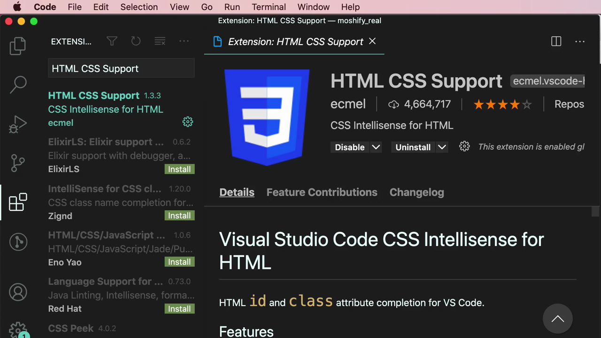

---

## 4. ส่วนขยาย VS Code ที่แนะนำ (5 ตัว)

### 4.1 HTML CSS Support

ส่วนขยายแรกคือ **HTML CSS Support** โดย ecmel — ให้ CSS IntelliSense สำหรับแอตทริบิวต์ `id` และ `class` ใน HTML:

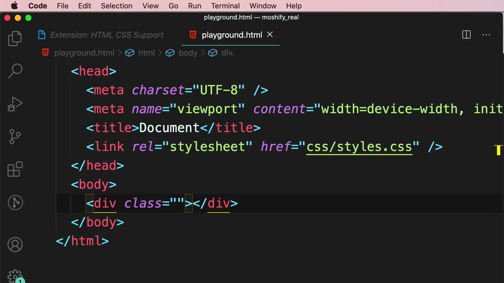

หลังติดตั้ง เมื่อพิมพ์ `class="h"` ในไฟล์ `playground.html` ระบบจะแสดงรายการ class ที่นิยามไว้แล้วในไฟล์ CSS ให้เลือกอัตโนมัติ (เช่น `hero`, `hero__content`, `hero__heading`, `card__header`):

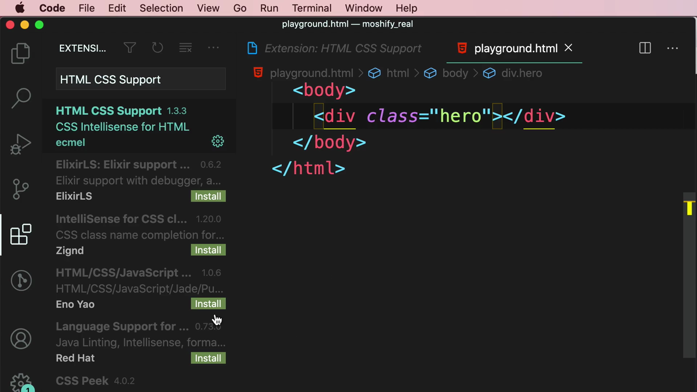

> **ประโยชน์:** ช่วยให้พิมพ์ class ตาม BEM ได้เร็วขึ้นและลดโอกาสพิมพ์ชื่อ class ผิด เพราะ VS Code จะดึงรายชื่อ class ที่มีอยู่จริงในไฟล์ CSS มาแนะนำ

### 4.2 CSS Peek

ส่วนขยายที่สอง **CSS Peek** โดย Pranay Prakash — ให้ "เปิดดู" (peek) นิยาม CSS ของ id/class ได้โดยตรงจากไฟล์ HTML โดยไม่ต้องสลับไฟล์ไปมา:

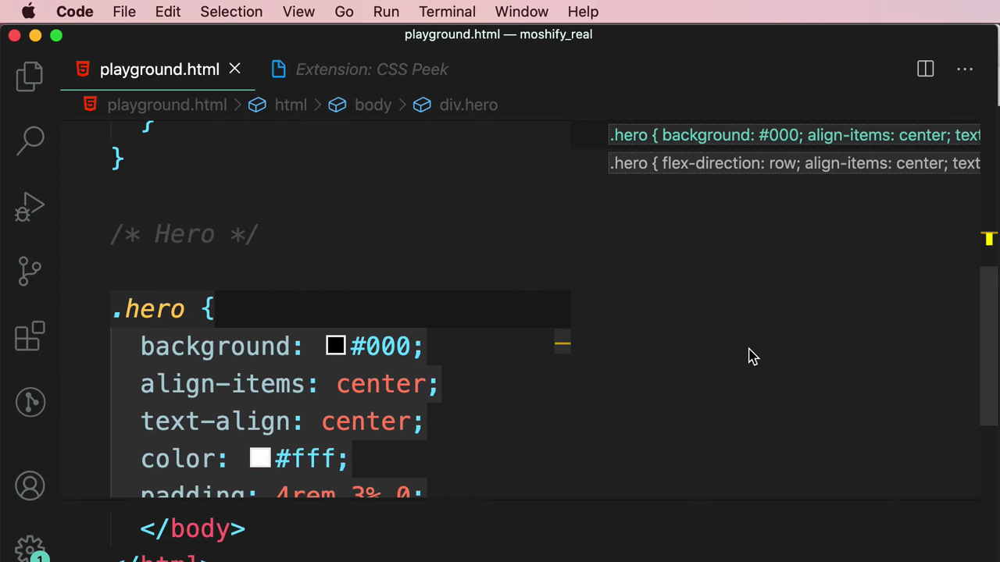

สาธิตการ peek class `.hero` ซึ่งมีนิยามอยู่ **สองที่** — กฎพื้นฐานและกฎภายใน media query — ระบบแสดงทั้งสองให้เลือกดู:

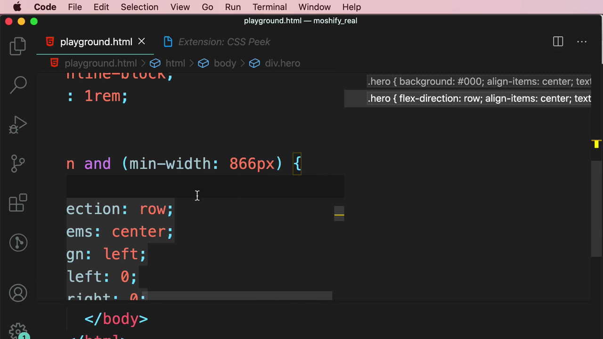

> **ประโยชน์:** ประหยัดเวลาไม่ต้องเลื่อนหาไฟล์ CSS เอง โดยเฉพาะเมื่อไฟล์ CSS มีขนาดใหญ่และมีการกำหนด selector เดียวกันซ้ำในหลาย media query

### 4.3 Prettier - Code Formatter

ส่วนขยายที่สาม **Prettier** — จัดรูปแบบโค้ดอัตโนมัติให้เป็นมาตรฐานเดียวกัน:

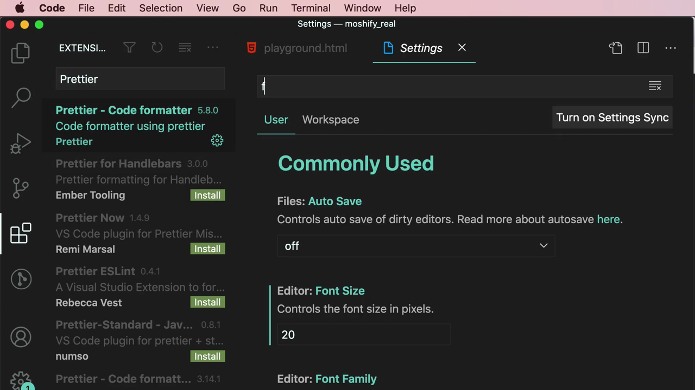

Mosh เปิด VS Code Settings แล้วค้นหา **"format on save"** และเปิดใช้งานตัวเลือก **Editor: Format On Save**:

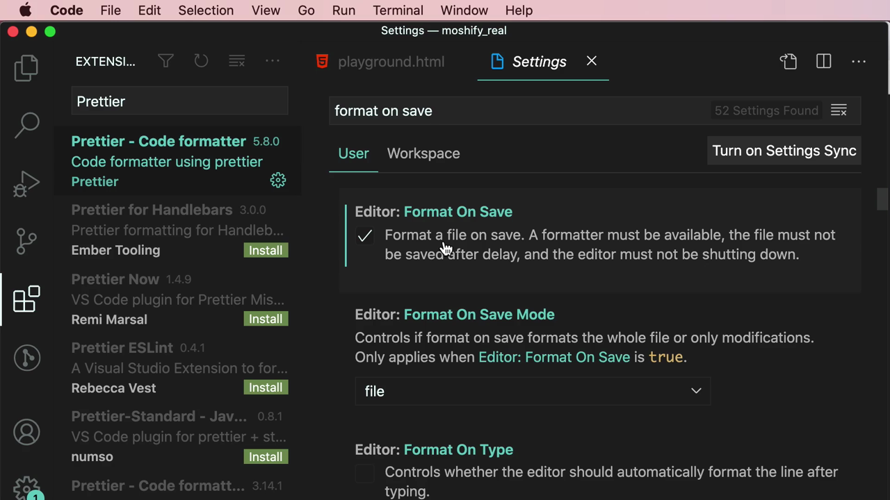

> **ประโยชน์:** เมื่อเปิด "Format On Save" ร่วมกับ Prettier ทุกครั้งที่กด Save ไฟล์ VS Code จะจัดระเบียบโค้ด (เว้นวรรค ขึ้นบรรทัดใหม่ เครื่องหมายคำพูด ฯลฯ) ให้เป็นมาตรฐานเดียวกันโดยอัตโนมัติ ไม่ต้องจัดฟอร์แมตเองด้วยมือ

### 4.4 Highlight Matching Tag

ส่วนขยายที่สี่ **Highlight Matching Tag** โดย vincaslt — ไฮไลต์แท็ก HTML คู่เปิด-ปิดที่ตรงกันให้เห็นชัดเจน:

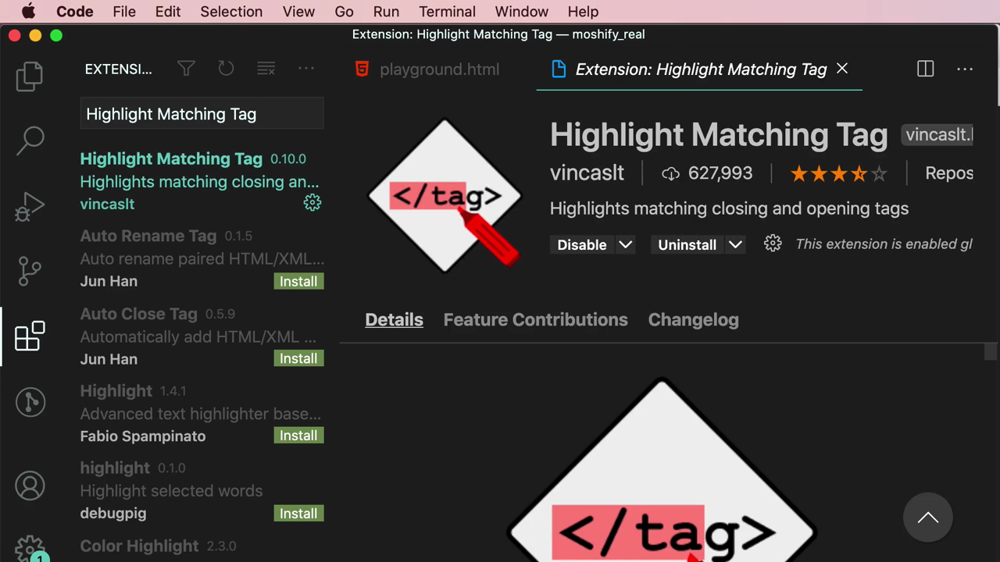

> **ประโยชน์:** เมื่อวางเคอร์เซอร์ที่แท็กปิด (เช่น `</head>`) ระบบจะไฮไลต์แท็กเปิดที่คู่กัน (`<head>`) ให้เห็นทันที ช่วยลดความสับสนเวลาไล่โครงสร้าง HTML ที่ซ้อนกันหลายชั้น

### 4.5 TODO Highlight

ส่วนขยายที่ห้า **TODO Highlight** โดย Wayou Liu — ไฮไลต์คอมเมนต์พิเศษอย่าง `TODO:` และ `FIXME:` ให้เด่นชัดในโค้ด:

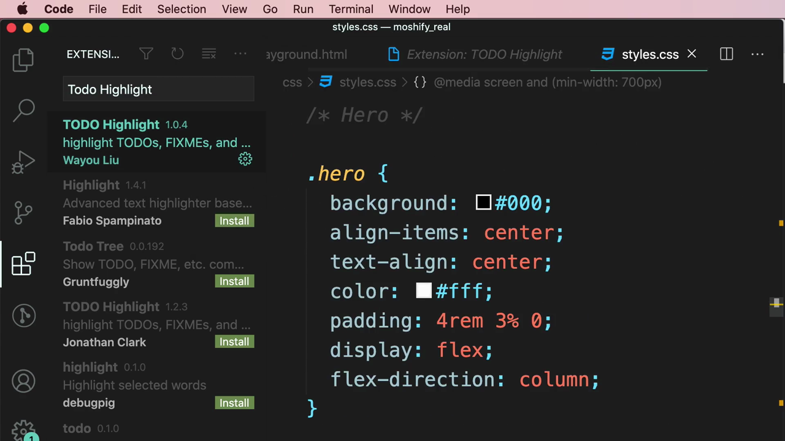

สาธิตผลลัพธ์: พิมพ์คอมเมนต์ `/* TODO: ... */` จะถูกไฮไลต์พื้นหลังสีเหลือง และ `/* FIXME: ... */` จะถูกไฮไลต์พื้นหลังสีชมพู:

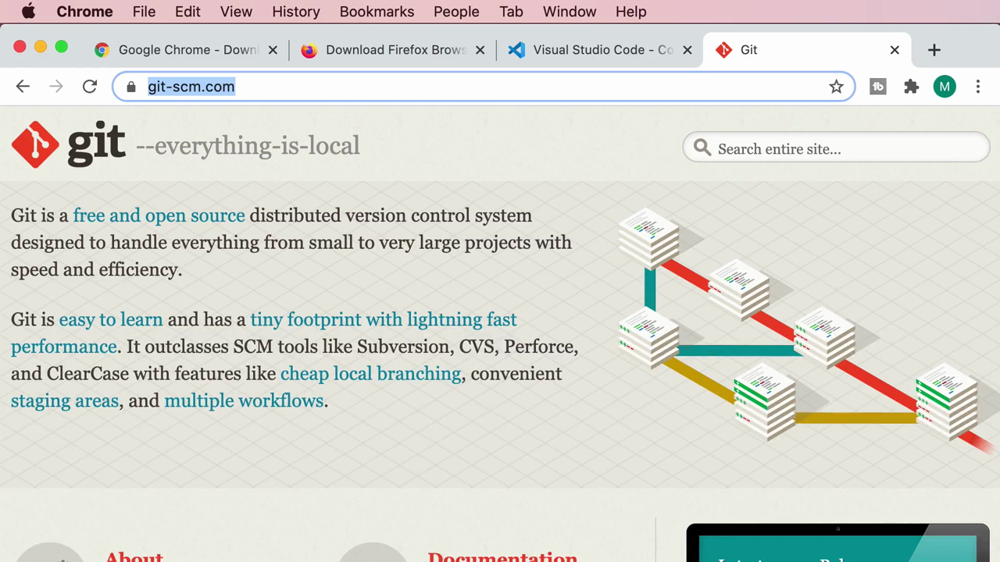

> **ประโยชน์:** ใช้จดบันทึกสิ่งที่ยังทำไม่เสร็จ (`TODO`) หรือจุดที่ต้องแก้ไข (`FIXME`) ไว้ในโค้ดโดยตรง แล้วมองเห็นได้ชัดเจนทันทีเมื่อเลื่อนผ่าน ไม่ต้องพึ่งเครื่องมือจัดการงานแยกต่างหากสำหรับรายการเล็กๆ น้อยๆ

---

## 5. Git — เครื่องมือควบคุมเวอร์ชัน

ปิดท้ายด้วยการเปิดเว็บไซต์ **git-scm.com** เพื่อดาวน์โหลด **Git**:

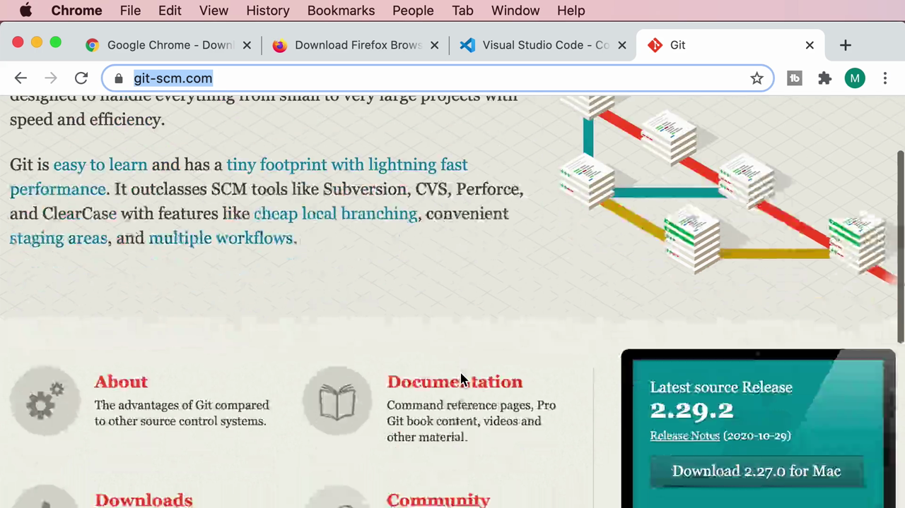

> Git อธิบายตัวเองว่าเป็น **"free and open source distributed version control system"** — ระบบควบคุมเวอร์ชันแบบกระจายศูนย์ที่ใช้ติดตามการเปลี่ยนแปลงของโค้ดตลอดระยะเวลาของโปรเจกต์ แม้คลิปนี้จะไม่ได้ลงรายละเอียดการใช้งาน Git แต่ Mosh แนะนำให้ติดตั้งไว้ล่วงหน้า เนื่องจากเป็นเครื่องมือมาตรฐานที่นักพัฒนาเว็บใช้กันแทบทุกโปรเจกต์

---

## สรุปภาพรวมของคลิปนี้

| ประเด็น | รายละเอียด |
|---|---|
| **หัวข้อ** | Tools You Need — เครื่องมือที่ต้องติดตั้งก่อนเริ่มโปรเจกต์ |
| **เบราว์เซอร์** | Google Chrome, Mozilla Firefox (แนะนำให้มีอย่างน้อย 2 ตัวเพื่อทดสอบ cross-browser) |
| **Editor** | Visual Studio Code |
| **ส่วนขยาย VS Code** | HTML CSS Support, CSS Peek, Prettier, Highlight Matching Tag, TODO Highlight |
| **เครื่องมืออื่น** | Git (version control) |

**แนวคิดสำคัญที่ได้จากคลิปนี้:**

1. **ควรมีเบราว์เซอร์มากกว่าหนึ่งตัวสำหรับทดสอบ** เพื่อตรวจสอบว่าเว็บไซต์แสดงผลถูกต้องในเบราว์เซอร์ต่างๆ (cross-browser testing) และ Firefox DevTools มีเครื่องมือแสดงภาพ Flexbox/Grid ที่มีประโยชน์มาก
2. **ส่วนขยาย VS Code ช่วยเร่งความเร็วและลดข้อผิดพลาด** ในการเขียน HTML/CSS ทั้งด้าน autocomplete (HTML CSS Support), การนำทางไปยังนิยาม CSS (CSS Peek), การจัดฟอร์แมตอัตโนมัติ (Prettier), การอ่านโครงสร้าง HTML ที่ซ้อนกัน (Highlight Matching Tag), และการจดบันทึกงานค้าง (TODO Highlight)
3. **เปิดใช้งาน "Format On Save" ร่วมกับ Prettier** ช่วยให้โค้ดมีรูปแบบสม่ำเสมอโดยอัตโนมัติทุกครั้งที่บันทึกไฟล์ ไม่ต้องจัดฟอร์แมตเองด้วยมือ
4. **Git เป็นเครื่องมือมาตรฐานสำหรับควบคุมเวอร์ชันโค้ด** ที่ควรติดตั้งไว้ล่วงหน้า แม้คลิปนี้จะยังไม่ได้ลงรายละเอียดการใช้งาน

---

*หมายเหตุ: คลิปนี้เป็นส่วนหนึ่งของคอร์ส "Building a Web Site" โดย Mosh Hamedani (codewithmosh.com) — คลิปที่ 5*
