# HTML-CSS-3: 07 - Essential Photoshop Skills (5:03)

**ไฟล์ต้นทาง:** `7-Essential_Photoshop_Skills.mp4`

▶️ **[เปิดวิดีโอต้นฉบับ](../../HTML-CSS-3/7-Essential_Photoshop_Skills.mp4)**

---

## ภาพรวมคลิปนี้

คลิปนี้ Mosh สอนทักษะพื้นฐานของ Adobe Photoshop ที่นักพัฒนา Front-end จำเป็นต้องรู้ เพื่อ "อ่าน" ไฟล์ดีไซน์ (`standard.psd`, `mobile.psd`) แล้วดึงข้อมูลที่ต้องใช้ในการเขียนโค้ด เช่น สี, ฟอนต์, ขนาด, และระยะห่าง โดยไม่จำเป็นต้องเป็นนักออกแบบมืออาชีพ

---

## 1. เปิดคลิปด้วยสไลด์ชื่อเรื่อง

สไลด์ชื่อคลิป **"Essential Photoshop Skills"** พร้อมรูปโปรไฟล์ผู้สอน:

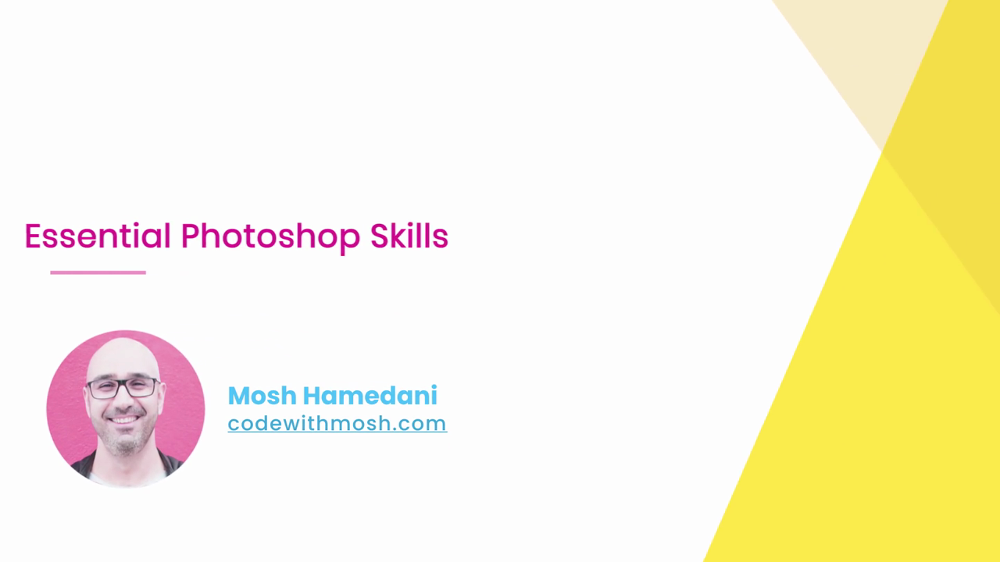

---

## 2. เปิดไฟล์ดีไซน์และดูภาพรวมทั้งหน้า

Mosh เปิดไฟล์ **`standard.psd`** (เวอร์ชันเดสก์ท็อป) ใน Photoshop 2021 แสดงภาพรวมทั้งหน้าเว็บ Moshify พร้อมเส้นไกด์แนวตั้งสีฟ้า (grid guides) ที่กำหนดคอลัมน์ของเลย์เอาต์:

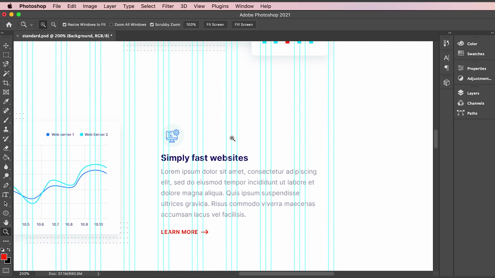

> **เส้นไกด์ (Guides)** สีฟ้าอมเขียวที่เห็นเป็นเส้นแนวตั้งขนานกันคือกริดที่นักออกแบบวางไว้ล่วงหน้า ช่วยให้นักพัฒนาเห็นแนวคอลัมน์และระยะห่างที่ดีไซน์ตั้งใจใช้ ซึ่งเป็นข้อมูลสำคัญเวลาแปลงเป็น CSS Grid หรือ Flexbox

---

## 3. การซูมและเลื่อนดูไฟล์ดีไซน์

Mosh เปิดเมนู **View** แสดงตัวเลือกการซูมและมุมมองต่างๆ:

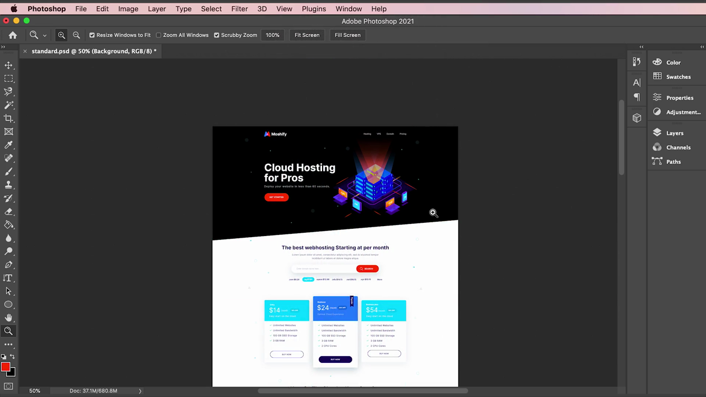

> คำสั่งสำคัญในเมนู View ที่ Mosh แนะนำ ได้แก่ **Zoom In / Zoom Out** (คีย์ลัด `Cmd +` / `Cmd -`), **Fit on Screen** (`Cmd 0` — ปรับให้พอดีหน้าจอ), **100%** (`Cmd 1` — ขนาดจริง), **Rulers** (`Cmd R` — แสดง/ซ่อนไม้บรรทัด), และกลุ่มคำสั่งจัดการ **Guides** (New Guide, Clear Guides ฯลฯ)

จากนั้นซูมออกดูภาพรวมส่วน hero ของหน้าเว็บที่ขนาด 66.7%:

> **ทักษะสำคัญ:** การซูมเข้า-ออกและเลื่อนดูไฟล์ดีไซน์อย่างคล่องแคล่วเป็นพื้นฐานที่ต้องฝึกให้ชิน เพราะต้องใช้ตลอดเวลาเพื่อตรวจสอบรายละเอียดเล็กๆ (เช่น ระยะห่าง, ขนาดไอคอน) แล้วสลับกลับมาดูภาพรวมทั้งหน้า

---

## 4. Eyedropper Tool — ดึงค่าสีจากดีไซน์

Mosh เลือก **Eyedropper Tool** จากแถบเครื่องมือด้านซ้าย:

เมนูย่อยของกลุ่มเครื่องมือเดียวกันแสดงเครื่องมือที่เกี่ยวข้อง ได้แก่ Eyedropper Tool, 3D Material Eyedropper Tool, Color Sampler Tool, **Ruler Tool**, Note Tool, และ Count Tool:

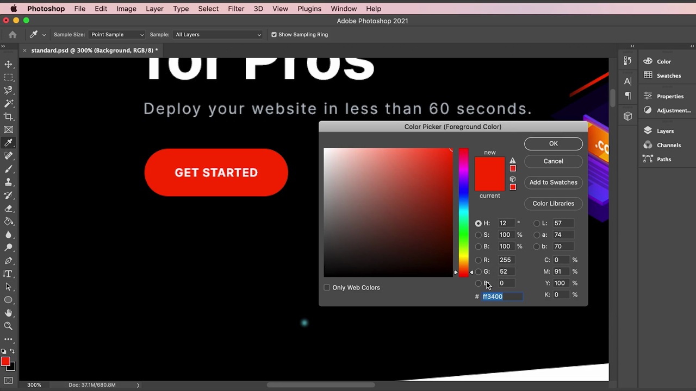

คลิกที่ปุ่ม "GET STARTED" สีแดงด้วย Eyedropper แล้วเปิด **Color Picker** เพื่อดูรหัสสีที่แม่นยำ:

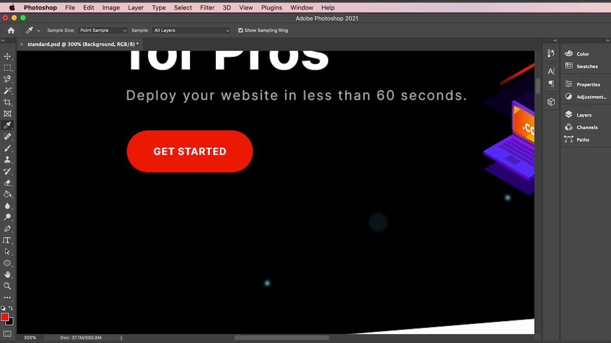

> ผลลัพธ์แสดงค่าสีที่ดูดมาคือ **`#ff3400`** (R: 255, G: 52, B: 0) — Mosh เน้นว่านี่คือวิธีที่แม่นยำที่สุดในการดึงค่าสีจากดีไซน์มาใช้ใน CSS แทนการกะประมาณด้วยสายตา

---

## 5. Type Tool — ตรวจสอบรายละเอียดตัวอักษร

เลือก **Type Tool** แล้วคลิกที่ข้อความหัวข้อ "Cloud Hosting for Pros" เพื่อดูคุณสมบัติฟอนต์ที่แถบเครื่องมือด้านบน:

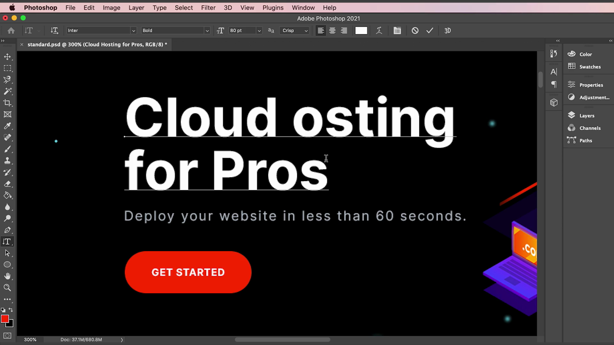

> เมื่อคลิกเข้าไปในเลเยอร์ข้อความ แถบเครื่องมือด้านบนจะแสดงรายละเอียดฟอนต์ทั้งหมดที่ใช้ ได้แก่ **ชื่อฟอนต์** (Inter), **น้ำหนัก** (Bold), และ **ขนาด** (80 pt ในตอนแรก) ซึ่งเป็นข้อมูลที่ต้องใช้เขียน CSS `font-family`, `font-weight`, `font-size` ให้ตรงกับดีไซน์

---

## 6. เปลี่ยนหน่วยวัดจาก Points เป็น Pixels

Mosh ชี้ให้เห็นปัญหา: Photoshop แสดงขนาดฟอนต์เป็นหน่วย **Points (pt)** โดยค่าเริ่มต้น แต่ CSS ใช้หน่วย **Pixels (px)** จึงต้องเปลี่ยนการตั้งค่า เข้าไปที่ **Photoshop > Preferences > Units & Rulers**:

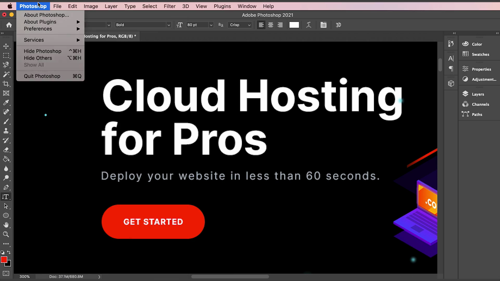

หน้าต่าง Preferences แสดงตัวเลือก **Rulers: Inches** และ **Type: Points**:

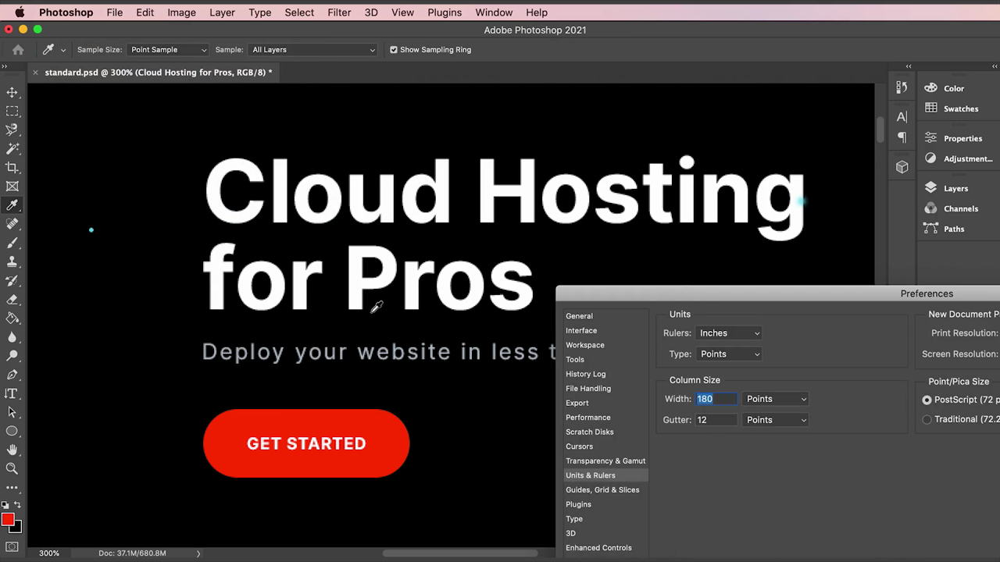

หลังเปลี่ยนหน่วย Type เป็น **Pixels** แล้ว แถบเครื่องมือ Type Tool จะแสดงขนาดฟอนต์เป็น **"80 px"** แทน "80 pt":

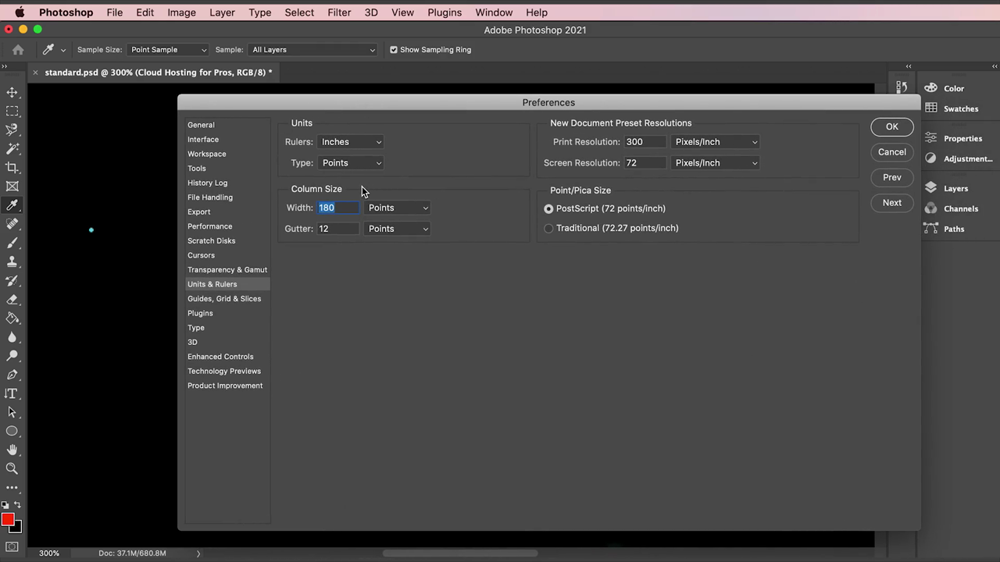

> **หลักการสำคัญ:** ควรตั้งค่า Photoshop ให้แสดงหน่วยเป็น **pixels** ตั้งแต่แรก เพื่อให้ตัวเลขที่อ่านได้จากดีไซน์ (ขนาดฟอนต์, ระยะห่าง) สามารถนำไปใช้ในโค้ด CSS ได้โดยตรงโดยไม่ต้องแปลงหน่วยเอง ลดโอกาสคำนวณผิดพลาด

---

## 7. เปรียบเทียบดีไซน์ Desktop กับ Mobile

Mosh เปิดไฟล์ **`mobile.psd`** เพิ่มอีกแท็บหนึ่ง แสดงภาพรวมเวอร์ชันมือถือทั้งหน้า:

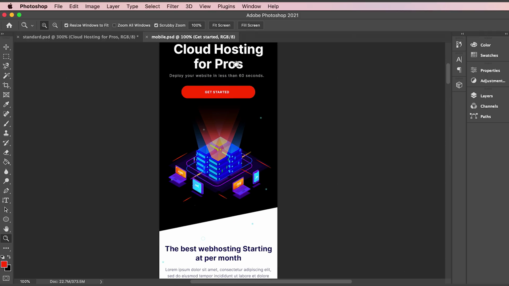

ซูมเข้าไปที่ส่วน hero ของเวอร์ชันมือถือเพื่อเปรียบเทียบกับเดสก์ท็อป:

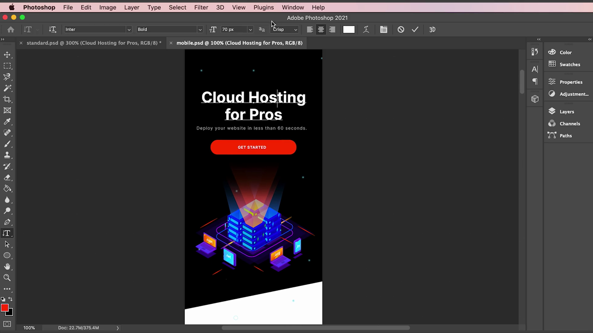

เมื่อคลิกที่ข้อความหัวข้อในเวอร์ชันมือถือด้วย Type Tool พบว่าขนาดฟอนต์เป็น **"70 px"** ซึ่งเล็กกว่าเวอร์ชันเดสก์ท็อป (80 px):

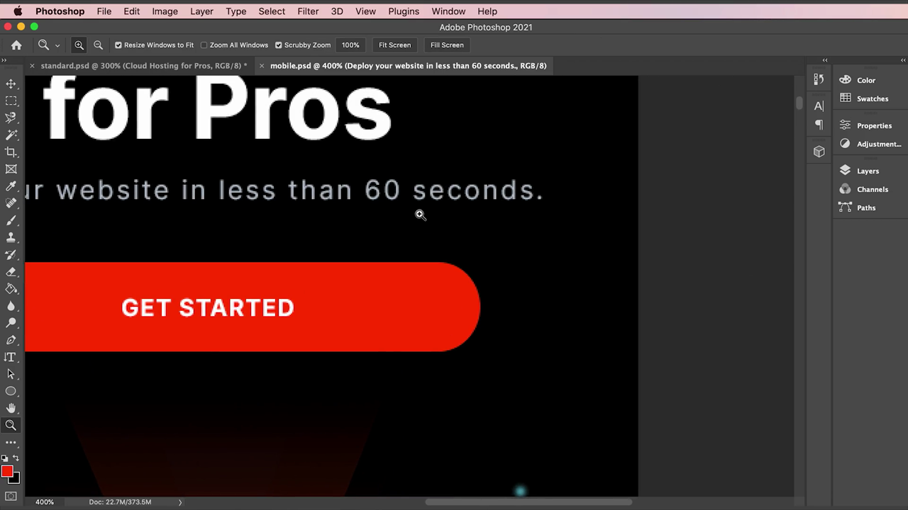

> **ข้อสังเกตสำคัญ:** ไฟล์ดีไซน์สองไฟล์ (`standard.psd` และ `mobile.psd`) ไม่ได้เป็นแค่ขนาดหน้าจอที่ต่างกันเท่านั้น แต่รายละเอียดอย่างขนาดฟอนต์ก็ถูกออกแบบมาให้ต่างกันด้วย (80px บนเดสก์ท็อป vs 70px บนมือถือ) นักพัฒนาจึงต้องเปิดเทียบทั้งสองไฟล์เสมอ เพื่อรู้ว่าค่าใดควรอยู่ใน media query สำหรับหน้าจอเล็ก

---

## 8. Ruler Tool — วัดระยะห่างระหว่างองค์ประกอบ

เลือก **Ruler Tool** จากกลุ่มเครื่องมือเดียวกับ Eyedropper แล้วลากวัดระยะห่างระหว่างองค์ประกอบสองจุด:

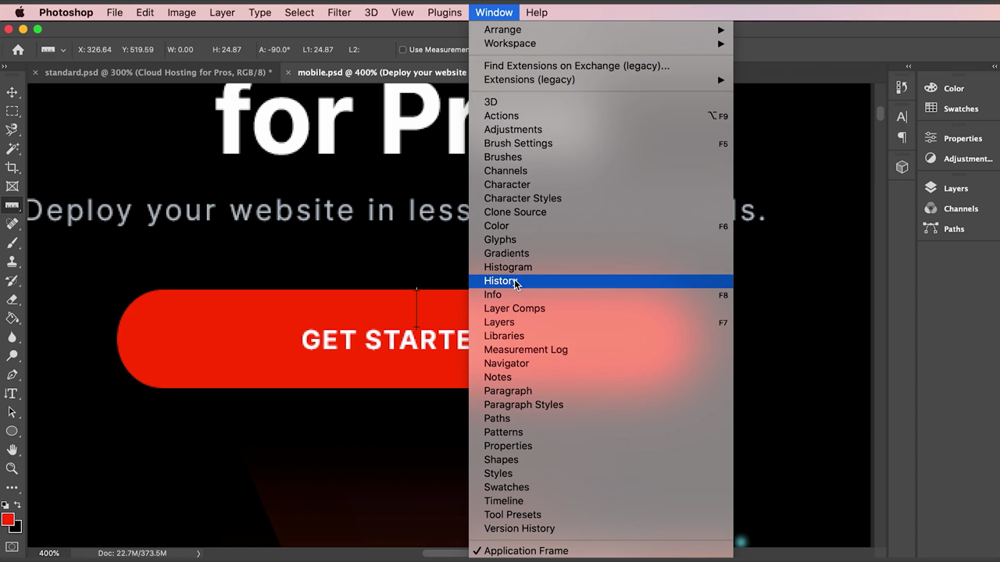

> แถบเครื่องมือด้านบนแสดงค่าที่วัดได้แบบละเอียด: ตำแหน่ง X/Y, ความกว้าง (W), ความสูง (H), มุมองศา (A), และความยาวเส้น (L1) เป็นหน่วย pixels ทำให้วัดระยะห่าง (margin/padding) ระหว่าง element ในดีไซน์ได้อย่างแม่นยำ แทนการกะด้วยสายตา

---

## 9. History Panel — แก้ไขเมื่อพลาด

Mosh เปิดเมนู **Window > History** เพื่อแสดงแผงประวัติการแก้ไข:

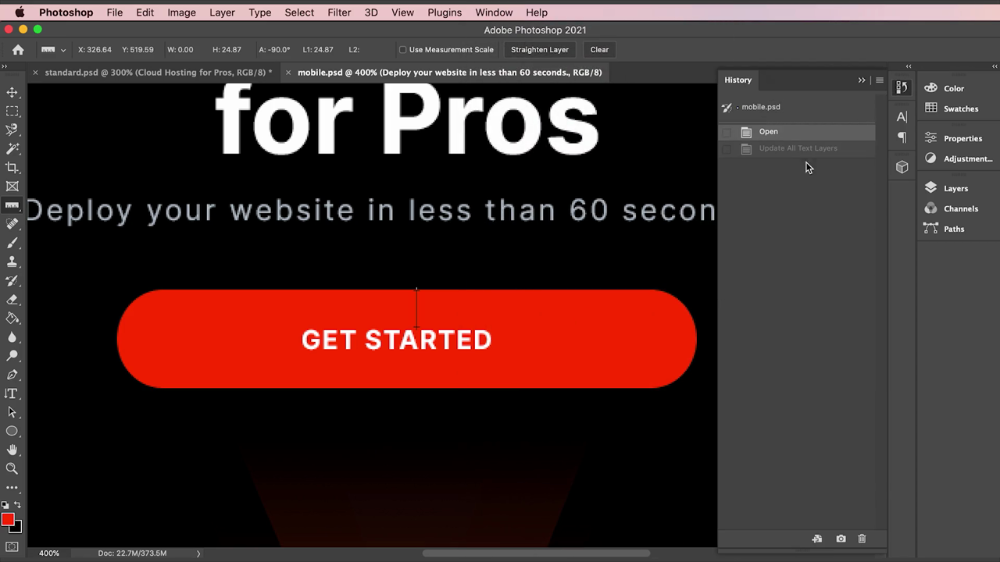

แผง History แสดงลำดับขั้นตอนการแก้ไขไฟล์ทั้งหมด (Open, Update All Text Layers ฯลฯ) และสามารถคลิกย้อนกลับไปยังขั้นตอนใดก็ได้:

> **ประโยชน์:** เนื่องจากนักพัฒนาที่ไม่ชำนาญ Photoshop อาจคลิกหรือพิมพ์ผิดพลาดบนไฟล์ดีไซน์โดยไม่ตั้งใจ (เช่น พิมพ์ตัวอักษรทับเลเยอร์ข้อความเดิม) แผง History ช่วยให้ย้อนกลับไปยังสถานะก่อนหน้าได้ง่าย โดยไม่ต้องกังวลว่าจะทำไฟล์ดีไซน์ต้นฉบับเสียหาย

---

## สรุปภาพรวมของคลิปนี้

| ประเด็น | รายละเอียด |
|---|---|
| **หัวข้อ** | Essential Photoshop Skills — ทักษะ Photoshop ที่จำเป็นสำหรับนักพัฒนา |
| **เครื่องมือที่สอน** | Zoom/Rulers/Guides (View menu), Eyedropper Tool, Type Tool, Ruler Tool, History panel |
| **การตั้งค่าสำคัญ** | เปลี่ยนหน่วย Type จาก Points เป็น Pixels (Preferences > Units & Rulers) |
| **ไฟล์ดีไซน์ที่เปรียบเทียบ** | `standard.psd` (เดสก์ท็อป, ฟอนต์หัวข้อ 80px) vs `mobile.psd` (มือถือ, ฟอนต์หัวข้อ 70px) |

**แนวคิดสำคัญที่ได้จากคลิปนี้:**

1. **ไม่จำเป็นต้องเป็นนักออกแบบมืออาชีพ** เพียงแค่รู้ทักษะพื้นฐาน 5 อย่างของ Photoshop (ซูม/เลื่อนดู, ดูดสี, ตรวจสอบฟอนต์, วัดระยะ, ย้อนกลับการแก้ไข) ก็เพียงพอสำหรับแปลงดีไซน์เป็นโค้ดได้แล้ว
2. **Eyedropper Tool + Color Picker คือวิธีดึงรหัสสีที่แม่นยำที่สุด** ไม่ควรกะสีด้วยสายตาเพราะอาจคลาดเคลื่อนได้
3. **ตั้งค่าหน่วยวัดใน Photoshop เป็น Pixels ตั้งแต่แรก** (Preferences > Units & Rulers) เพื่อให้ตัวเลขที่อ่านได้นำไปใช้ใน CSS ได้ทันทีโดยไม่ต้องแปลงหน่วย
4. **ต้องเปิดเทียบทั้งไฟล์ Desktop และ Mobile เสมอ** เพราะรายละเอียดอย่างขนาดฟอนต์อาจถูกออกแบบมาให้ต่างกันโดยเจตนา ไม่ใช่แค่ปรับสัดส่วนเดียวกัน
5. **Ruler Tool ช่วยวัดระยะห่างระหว่าง element ได้แม่นยำเป็นพิกเซล** มีประโยชน์มากเวลาต้องกำหนดค่า margin/padding ให้ตรงกับดีไซน์
6. **แผง History ช่วยย้อนกลับการแก้ไขที่ผิดพลาดโดยไม่ตั้งใจ** ทำให้มั่นใจได้ว่าจะไม่ทำไฟล์ดีไซน์ต้นฉบับเสียหายถาวร

---

*หมายเหตุ: คลิปนี้เป็นส่วนหนึ่งของคอร์ส "Building a Web Site" โดย Mosh Hamedani (codewithmosh.com) — คลิปที่ 7*
