# HTML-CSS-3: 08 - Identifying the Components (6:09)

**ไฟล์ต้นทาง:** `8-Identifying_the_Components.mp4`

▶️ **[เปิดวิดีโอต้นฉบับ](../../HTML-CSS-3/8-Identifying_the_Components.mp4)**

---

## ภาพรวมคลิปนี้

คลิปนี้ Mosh พาดูเว็บไซต์ **Moshify** เวอร์ชันที่สร้างเสร็จสมบูรณ์แล้ว (รันบน local dev server ที่ `127.0.0.1:5501/index.html`) โดยเลื่อนไล่ดูตั้งแต่บนสุดจนถึงล่างสุดของหน้าเว็บ เพื่อ **"แกะ" หรือระบุ (identify) ส่วนประกอบ (components) ที่ใช้ซ้ำได้** ทั่วทั้งหน้า ก่อนจะเริ่มลงมือเขียนโค้ดจริงในคลิปถัดๆ ไป แนวคิดหลักของคลิปนี้คือ **Modular CSS** — การมองหน้าเว็บเป็นการประกอบกันของชิ้นส่วน UI เล็กๆ ที่นำกลับมาใช้ซ้ำได้ (reusable components) แทนที่จะเขียน CSS แบบเฉพาะเจาะจงทีละหน้า

---

## 1. เปิดคลิปด้วยสไลด์ชื่อเรื่องและหัวข้อ "Modular CSS"

สไลด์ชื่อคลิป **"Identifying the Components"** พร้อมรูปโปรไฟล์ผู้สอน:

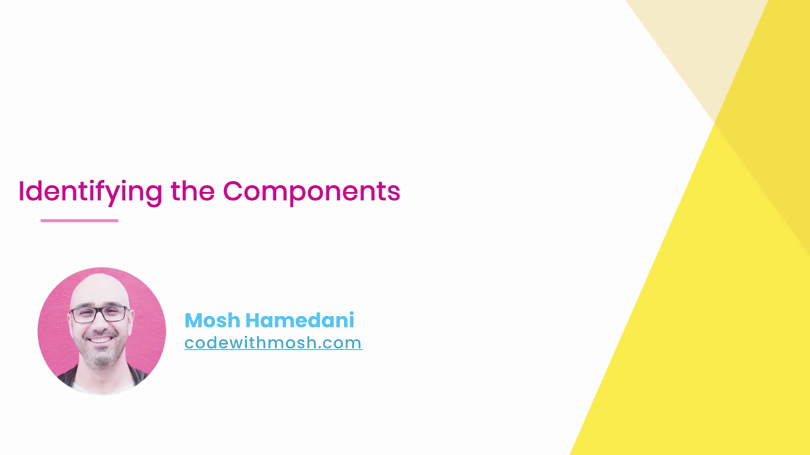

ตามด้วยสไลด์ชื่อหัวข้อย่อย **"Modular CSS"** พื้นหลังสีฟ้าอ่อน ซึ่งเป็นแนวคิดแกนกลางของคลิปนี้:

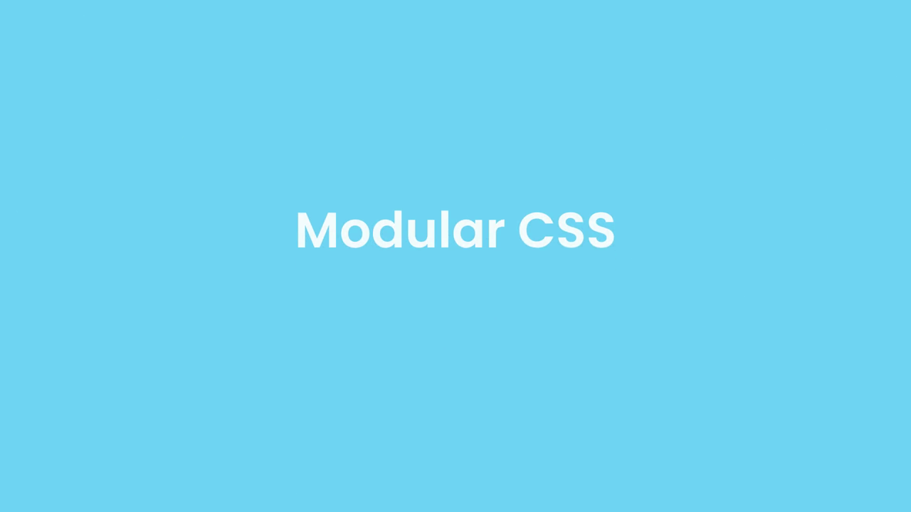

> **แนวคิดสำคัญ:** "Modular CSS" หมายถึงการออกแบบ CSS ให้เป็นโมดูล (module) แยกส่วนกันตามส่วนประกอบ (component) แต่ละชิ้น เช่น ปุ่ม, การ์ด, ป้ายราคา ฯลฯ เพื่อให้แต่ละชิ้นสามารถนำไปใช้ซ้ำในหลายที่ของหน้าเว็บได้โดยไม่ต้องเขียนโค้ดซ้ำ

---

## 2. เปิดเว็บไซต์ Moshify เวอร์ชันสมบูรณ์ใน Chrome

Mosh เปิด Google Chrome ไปที่ `127.0.0.1:5501/index.html` ซึ่งเป็น **local dev server** (ไม่ใช่ไฟล์ Photoshop เหมือนคลิปก่อนหน้า) แสดงหน้าเว็บ Moshify เวอร์ชันที่สร้างเสร็จสมบูรณ์แล้ว เริ่มจากส่วน hero header:

> ส่วน **hero header** ประกอบด้วยพื้นหลังสีดำ หัวข้อ "Cloud Hosting for Pros" และปุ่ม "GET STARTED" — Mosh อธิบายว่านี่คือจุดเริ่มต้นของหน้าเว็บที่ผู้ใช้จะเห็นเป็นอันดับแรก

เลื่อนลงมาดูส่วนถัดไปที่ยังอยู่ในโซน hero:

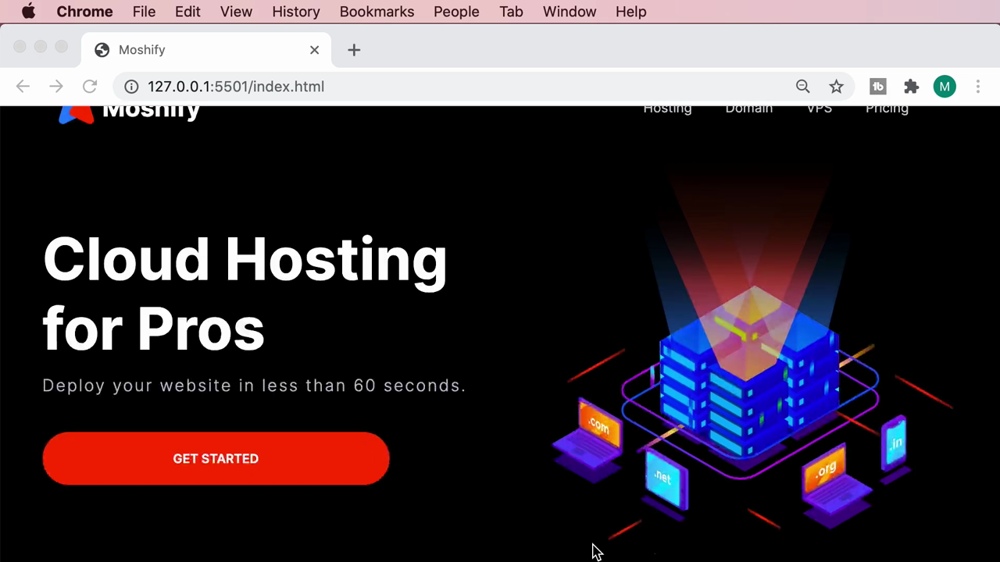

---

## 3. ส่วนประกอบที่ 1 — Input Group (ช่องค้นหาโดเมน)

Mosh ชี้ให้ดูส่วน **domain search input-group** ซึ่งเป็นช่อง input พร้อมปุ่ม "SEARCH" ติดกันเป็นกลุ่มเดียว:

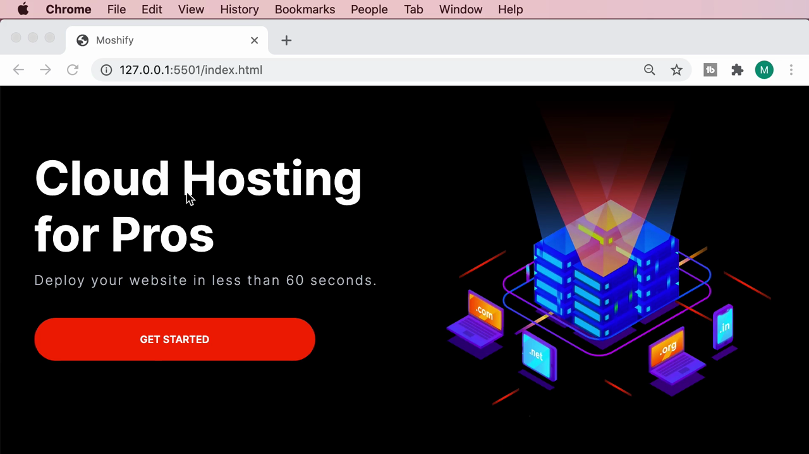

> **Input Group** คือหนึ่งใน component ที่ Mosh ระบุว่าจะต้องสร้างแยกต่างหาก เพราะรูปแบบนี้ (input + button ติดกัน มีเส้นขอบร่วมกัน) จะถูกใช้ซ้ำในส่วนอื่นของเว็บไซต์ด้วย (ตรงกับคลิปที่ 17 "Input Groups" ที่จะสอนสร้าง component นี้โดยตรง)

---

## 4. ส่วนประกอบที่ 2 — Badges (ป้ายราคาโดเมน)

เลื่อนลงมาดูแถบราคาโดเมนแบบ **badge** ที่แสดงราคาแต่ละนามสกุลโดเมน:

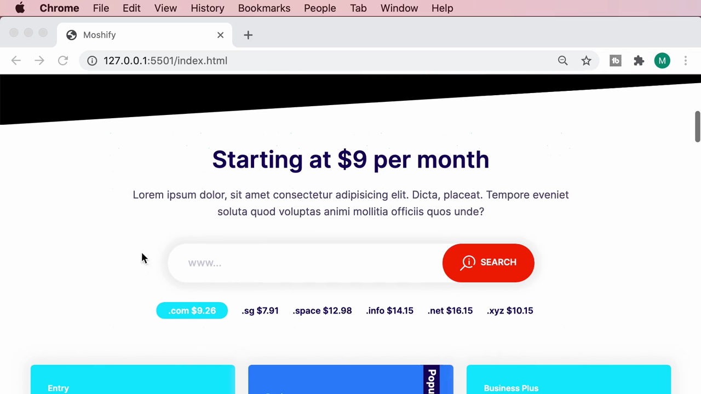

> ป้ายราคาที่เห็นได้แก่ `.com $9.26`, `.sg $7.91`, `.space $12.98`, `.info $14.15`, `.net $16.15`, `.xyz $10.15` — แต่ละอันคือ **Badge component** รูปทรงแคปซูล (pill-shaped) ที่ใช้แสดงข้อมูลสั้นๆ ซึ่งจะปรากฏซ้ำในส่วนป้ายราคาการ์ด (Pricing) และป้าย "Popular" ด้วยเช่นกัน (ตรงกับคลิปที่ 12 "Badges")

---

## 5. ส่วนประกอบที่ 3 — Pricing Cards

เลื่อนลงมาถึงส่วน **pricing cards** สามใบ: Entry ($14), Business ($24, มีป้าย "Popular"), Business Plus ($54):

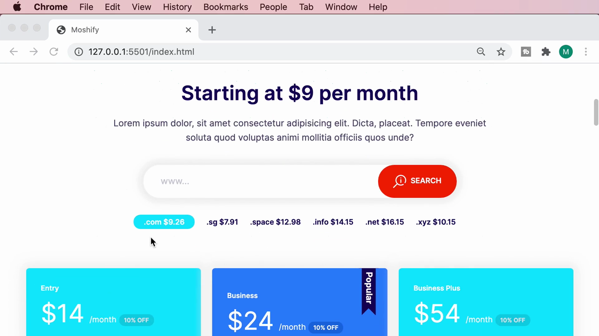

ซูมดูรายละเอียดป้าย "Popular" สีน้ำเงินเข้มที่มุมขวาบนของการ์ด Business:

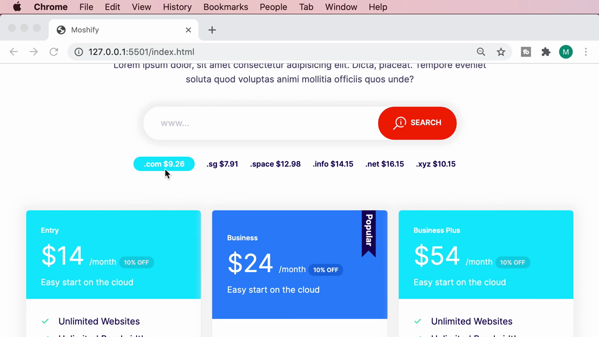

> การ์ดแต่ละใบประกอบด้วยหัวการ์ดสีพื้น (header), ราคาตัวใหญ่พร้อมป้าย "10% OFF", คำบรรยายสั้น, รายการ checklist (✓ Unlimited Websites, Unlimited Bandwidth, 100 GB SSD Storage, 3 GB RAM), และปุ่ม outline "BUY NOW" ด้านล่าง — Mosh ชี้ว่านี่คือ **Card component** ที่ผสมกับ **List component** (checklist) และ **Button component** (BUY NOW) ซ้อนกันอยู่ภายใน ตรงกับคลิปที่ 18 "Cards", 13 "Lists" และปุ่มที่จะสอนในคลิปหลังจากนี้

---

## 6. ส่วนประกอบที่ 4 — Feature Blocks (ไอคอน + หัวข้อ + คำอธิบาย + ลิงก์)

เลื่อนลงมาดูส่วน **"Simply Fast Websites"** ซึ่งเป็น feature block ที่มีไอคอน, หัวข้อ, คำบรรยาย, ลิงก์ "LEARN MORE" และกราฟประกอบ:

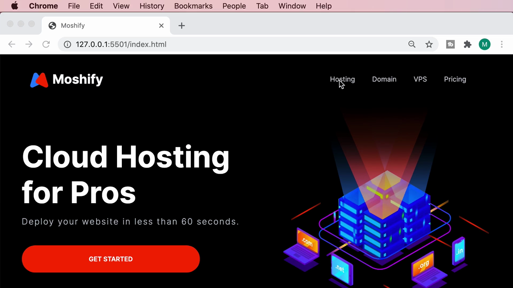

ดูกราฟ **"Server Request"** ที่อยู่คู่กับ feature block นี้:

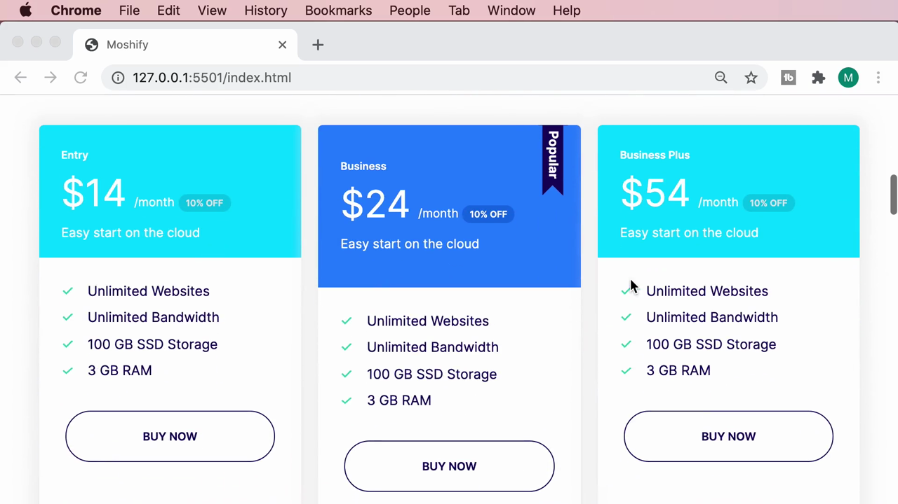

ดูอีก feature block หนึ่งที่มีโครงสร้างเดียวกัน (ไอคอน + หัวข้อ + ย่อหน้า):

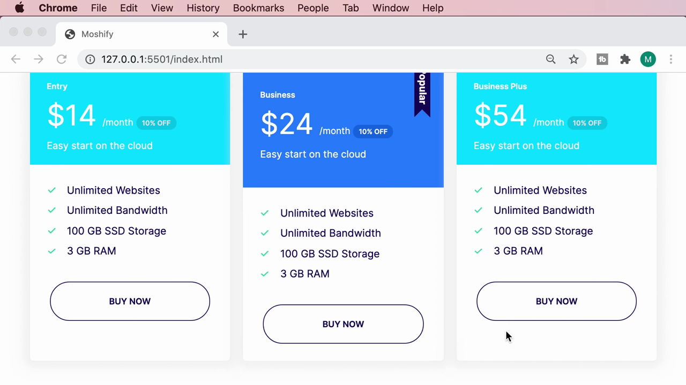

ภาพรวมของทั้งเซกชัน "Simply Fast Websites" พร้อมกราฟ:

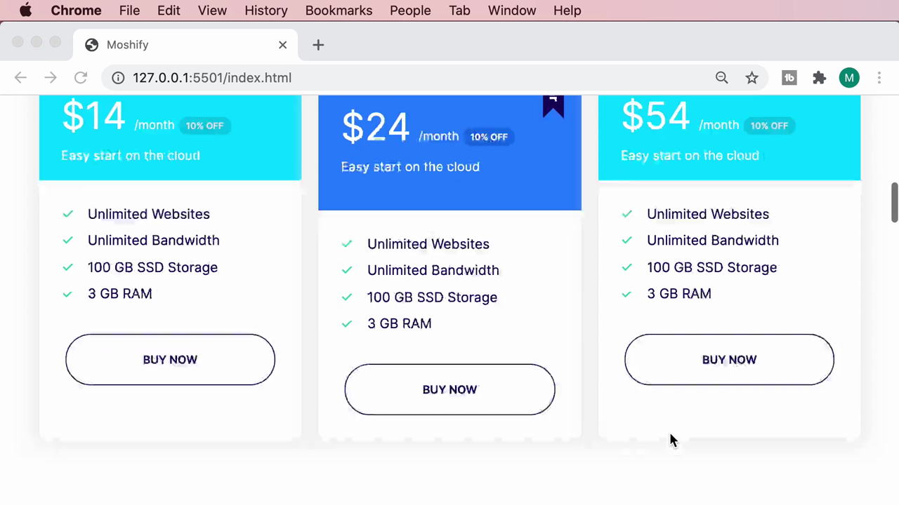

ซูมดูลิงก์ **"LEARN MORE →"** สีแดงพร้อมลูกศร:

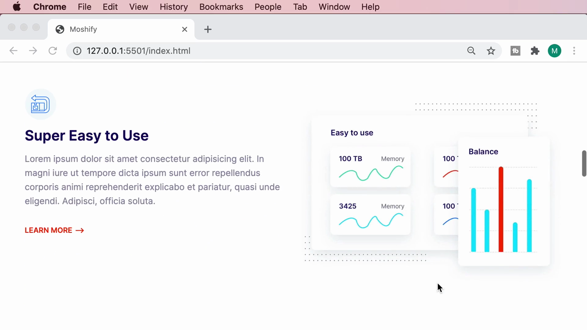

> **แนวคิดสำคัญ:** ส่วนนี้แสดงให้เห็นว่า feature block เดียวกัน (ไอคอน + หัวข้อ + ย่อหน้า + ลิงก์) ถูกใช้ซ้ำหลายครั้งในหน้าเว็บ เพียงเปลี่ยนเนื้อหาข้างในเท่านั้น — นี่คือตัวอย่างที่ชัดเจนที่สุดของแนวคิด Modular CSS ที่ Mosh ต้องการสื่อ

---

## 7. ส่วนประกอบที่ 5 — User-friendly Control Panel

เลื่อนผ่านช่วงเปลี่ยนเซกชันเข้าสู่พื้นหลังสีดำของส่วน **"User-friendly Control Panel"**:

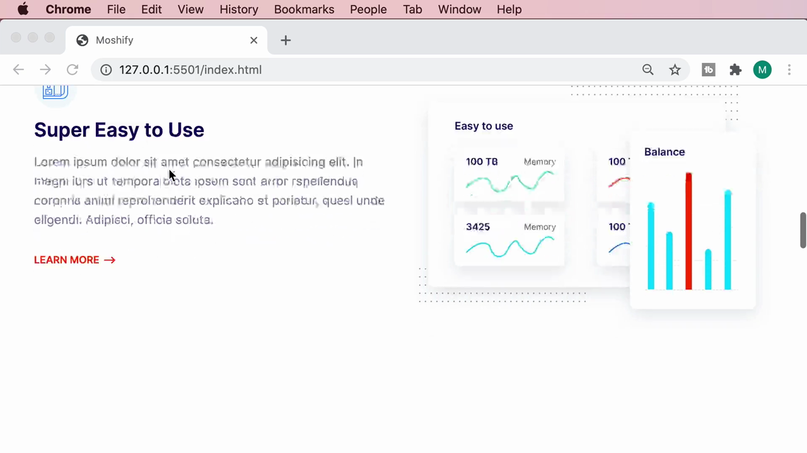

แสดงหัวข้อเซกชันเต็มพร้อมภาพหน้าจอแท็บเล็ตจำลอง (placeholder) และหัวข้อย่อย "Easy Start & Managed Updates":

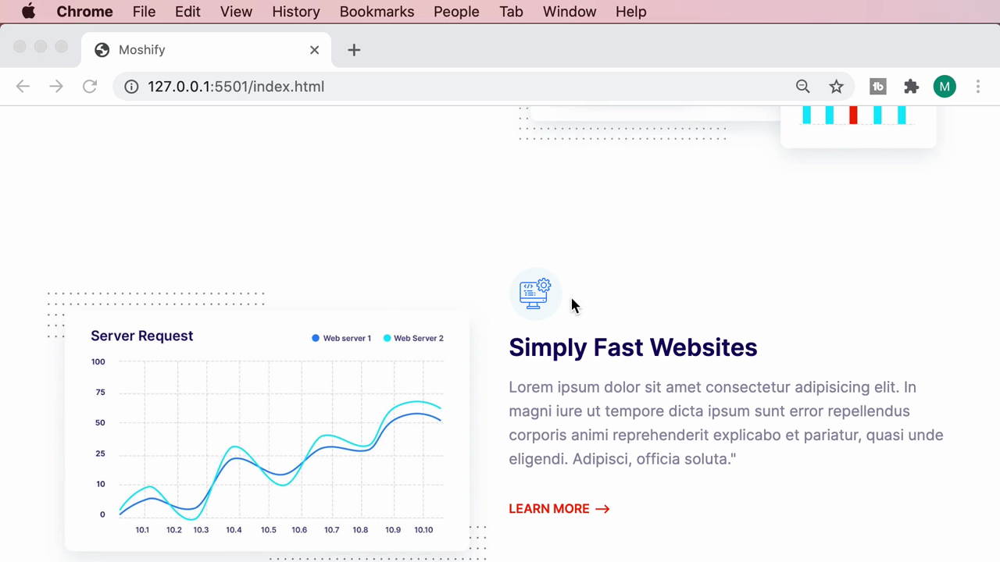

เลื่อนดูรายการหัวข้อย่อยอื่นๆ ในเซกชันเดียวกัน — แต่ละหัวข้อมีไอคอนเส้น (outline icon) สีฟ้า, หัวข้อตัวหนา, และย่อหน้าอธิบาย ซ้ำกันเป็นแพทเทิร์นเดียวกันหลายชุด ("Staging, Git & WP-CLI", "Dynamic Caching & More"):

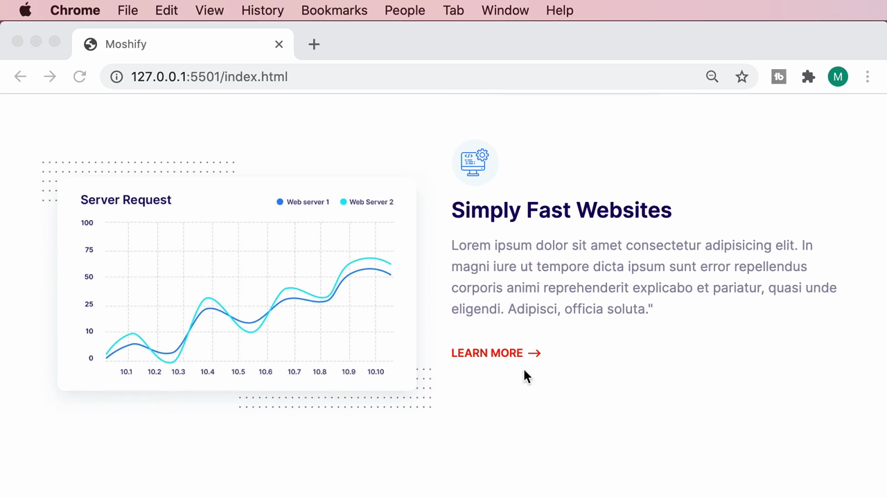

> เซกชันนี้ก็เป็นอีกตัวอย่างของ **feature list ที่ใช้ซ้ำ component เดียวกัน** (ไอคอน + หัวข้อ + คำอธิบาย) เพียงแต่อยู่บนพื้นหลังสีดำ (dark theme) ต่างจากพื้นหลังสีขาวของเซกชันก่อนหน้า

---

## 8. แทรกภาพเปรียบเทียบ VS Code และเบราว์เซอร์

ระหว่างการเลื่อนดู มีเฟรมหนึ่งที่จอถูกแบ่งครึ่ง แสดง **VS Code แผง Source Control** (ฝั่งซ้าย) คู่กับเบราว์เซอร์ที่แสดงหน้า Moshify (ฝั่งขวา):

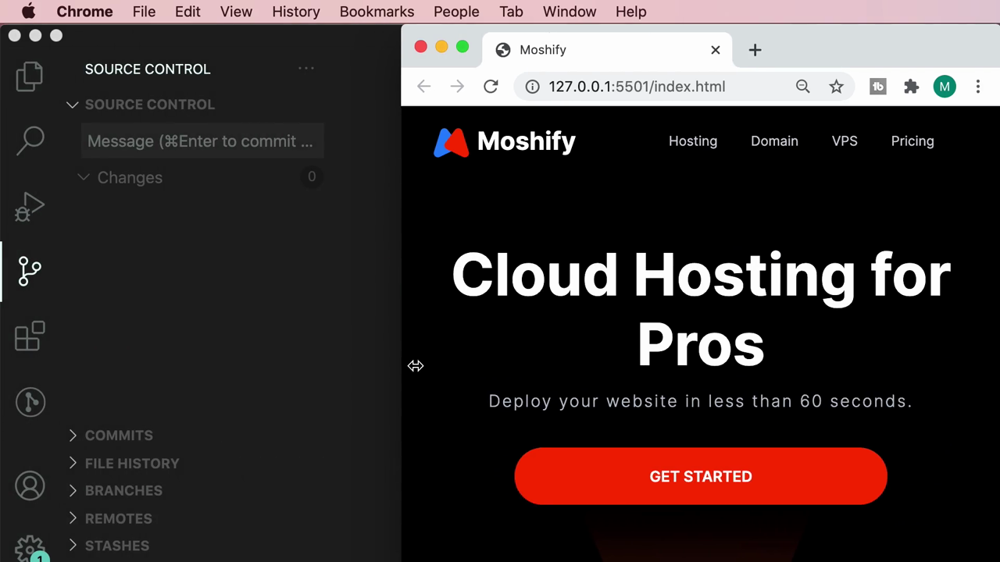

จากนั้นกลับมาที่มุมมองเบราว์เซอร์เต็มจอ เลื่อนกลับขึ้นไปดูส่วน hero อีกครั้ง:

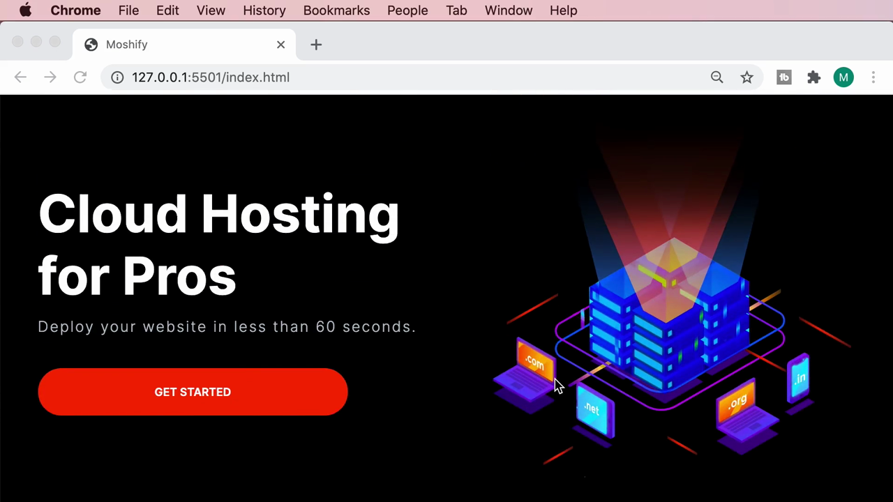

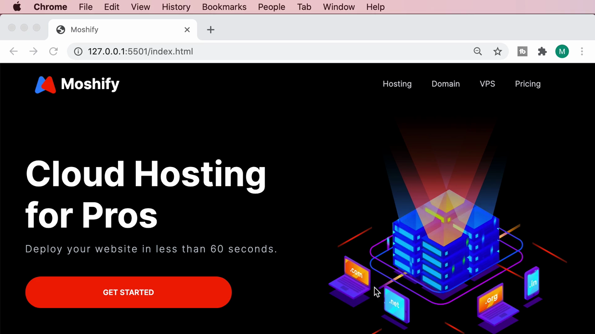

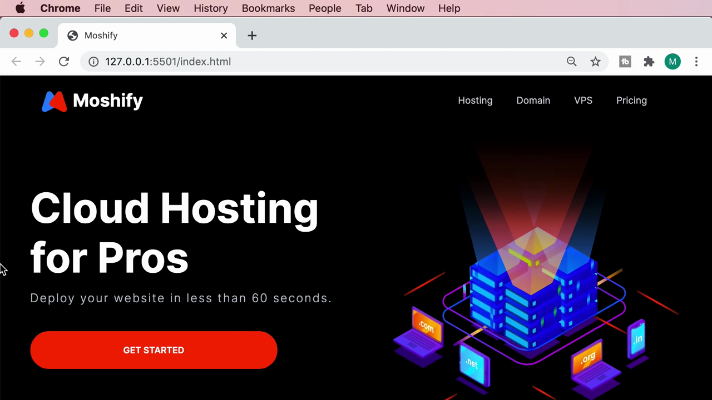

> เฟรมนี้น่าจะเป็นการสลับหน้าจอชั่วครู่เพื่อดู commit history หรือสถานะไฟล์ในโปรเจกต์ (git) ก่อนจะกลับมาเลื่อนดูหน้าเว็บต่อ ซึ่งสอดคล้องกับที่คลิปที่ 5 (Tools You Need) แนะนำให้ติดตั้ง Git ไว้ใช้ควบคุมเวอร์ชันตลอดการเขียนโปรเจกต์นี้

---

## 9. ทบทวน Pricing Cards และ Feature Section อีกครั้ง

เลื่อนลงมาซ้ำอีกรอบผ่านส่วน pricing cards สามใบ (Entry / Business / Business Plus):

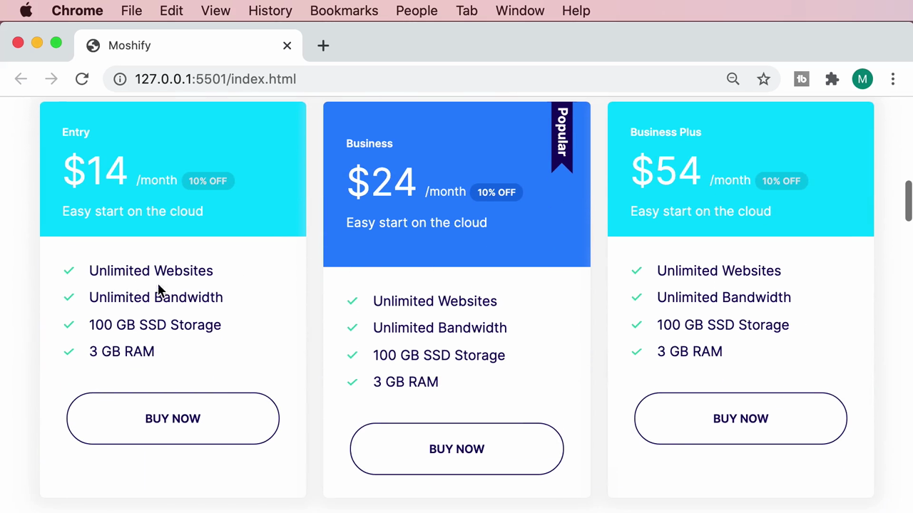

และผ่านส่วน "Simply Fast Websites" พร้อมกราฟอีกครั้ง:

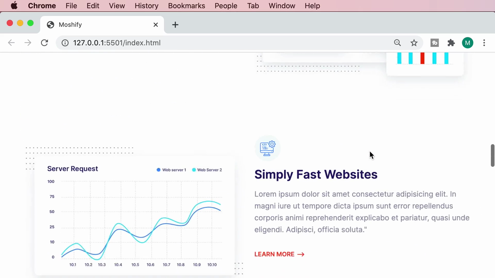

---

## 10. ส่วนประกอบที่ 6 — Testimonial Card (การ์ดรีวิวลูกค้า)

เลื่อนผ่านช่วงเปลี่ยนที่มีกล่องแชทลอยขึ้นมา (chat bubble transition) เข้าสู่ธีมสีดำของเซกชัน Control Panel อีกครั้ง:

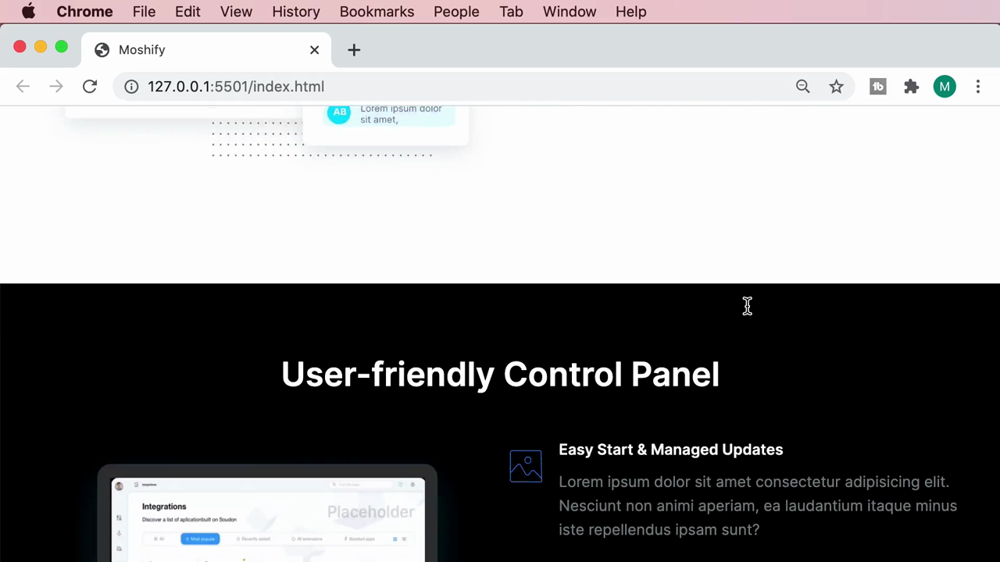

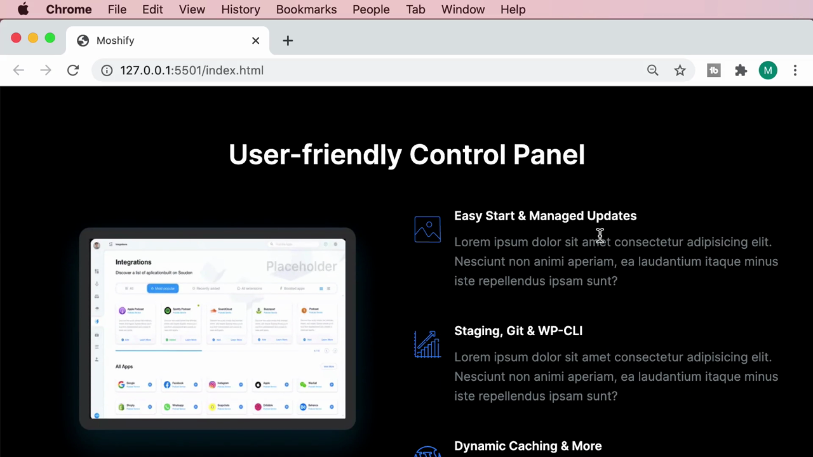

เลื่อนต่อไปดูหัวข้อย่อยสุดท้ายของเซกชันนี้ **"Dynamic Caching & More"**:

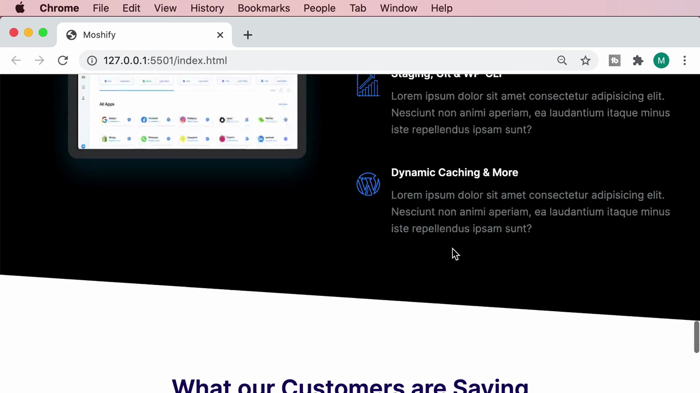

จากนั้นเข้าสู่เซกชัน **"What our Customers are Saying"** ซึ่งมี **testimonial card** — การ์ดรีวิวที่มีรูปลูกค้า (John Lumeo, ABC Company), คำพูดในเครื่องหมายคำพูด (italic), เส้นคั่นสั้นสีฟ้า, ชื่อ และชื่อบริษัท:

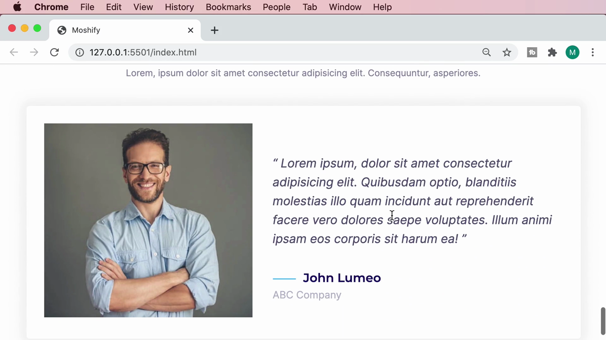

ดูการ์ด testimonial แบบเต็มอีกครั้งพร้อมไฮไลต์ข้อความบางส่วน (แสดงว่า Mosh กำลังชี้/select ข้อความเพื่ออธิบายโครงสร้าง):

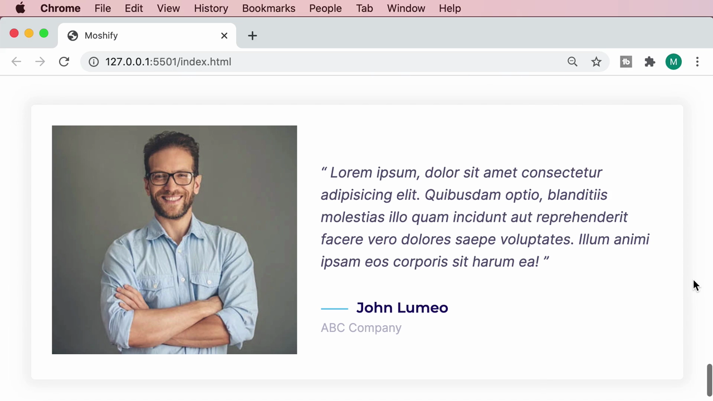

> **Testimonial Card** เป็น component ใหม่ที่ยังไม่เคยพูดถึงในรายการก่อนหน้า ประกอบด้วยรูปภาพสี่เหลี่ยม, ข้อความอ้างอิงแบบตัวเอียง (italic quote), และป้ายชื่อผู้พูดพร้อมเส้นคั่น — เป็นอีกหนึ่งโมดูลที่แยกออกมาสร้างเป็น component เฉพาะได้

---

## 11. ส่วนปิดท้าย — Call to Action และ Footer

เลื่อนลงมาถึงส่วน **"Ready to Get Started?"** — กล่องสีน้ำเงินขนาดใหญ่พร้อมหัวข้อ คำอธิบาย และปุ่ม "GET STARTED" สีฟ้าอ่อน วางเหลื่อมอยู่ระหว่างพื้นหลังขาวกับพื้นหลังดำของ footer:

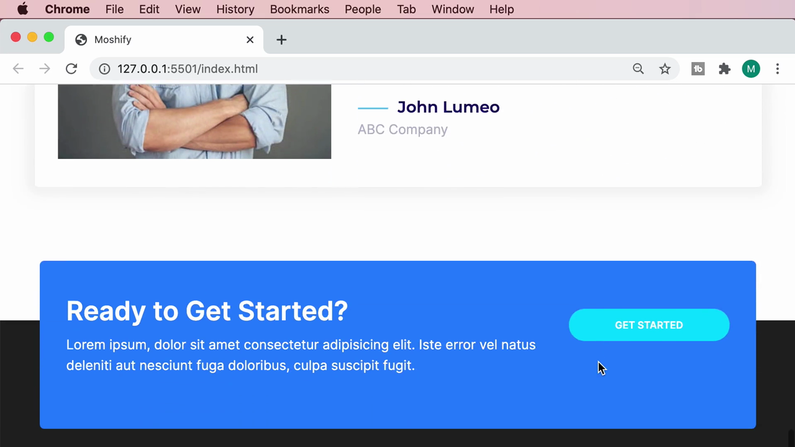

เลื่อนลงมาถึง **Footer** ส่วนล่างสุดของหน้าเว็บ แสดงโลโก้ Moshify, ข้อความลิขสิทธิ์ "Copyright © 2020 Mosh Hamedani" และลิงก์แบ่งเป็น 4 หมวดหมู่ (Products, Company, Support, Domains):

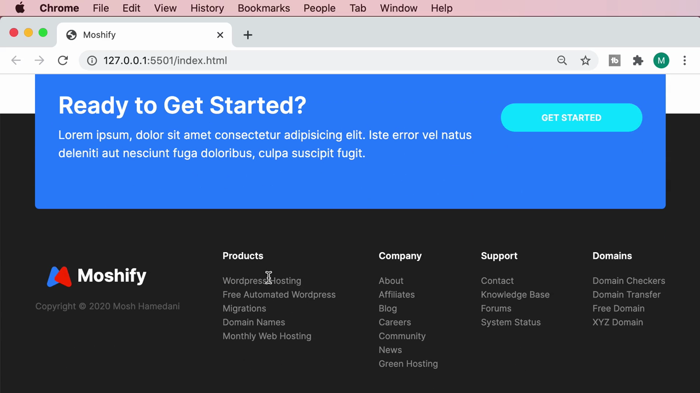

> ส่วน **Call to Action (CTA)** ใช้โครงสร้างคล้ายกับ hero header (หัวข้อ + คำอธิบาย + ปุ่ม) แต่ย่อขนาดลงและวางเป็นกล่องลอย (floating box) คร่อมรอยต่อระหว่างพื้นหลังสีขาวกับสีดำ ส่วน **Footer** มีลิงก์จัดเป็นคอลัมน์ (link columns) ซึ่งเป็นแพทเทิร์นมาตรฐานที่พบได้ในเว็บไซต์ทั่วไป

---

## สรุปภาพรวมของคลิปนี้

| ประเด็น | รายละเอียด |
|---|---|
| **หัวข้อ** | Identifying the Components — แกะส่วนประกอบ UI จากเว็บไซต์ Moshify ที่สร้างเสร็จแล้ว |
| **แนวคิดหลัก** | Modular CSS — มองหน้าเว็บเป็นการประกอบกันของ component ที่ใช้ซ้ำได้ |
| **วิธีดู** | เปิดเว็บไซต์ Moshify เวอร์ชันสมบูรณ์ที่ `127.0.0.1:5501/index.html` แล้วเลื่อนไล่ดูตั้งแต่บนสุดถึงล่างสุด |
| **Component ที่ระบุได้** | Input Group (ช่องค้นหาโดเมน), Badge (ป้ายราคา/Popular), Card (Pricing Card), List (checklist ในการ์ด), Button (BUY NOW/GET STARTED), Feature Block (ไอคอน+หัวข้อ+คำอธิบาย+ลิงก์), Testimonial Card, Call to Action, Footer link columns |
| **ความเชื่อมโยงกับคลิปถัดไป** | แต่ละ component ที่ระบุในคลิปนี้จะถูกสอนสร้างแยกเป็นคลิปเฉพาะ ได้แก่ 9-Color Palette, 10-Typography, 11-Links, 12-Badges, 13-Lists, 15-Buttons, 16-Inputs, 17-Input Groups, 18-Cards, 19-Plans, 20-Popular Badge |

**แนวคิดสำคัญที่ได้จากคลิปนี้:**

1. **การขึ้นโปรเจกต์จริงควรเริ่มจากการ "แกะ" ส่วนประกอบ (component) ของดีไซน์ก่อนลงมือเขียนโค้ด** เพื่อวางแผนว่าจะสร้าง CSS class แบบใดให้นำกลับมาใช้ซ้ำได้ ไม่ต้องเขียนสไตล์ซ้ำซ้อนในหลายจุด
2. **Modular CSS คือการมองแต่ละส่วนของ UI เป็นหน่วยย่อยอิสระ** (เช่น Badge, Card, Button, Input Group) ที่สามารถประกอบเข้าด้วยกันเป็นหน้าเว็บที่ซับซ้อนได้ ตรงกับหลักการ BEM และ OOCSS ที่เรียนมาก่อนหน้านี้ในคอร์ส
3. **Component เดียวกันมักปรากฏซ้ำในหลายจุดของหน้าเว็บ** เช่น Badge ปรากฏทั้งในราคาโดเมนและป้าย "Popular" บนการ์ด, ปุ่มปรากฏทั้งใน hero, pricing card, และ CTA — การรู้จักสังเกตสิ่งนี้ช่วยลดงานเขียน CSS ซ้ำซ้อน
4. **คลิปนี้ทำหน้าที่เป็น "แผนที่" ก่อนเข้าสู่บทเรียนโค้ดดิ้งจริง** — รายชื่อ component ทั้งหมดที่ระบุในคลิปนี้จะถูกนำไปสอนสร้างทีละตัวในคลิปถัดๆ ไปตามลำดับ

---

*หมายเหตุ: คลิปนี้เป็นส่วนหนึ่งของคอร์ส "Building a Web Site" โดย Mosh Hamedani (codewithmosh.com) — คลิปที่ 8*
