# HTML-CSS-3: 09 - Color Palette (3:13)

**ไฟล์ต้นทาง:** `9-Color_Palette.mp4`

▶️ **[เปิดวิดีโอต้นฉบับ](../../HTML-CSS-3/9-Color_Palette.mp4)**

---

## ภาพรวมคลิปนี้

คลิปนี้เป็นบทเรียนโค้ดดิ้งคลิปแรกของโปรเจกต์ Moshify (ต่อจากคลิปที่ 8 ที่แกะส่วนประกอบไว้) โดย Mosh พาสร้าง **Color Palette** ให้กับโปรเจกต์ ด้วยการประกาศชุดสี (Primary, Secondary, Accent, Headings, Body) เป็น **CSS Custom Properties (CSS Variables)** ไว้ใน selector `:root` ของไฟล์ `styles.css` แทนการเขียนค่าสีแบบ hardcode กระจัดกระจายทั่วโปรเจกต์ พร้อมสาธิตการใช้ VS Code IntelliSense ช่วย autocomplete ค่าสี และปิดท้ายด้วยการ commit งานผ่าน Git

---

## 1. เปิดคลิปด้วยสไลด์ชื่อเรื่อง

สไลด์ชื่อคลิป **"Color Palette"** พร้อมรูปโปรไฟล์ผู้สอน:

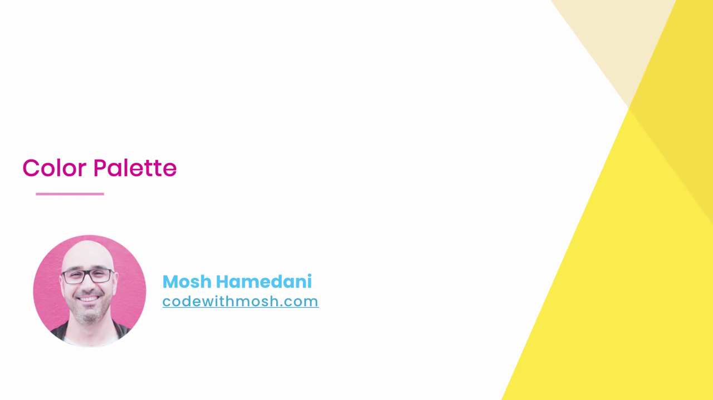

ตามด้วยสไลด์ป้ายเหลือง **"COLOR PALETTE"** ที่ยังว่างเปล่า รอเผยรายการทีละข้อ:

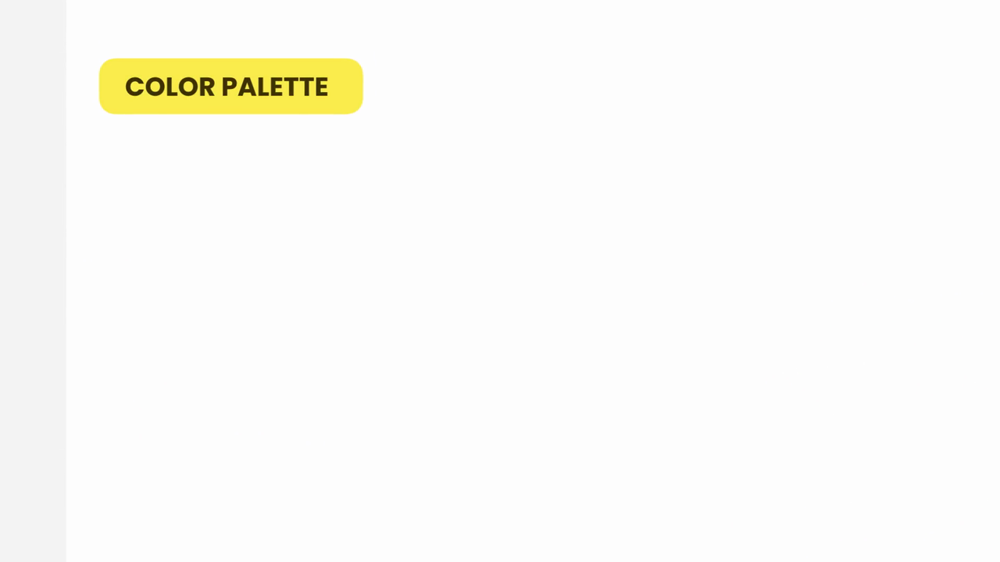

ทยอยเผยรายการแรก **"Primary"** พร้อมจุดกลมสีเหลืองนำหน้า (เป็นเพียงตัวอย่างสีของสไลด์ ไม่ใช่สีจริงที่จะใช้):

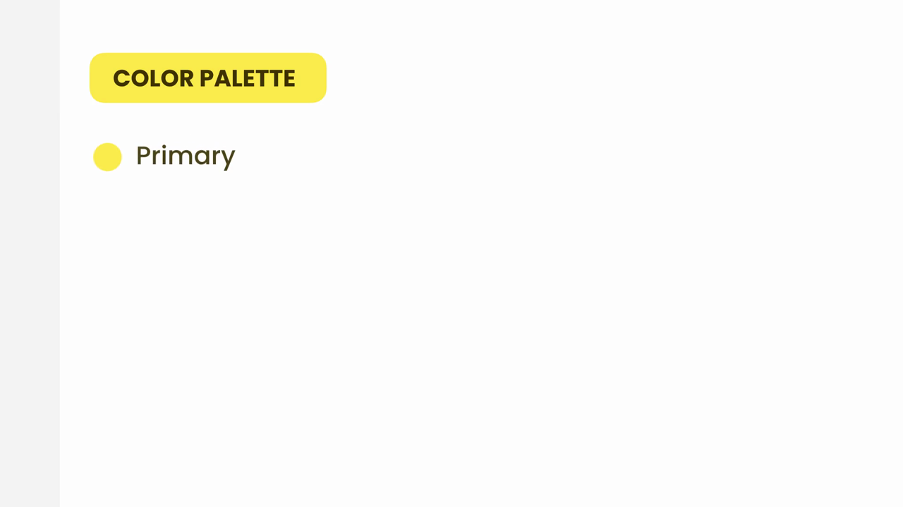

เผยครบสามรายการ **"Primary", "Secondary", "Accent"**:

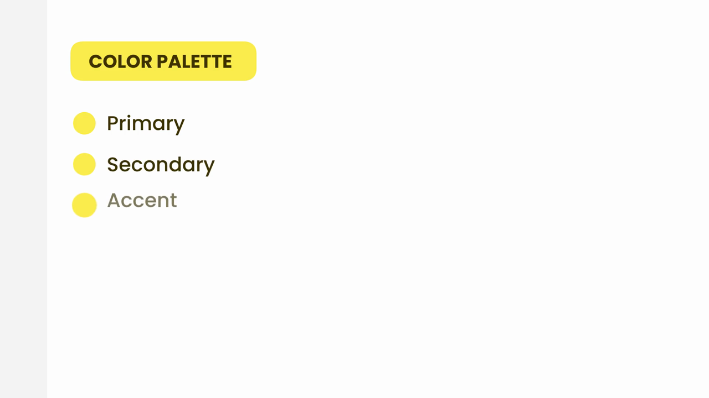

> **แนวคิดสำคัญ:** Mosh อธิบายว่าเว็บไซต์ที่ดีมักใช้ชุดสีที่จำกัดและสอดคล้องกันทั้งเว็บไซต์ ไม่ใช่ใช้สีตามใจชอบในแต่ละจุด การกำหนด "Color Palette" ไว้ล่วงหน้าจึงเป็นขั้นตอนสำคัญก่อนเริ่มเขียน CSS ของแต่ละ component

---

## 2. ย้อนดูค่าสีจากไฟล์ดีไซน์ Photoshop (`standard.psd`)

Mosh สลับไปที่ Adobe Photoshop 2021 เปิดไฟล์ `standard.psd` เลื่อนดูส่วน hero header ที่มีปุ่ม "GET STARTED" สีแดง และป้ายราคาโดเมนสีฟ้า:

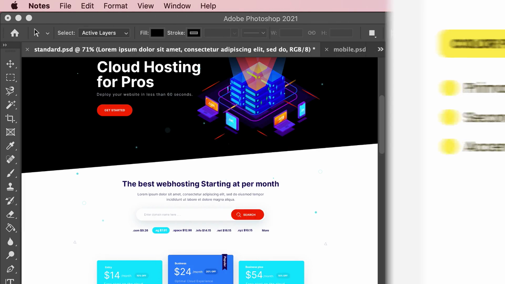

เลื่อนลงมาดูส่วน pricing cards สามใบ (Entry สีฟ้าอ่อน, Business สีน้ำเงิน มีป้าย "Popular", Business Plus สีฟ้าอ่อน) เพื่อสังเกตโทนสีที่ใช้ในดีไซน์:

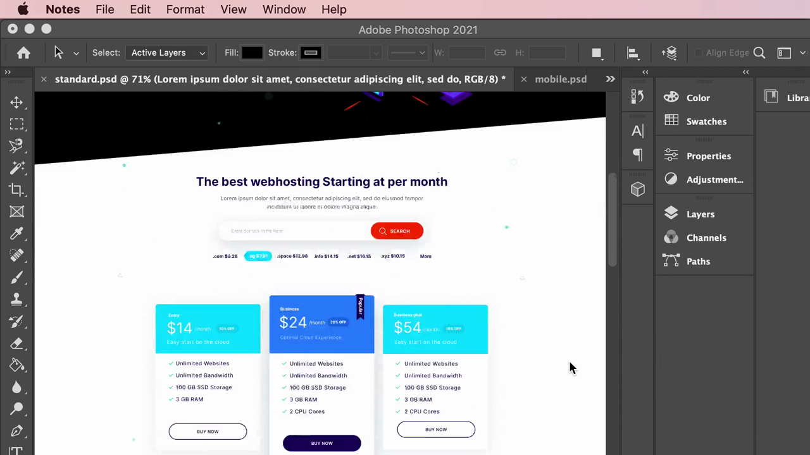

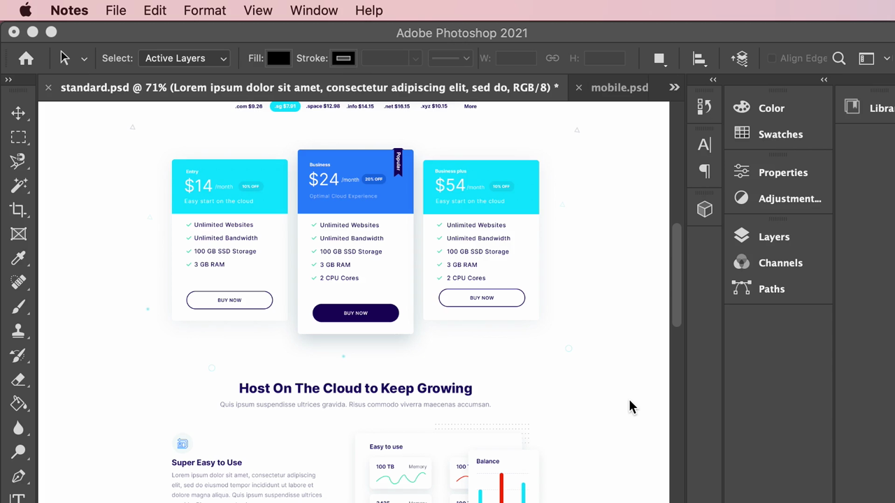

เลื่อนกลับขึ้นไปดูส่วน hero และช่องค้นหาโดเมนอีกครั้ง เพื่อยืนยันโทนสีก่อนเริ่มกำหนดตัวแปร:

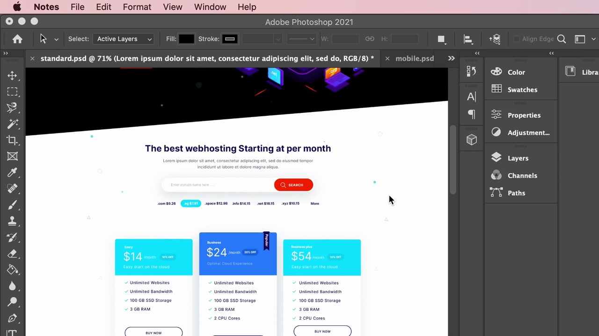

ซูมดูปุ่ม **"GET STARTED"** สีแดงส้มที่มุมซ้ายของ hero header โดยละเอียด:

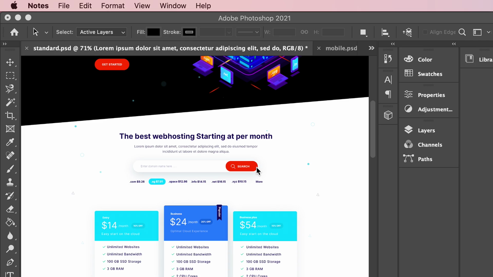

> **ทำไมต้องย้อนดูไฟล์ดีไซน์ก่อน:** เพราะสีทุกสีที่จะกำหนดเป็น CSS Variable ต้องตรงกับสีที่ดีไซเนอร์กำหนดไว้ในไฟล์ Photoshop เป๊ะ — ในคลิปที่ 7 (Essential Photoshop Skills) ได้สอนวิธีใช้ Eyedropper Tool คลิกที่องค์ประกอบเพื่อดึงรหัสสี (hex code) มาแล้ว ซึ่งเป็นเทคนิคเดียวกันที่นำมาใช้ในคลิปนี้

---

## 3. สาธิตปัญหาของการเขียนสีแบบ Hardcode (ตัวอย่าง `gold`)

Mosh สลับกลับมาที่ VS Code เปิดไฟล์ `css/styles.css` แล้วพิมพ์ตัวอย่างสาธิตโดยตั้งค่า `background: gold;` ให้กับ `body`:

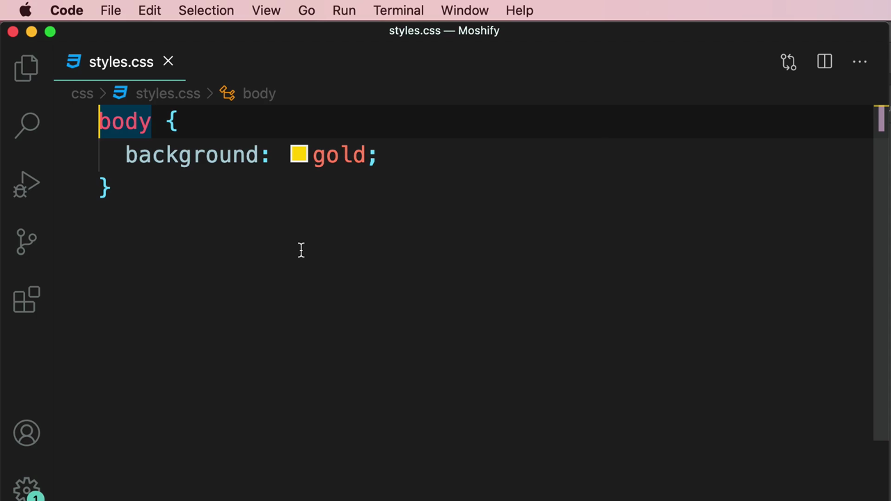

ไฮไลต์เลือกทั้งบล็อกโค้ด `body { background: gold; }` เพื่อชี้ให้เห็นตัวอย่าง:

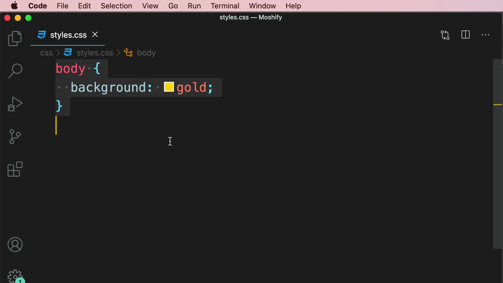

จากนั้นลบโค้ดตัวอย่างนี้ทิ้งทั้งหมด เหลือไฟล์ว่างเปล่า:

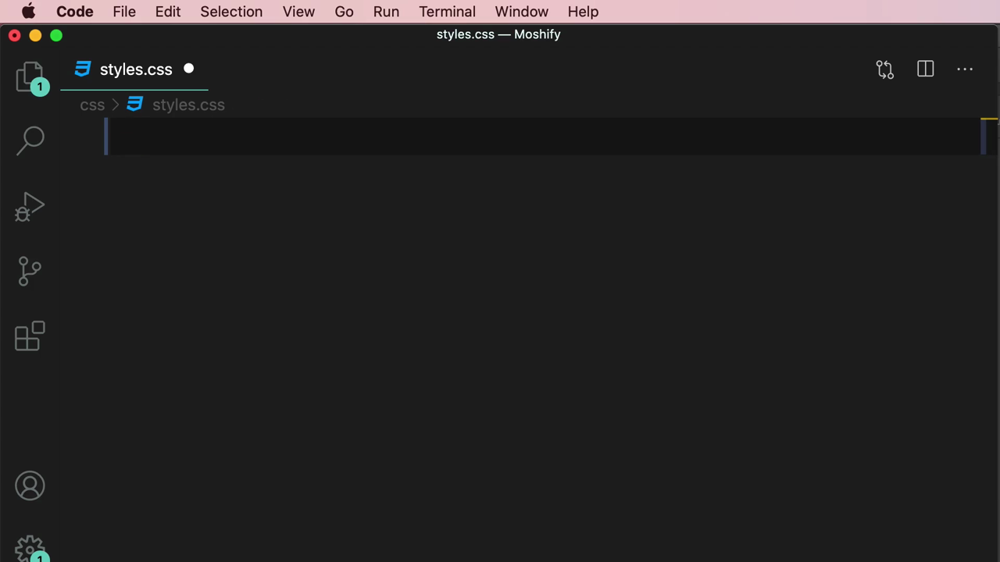

> **แนวคิดสำคัญ:** CSS มีชื่อสีสำเร็จรูป (named colors) อย่าง `gold`, `red`, `blue` ให้ใช้ได้ทันที แต่ Mosh ชี้ว่าชื่อสีเหล่านี้**ไม่สามารถระบุเฉดสีที่ตรงกับดีไซน์ได้แม่นยำ** และหากใช้ชื่อสีเดียวกันซ้ำในหลายไฟล์ เมื่อต้องการเปลี่ยนสีทีหลังจะต้องไล่แก้ทีละจุด จึงต้องใช้แนวทางที่ดีกว่า — นั่นคือ CSS Variables

---

## 4. เริ่มประกาศ CSS Variables ด้วย Selector `:root`

พิมพ์ selector **`:root`** พร้อม IntelliSense แสดงคำเตือน (เส้นหยักสีเหลือง) เนื่องจากยังไม่มีเนื้อหาข้างใน:

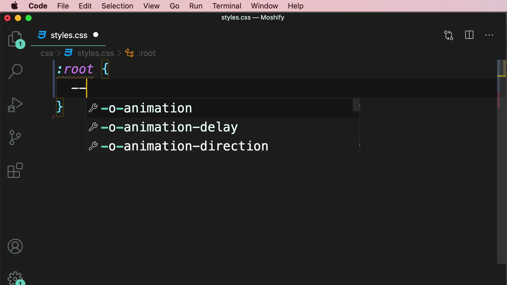

เริ่มพิมพ์ตัวแปรแรก โดยใช้ไวยากรณ์ `--` นำหน้าชื่อ พิมพ์ `--color-primary`:

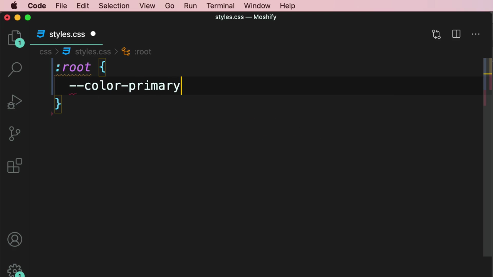

พิมพ์ค่า hex เริ่มต้น `#2` ระบบ IntelliSense/Emmet ขึ้นคำแนะนำอัตโนมัติ **`#222222`**:

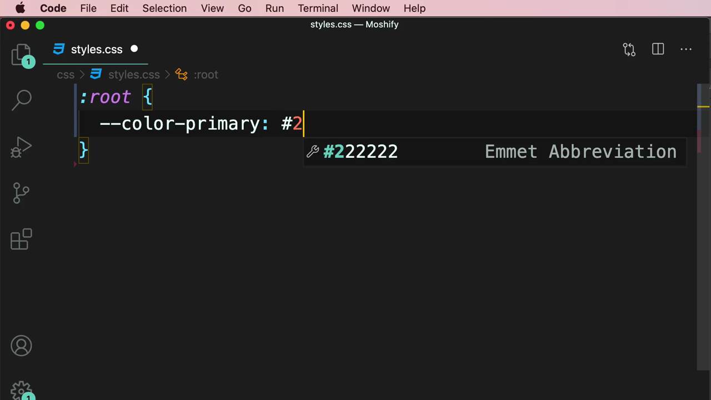

พิมพ์ค่าจริงจนครบเป็น **`--color-primary: #2584ff;`** (สีฟ้าที่ดึงมาจากปุ่ม/ลิงก์ในดีไซน์):

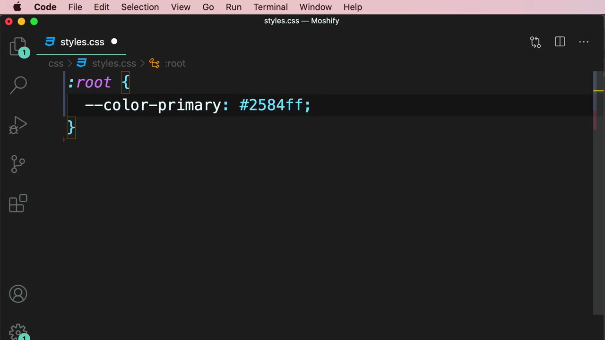

> **ไวยากรณ์สำคัญ:** CSS Custom Property ต้องขึ้นต้นด้วยเครื่องหมาย `--` (สองขีด) ตามด้วยชื่อตัวแปรที่ตั้งเอง เช่น `--color-primary` แล้วตามด้วย `:` และค่าสี ปิดท้ายด้วย `;` เหมือน CSS property ทั่วไป ต้องประกาศไว้ภายใน selector ที่ต้องการให้ตัวแปรนี้มีผล ซึ่งการประกาศไว้ใน `:root` หมายถึงตัวแปรนี้จะมีผล (scope) ครอบคลุมทั้งเอกสาร HTML

---

## 5. ประกาศตัวแปรสีที่เหลือ (Secondary, Accent)

VS Code แสดงเมนู autocomplete ของ property ที่ขึ้นต้นด้วย `--color-` (มีตัวเลือกไม่เกี่ยวข้องอย่าง `-moz-border-top-colors`, `border-top-color` ปรากฏแทรกมาด้วย เนื่องจากยังไม่ตรงกับชื่อตัวแปรที่ตั้งเอง):

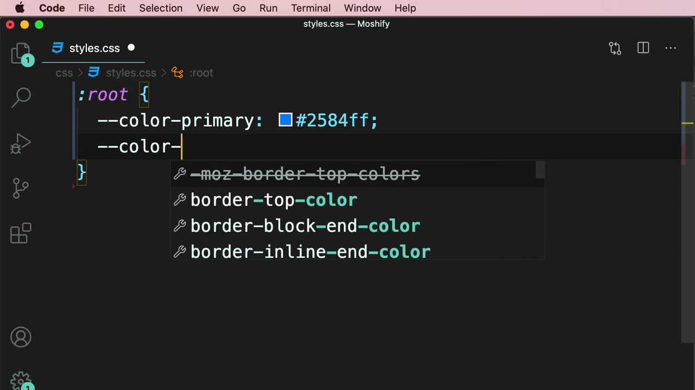

พิมพ์ชื่อตัวแปรที่สอง **`--color-secondary`**:

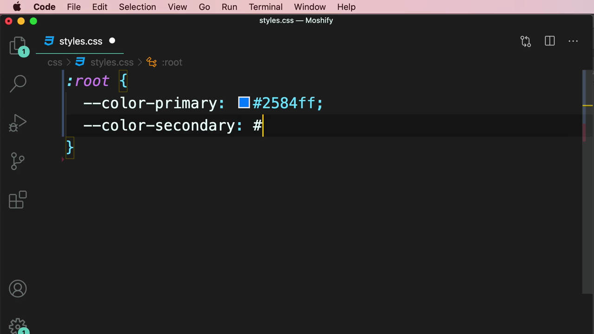

พิมพ์ค่า hex `#00d9` ระบบแนะนำ **`#00d900`** (ไม่ตรงกับที่ต้องการ):

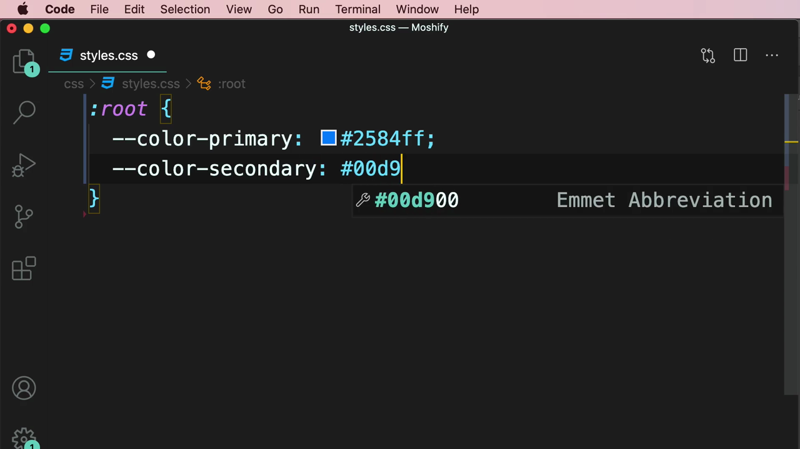

พิมพ์ต่อจนได้ค่าที่ถูกต้องเป็น **`--color-secondary: #00d9ff;`** (สีฟ้าอมเขียว/cyan):

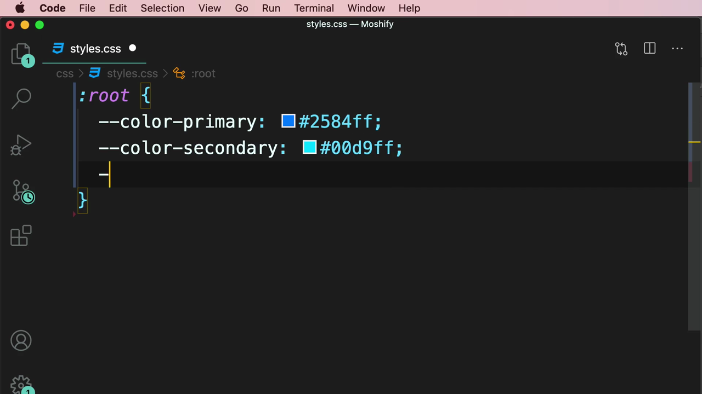

พิมพ์ตัวแปรที่สาม **`--color-accent`** และพิมพ์ค่า `#ff34` ระบบแนะนำ **`#ff34ff`**:

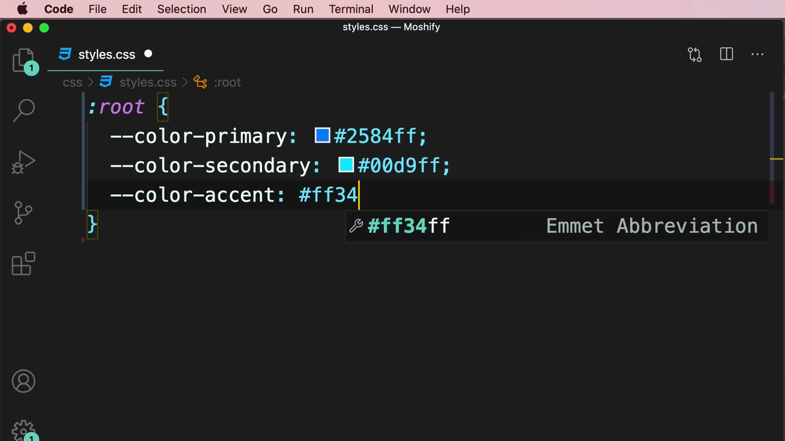

พิมพ์ต่อจนได้ค่าที่ถูกต้องเป็น **`--color-accent: #ff3400;`** (สีแดงส้ม ตรงกับปุ่ม "GET STARTED" ที่เห็นในดีไซน์):

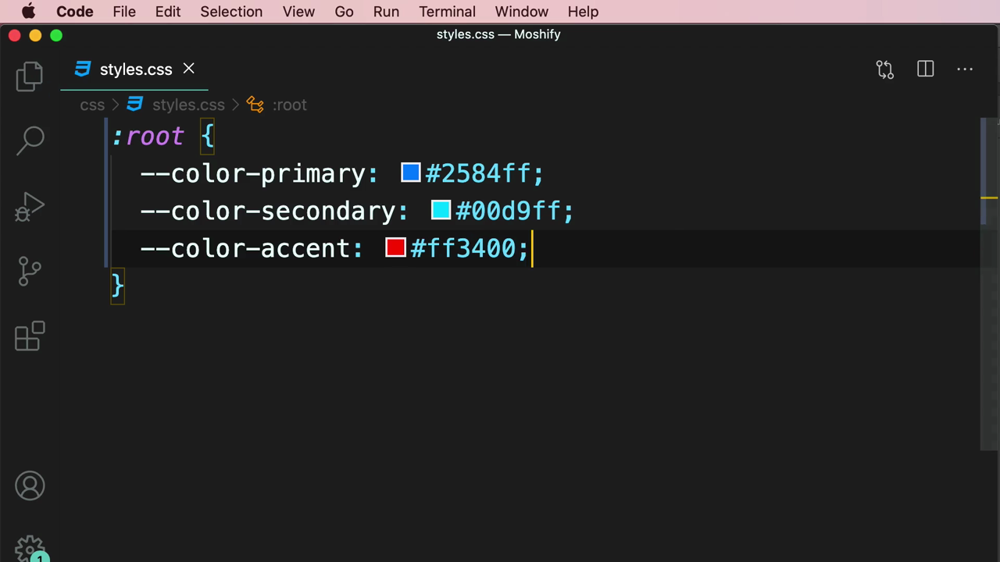

> ทั้งสามตัวแปรนี้คือชุดสีหลัก (Primary, Secondary, Accent) ที่จะถูกนำไปใช้ซ้ำในทุกส่วนของเว็บไซต์ เช่น ปุ่ม ลิงก์ ป้ายราคา และไอคอนต่างๆ

---

## 6. ย้อนกลับไปดูดีไซน์เพิ่มเติมใน Photoshop

สลับกลับไปที่ Photoshop เพื่อดูส่วน **"Host On The Cloud to Keep Growing"** ซึ่งมีข้อความหัวข้อสีม่วงเข้มและข้อความบรรยายสีเทา:

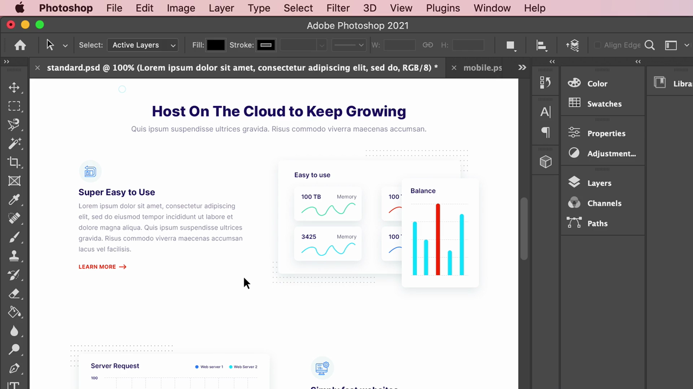

ซูมดู toolbar เครื่องมือ Zoom ของ Photoshop (ตัวเลือก "Scroll All Windows", "100%", "Fit Screen", "Fill Screen") ที่ใช้ปรับมุมมองก่อนตรวจสอบสีของหัวข้อและข้อความ:

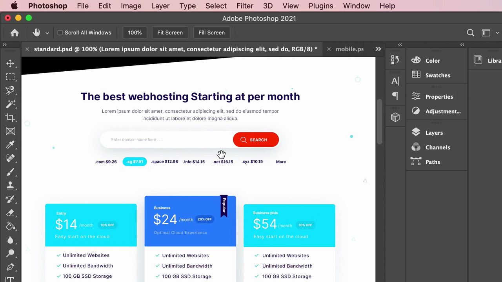

> Mosh ใช้ Eyedropper Tool ตรวจสอบสีของหัวข้อ ("Host On The Cloud to Keep Growing" — สีม่วงเข้ม) และสีของข้อความบรรยาย (สีเทาอมม่วง) เพื่อนำมากำหนดเป็นตัวแปรสีสำหรับหัวข้อ (headings) และเนื้อหา (body) ตามลำดับ

---

## 7. ประกาศตัวแปรสีสำหรับข้อความ (Headings, Body)

กลับมาที่ VS Code เห็นตัวแปรสีทั้งสามตัวที่ตั้งไว้แล้วครบ (Primary, Secondary, Accent):

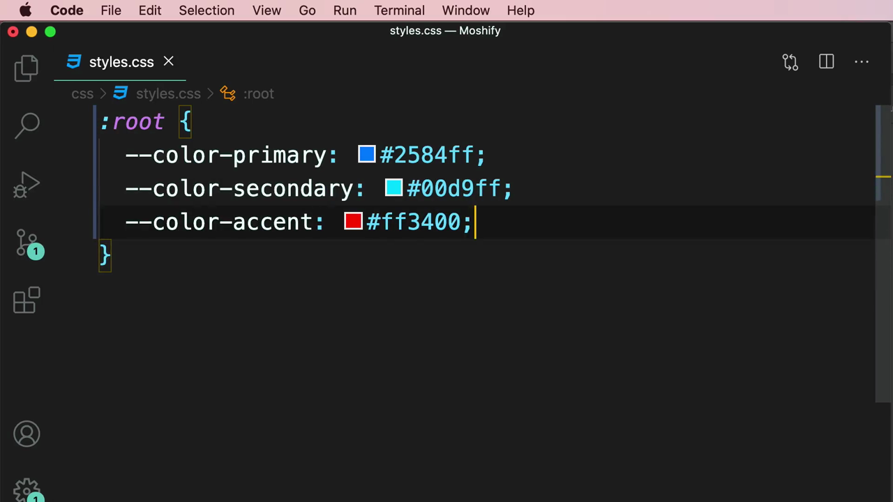

เริ่มพิมพ์ตัวแปรที่สี่ **`--color-headings`**:

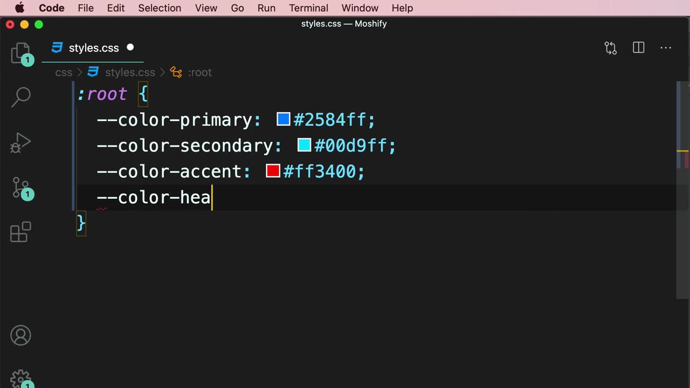

พิมพ์ค่า hex `#1b` ระบบแนะนำ **`#1b1b1b`**:

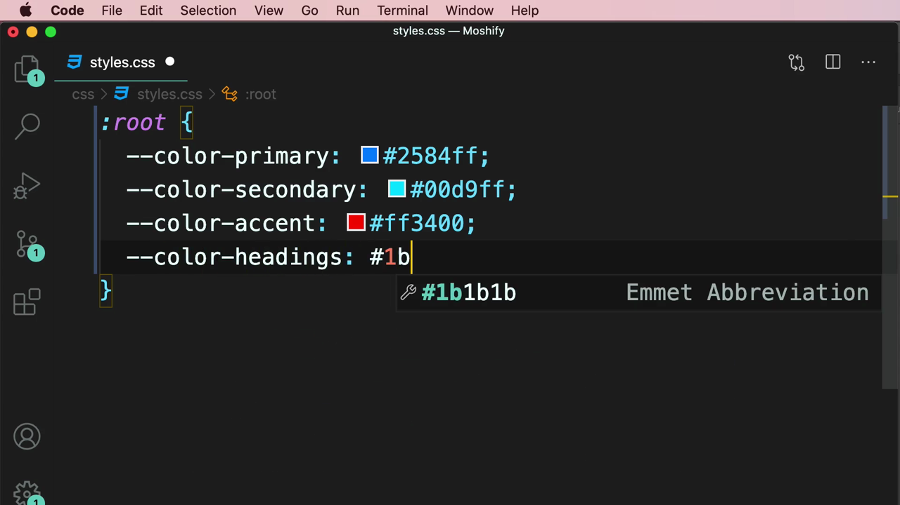

พิมพ์ต่อจนได้ค่าที่ถูกต้องเป็น **`--color-headings: #1b0760;`** (สีม่วงเข้ม ตรงกับสีหัวข้อในดีไซน์):

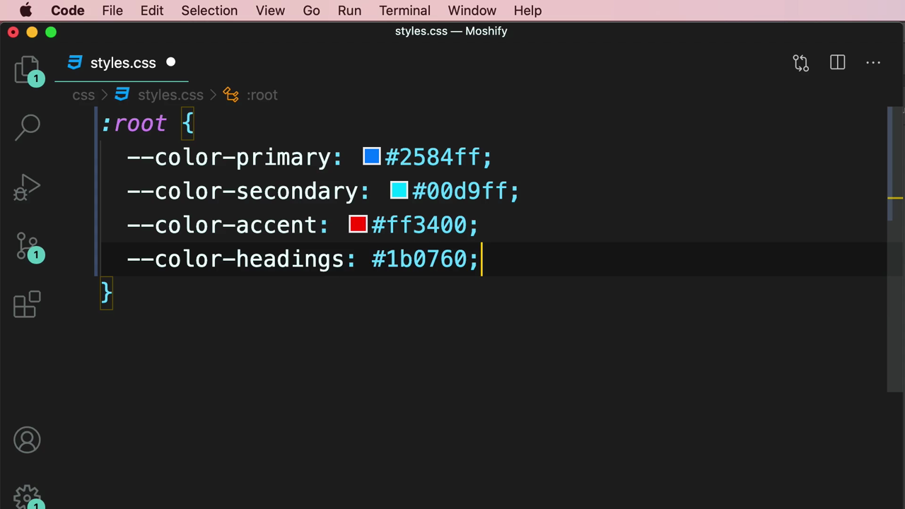

เริ่มพิมพ์ตัวแปรสุดท้าย **`--color-body:`**:

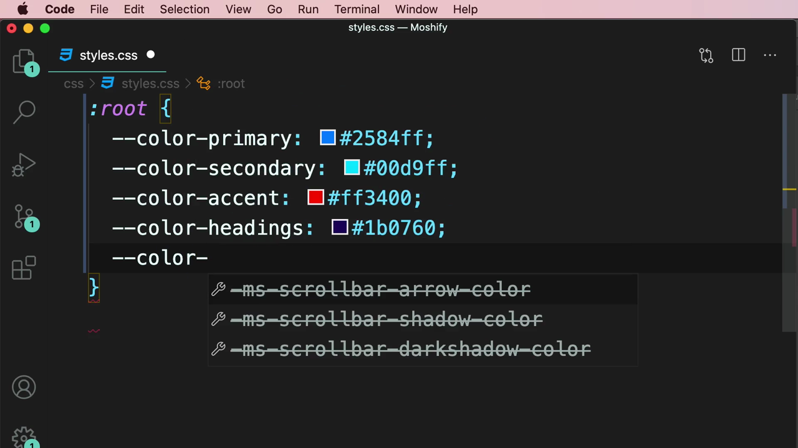

พิมพ์ค่า hex เริ่มต้น `#918`:

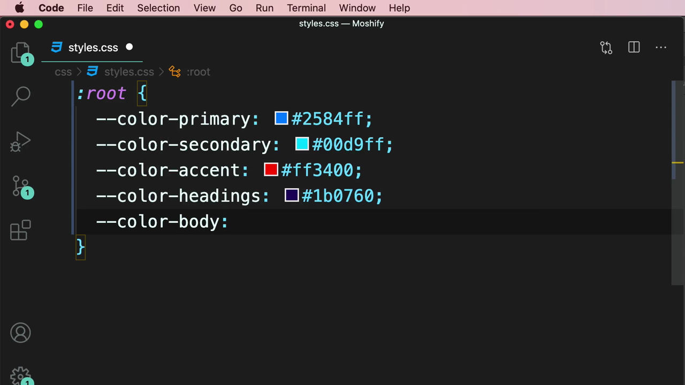

ระบบแนะนำ **`#991188`** (ไม่ตรงกับที่ต้องการ):

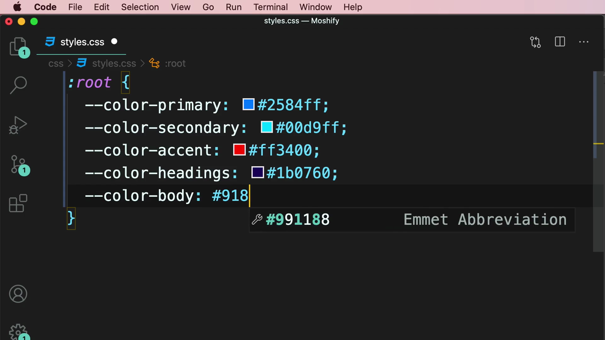

พิมพ์ต่อจนได้ค่าที่ถูกต้องเป็น **`--color-body: #918ca4;`** (สีเทาอมม่วง สำหรับข้อความเนื้อหาทั่วไป):

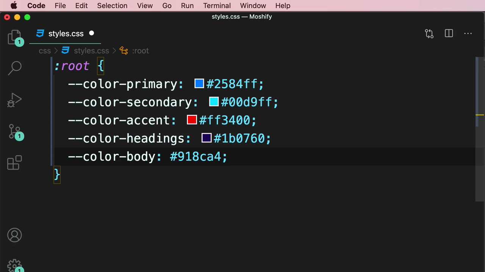

คลิกที่สี่เหลี่ยมตัวอย่างสี (color swatch) หน้าค่า `#918ca4` เพื่อเปิด **Color Picker ในตัวของ VS Code** ตรวจสอบและปรับแต่งสีแบบเห็นภาพ:

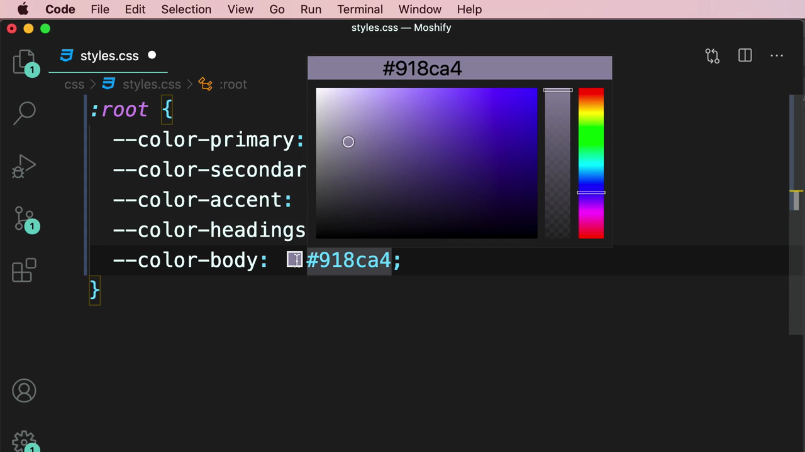

> **ประโยชน์ของ Color Swatch ใน VS Code:** เมื่อพิมพ์ค่าสีแบบ hex, rgb หรือชื่อสีที่ถูกต้อง VS Code จะแสดงสี่เหลี่ยมเล็กๆ แสดงตัวอย่างสีนั้นไว้หน้าโค้ดโดยอัตโนมัติ และสามารถคลิกเพื่อเปิด color picker แบบกราฟิกมาปรับแต่งค่าสีได้โดยไม่ต้องพิมพ์ตัวเลขเอง

---

## 8. ภาพรวมตัวแปรสีทั้งหมดที่ประกาศเสร็จสมบูรณ์

โค้ดตัวแปรสีทั้ง 5 ตัวใน `:root` ที่ประกาศเสร็จสมบูรณ์:

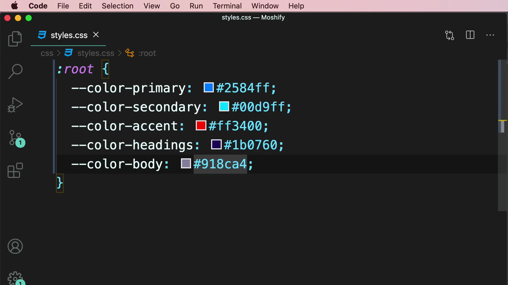

```css
:root {
  --color-primary: #2584ff;
  --color-secondary: #00d9ff;
  --color-accent: #ff3400;
  --color-headings: #1b0760;
  --color-body: #918ca4;
}
```

---

## 9. Commit งานด้วย Git ผ่าน VS Code Source Control

เปิดแผง **Source Control** ของ VS Code แสดงไฟล์ `styles.css` ที่มีการเปลี่ยนแปลง (สถานะ "M" = Modified) พร้อมช่องพิมพ์ commit message:

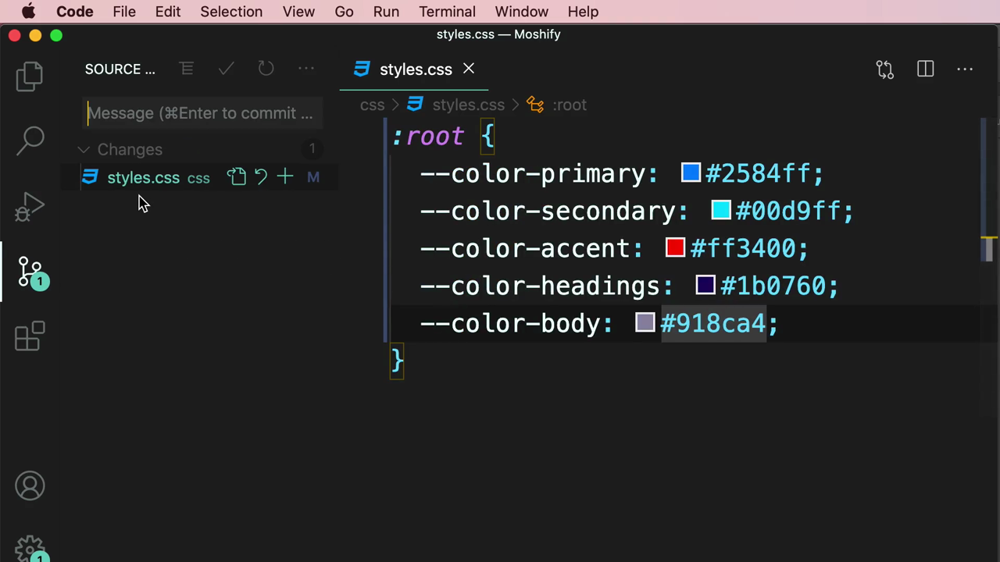

เปิดดู **Git diff** เปรียบเทียบโค้ดเก่า (ฝั่งซ้าย สีแดง แสดง `body { background: gold; }` ที่ถูกลบ) กับโค้ดใหม่ (ฝั่งขวา สีเขียว แสดงตัวแปรสีทั้ง 5 ตัวที่เพิ่มเข้ามาใน `:root`):

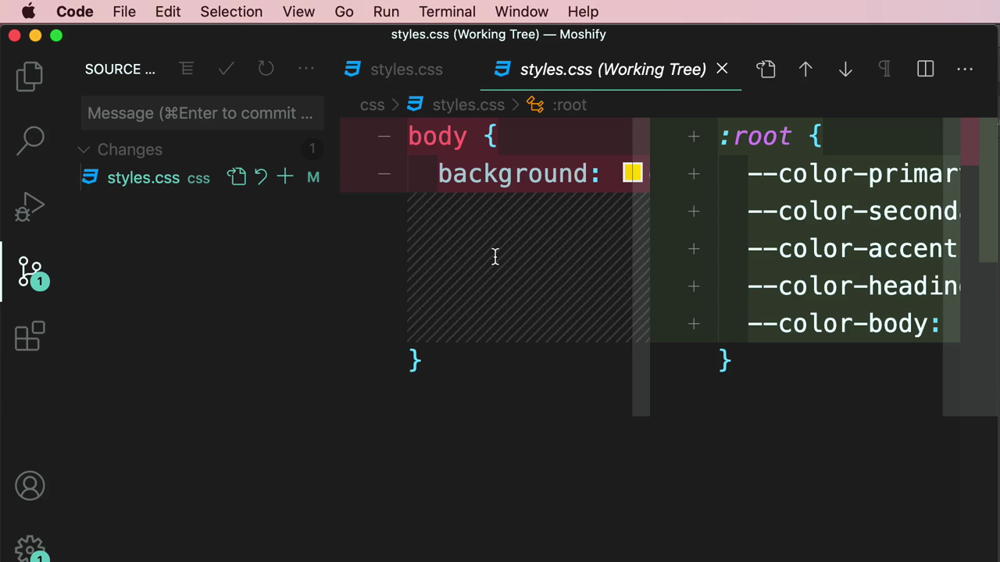

หลัง commit สำเร็จ แผง Changes แสดงจำนวนเป็น **0** (ไม่มีการเปลี่ยนแปลงค้างอยู่แล้ว) และหน้าต่าง diff แสดงทั้งสองฝั่งเป็นโค้ดเดียวกัน (`:root` พร้อมตัวแปรทั้ง 5 ตัว) ยืนยันว่า commit เข้าประวัติ Git เรียบร้อย:

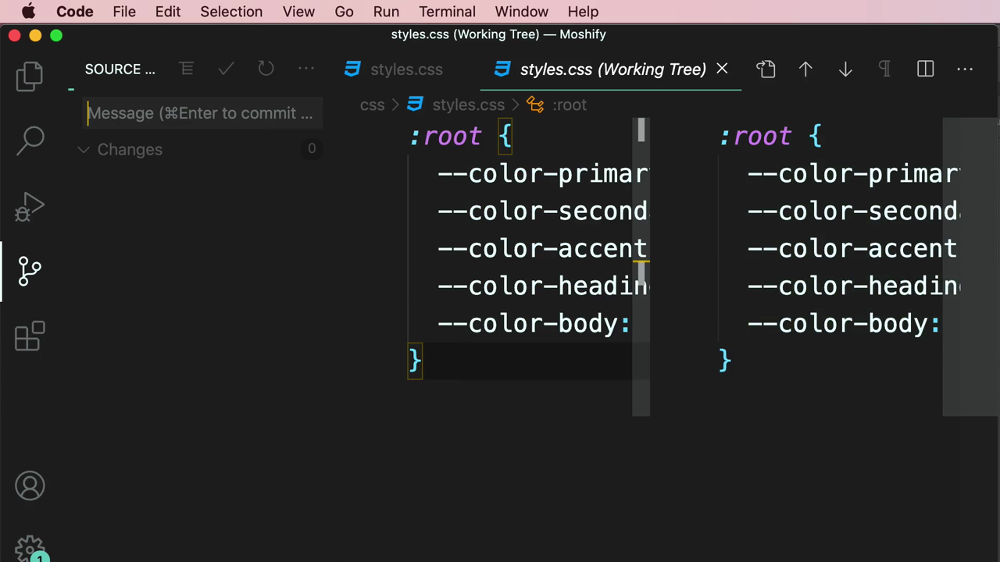

> **แนวคิดสำคัญ:** การ commit งานทุกครั้งที่ทำเสร็จเป็นขั้นตอนย่อยๆ (เช่น หลังประกาศ Color Palette เสร็จ) ช่วยให้มีประวัติการเปลี่ยนแปลงของโค้ดที่ชัดเจน สามารถย้อนกลับไปดูหรือย้อนกลับเวอร์ชันได้หากจำเป็น สอดคล้องกับที่คลิปที่ 5 (Tools You Need) แนะนำให้ติดตั้ง Git ไว้ใช้งานตั้งแต่ต้น

---

## สรุปภาพรวมของคลิปนี้

| ประเด็น | รายละเอียด |
|---|---|
| **หัวข้อ** | Color Palette — กำหนดชุดสีของโปรเจกต์ด้วย CSS Variables |
| **ไฟล์ที่แก้ไข** | `css/styles.css` |
| **Selector ที่ใช้** | `:root` |
| **ตัวแปรที่ประกาศ** | `--color-primary: #2584ff;`, `--color-secondary: #00d9ff;`, `--color-accent: #ff3400;`, `--color-headings: #1b0760;`, `--color-body: #918ca4;` |
| **เครื่องมือที่ใช้** | Adobe Photoshop (Eyedropper/ตรวจสอบสีจากดีไซน์), VS Code (IntelliSense/Emmet autocomplete, Color Picker, Source Control) |
| **ปิดท้าย** | Commit โค้ดผ่าน Git ใน VS Code |

**แนวคิดสำคัญที่ได้จากคลิปนี้:**

1. **CSS Custom Properties (`--variable-name`) ที่ประกาศใน `:root` ทำหน้าที่เป็น "Design Token"** สำหรับสีที่ใช้ซ้ำได้ทั่วทั้งเว็บไซต์ ต่างจากการเขียนค่าสี hardcode (เช่น `gold` หรือ `#ff3400` ตรงๆ) ที่ต้องไล่แก้ทีละจุดเมื่อเปลี่ยนธีมสี
2. **การตั้งชื่อตัวแปรตามบทบาท (role-based naming)** เช่น `--color-primary`, `--color-accent`, `--color-headings` แทนการตั้งชื่อตามสีจริง (เช่น `--blue`, `--red`) ช่วยให้เปลี่ยนสีภายหลังได้โดยไม่ต้องเปลี่ยนชื่อตัวแปรทั้งโปรเจกต์
3. **ควรดึงค่าสีจากไฟล์ดีไซน์ (Photoshop) ให้ตรงเป๊ะก่อนกำหนดตัวแปร** โดยใช้เทคนิค Eyedropper Tool ที่เรียนมาจากคลิปที่ 7 เพื่อให้ผลลัพธ์ตรงกับดีไซน์ต้นฉบับ
4. **VS Code มี IntelliSense/Emmet ช่วยแนะนำค่าสี hex อัตโนมัติ** ขณะพิมพ์ และมี Color Swatch/Color Picker ในตัวช่วยตรวจสอบและปรับสีแบบเห็นภาพโดยไม่ต้องสลับไปเครื่องมืออื่น
5. **ควร Commit งานเป็นขั้นตอนย่อยๆ ด้วย Git** ทุกครั้งที่ทำงานส่วนหนึ่งเสร็จสมบูรณ์ (เช่น หลังประกาศ Color Palette) เพื่อรักษาประวัติการพัฒนาโค้ดที่ตรวจสอบย้อนกลับได้

---

*หมายเหตุ: คลิปนี้เป็นส่วนหนึ่งของคอร์ส "Building a Web Site" โดย Mosh Hamedani (codewithmosh.com) — คลิปที่ 9*
